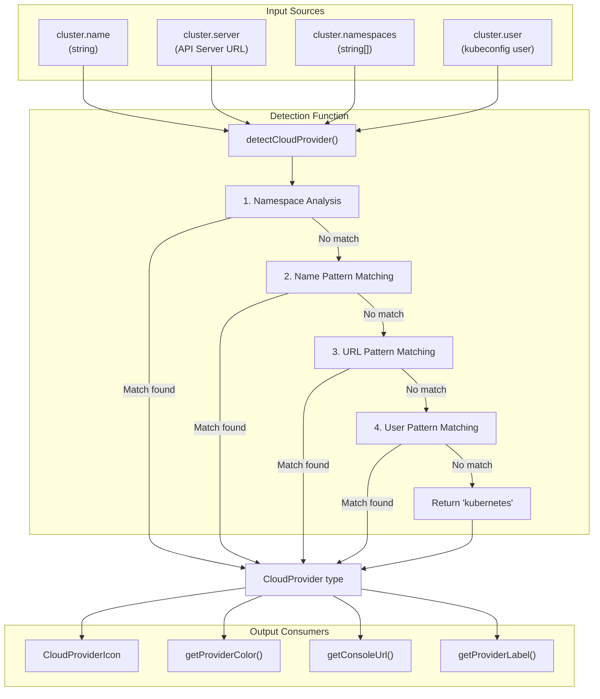
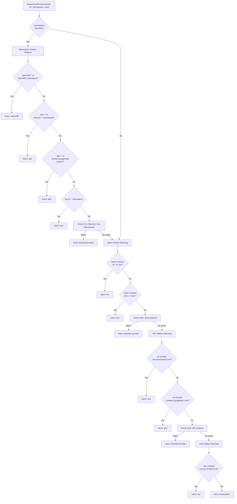
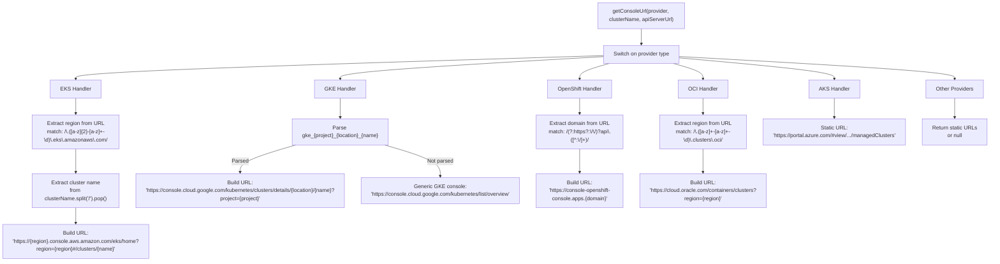
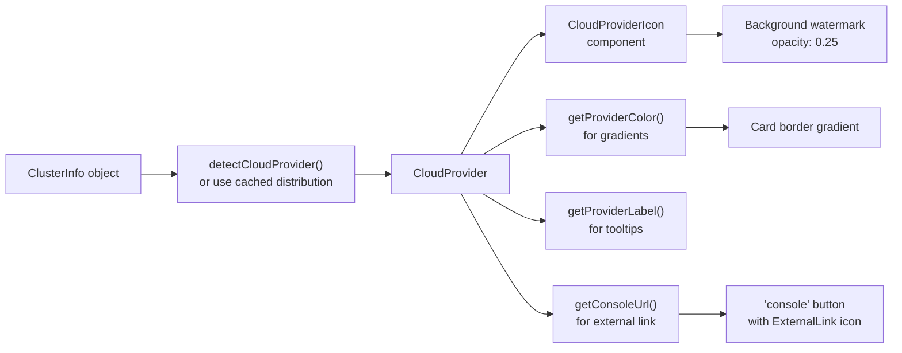
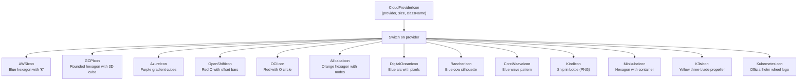
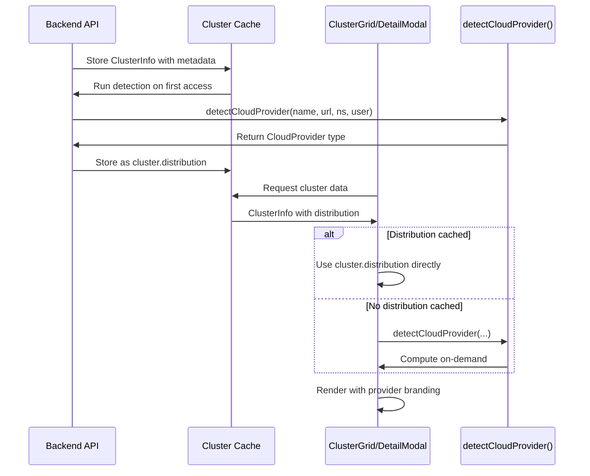

<!-- source: DeepWiki mcp.deepwiki.com · repo kubestellar/console · page 4.4 Cloud Provider Detection · fetched 2026-10-26 -->

# Cloud Provider Detection

<details>
<summary>Relevant source files</summary>

The following files were used as context for generating this wiki page:

- [web/src/components/clusters/ClusterDetailModal.tsx](web/src/components/clusters/ClusterDetailModal.tsx)
- [web/src/components/clusters/Clusters.tsx](web/src/components/clusters/Clusters.tsx)
- [web/src/components/clusters/ResourceDetailModals.tsx](web/src/components/clusters/ResourceDetailModals.tsx)
- [web/src/components/clusters/components/ClusterGrid.tsx](web/src/components/clusters/components/ClusterGrid.tsx)
- [web/src/components/clusters/components/GPUDetailModal.tsx](web/src/components/clusters/components/GPUDetailModal.tsx)
- [web/src/components/ui/CloudProviderIcon.tsx](web/src/components/ui/CloudProviderIcon.tsx)
- [web/src/hooks/useMCP.ts](web/src/hooks/useMCP.ts)

</details>


## Purpose and Scope

The Cloud Provider Detection system automatically identifies which cloud platform or Kubernetes distribution a cluster is running on based on cluster metadata. This system enables the KubeStellar Console to:

- Display provider-specific branding, icons, and color schemes
- Generate deep links to cloud provider web consoles for quick access
- Provide context-aware UI elements tailored to each platform's characteristics

This page documents the detection algorithms, supported providers, and integration points. For information about the cluster UI components that consume this data, see [Cluster UI Components](#4.3).

**Sources:** [web/src/components/ui/CloudProviderIcon.tsx:1-586]()

---

## System Architecture

The cloud provider detection system operates as a pure function that analyzes cluster metadata without requiring external API calls. It provides immediate classification results that are cached at the cluster level.



**Sources:** [web/src/components/ui/CloudProviderIcon.tsx:462-585](), [web/src/components/clusters/ClusterGrid.tsx:117-122]()

---

## CloudProvider Type Definition

The system recognizes 13 distinct provider types through the `CloudProvider` union type:

| Provider | Type Value | Detection Priority | Console Link Support |
|----------|-----------|-------------------|---------------------|
| AWS EKS | `'eks'` | Namespace, Name, URL | ✅ Region-aware |
| Google GKE | `'gke'` | Namespace, Name, URL | ✅ Project-aware |
| Azure AKS | `'aks'` | Namespace, Name, URL | ✅ Generic |
| OpenShift | `'openshift'` | Namespace, Name, URL | ✅ Apps subdomain |
| Oracle OKE | `'oci'` | Namespace, Name, URL, User | ✅ Region-aware |
| Alibaba ACK | `'alibaba'` | Name, URL | ✅ Generic |
| DigitalOcean | `'digitalocean'` | Name, URL | ✅ Generic |
| Rancher | `'rancher'` | Namespace, Name | ❌ |
| CoreWeave | `'coreweave'` | Name, URL | ✅ Generic |
| Kind | `'kind'` | Name | ❌ |
| Minikube | `'minikube'` | Name | ❌ |
| K3s | `'k3s'` | Namespace, Name | ❌ |
| Generic Kubernetes | `'kubernetes'` | Default fallback | ❌ |

**Sources:** [web/src/components/ui/CloudProviderIcon.tsx:5](), [web/src/components/ui/CloudProviderIcon.tsx:415-458]()

---

## Detection Logic Flow

The `detectCloudProvider()` function implements a four-tier detection strategy with early returns:



**Sources:** [web/src/components/ui/CloudProviderIcon.tsx:462-585]()

---

## Detection Patterns by Priority

### Priority 1: Namespace-Based Detection

Namespace-based detection provides the highest accuracy since namespace names are provider-controlled and difficult to spoof.

**Implementation:** [web/src/components/ui/CloudProviderIcon.tsx:472-504]()

| Provider | Namespace Patterns | Examples |
|----------|-------------------|----------|
| OpenShift | `openshift-*`, `openshift` | `openshift-apiserver`, `openshift-monitoring` |
| EKS | `aws-*`, `amazon-*`, `amazon-cloudwatch` | `aws-observability`, `amazon-cloudwatch` |
| GKE | `gke-*`, `config-management-system`, `gke-managed-filestorecsi` | `gke-connect`, `config-management-system` |
| AKS | `azure-*`, `azure-arc` | `azure-arc`, `azure-workload-identity` |
| OCI | `oci-*`, `oraclecloud-*` | `oci-ccm`, `oraclecloud-storage` |
| Rancher | `cattle-system`, `cattle-*` | `cattle-system`, `cattle-fleet-system` |
| K3s | `k3s-system` | `k3s-system` |

### Priority 2: Name-Based Detection

Cluster names often contain provider-specific identifiers embedded by management tools.

**Implementation:** [web/src/components/ui/CloudProviderIcon.tsx:506-542]()

```typescript
// Examples of name pattern matching
name.includes('oci') || name.includes('oke') || name.includes('oracle') // → 'oci'
name.includes('eks') || name.includes('aws') || name.match(/arn:aws:/) // → 'eks'
name.includes('gke') || name.includes('gcp') || name.includes('google') // → 'gke'
name.includes('aks') || name.includes('azure') // → 'aks'
name.includes('openshift') || name.includes('ocp') || name.includes('rosa') // → 'openshift'
```

**GKE Cluster Name Format:** `gke_<project-id>_<zone>_<cluster-name>`

### Priority 3: URL-Based Detection

API server URLs contain provider-specific domain patterns.

**Implementation:** [web/src/components/ui/CloudProviderIcon.tsx:544-577]()

| Provider | URL Pattern | Example |
|----------|-------------|---------|
| EKS | `.eks.amazonaws.com` | `https://ABC123.sk1.us-east-1.eks.amazonaws.com` |
| GKE | `container.googleapis.com`, `.container.cloud.google.com`, `gke.io` | `https://container.googleapis.com/v1/projects/...` |
| AKS | `.azmk8s.io` | `https://myaks-dns-12345.hcp.eastus.azmk8s.io:443` |
| OCI | `.oraclecloud.com` | `https://c...k8s.us-ashburn-1.oraclecloud.com:6443` |
| Alibaba | `.aliyuncs.com` | `https://172.16.0.1:6443` (internal) |
| DigitalOcean | `.digitalocean.com`, `k8s.ondigitalocean` | `https://1234-5678-1234.k8s.ondigitalocean.com` |
| CoreWeave | `.coreweave.com` | `https://k8s.lga1.coreweave.com:6443` |
| OpenShift | `openshift.com`, `openshiftapps.com`, `.openshift.` | `https://api.cluster.openshift.com:6443` |

### Priority 4: User-Based Detection

Oracle OKE generates unique user patterns that can be detected.

**Implementation:** [web/src/components/ui/CloudProviderIcon.tsx:579-582]()

```typescript
// OKE user pattern: user-[lowercase_alphanumeric_10-12_chars]
if (user.match(/^user-[a-z0-9]{10,12}$/)) {
  return 'oci'
}
```

**Example:** `user-chbezebxx3a`

**Sources:** [web/src/components/ui/CloudProviderIcon.tsx:462-585]()

---

## Console URL Generation

The `getConsoleUrl()` function generates deep links to provider-specific web consoles, extracting region, project, and cluster information from the metadata.



### EKS Console URL Pattern

**Implementation:** [web/src/components/ui/CloudProviderIcon.tsx:419-429]()

```typescript
// Extract region from API server URL or cluster name
const urlRegionMatch = serverUrl.match(/\.([a-z]{2}-[a-z]+-\d)\.eks\.amazonaws\.com/)
const nameRegionMatch = clusterName.match(/(us|eu|ap|sa|ca|me|af)-(north|south|east|west|central|northeast|southeast)-\d/)
const region = urlRegionMatch?.[1] || nameRegionMatch?.[0] || 'us-east-1'
const shortName = clusterName.split('/').pop() || clusterName

// Result: https://us-east-1.console.aws.amazon.com/eks/home?region=us-east-1#/clusters/my-cluster
```

### GKE Console URL Pattern

**Implementation:** [web/src/components/ui/CloudProviderIcon.tsx:430-446]()

```typescript
// Parse GKE cluster name format: gke_<project>_<location>_<name>
const gkeMatch = clusterName.match(/gke_([^_]+)_([^_]+)_(.+)/)
if (gkeMatch) {
  const [, project, location, gkeName] = gkeMatch
  return `https://console.cloud.google.com/kubernetes/clusters/details/${location}/${gkeName}?project=${project}`
}
// Fallback to overview page
return 'https://console.cloud.google.com/kubernetes/list/overview'
```

### OpenShift Console URL Pattern

**Implementation:** [web/src/components/ui/CloudProviderIcon.tsx:434-440](), [web/src/components/clusters/ClusterDetailModal.tsx:23-31]()

```typescript
// Transform: api.cluster.example.com → console-openshift-console.apps.cluster.example.com
const apiMatch = apiServerUrl?.match(/(?:https?:\/\/)?api\.([^:\/]+)/)
if (apiMatch) {
  return `https://console-openshift-console.apps.${apiMatch[1]}`
}
```

**Sources:** [web/src/components/ui/CloudProviderIcon.tsx:415-458](), [web/src/components/clusters/ClusterDetailModal.tsx:19-63]()

---

## Integration with UI Components

### ClusterGrid Integration

The cluster grid displays provider icons and generates console links for each cluster card.

**Implementation:** [web/src/components/clusters/components/ClusterGrid.tsx:117-122](), [web/src/components/clusters/components/ClusterGrid.tsx:276-289]()



**Code Example:**

```typescript
// Determine provider (prefer cached, fallback to detection)
const provider = (cluster.distribution as ReturnType<typeof detectCloudProvider>) ||
  detectCloudProvider(cluster.name, cluster.server, cluster.namespaces, cluster.user)

// Apply branding
const providerColor = getProviderColor(provider)
const themeColor = '#9333ea'

// Card with gradient border
<div style={{
  background: `linear-gradient(135deg, ${providerColor}80 0%, ${themeColor}60 100%)`,
}}>
  {/* Background watermark */}
  <CloudProviderIcon provider={provider} size={100} />
  
  {/* Console link */}
  {consoleUrl && (
    <a href={consoleUrl} target="_blank">console</a>
  )}
</div>
```

### ClusterDetailModal Integration

The detail modal uses the same detection logic but also includes the provider as a clickable badge.

**Implementation:** [web/src/components/clusters/ClusterDetailModal.tsx:288-323]()

```typescript
// Detect provider with server URL priority
const serverUrl = clusterInfo?.server || health?.apiServer
const detectedProvider = clusterInfo?.distribution as CloudProviderType ||
  detectCloudProviderShared(clusterName, serverUrl, clusterInfo?.namespaces, clusterUser)

// Generate console URL
const consoleUrl = getConsoleUrlForProvider(detectedProvider, clusterName, serverUrl)

// Render as clickable badge or static badge
{consoleUrl ? (
  <a href={consoleUrl} target="_blank" className={providerStyles}>
    <CloudProviderIcon provider={detectedProvider} size={16} />
    {providerLabel}
    <ExternalLink className="w-3.5 h-3.5" />
  </a>
) : (
  <span className={providerStyles}>
    <CloudProviderIcon provider={detectedProvider} size={16} />
    {providerLabel}
  </span>
)}
```

**Sources:** [web/src/components/clusters/components/ClusterGrid.tsx:99-298](), [web/src/components/clusters/ClusterDetailModal.tsx:83-337]()

---

## Provider Color and Styling System

Each provider has an associated primary color used for UI theming.

**Implementation:** [web/src/components/ui/CloudProviderIcon.tsx:377-393]()

| Provider | Color Hex | Usage |
|----------|-----------|-------|
| EKS | `#5B6AD4` | Card borders, gradient overlays |
| GKE | `#4285F4` | Official Google Blue |
| AKS | `#773ADC` | Azure purple |
| OpenShift | `#EE0000` | Red Hat red |
| OCI | `#C74634` | Oracle red |
| Alibaba | `#FF6A00` | Alibaba orange |
| DigitalOcean | `#0080FF` | DO blue |
| Rancher | `#2453FF` | Rancher blue |
| CoreWeave | `#2741E7` | CoreWeave blue |
| Kind | `#2496ED` | Docker blue |
| Minikube | `#326CE5` | Kubernetes blue |
| K3s | `#FFC61C` | K3s yellow |
| Kubernetes | `#326CE5` | Official K8s blue |

### Tailwind Border Classes

**Implementation:** [web/src/components/ui/CloudProviderIcon.tsx:396-412]()

The `getProviderBorderClass()` function returns Tailwind utility classes for consistent border styling:

```typescript
export function getProviderBorderClass(provider: CloudProvider): string {
  switch (provider) {
    case 'eks': return 'border-indigo-500/40'
    case 'gke': return 'border-blue-500/40'
    case 'aks': return 'border-purple-500/40'
    case 'openshift': return 'border-red-500/40'
    // ... etc
  }
}
```

**Sources:** [web/src/components/ui/CloudProviderIcon.tsx:377-412]()

---

## Icon Component System

Each provider has a custom SVG icon component rendered through the `CloudProviderIcon` wrapper.

**Implementation:** [web/src/components/ui/CloudProviderIcon.tsx:303-335]()



### Icon Specifications

| Icon Component | Lines | Size (viewBox) | Notable Features |
|----------------|-------|----------------|------------------|
| `AWSIcon` | 14-29 | 24x24 | Gradient fill, hexagon shape |
| `GCPIcon` | 32-49 | 24x24 | 3D cube structure, rounded hexagon |
| `AzureIcon` | 52-78 | 16x16 | 3x3 grid of gradient cubes |
| `OpenShiftIcon` | 81-98 | 100x100 | Red ring with tilted bars |
| `OCIIcon` | 101-106 | 24x24 | Simple O with border |
| `AlibabaIcon` | 109-137 | 24x24 | Network topology pattern |
| `DigitalOceanIcon` | 140-155 | 24x24 | Arc with pixel decoration |
| `RancherIcon` | 158-179 | 24x24 | Cow head silhouette |
| `CoreWeaveIcon` | 182-206 | 24x24 | Double wave lines |
| `KindIcon` | 209-218 | N/A | External PNG image |
| `MinikubeIcon` | 221-253 | 24x24 | Container box + helm wheel |
| `K3sIcon` | 256-285 | 24x24 | Three-blade propeller shape |
| `KubernetesIcon` | 288-301 | 722.9x702 | Official SVG from Wikimedia |

**Note:** The `KindIcon` component loads an external PNG (`/kind-logo.png`) rather than using inline SVG.

**Sources:** [web/src/components/ui/CloudProviderIcon.tsx:13-301]()

---

## Caching and Performance

Provider detection results are cached at the cluster level in the `ClusterInfo` object as the `distribution` field.

**Data Flow:**



**Backend Detection:** The backend may pre-compute the provider type during cluster discovery and store it in the `distribution` field. The frontend prefers this cached value but falls back to client-side detection if unavailable.

**Frontend Detection:** [web/src/components/clusters/components/ClusterGrid.tsx:117-119]()

```typescript
const provider = (cluster.distribution as ReturnType<typeof detectCloudProvider>) ||
  detectCloudProvider(cluster.name, cluster.server, cluster.namespaces, cluster.user)
```

**Sources:** [web/src/components/clusters/components/ClusterGrid.tsx:117-122](), [web/src/components/clusters/ClusterDetailModal.tsx:288-293]()

---

## Testing and Edge Cases

### Ambiguous Cluster Names

When cluster names don't contain provider identifiers, the system falls back to namespace or URL detection:

```typescript
// Name: "prod-cluster" (ambiguous)
// Namespaces: ["openshift-apiserver", "openshift-monitoring"]
// Result: 'openshift' (detected via namespace)
```

### OpenShift on Non-OpenShift URLs

OpenShift clusters can run on any infrastructure. The namespace check ensures accurate detection even when the URL doesn't indicate OpenShift:

```typescript
// URL: "https://192.168.1.100:6443" (generic)
// Namespaces: ["openshift-kube-apiserver"]
// Result: 'openshift' (detected via namespace, highest priority)
```

### GKE Standard vs Autopilot

Both GKE cluster types use the same detection patterns, but Autopilot clusters may have additional managed namespaces like `gke-managed-system`:

```typescript
// Standard: ["kube-system", "default", "gke-connect"]
// Autopilot: ["kube-system", "default", "gke-connect", "gke-managed-system"]
// Both detect as: 'gke'
```

### Local Development Clusters

Kind, Minikube, and K3s are detected primarily by name since their URLs are typically localhost:

```typescript
// Kind: "kind-dev-cluster", "https://127.0.0.1:6443" → 'kind'
// Minikube: "minikube", "https://192.168.49.2:8443" → 'minikube'
// K3s: "default", namespaces: ["k3s-system"] → 'k3s'
```

**Sources:** [web/src/components/ui/CloudProviderIcon.tsx:462-585]()

---

