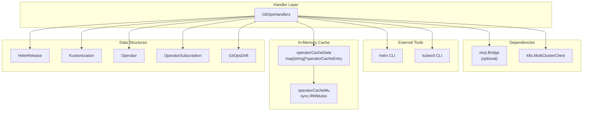
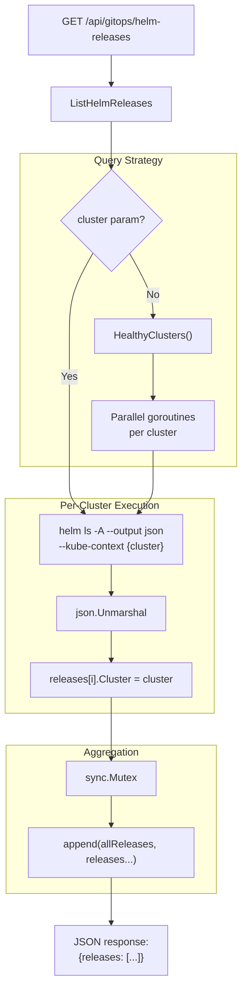
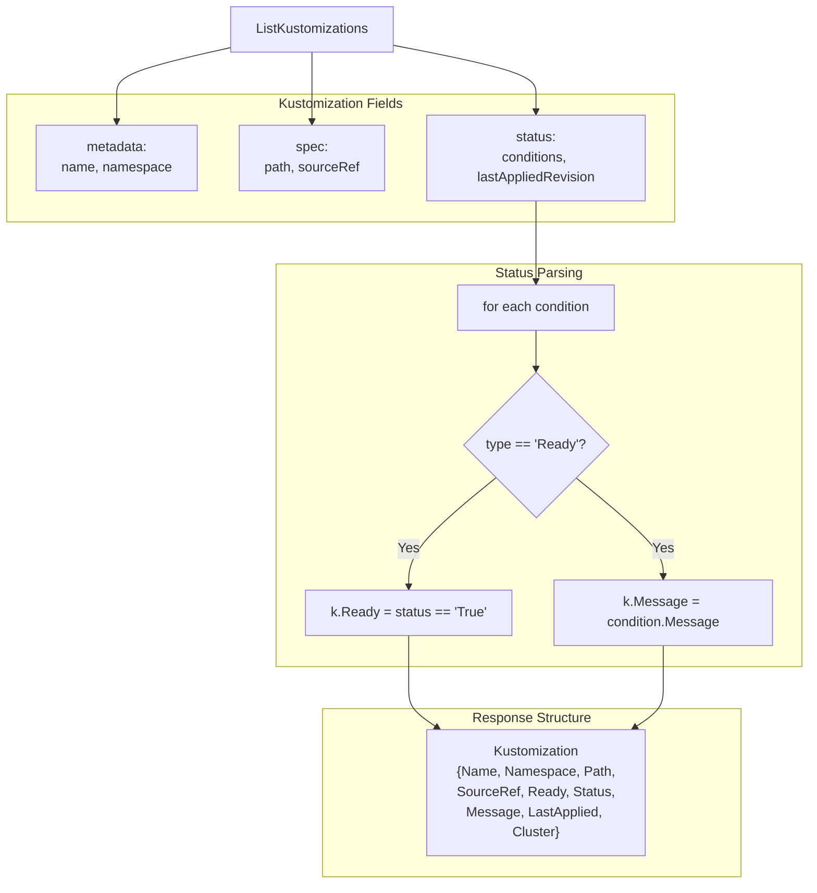
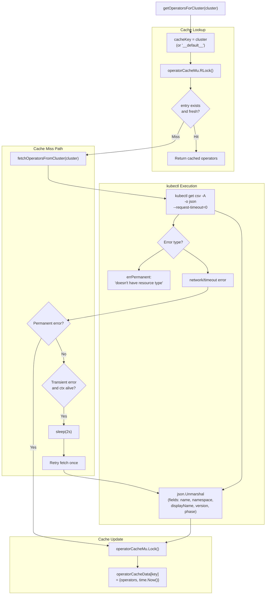
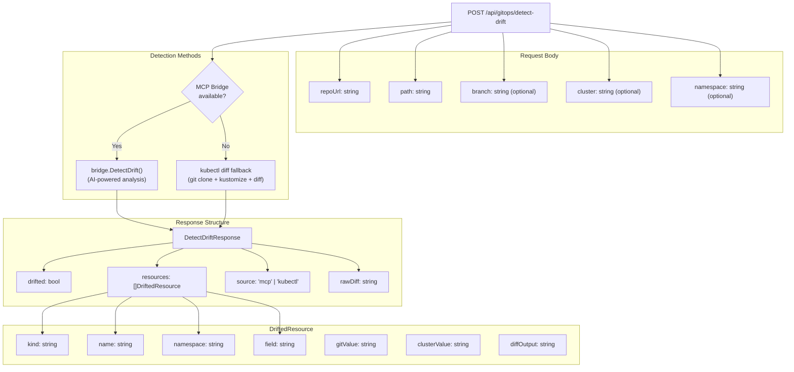
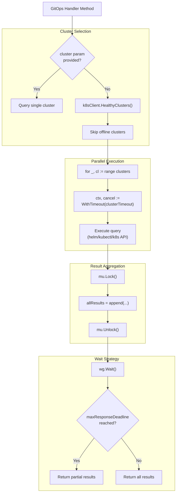
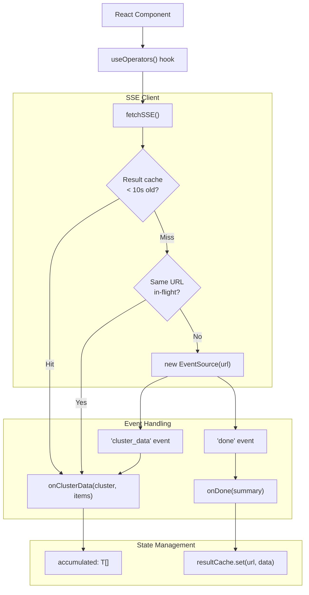

<!-- source: DeepWiki mcp.deepwiki.com · repo kubestellar/console · page 5.2 GitOps Handlers · fetched 2026-10-26 -->

# GitOps Handlers

<details>
<summary>Relevant source files</summary>

The following files were used as context for generating this wiki page:

- [pkg/api/handlers/demo_data.go](pkg/api/handlers/demo_data.go)
- [pkg/api/handlers/gitops.go](pkg/api/handlers/gitops.go)
- [pkg/api/handlers/mcp.go](pkg/api/handlers/mcp.go)
- [pkg/api/handlers/sse.go](pkg/api/handlers/sse.go)
- [pkg/api/server.go](pkg/api/server.go)
- [pkg/k8s/client.go](pkg/k8s/client.go)
- [web/src/components/cards/ProactiveGPUNodeHealthMonitor.tsx](web/src/components/cards/ProactiveGPUNodeHealthMonitor.tsx)
- [web/src/config/cards/gpu-node-health.ts](web/src/config/cards/gpu-node-health.ts)
- [web/src/config/dashboards/gpu.ts](web/src/config/dashboards/gpu.ts)
- [web/src/hooks/mcp/types.ts](web/src/hooks/mcp/types.ts)
- [web/src/lib/sseClient.ts](web/src/lib/sseClient.ts)

</details>


## Purpose and Scope

The GitOps handlers provide API endpoints for monitoring and managing GitOps resources across multiple Kubernetes clusters. This includes tracking Helm releases, Flux Kustomizations, Operator Lifecycle Manager (OLM) operators and subscriptions, and detecting configuration drift between Git and cluster state.

For general multi-cluster resource management, see [MCP Handlers](#5.1). For backend handler architecture, see [Backend API Handlers](#5).

**Sources:** [pkg/api/handlers/gitops.go:1-95]()

---

## Handler Architecture

The `GitOpsHandlers` struct provides a unified interface for GitOps operations, delegating to either the MCP bridge or the direct Kubernetes client based on availability.



**Sources:** [pkg/api/handlers/gitops.go:33-45](), [pkg/api/handlers/gitops.go:390-397]()

---

## API Endpoints

The GitOps handlers expose the following REST and SSE streaming endpoints:

| Method | Endpoint | Purpose | Streaming |
|--------|----------|---------|-----------|
| `GET` | `/api/gitops/drifts` | List detected GitOps drifts | No |
| `GET` | `/api/gitops/helm-releases` | List Helm releases across clusters | No |
| `GET` | `/api/gitops/helm-releases/stream` | Stream Helm releases per cluster | Yes (SSE) |
| `GET` | `/api/gitops/helm-history` | Get Helm release history | No |
| `GET` | `/api/gitops/helm-values` | Get Helm values for a release | No |
| `GET` | `/api/gitops/kustomizations` | List Flux Kustomizations | No |
| `GET` | `/api/gitops/operators` | List OLM ClusterServiceVersions | No |
| `GET` | `/api/gitops/operators/stream` | Stream operators per cluster | Yes (SSE) |
| `GET` | `/api/gitops/operator-subscriptions` | List OLM subscriptions | No |
| `GET` | `/api/gitops/operator-subscriptions/stream` | Stream subscriptions per cluster | Yes (SSE) |
| `POST` | `/api/gitops/detect-drift` | Detect drift for specific repo/path | No |
| `POST` | `/api/gitops/sync` | Sync GitOps resources from Git | No |

**Sources:** [pkg/api/server.go:549-565]()

---

## Helm Release Management

### Release Listing

The `ListHelmReleases` handler queries all clusters in parallel to aggregate Helm releases. Each cluster is queried via `helm ls -A --output json`.



**Sources:** [pkg/api/handlers/gitops.go:156-198](), [pkg/api/handlers/gitops.go:206-235]()

### Release History

The `ListHelmHistory` handler provides revision history for a specific Helm release by executing `helm history {release} -n {namespace} --output json --kube-context {cluster}`.

**Sources:** [pkg/api/handlers/gitops.go:883-933]()

### Streaming Architecture

Helm releases support SSE streaming via `StreamHelmReleases`, which uses the generic `streamClusters` helper to deliver per-cluster results incrementally.

**Sources:** [pkg/api/handlers/gitops.go:959-1004]()

---

## Flux Kustomization Tracking

The `ListKustomizations` handler queries Flux `Kustomization` custom resources across clusters using `kubectl get kustomizations.kustomize.toolkit.fluxcd.io -A -o json`.



**Sources:** [pkg/api/handlers/gitops.go:238-282](), [pkg/api/handlers/gitops.go:284-356]()

---

## OLM Operator Management

### Operator Cache Architecture

Operator queries are the slowest GitOps operation—querying 1000+ ClusterServiceVersions can take 90-100 seconds. The handler implements aggressive caching to optimize performance.



**Configuration:**
- `operatorCacheTTL = 5 * time.Minute` - Cache lifetime
- `operatorPerClusterTimeout = 180 * time.Second` - Per-cluster query timeout
- `operatorRestOverallTimeout = 200 * time.Second` - Overall REST endpoint timeout

**Sources:** [pkg/api/handlers/gitops.go:372-383](), [pkg/api/handlers/gitops.go:538-588](), [pkg/api/handlers/gitops.go:590-660]()

### Operator Subscriptions

The `ListOperatorSubscriptions` handler queries OLM `Subscription` resources using `kubectl get subscriptions.operators.coreos.com -A -o jsonpath=...`. Subscriptions define which operator versions are installed.

**Sources:** [pkg/api/handlers/gitops.go:662-707](), [pkg/api/handlers/gitops.go:789-828]()

### SSE Streaming

Both operators and subscriptions support SSE streaming for progressive UI rendering:

- `StreamOperators` - Emits operators as each cluster completes (timeout: 180s per cluster)
- `StreamOperatorSubscriptions` - Emits subscriptions as each cluster completes (timeout: 30s per cluster)

**Sources:** [pkg/api/handlers/gitops.go:453-533](), [pkg/api/handlers/gitops.go:709-786]()

---

## Drift Detection

### Detection Request Flow

The `DetectDrift` handler compares Git repository state with cluster resources to identify configuration drift.



**Sources:** [pkg/api/handlers/gitops.go:47-74](), [pkg/api/server.go:562]()

### Sync Operation

The `Sync` handler applies Git resources to clusters via `kubectl apply` or MCP bridge tooling. It supports dry-run mode for validation without applying changes.

**Sources:** [pkg/api/handlers/gitops.go:76-94](), [pkg/api/server.go:563]()

---

## Performance Optimizations

### Multi-Cluster Query Parallelization

All GitOps handlers execute per-cluster queries in parallel goroutines with individual timeouts. Offline clusters are skipped via `HealthyClusters()`.



**Sources:** [pkg/api/handlers/gitops.go:166-193](), [pkg/api/handlers/mcp.go:31-48]()

### Operator Cache Strategy

The operator cache uses a per-cluster entry map with mutex-protected access and TTL-based expiration:

| Component | Value | Purpose |
|-----------|-------|---------|
| `operatorCacheData` | `map[string]*operatorCacheEntry` | Per-cluster cached results |
| `operatorCacheMu` | `sync.RWMutex` | Concurrent access protection |
| `operatorCacheTTL` | `5 * time.Minute` | Cache freshness window |
| `operatorCacheEntry.fetchedAt` | `time.Time` | Cache entry timestamp |

**Cache keys:** `{cluster}` for named clusters, `"__default__"` for default context

**Permanent vs Transient Errors:**
- **Permanent** (`errPermanent`): Cluster lacks OLM CRDs - cached to avoid repeated failures
- **Transient**: Network/timeout errors - NOT cached, will retry on next request

**Sources:** [pkg/api/handlers/gitops.go:385-397](), [pkg/api/handlers/gitops.go:590-592]()

### Timeout Configuration

| Operation | Timeout | Rationale |
|-----------|---------|-----------|
| Helm release listing | 30s per cluster | Helm CLI can be slow on large clusters |
| Kustomization query | 15s per cluster | Flux CRDs are lightweight |
| Operator listing (CSV) | 180s per cluster | 1000+ CSVs take 90-100s to query |
| Subscription listing | 30s per cluster | Subscriptions are fewer than CSVs |
| Overall REST response | 200s | Allows slowest operator query + overhead |

**Sources:** [pkg/api/handlers/gitops.go:372-382]()

---

## Data Structures

### Core Types

```go
// HelmRelease represents a Helm release
type HelmRelease struct {
    Name       string `json:"name"`
    Namespace  string `json:"namespace"`
    Revision   string `json:"revision"`
    Updated    string `json:"updated"`
    Status     string `json:"status"`
    Chart      string `json:"chart"`
    AppVersion string `json:"app_version"`
    Cluster    string `json:"cluster,omitempty"`
}

// Kustomization represents a Flux Kustomization resource
type Kustomization struct {
    Name        string `json:"name"`
    Namespace   string `json:"namespace"`
    Path        string `json:"path"`
    SourceRef   string `json:"sourceRef"`
    Ready       bool   `json:"ready"`
    Status      string `json:"status"`
    Message     string `json:"message,omitempty"`
    LastApplied string `json:"lastApplied,omitempty"`
    Cluster     string `json:"cluster,omitempty"`
}

// Operator represents an OLM ClusterServiceVersion
type Operator struct {
    Name        string `json:"name"`
    DisplayName string `json:"displayName"`
    Namespace   string `json:"namespace"`
    Version     string `json:"version"`
    Phase       string `json:"phase"` // Succeeded, Failed, Installing
    Channel     string `json:"channel,omitempty"`
    Source      string `json:"source,omitempty"`
    Cluster     string `json:"cluster,omitempty"`
}

// OperatorSubscription represents an OLM subscription
type OperatorSubscription struct {
    Name                string `json:"name"`
    Namespace           string `json:"namespace"`
    Channel             string `json:"channel"`
    Source              string `json:"source"`
    InstallPlanApproval string `json:"installPlanApproval"`
    CurrentCSV          string `json:"currentCSV"`
    InstalledCSV        string `json:"installedCSV,omitempty"`
    Cluster             string `json:"cluster,omitempty"`
}
```

**Sources:** [pkg/api/handlers/gitops.go:96-142](), [pkg/api/handlers/gitops.go:358-368]()

---

## Integration with Frontend

### React Hooks

Frontend components consume GitOps data via specialized hooks:

- `useHelmReleases()` - Fetches Helm releases via REST or SSE
- `useKustomizations()` - Fetches Flux Kustomizations
- `useOperators()` - Fetches OLM operators (uses SSE by default due to slow queries)
- `useOperatorSubscriptions()` - Fetches OLM subscriptions

**Sources:** [web/src/hooks/mcp/types.ts:516-571]()

### SSE Client Integration

The frontend `fetchSSE()` utility handles SSE streams with deduplication and caching:



**Sources:** [web/src/lib/sseClient.ts:1-152]()

---

## Demo Mode Support

All GitOps handlers support demo mode via the `X-Demo-Mode: true` header. Demo data includes:

- 2 Helm releases across sample clusters
- 2 Flux Kustomizations (one ready, one not ready)
- 6 OLM operators with various phases
- 3 operator subscriptions

**Sources:** [pkg/api/handlers/demo_data.go:8-13](), [pkg/api/handlers/gitops.go:1006-1031]()

---

