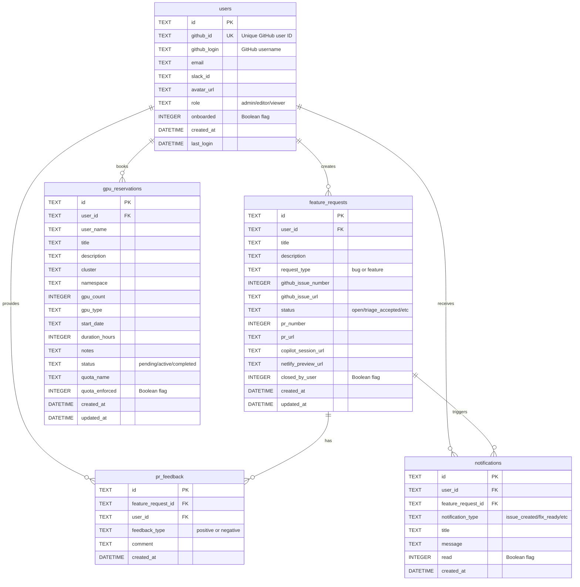
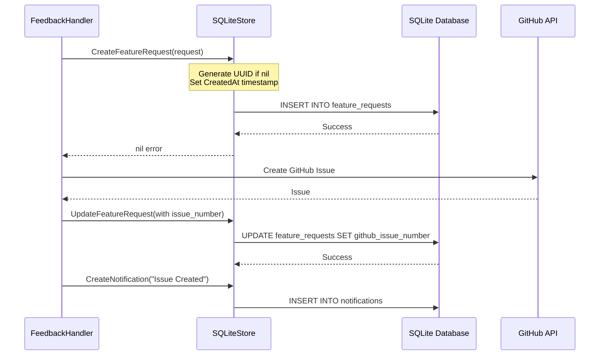
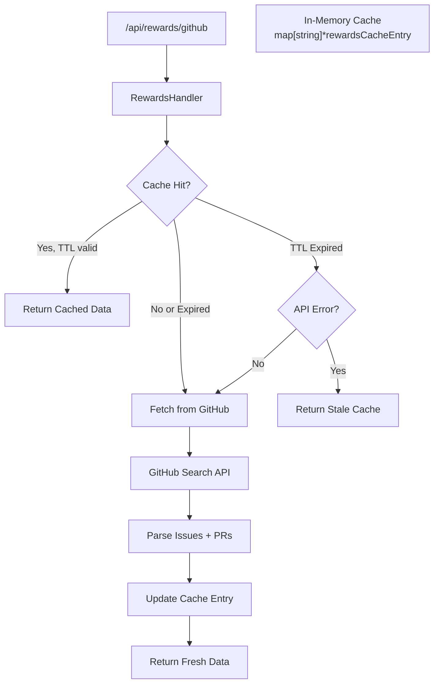
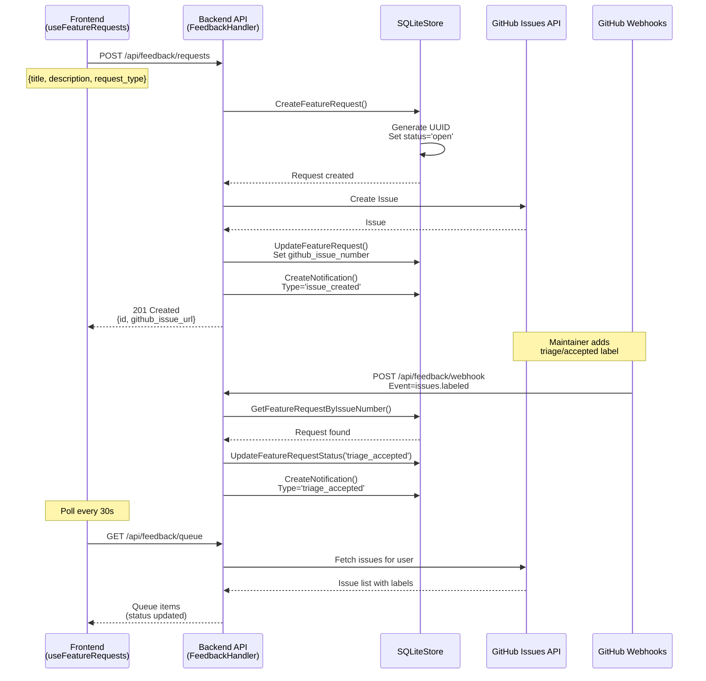
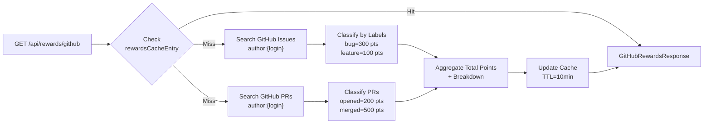

<!-- source: DeepWiki mcp.deepwiki.com · repo kubestellar/console · page 6.4 Data Persistence · fetched 2026-10-26 -->

# Data Persistence

<details>
<summary>Relevant source files</summary>

The following files were used as context for generating this wiki page:

- [pkg/api/handlers/feedback.go](pkg/api/handlers/feedback.go)
- [pkg/api/handlers/gpu.go](pkg/api/handlers/gpu.go)
- [pkg/api/handlers/rewards.go](pkg/api/handlers/rewards.go)
- [pkg/models/feedback.go](pkg/models/feedback.go)
- [pkg/models/gpu.go](pkg/models/gpu.go)
- [pkg/store/sqlite.go](pkg/store/sqlite.go)
- [pkg/store/store.go](pkg/store/store.go)
- [web/src/components/charts/BarChart.tsx](web/src/components/charts/BarChart.tsx)
- [web/src/components/charts/PieChart.tsx](web/src/components/charts/PieChart.tsx)
- [web/src/components/feedback/FeatureRequestButton.tsx](web/src/components/feedback/FeatureRequestButton.tsx)
- [web/src/components/feedback/FeatureRequestModal.tsx](web/src/components/feedback/FeatureRequestModal.tsx)
- [web/src/hooks/useFeatureRequests.ts](web/src/hooks/useFeatureRequests.ts)
- [web/src/hooks/useGPUReservations.ts](web/src/hooks/useGPUReservations.ts)

</details>


## Purpose and Scope

This document covers the data persistence layer for the **Feedback & Rewards System**, specifically focusing on how feature requests, notifications, PR feedback, and contribution rewards are stored and retrieved. The system uses SQLite for backend persistence and implements caching strategies to optimize performance.

For information about multi-tier caching strategies for cluster data, see [Data Flow & Caching](#2.4). For details on the feedback submission flow, see [Feature Request Flow](#6.1). For webhook-driven state updates, see [GitHub Webhook Integration](#6.2).

---

## SQLite Schema

The backend uses SQLite as the primary local-first database for storing user-generated content. The database is opened with foreign key constraints enabled via the connection string `?_foreign_keys=on`.

### Core Tables

The feedback system relies on five main tables that form a relational schema:



**Sources:** [pkg/store/sqlite.go:38-186]()

### Schema Migration

The `migrate()` function creates tables if they don't exist and runs column additions for existing databases. Column migrations are executed with ignored errors since columns may already exist:

| Migration | Purpose |
|-----------|---------|
| `ALTER TABLE users ADD COLUMN role TEXT DEFAULT 'viewer'` | Add RBAC roles |
| `ALTER TABLE users ADD COLUMN slack_id TEXT` | Enable Slack notifications |
| `ALTER TABLE feature_requests ADD COLUMN closed_by_user INTEGER DEFAULT 0` | Track who closed issues |

**Sources:** [pkg/store/sqlite.go:192-202]()

---

## Store Interface

The `Store` interface defines the contract for all persistence operations. It provides a clean abstraction that allows for alternative implementations (e.g., PostgreSQL, in-memory) without changing handler code.

### Feature Request Operations

```go
type Store interface {
    // Feature Requests
    CreateFeatureRequest(request *models.FeatureRequest) error
    GetFeatureRequest(id uuid.UUID) (*models.FeatureRequest, error)
    GetFeatureRequestByIssueNumber(issueNumber int) (*models.FeatureRequest, error)
    GetFeatureRequestByPRNumber(prNumber int) (*models.FeatureRequest, error)
    GetUserFeatureRequests(userID uuid.UUID) ([]models.FeatureRequest, error)
    GetAllFeatureRequests() ([]models.FeatureRequest, error)
    UpdateFeatureRequest(request *models.FeatureRequest) error
    UpdateFeatureRequestStatus(id uuid.UUID, status models.RequestStatus) error
    CloseFeatureRequest(id uuid.UUID, closedByUser bool) error
    UpdateFeatureRequestPR(id uuid.UUID, prNumber int, prURL string) error
    UpdateFeatureRequestPreview(id uuid.UUID, previewURL string) error
    UpdateFeatureRequestLatestComment(id uuid.UUID, comment string) error
}
```

The interface includes specialized update methods for specific fields (status, PR info, preview URL, comments) to avoid full entity updates when only partial changes are needed.

**Sources:** [pkg/store/store.go:60-72]()

### Notification Operations

```go
type Store interface {
    // Notifications
    CreateNotification(notification *models.Notification) error
    GetUserNotifications(userID uuid.UUID, limit int) ([]models.Notification, error)
    GetUnreadNotificationCount(userID uuid.UUID) (int, error)
    MarkNotificationRead(id uuid.UUID) error
    MarkAllNotificationsRead(userID uuid.UUID) error
}
```

Notifications support bulk operations (`MarkAllNotificationsRead`) to improve UX when users clear all updates at once.

**Sources:** [pkg/store/store.go:79-83]()

---

## SQLiteStore Implementation

The `SQLiteStore` struct implements the `Store` interface using the `modernc.org/sqlite` pure-Go driver, avoiding CGo dependencies.

### Feature Request Persistence

#### Create Operation



The creation flow is split into two steps: first insert the local record, then update it with the GitHub issue number after successful issue creation. This ensures we have a persistent record even if GitHub API fails.

**Sources:** [pkg/api/handlers/feedback.go:88-110](), [pkg/store/sqlite.go:750-782]()

#### Retrieval by Issue Number

The handler needs to look up feature requests by GitHub issue number when processing webhooks:

```sql
SELECT id, user_id, title, description, request_type, 
       github_issue_number, github_issue_url, status, pr_number, pr_url,
       copilot_session_url, netlify_preview_url, closed_by_user,
       created_at, updated_at
FROM feature_requests 
WHERE github_issue_number = ?
```

This query uses an indexed column (`idx_feature_requests_status`) for efficient lookups.

**Sources:** [pkg/store/sqlite.go:795-838]()

### Notification System

Notifications are created in response to lifecycle events (issue created, triage accepted, PR ready, etc.). The `CreateNotification` method handles UUID generation and timestamp assignment:

```go
func (s *SQLiteStore) CreateNotification(notification *models.Notification) error {
    if notification.ID == uuid.Nil {
        notification.ID = uuid.New()
    }
    notification.CreatedAt = time.Now()

    _, err := s.db.Exec(`INSERT INTO notifications 
        (id, user_id, feature_request_id, notification_type, title, message, read, created_at) 
        VALUES (?, ?, ?, ?, ?, ?, ?, ?)`,
        notification.ID.String(), 
        notification.UserID.String(), 
        nullUUID(notification.FeatureRequestID),
        string(notification.NotificationType), 
        notification.Title, 
        notification.Message, 
        boolToInt(notification.Read), 
        notification.CreatedAt)
    return err
}
```

The `nullUUID` helper handles the nullable foreign key for `feature_request_id` since some notifications (e.g., system announcements) aren't tied to specific requests.

**Sources:** [pkg/store/sqlite.go:936-956]()

### Query Optimization

The schema includes several indexes to optimize common query patterns:

```sql
CREATE INDEX IF NOT EXISTS idx_feature_requests_user ON feature_requests(user_id);
CREATE INDEX IF NOT EXISTS idx_feature_requests_status ON feature_requests(status);
CREATE INDEX IF NOT EXISTS idx_pr_feedback_request ON pr_feedback(feature_request_id);
CREATE INDEX IF NOT EXISTS idx_notifications_user ON notifications(user_id, read);
```

The composite index on `(user_id, read)` is particularly important for the "unread count" query:

```sql
SELECT COUNT(*) FROM notifications WHERE user_id = ? AND read = 0
```

**Sources:** [pkg/store/sqlite.go:158-161]()

---

## Frontend Persistence Strategy

The frontend uses **localStorage** for demo mode fallback and client-side state when the backend is unavailable. This enables the Console to function on Netlify preview deployments without a running backend.

### Demo Mode Detection

```typescript
function isDemoUser(): boolean {
  const token = localStorage.getItem(STORAGE_KEY_TOKEN)
  return !token || token === 'demo-token'
}
```

When no valid authentication token exists, the hook returns mock data instead of attempting API calls.

**Sources:** [web/src/hooks/useFeatureRequests.ts:6-9]()

### Mock Data Structure

Demo mode provides realistic mock data that matches the production schema:

```typescript
const DEMO_FEATURE_REQUESTS: FeatureRequest[] = [
  {
    id: 'demo-1',
    user_id: 'demo-user',
    title: 'Add dark mode toggle to settings',
    description: 'Would be great to have a dark mode option in the settings panel.',
    request_type: 'feature',
    github_issue_number: 42,
    github_issue_url: 'https://github.com/kubestellar/console/issues/42',
    status: 'fix_ready',
    pr_number: 87,
    pr_url: 'https://github.com/kubestellar/console/pull/87',
    created_at: new Date(Date.now() - 3 * 24 * 60 * 60 * 1000).toISOString(),
  },
  // ... more demo items
]
```

The mock data includes all possible status values to demonstrate the full workflow progression in demo mode.

**Sources:** [web/src/hooks/useFeatureRequests.ts:120-159]()

### State Management for Notifications

Demo notifications use a **mutable global state** that persists across hook instances:

```typescript
let demoNotificationsState: Notification[] | null = null

function getDemoNotifications(): Notification[] {
  if (demoNotificationsState === null) {
    // Initialize from the initial demo data (deep copy to avoid mutation of original)
    demoNotificationsState = INITIAL_DEMO_NOTIFICATIONS.map(n => ({ ...n }))
  }
  return demoNotificationsState
}
```

This allows marking notifications as read in demo mode without requiring a backend:

```typescript
if (isDemoUser()) {
  setNotifications(prev =>
    prev.map(n => (n.id === id ? { ...n, read: true } : n))
  )
  setUnreadCount(prev => Math.max(0, prev - 1))
  return
}
```

**Sources:** [web/src/hooks/useFeatureRequests.ts:186-201](), [web/src/hooks/useFeatureRequests.ts:468-476]()

---

## Rewards Caching Architecture

The rewards system implements an **in-memory cache** with TTL-based expiration to avoid excessive GitHub API calls. Unlike feature requests (which are persisted to SQLite), rewards data is ephemeral and reconstructed from GitHub on each cache miss.

### Cache Structure



**Sources:** [pkg/api/handlers/rewards.go:66-144]()

### Cache Entry Definition

```go
type rewardsCacheEntry struct {
    response  *GitHubRewardsResponse
    fetchedAt time.Time
}

type RewardsHandler struct {
    githubToken string
    orgs        string
    httpClient  *http.Client

    mu    sync.RWMutex
    cache map[string]*rewardsCacheEntry // keyed by github_login
}
```

The handler uses a `sync.RWMutex` to allow concurrent reads while protecting writes. Cache keys are GitHub usernames, enabling per-user caching with a 10-minute TTL:

```go
const rewardsCacheTTL = 10 * time.Minute
```

**Sources:** [pkg/api/handlers/rewards.go:66-79](), [pkg/api/handlers/rewards.go:25]()

### Cache Hit Logic

```go
// Check cache
h.mu.RLock()
if entry, ok := h.cache[githubLogin]; ok && time.Since(entry.fetchedAt) < rewardsCacheTTL {
    h.mu.RUnlock()
    resp := *entry.response
    resp.FromCache = true
    return c.JSON(resp)
}
h.mu.RUnlock()
```

If the cache entry exists and the TTL hasn't expired, the handler returns immediately with `FromCache: true` in the response.

**Sources:** [pkg/api/handlers/rewards.go:99-107]()

### Stale Cache Fallback

If GitHub API is unreachable during a cache miss, the handler falls back to stale data:

```go
resp, err := h.fetchUserRewards(githubLogin, token)
if err != nil {
    log.Printf("[rewards] Failed to fetch GitHub rewards for %s: %v", githubLogin, err)

    // Return stale cache if available
    h.mu.RLock()
    if entry, ok := h.cache[githubLogin]; ok {
        h.mu.RUnlock()
        stale := *entry.response
        stale.FromCache = true
        return c.JSON(stale)
    }
    h.mu.RUnlock()

    return c.Status(fiber.StatusServiceUnavailable).JSON(fiber.Map{"error": "GitHub API unavailable"})
}
```

This graceful degradation ensures the UI remains functional even during GitHub outages.

**Sources:** [pkg/api/handlers/rewards.go:118-133]()

---

## Data Flow Patterns

### Feature Request Lifecycle



**Sources:** [pkg/api/handlers/feedback.go:59-131](), [pkg/api/handlers/feedback.go:896-922](), [web/src/hooks/useFeatureRequests.ts:266-281]()

### Notification Polling

The frontend polls for new notifications every 30 seconds to detect status changes without requiring a persistent WebSocket connection:

```typescript
useEffect(() => {
    if (isDemoUser()) return

    pollingRef.current = window.setInterval(() => {
      loadUnreadCount()
      loadNotifications()
    }, 30000)

    return () => {
      if (pollingRef.current) {
        clearInterval(pollingRef.current)
      }
    }
  }, [loadUnreadCount, loadNotifications])
```

This lightweight approach works well for low-frequency updates while avoiding WebSocket complexity.

**Sources:** [web/src/hooks/useFeatureRequests.ts:452-466]()

### Rewards Data Aggregation



The system searches GitHub issues and PRs authored by the user, classifies them based on labels, and aggregates points according to predefined reward values.

**Sources:** [pkg/api/handlers/rewards.go:146-205](), [pkg/api/handlers/rewards.go:282-337]()

---

## Persistence Configuration

### Database Location

The SQLite database file is created at the path specified during server initialization:

```go
store, err := store.NewSQLiteStore(dbPath)
```

For containerized deployments, this is typically mounted as a persistent volume. For local development, it defaults to a local file (e.g., `./console.db`).

### Foreign Key Enforcement

Foreign key constraints are enabled via the connection string:

```go
db, err := sql.Open("sqlite", dbPath+"?_foreign_keys=on")
```

This ensures referential integrity—e.g., deleting a user cascades to their feature requests and notifications:

```sql
CREATE TABLE IF NOT EXISTS feature_requests (
    ...
    user_id TEXT NOT NULL REFERENCES users(id) ON DELETE CASCADE,
    ...
)
```

**Sources:** [pkg/store/sqlite.go:22](), [pkg/store/sqlite.go:119-134]()

### Backup and Recovery

While not implemented in the current codebase, SQLite supports several backup strategies:

| Strategy | Command | Use Case |
|----------|---------|----------|
| File copy | `cp console.db console.db.backup` | Simple backups (must stop server) |
| SQLite backup API | `.backup FILENAME` | Online backups (no downtime) |
| Write-Ahead Logging (WAL) | `PRAGMA journal_mode=WAL` | Concurrent reads during writes |

The current implementation uses the default DELETE journal mode, which is simpler but less concurrent than WAL.

---

## Summary Table: Persistence Mechanisms

| Data Type | Backend Storage | Frontend Storage | Cache TTL | Fallback Strategy |
|-----------|----------------|------------------|-----------|-------------------|
| Feature Requests | SQLite (`feature_requests`) | Demo mode: `DEMO_FEATURE_REQUESTS` constant | N/A (persistent) | Demo mode mock data |
| Notifications | SQLite (`notifications`) | Demo mode: `demoNotificationsState` global | N/A (persistent) | Demo mode mock data |
| PR Feedback | SQLite (`pr_feedback`) | None | N/A (persistent) | N/A |
| GitHub Rewards | In-memory map (`rewardsCacheEntry`) | None | 10 minutes | Stale cache on API error |
| GPU Reservations | SQLite (`gpu_reservations`) | Demo mode: `DEMO_RESERVATIONS` constant | N/A (persistent) | Demo mode mock data |
| User Sessions | JWT in localStorage (`STORAGE_KEY_TOKEN`) | localStorage | Until token expiry | Demo token (`demo-token`) |

**Sources:** [pkg/store/sqlite.go:38-186](), [pkg/api/handlers/rewards.go:66-144](), [web/src/hooks/useFeatureRequests.ts:120-201](), [web/src/hooks/useGPUReservations.ts:60-116]()

---

