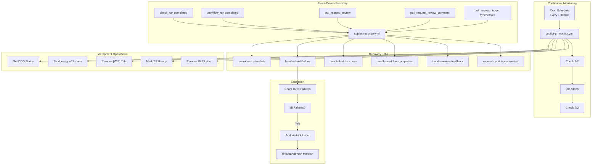
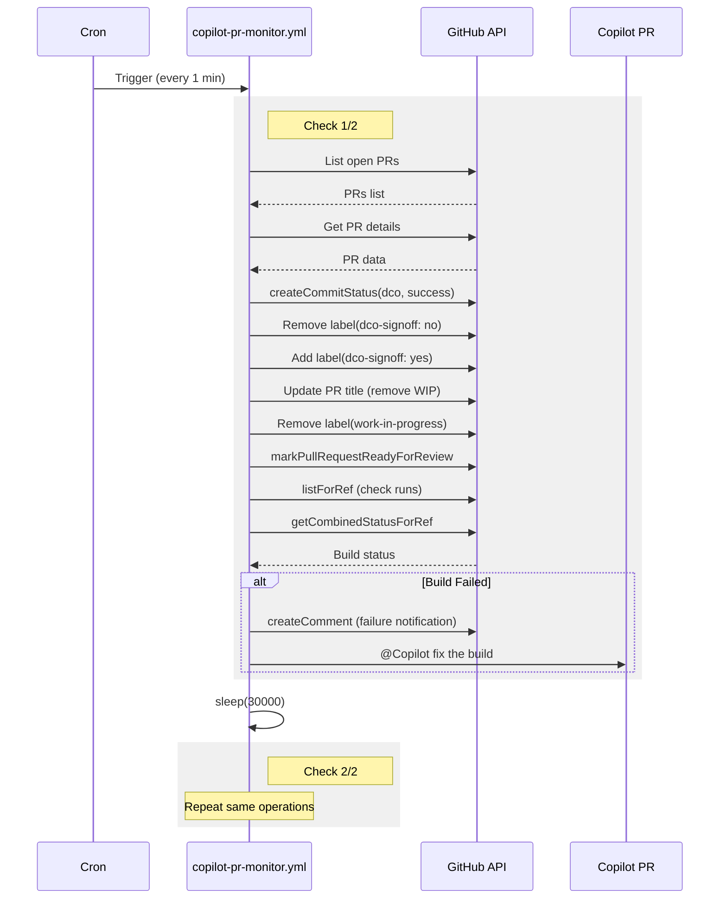
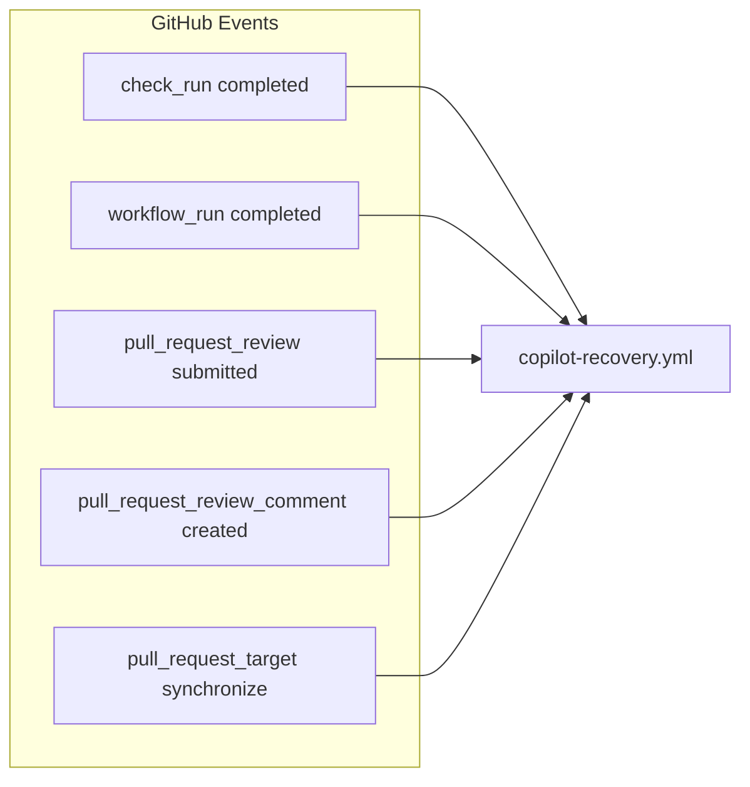
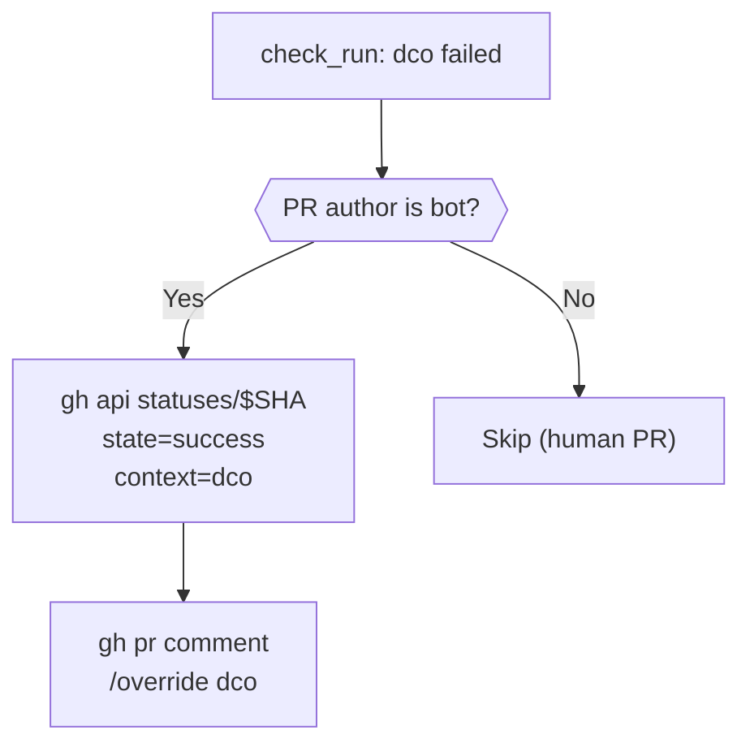
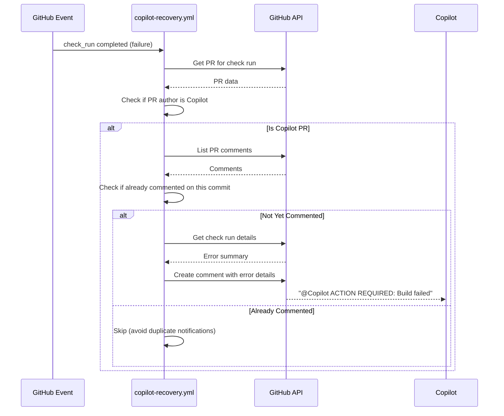
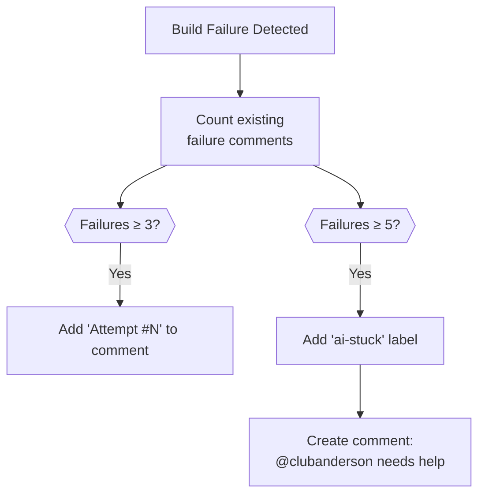
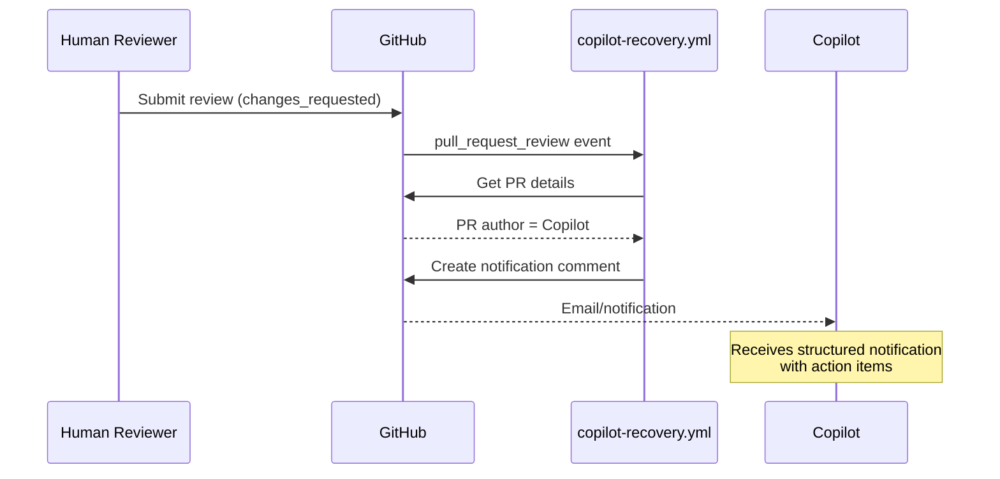
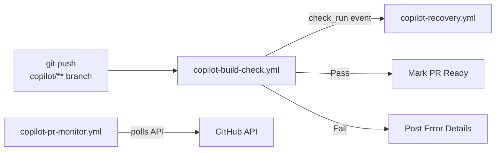

<!-- source: DeepWiki mcp.deepwiki.com · repo kubestellar/console · page 7.3 PR Monitoring & Recovery · fetched 2026-10-26 -->

# PR Monitoring & Recovery

<details>
<summary>Relevant source files</summary>

The following files were used as context for generating this wiki page:

- [.github/ISSUE_TEMPLATE/bug_report.yaml](.github/ISSUE_TEMPLATE/bug_report.yaml)
- [.github/workflows/ai-fix.yml](.github/workflows/ai-fix.yml)
- [.github/workflows/copilot-assigned.yml](.github/workflows/copilot-assigned.yml)
- [.github/workflows/copilot-automation.yml](.github/workflows/copilot-automation.yml)
- [.github/workflows/copilot-build-check.yml](.github/workflows/copilot-build-check.yml)
- [.github/workflows/copilot-pr-monitor.yml](.github/workflows/copilot-pr-monitor.yml)
- [.github/workflows/copilot-recovery.yml](.github/workflows/copilot-recovery.yml)
- [.github/workflows/copilot-setup-steps.yml](.github/workflows/copilot-setup-steps.yml)
- [.github/workflows/triage-command.yml](.github/workflows/triage-command.yml)

</details>


## Purpose and Scope

This page documents the **continuous monitoring and automated recovery system** for Copilot-generated pull requests. The system consists of two complementary workflows that ensure PRs progress smoothly from draft to merge-ready state, automatically handling common failure modes and escalating to humans when necessary.

For information about the initial AI fix workflow that creates PRs, see [AI Fix Workflow](#7.2). For build verification details, see [Build Verification Pipeline](#7.4). For preview deployment testing specifics, see [Netlify Preview Testing](#7.5).

---

## System Architecture



**Sources:** [.github/workflows/copilot-pr-monitor.yml:1-264](), [.github/workflows/copilot-recovery.yml:1-652]()

---

## Continuous Monitoring Loop

The `copilot-pr-monitor.yml` workflow runs on a **cron schedule every 1 minute** and performs **2 checks with a 30-second interval** for effective 30-second polling of Copilot PRs.

### PR Discovery

The monitor discovers PRs to check using one of two methods:

1. **Automatic Discovery**: Lists all open PRs and filters by author matching `Copilot` or containing `copilot` in login
2. **Manual Trigger**: Accepts a specific `pr_number` input via `workflow_dispatch`

[.github/workflows/copilot-pr-monitor.yml:31-49]()

### Idempotent Operations

The monitor performs the following operations on **every check**, regardless of current state:

| Operation | Implementation | Purpose |
|-----------|---------------|---------|
| DCO Override | Creates commit status `dco` with `state=success` | Bypasses DCO requirement for bot commits |
| Fix DCO Labels | Removes `dco-signoff: no`, adds `dco-signoff: yes` | Ensures PR passes label checks |
| Remove WIP Title | Strips `[WIP]` prefix, adds 🐛 emoji | Signals PR is no longer work-in-progress |
| Remove WIP Label | Removes `do-not-merge/work-in-progress` | Allows PR to be merged |
| Mark Ready | Uses GraphQL `markPullRequestReadyForReview` mutation | Converts draft to ready-for-review |

**Sources:** [.github/workflows/copilot-pr-monitor.yml:68-152]()



**Sources:** [.github/workflows/copilot-pr-monitor.yml:24-263]()

---

## Event-Driven Recovery System

The `copilot-recovery.yml` workflow complements the monitoring loop by **reacting to specific GitHub events** with targeted recovery actions.

### Trigger Events



**Sources:** [.github/workflows/copilot-recovery.yml:3-25]()

### Concurrency Control

The workflow uses **concurrency groups** to prevent overlapping executions:

```yaml
concurrency:
  group: copilot-recovery-${{ github.event.check_run.pull_requests[0].number || ... }}
  cancel-in-progress: true
```

This ensures only one recovery job runs per PR at a time, with newer runs canceling in-progress ones.

**Sources:** [.github/workflows/copilot-recovery.yml:33-35]()

### Gate Job Pattern

The workflow includes a **gate job** that always runs to prevent GitHub from sending "No jobs were run" failure notifications:

[.github/workflows/copilot-recovery.yml:41-44]()

---

## DCO Override Automation

### Problem Statement

Bot accounts cannot sign commits with the Developer Certificate of Origin (DCO). The DCO check would block all Copilot PRs from merging.

### Solution Architecture

Both monitoring and recovery workflows automatically override the DCO status for bot PRs:

**Monitor Approach** (proactive):
- Runs every 30 seconds
- Sets DCO status to `success` unconditionally
- [.github/workflows/copilot-pr-monitor.yml:68-79]()

**Recovery Approach** (reactive):
- Triggers on `check_run` event with `name=dco` and `conclusion=failure`
- Verifies PR author is a bot
- Sets status via GitHub API
- Posts Prow override command as fallback
- [.github/workflows/copilot-recovery.yml:47-95]()

### Implementation Details



**Sources:** [.github/workflows/copilot-recovery.yml:54-95]()

The bot detection logic checks for:
- Author login contains `[bot]`
- Author login is exactly `Copilot`
- Author login is `copilot-swe-agent`
- Author login starts with `dependabot`

[.github/workflows/copilot-recovery.yml:69]()

---

## Build Failure Detection and Notification

### Dual Detection Strategy

The system checks for build failures in **two places** to handle both GitHub native checks and external CI systems:

1. **Check Runs** (`github.rest.checks.listForRef`)
2. **Status Contexts** (`github.rest.repos.getCombinedStatusForRef`)

This dual approach is necessary because Netlify uses status contexts while GitHub Actions use check runs.

**Sources:** [.github/workflows/copilot-pr-monitor.yml:155-178]()

### Failure Notification Flow



**Sources:** [.github/workflows/copilot-recovery.yml:99-201]()

### Deduplication Mechanism

To avoid spamming Copilot with duplicate failure notifications, the system:

1. Extracts the PR's `head.sha` (commit SHA)
2. Searches existing comments for "Build Failure Detected" containing that SHA
3. Only posts a new comment if none exists for that commit

[.github/workflows/copilot-recovery.yml:146-156]()

### Error Detail Extraction

The failure comment includes detailed diagnostics:

```
## 🔴 Build Failure Detected

**Check:** [check name]
**Commit:** [short SHA]
**Status:** Failed
**Details:** [View Check Run](URL)

### Error Summary
[last 500 chars of check run output]

---
@Copilot **ACTION REQUIRED:** The build has failed. You must fix this immediately.

**Steps to fix:**
1. Run `cd web && npm run build` locally to see the exact TypeScript errors
2. Fix ALL errors shown in the build output
...
```

**Sources:** [.github/workflows/copilot-recovery.yml:172-200]()

---

## Build Success and Preview Testing

When a build succeeds, the recovery system automatically tests the Netlify preview deployment and requests Copilot verification.

### Preview URL Construction

The system constructs preview URLs using the **custom domain pattern** to avoid Playwright blocking:

```
https://deploy-preview-{PR_NUMBER}.console-deploy-preview.kubestellar.io
```

**Sources:** [.github/workflows/copilot-recovery.yml:254]()

### Health Check Protocol

| Test | Implementation | Success Criteria |
|------|----------------|------------------|
| HTTP Accessibility | `curl -s -o /dev/null -w "%{http_code}"` with 10s timeout | HTTP 200 |
| Warmup Period | Wait up to 2 minutes with 10s intervals | First successful 200 response |
| JavaScript Errors | `grep -qi "chunk.*failed\|module.*error\|syntax.*error"` | No error patterns found |
| App Rendering | Check for `id="root"` and content length > 5000 | Both conditions met |

**Sources:** [.github/workflows/copilot-recovery.yml:263-300]()

### Automated Verification Request

After successful health checks, the system posts a comment requesting Copilot to verify the preview:

```markdown
## 🔍 Preview Ready - Verification Required

@copilot New commit detected. Please verify the preview deployment:

1. **Fetch the preview:**
   ```bash
   curl -s [PREVIEW_URL]
   ```

2. **Verify the response contains:**
   - `<div id="root">` (React mount point)
   - JavaScript and CSS bundle references
   - No error messages

3. **Report your findings** confirming the preview works.
```

**Sources:** [.github/workflows/copilot-recovery.yml:628-646]()

---

## Escalation Mechanism

When Copilot repeatedly fails to fix build errors, the system automatically escalates to human maintainers.

### Failure Counting

The monitor tracks failure history by:

1. Counting existing comments containing "Build Failed" and "@Copilot"
2. Incrementing the count for each new failure
3. Including attempt number in failure comments after 3 failures

[.github/workflows/copilot-pr-monitor.yml:200-208]()

### Escalation Threshold



**Sources:** [.github/workflows/copilot-pr-monitor.yml:204-232]()

### Escalation Comment Format

```markdown
## Needs Human Help

@clubanderson PR has 6 build failures. Copilot needs help.
```

The mention ensures the maintainer receives a GitHub notification. The `ai-stuck` label provides a visual indicator in PR lists and can be used for automated tracking.

**Sources:** [.github/workflows/copilot-pr-monitor.yml:226-232]()

---

## Code Review Feedback Handling

The recovery system monitors for human code review feedback and automatically notifies Copilot.

### Trigger Events

The workflow responds to two event types:

1. **`pull_request_review`** with `state=changes_requested`
2. **`pull_request_review_comment`** (any line comment)

**Sources:** [.github/workflows/copilot-recovery.yml:440-496]()

### Feedback Notification



**Sources:** [.github/workflows/copilot-recovery.yml:440-496]()

### Notification Format

```markdown
## 📝 Code Review Feedback Received

**Reviewer:** @[reviewer_login]
**Type:** review / comment

@copilot A reviewer has provided feedback on your PR. Please:

1. **Read and understand** the feedback above
2. **Address all requested changes**
3. **Push commits** with the fixes
4. **Reply** to confirm the changes have been made

If you disagree with any feedback, explain your reasoning in a reply.
```

**Sources:** [.github/workflows/copilot-recovery.yml:478-495]()

---

## Auto-Ready Transition

When builds succeed and previews are healthy, the recovery system automatically transitions PRs from draft to ready for review.

### Draft Detection and Transition

The workflow uses the **GraphQL API** to mark PRs ready because the REST API does not support this operation reliably:

[.github/workflows/copilot-recovery.yml:367-388]()

```graphql
mutation {
  markPullRequestReadyForReview(input: {pullRequestId: "$PR_NODE_ID"}) {
    pullRequest {
      isDraft
    }
  }
}
```

### Token Requirements

The operation requires a **Personal Access Token (PAT)** with appropriate permissions because the default `GITHUB_TOKEN` cannot modify PRs created by the `Copilot` user:

```yaml
env:
  GH_TOKEN: ${{ secrets.CONSOLE_AUTO || secrets.GITHUB_TOKEN }}
```

**Sources:** [.github/workflows/copilot-recovery.yml:370]()

---

## Manual Testing Interface

The recovery workflow provides a **`workflow_dispatch`** interface for manual preview testing.

### Input Parameters

| Parameter | Type | Required | Default | Purpose |
|-----------|------|----------|---------|---------|
| `pr_number` | string | Yes | - | PR number to test |
| `test_preview` | boolean | No | `true` | Whether to run preview test |

**Sources:** [.github/workflows/copilot-recovery.yml:15-25]()

### Use Cases

1. **Debugging**: Test preview health checks without waiting for automatic triggers
2. **Validation**: Manually verify fixes before human review
3. **Monitoring**: Check preview status during long builds

The manual test job performs identical checks to automatic preview testing but can be triggered on-demand.

**Sources:** [.github/workflows/copilot-recovery.yml:499-583]()

---

## Idempotent Operations Design

The monitoring and recovery system is designed with **idempotency** as a core principle to allow safe repeated execution.

### Why Idempotency Matters

1. **Cron Overlap**: Monitor runs every minute, potentially overlapping executions
2. **Event Storms**: Multiple events can trigger recovery in rapid succession
3. **Retry Safety**: Failed operations can be retried without side effects
4. **State Drift**: External changes (manual edits) are automatically corrected

### Idempotent Operation Examples

| Operation | Idempotent Implementation | Non-Idempotent Alternative |
|-----------|---------------------------|---------------------------|
| Set DCO Status | `POST /statuses/$SHA` with `state=success` | N/A (GitHub API is idempotent) |
| Add Label | `addLabels()` - no-op if label exists | Would create duplicates |
| Remove Label | `removeLabel()` - no-op if label absent | Would throw error |
| Update Title | Replace with computed value | Append suffix (would grow) |
| Create Comment | Check for existing comment first | Always create (duplicates) |
| Mark Ready | GraphQL mutation - no-op if already ready | Would fail on already-ready PR |

**Sources:** [.github/workflows/copilot-pr-monitor.yml:68-152](), [.github/workflows/copilot-recovery.yml:77-93]()

### Deduplication Strategy

For operations that are **not naturally idempotent** (like creating comments), the system implements **manual deduplication**:

```javascript
// Check if we already posted a failure comment for this commit
EXISTING=$(gh api repos/.../issues/$PR_NUM/comments \
  --jq "[.[] | select(.body | contains(\"Build Failure Detected\") 
              and contains(\"$HEAD_SHA\"))] | length")

if [ "$EXISTING" -gt "0" ]; then
  should_comment=false
fi
```

**Sources:** [.github/workflows/copilot-recovery.yml:139-156]()

---

## Monitoring Interval Analysis

### Effective Polling Rate

The monitor achieves **effective 30-second polling** through a two-phase approach:

1. **Cron**: `* * * * *` (every 1 minute)
2. **Internal Checks**: 2 checks with 30s sleep between them

This results in checks at: 0s, 30s, 60s, 90s, 120s, ...

**Sources:** [.github/workflows/copilot-pr-monitor.yml:4-6](), [.github/workflows/copilot-pr-monitor.yml:255-261]()

### Concurrency Behavior

```mermaid
gantt
    title Monitoring Timeline
    dateFormat ss
    axisFormat %S
    
    section Run 1
    Check 1/2    :a1, 00, 5s
    Sleep 30s    :a2, 05, 30s
    Check 2/2    :a3, 35, 5s
    
    section Run 2
    Check 1/2    :b1, 60, 5s
    Sleep 30s    :b2, 65, 30s
    Check 2/2    :b3, 95, 5s
```



If a run takes longer than 60 seconds (e.g., slow GitHub API), the next cron trigger will start a **new concurrent run**. The concurrency group is at the **workflow level**, so these runs execute in parallel.

---

## Integration with Build Verification

The monitoring and recovery system works in conjunction with the **build verification pipeline** (see [Build Verification Pipeline](#7.4)):

### Workflow Relationship



The build check workflow:
- Runs `npm run build` and `npm run lint` synchronously
- Posts detailed error output if either fails
- Marks PR ready and removes WIP markers if both pass

**Sources:** [.github/workflows/copilot-build-check.yml:1-144]()

The monitor and recovery workflows:
- Ensure DCO is overridden regardless of build status
- Detect build failures from Netlify checks (different from copilot-build-check)
- Handle preview deployment testing
- Escalate persistent failures

This **separation of concerns** allows:
- Build verification to run immediately on push (fast feedback)
- Monitoring to handle edge cases and external CI (Netlify)
- Recovery to respond to any GitHub event, not just pushes

---

## Error Handling and Resilience

### Try-Catch Wrapping

Most operations in the monitoring script use JavaScript try-catch blocks that **silently ignore errors**:

```javascript
try {
  await github.rest.repos.createCommitStatus(...);
  core.info(`DCO: overridden`);
} catch (e) { /* ignore */ }
```

**Sources:** [.github/workflows/copilot-pr-monitor.yml:69-79]()

This design ensures that:
1. One failed operation doesn't block others
2. Transient GitHub API errors don't cause workflow failures
3. The workflow always completes successfully (no noise)

### Conditional Execution

Recovery jobs use **if conditions** to prevent execution when preconditions aren't met:

```yaml
if: |
  github.event_name == 'check_run' &&
  github.event.check_run.conclusion == 'failure' &&
  github.event.check_run.name != 'dco'
```

**Sources:** [.github/workflows/copilot-recovery.yml:100-106]()

This prevents wasted runs and simplifies job logic by assuming preconditions are already validated.

---

## Summary

The PR Monitoring & Recovery system provides **autonomous PR management** through:

1. **Continuous Monitoring**: Every 30 seconds, ensuring PRs progress automatically
2. **Event-Driven Recovery**: Immediate response to failures and feedback
3. **Idempotent Operations**: Safe repeated execution with automatic drift correction
4. **Escalation**: Human notification after 5+ consecutive failures
5. **Preview Testing**: Automated health checks with detailed diagnostics
6. **Zero Configuration**: No manual intervention required for Copilot PRs

The system enables the **AI-driven development pipeline** by acting as a virtual maintainer that handles routine PR management tasks, allowing humans to focus on architecture decisions and complex reviews.

**Sources:** [.github/workflows/copilot-pr-monitor.yml:1-264](), [.github/workflows/copilot-recovery.yml:1-652](), [.github/workflows/copilot-build-check.yml:1-144]()

---

