<!-- source: DeepWiki mcp.deepwiki.com · repo kubestellar/console · page 8 Update System · fetched 2026-10-26 -->

# Update System

<details>
<summary>Relevant source files</summary>

The following files were used as context for generating this wiki page:

- [pkg/agent/update_checker.go](pkg/agent/update_checker.go)
- [pkg/settings/types.go](pkg/settings/types.go)
- [web/src/components/layout/navbar/UpdateIndicator.tsx](web/src/components/layout/navbar/UpdateIndicator.tsx)
- [web/src/components/settings/Settings.tsx](web/src/components/settings/Settings.tsx)
- [web/src/components/settings/UpdateSettings.tsx](web/src/components/settings/UpdateSettings.tsx)
- [web/src/components/settings/sections/AnalyticsSection.tsx](web/src/components/settings/sections/AnalyticsSection.tsx)
- [web/src/components/settings/sections/index.ts](web/src/components/settings/sections/index.ts)
- [web/src/components/updates/UpdateProgressBanner.tsx](web/src/components/updates/UpdateProgressBanner.tsx)
- [web/src/hooks/useUpdateProgress.ts](web/src/hooks/useUpdateProgress.ts)
- [web/src/hooks/useVersionCheck.tsx](web/src/hooks/useVersionCheck.tsx)
- [web/src/types/updates.ts](web/src/types/updates.ts)

</details>


The Update System provides comprehensive software update capabilities for the KubeStellar Console across three deployment modes: developer (source), binary, and Helm. It supports multiple update channels (stable, unstable, developer), automatic update execution, real-time progress tracking via WebSocket, and rollback mechanisms for failed updates. The system detects the installation method and applies the appropriate update strategy, with full UI integration for configuration and monitoring.

For information about version display and analytics, see [Overview](#1). For CI/CD automation and release workflows, see [CI/CD Automation System](#7).

---

## System Architecture

The update system consists of frontend components for configuration and monitoring, a backend UpdateChecker service in kc-agent, and integration with GitHub APIs for release discovery and SHA tracking.

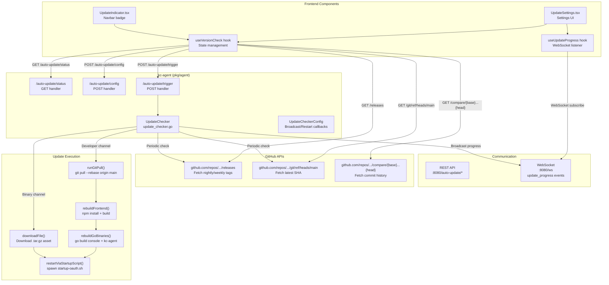

**Sources:**
- [web/src/components/settings/UpdateSettings.tsx:1-886]()
- [pkg/agent/update_checker.go:1-888]()
- [web/src/hooks/useVersionCheck.tsx:1-774]()
- [web/src/hooks/useUpdateProgress.ts:1-100]()

---

## Update Channels

The system supports three update channels, each tracking different release cadences and serving different use cases.

| Channel | Release Type | GitHub Tag Pattern | Check Interval | Use Case |
|---------|-------------|-------------------|----------------|----------|
| `stable` | Weekly releases | `v0.0.1-weekly.YYYYMMDD` | 60 minutes | Production deployments |
| `unstable` | Nightly releases | `v0.0.1-nightly.YYYYMMDD` | 60 minutes | Testing latest features |
| `developer` | main branch HEAD | Latest commit SHA | 5 minutes | Development from source |

### Channel Detection

The default channel is determined by the deployment context:

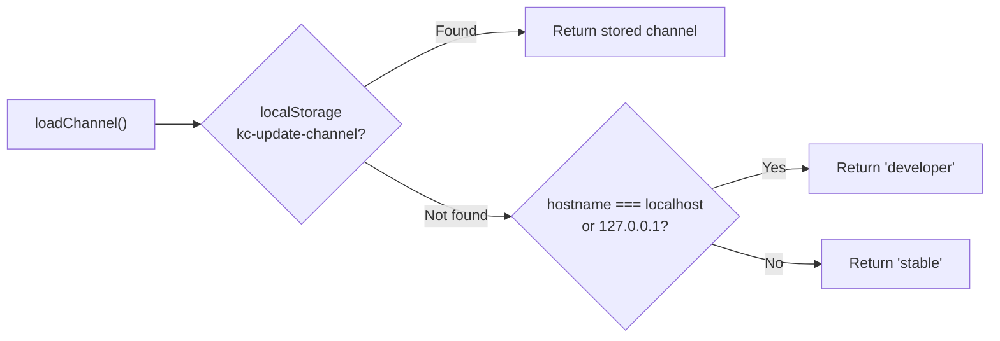

**Channel Configuration:**
- Frontend: Stored in `localStorage.getItem('kc-update-channel')`
- Backend: Synced to kc-agent via `POST /auto-update/config`
- Persistence: Survives page refresh but not browser data clear

**Sources:**
- [web/src/hooks/useVersionCheck.tsx:217-227]()
- [web/src/types/updates.ts:8-17]()
- [pkg/agent/update_checker.go:19-26]()

---

## Install Methods

The update strategy varies based on how the console was installed. The system detects the install method and applies the appropriate update procedure.

| Install Method | Detection Logic | Update Strategy | Auto-Update Support |
|---------------|----------------|-----------------|-------------------|
| `dev` | `go.mod` exists in current directory | Git pull + rebuild frontend/backend | ✅ Full support |
| `binary` | No `go.mod`, not in Kubernetes | Download new tarball + replace binary | ✅ Full support |
| `helm` | `KUBERNETES_SERVICE_HOST` env var set | Manual `helm upgrade` required | ❌ Disabled |
| `unknown` | Detection failed | No updates available | ❌ Disabled |

### Install Method Detection

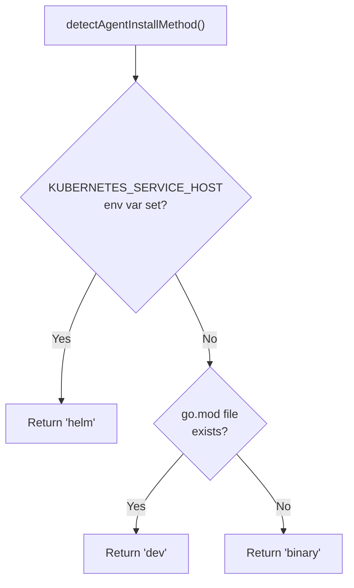

The frontend also detects install method independently:
- **Frontend Logic**: `window.location.hostname === 'localhost'` → `dev`, otherwise query backend
- **Backend Health Endpoint**: Returns `install_method` field in `/health` response
- **kc-agent Health Endpoint**: Returns `install_method` in `localhost:8080/health`

**Sources:**
- [pkg/agent/update_checker.go:688-696]()
- [web/src/hooks/useVersionCheck.tsx:275-279]()
- [web/src/types/updates.ts:20-26]()

---

## Version Detection & Checking

The version checking system uses a multi-tier caching strategy to minimize GitHub API calls while keeping update notifications timely.

### Version Sources

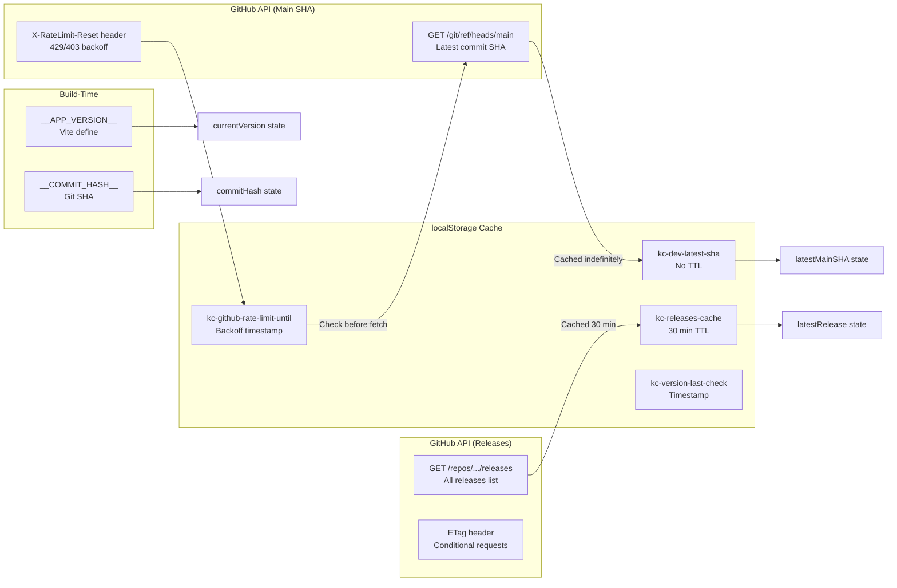

### Caching Strategy

**Release Channel Caching:**
- **TTL**: 30 minutes (`CACHE_TTL_MS = 30 * 60 * 1000`)
- **Conditional Requests**: Uses ETag from previous response
- **304 Not Modified**: Updates timestamp but keeps cached data
- **Storage Key**: `kc-releases-cache`

**Developer Channel Caching:**
- **TTL**: None (cache persists until replaced)
- **Rate Limiting**: 403/429 responses trigger 15-minute backoff
- **Backoff Storage**: `kc-github-rate-limit-until` timestamp
- **Storage Key**: `kc-dev-latest-sha`

### Update Detection Logic

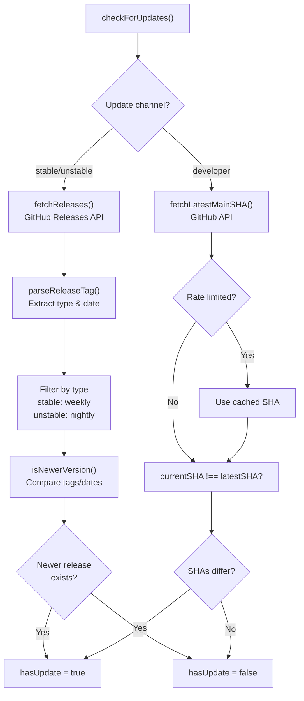

**Version Comparison Rules:**
- **Stable Channel**: Compares semantic version parts, considers nightly/weekly pre-releases as older than stable releases
- **Unstable Channel**: Compares date suffixes (e.g., `20250124` vs `20250125`)
- **Developer Channel**: Compares commit SHAs directly, no version tags involved

**Sources:**
- [web/src/hooks/useVersionCheck.tsx:36-177]()
- [web/src/hooks/useVersionCheck.tsx:182-211]()
- [web/src/hooks/useVersionCheck.tsx:379-436]()

---

## Auto-Update Execution

The UpdateChecker service in kc-agent performs periodic checks and executes updates based on the configured channel and install method.

### UpdateChecker Lifecycle

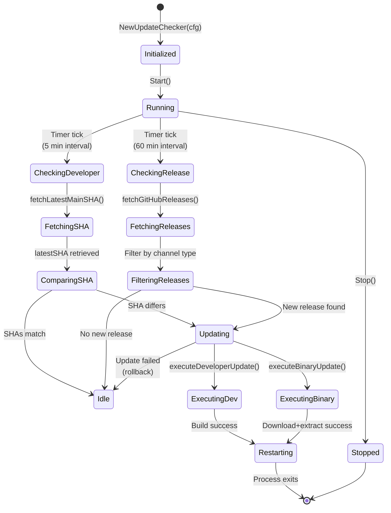

### Developer Channel Update Flow

The developer channel performs a complete source rebuild and restart:

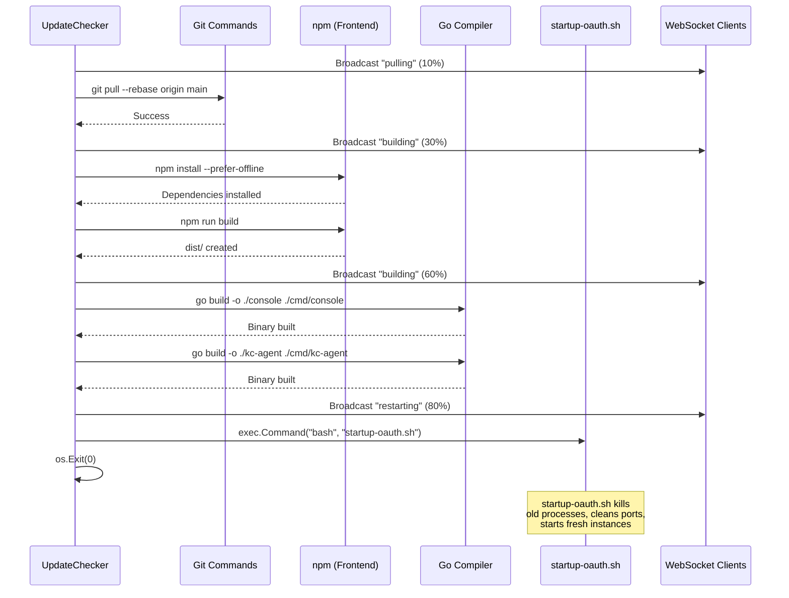

**Key Implementation Details:**

**Git Pull:**
- Command: `git pull --rebase origin main`
- Working directory: Repository root detected via `git rev-parse --show-toplevel`
- Output: Streamed to stdout/stderr for debugging

**Frontend Build:**
- Commands: `npm install --prefer-offline` + `npm run build`
- Working directory: `{repoPath}/web`
- Artifacts: `{repoPath}/web/dist/` directory

**Backend Build:**
- Commands: `go build -o ./console ./cmd/console` + `go build -o ./kc-agent ./cmd/kc-agent`
- Environment: `GOWORK=off` to avoid workspace conflicts
- Output: Binaries replace existing ones

**Restart Strategy:**
- Spawns `startup-oauth.sh` with `syscall.SysProcAttr{Setpgid: true}` (new process group)
- Redirects stdout/stderr to `data/auto-update-restart.log` to prevent broken pipe
- Current process exits via `os.Exit(0)` to allow clean replacement
- Script handles port cleanup (kills processes on 8080/5173) and restarts all components

**Sources:**
- [pkg/agent/update_checker.go:274-352]()
- [pkg/agent/update_checker.go:354-405]()
- [pkg/agent/update_checker.go:771-843]()

### Binary Channel Update Flow

Binary updates download a platform-specific tarball and replace the running executable:

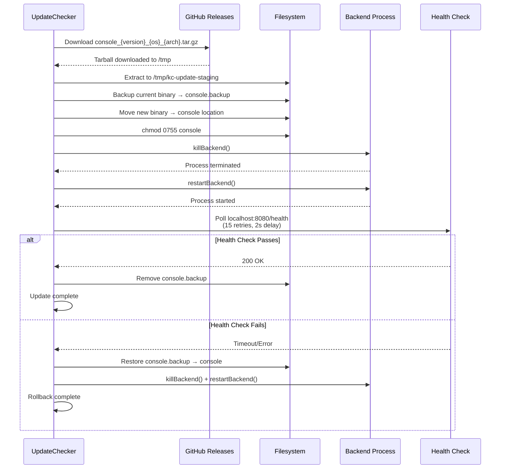

**Platform Detection:**
- Pattern: `console_{version}_{os}_{arch}.tar.gz`
- Example: `console_0.0.1-weekly.20250124_linux_amd64.tar.gz`
- Runtime values: `runtime.GOOS` and `runtime.GOARCH`

**Health Check Parameters:**
- **URL**: `http://localhost:8080/health`
- **Retries**: 15 attempts (`healthCheckRetries`)
- **Delay**: 2 seconds between attempts (`healthCheckDelay`)
- **Total timeout**: ~30 seconds

**Sources:**
- [pkg/agent/update_checker.go:470-594]()
- [pkg/agent/update_checker.go:844-858]()

---

## Update UI & Progress

The UpdateSettings component provides comprehensive configuration and monitoring for the update system.

### Prerequisites Checklist

For developer channel auto-updates, the system validates multiple prerequisites before enabling the "Update Now" button:

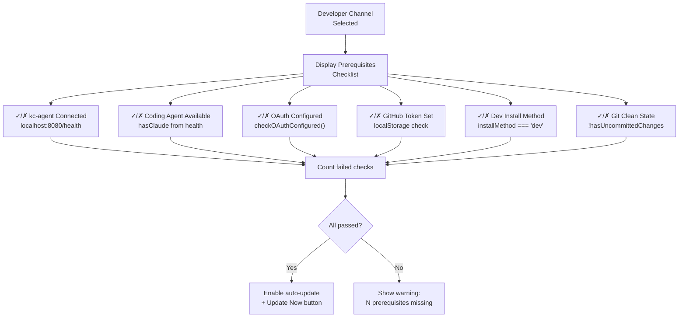

**Prerequisites Implementation:**

Each prerequisite row is rendered by the `PrereqRow` component with:
- **Icon**: Visual indicator (Terminal, Bot, Shield, Github, etc.)
- **Label**: Description of the requirement
- **Status**: Check mark (green) or X (red) with status text
- **Fix Link**: Optional "Go to settings" button that scrolls to relevant section

**Scroll Navigation:**
- Uses `scrollToSettingsSection(sectionId)` helper
- Finds element by ID, calculates scroll offset within `#main-content` container
- Adds temporary ring animation (`ring-2 ring-purple-500/50`) for 2 seconds

**Sources:**
- [web/src/components/settings/UpdateSettings.tsx:309-389]()
- [web/src/components/settings/UpdateSettings.tsx:788-838]()
- [web/src/components/settings/UpdateSettings.tsx:47-58]()

### WebSocket Progress Tracking

Real-time update progress is delivered via WebSocket broadcasts from kc-agent:

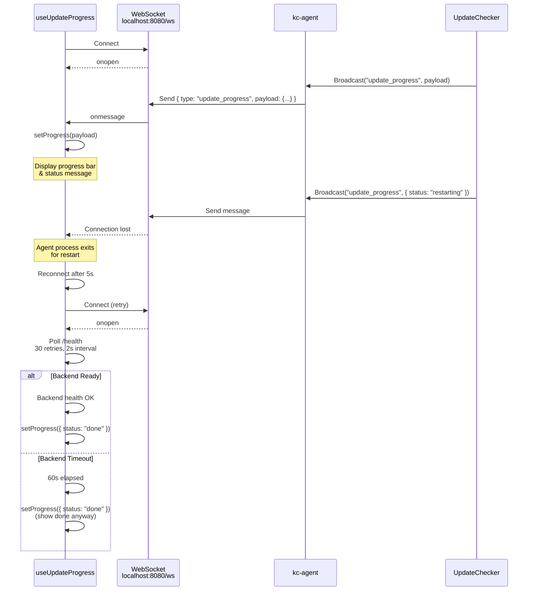

**UpdateProgress Payload Structure:**

```typescript
interface UpdateProgress {
  status: 'idle' | 'checking' | 'pulling' | 'building' | 'restarting' | 'done' | 'failed'
  message: string
  progress: number // 0-100
  error?: string
}
```

**Progress Percentage Milestones:**
- 5%: Initial trigger
- 10%: Git pull started
- 30%: Frontend build started
- 60%: Backend build started
- 80%: Restart initiated
- 90%: Waiting for backend health
- 100%: Update complete

**WebSocket Reconnection Logic:**
- **Retry Interval**: 5 seconds (`WS_RECONNECT_MS`)
- **Backend Polling**: 30 attempts × 2 seconds = 60 second timeout (`BACKEND_POLL_MAX`)
- **Health Endpoint**: `GET /health` with `cache: 'no-store'` to bypass stale cache

**Sources:**
- [web/src/hooks/useUpdateProgress.ts:1-100]()
- [pkg/agent/update_checker.go:52-58]()
- [web/src/components/settings/UpdateSettings.tsx:457-481]()

### Update Settings Component Structure

The UpdateSettings component is organized into distinct sections:

| Section | Purpose | Visibility Conditions |
|---------|---------|----------------------|
| Header | Shows install method badge + "Check Now" button | Always visible |
| Channel Selector | Dropdown to choose stable/unstable/developer | Always visible |
| Environment Prerequisites | Checklist of requirements for auto-update | `channel === 'developer'` |
| Auto-Update Toggle | Enable/disable automatic updates | `!isHelmInstall && agentConnected && hasCodingAgent` |
| Agent Required Notice | Info banner explaining agent requirement | `!agentConnected && !isHelmInstall` |
| Helm Install Notice | Warning that auto-update is disabled | `isHelmInstall` |
| Dev Mode Warning | Warning about VITE_APP_VERSION mismatch | Non-release version detected |
| Update Progress Banner | Real-time progress bar with countdown | `isUpdating` |
| Update Complete/Failed | Success/error banner with refresh button | `updateProgress?.status === 'done' \| 'failed'` |
| Version Status | Current vs latest version comparison | Always visible |
| Recent Commits | Expandable commit list between SHAs | `channel === 'developer' && recentCommits.length > 0` |
| Update Now Button | Trigger immediate update | `hasUpdate && agentConnected && !isHelmInstall` |
| Release Notes | Expandable release notes from GitHub | `latestRelease?.releaseNotes` exists |
| Update Instructions | Manual update commands for each method | `hasUpdate && !autoUpdateEnabled` (varies by channel) |

**Recent Commits Display:**

When developer channel detects a SHA mismatch, the UI fetches commit history via GitHub Compare API:

```
GET /repos/kubestellar/console/compare/{currentSHA}...{latestSHA}
```

Displays up to 20 most recent commits in reverse chronological order with:
- Short SHA (7 chars)
- First line of commit message
- Author name and relative timestamp

**Sources:**
- [web/src/components/settings/UpdateSettings.tsx:60-886]()
- [web/src/hooks/useVersionCheck.tsx:442-491]()

---

## Rollback & Recovery

The update system implements multiple rollback strategies to recover from failed updates.

### Developer Channel Rollback

When frontend or backend builds fail during a developer channel update, the system performs a git reset:

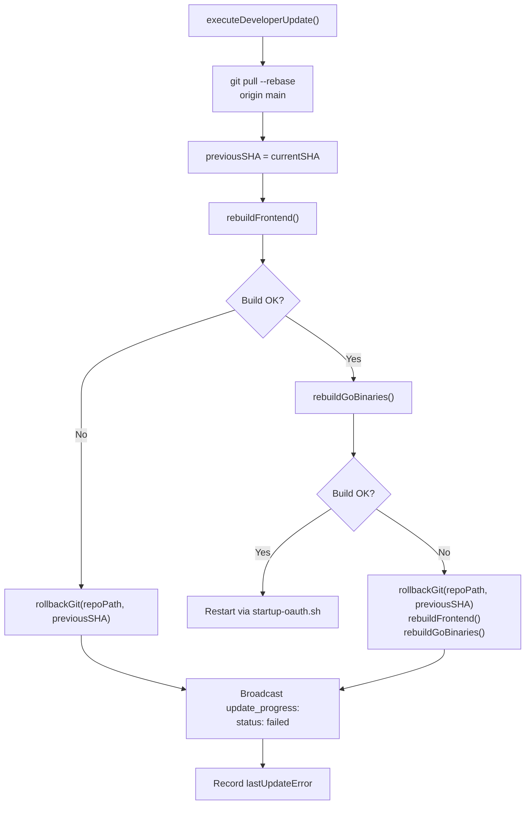

**Rollback Implementation:**
- **Command**: `git reset --hard {previousSHA}`
- **Rebuild**: Re-runs `npm install + npm run build` + `go build` to restore working state
- **Error Recording**: Stores error message in `UpdateChecker.lastUpdateError` for UI display

**Sources:**
- [pkg/agent/update_checker.go:274-352]()
- [pkg/agent/update_checker.go:833-842]()

### Binary Channel Rollback

Binary updates create a backup before replacing the executable and restore it if the new version fails health checks:

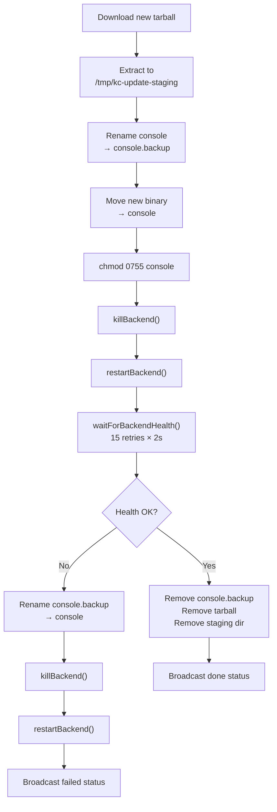

**Health Check Validation:**
- **Endpoint**: `http://localhost:8080/health`
- **Client Timeout**: 2 seconds per request
- **Total Attempts**: 15 retries with 2-second delays = 30 seconds max
- **Success Criteria**: HTTP 200 response

**Backup Cleanup:**
- Success: `os.Remove(consolePath + ".backup")` immediately after health check passes
- Failure: `.backup` file remains for manual investigation

**Sources:**
- [pkg/agent/update_checker.go:470-594]()
- [pkg/agent/update_checker.go:844-858]()

### Error Recording & Display

All update failures are recorded for user visibility:

**UpdateChecker State:**
```go
type UpdateChecker struct {
    lastUpdateTime  time.Time
    lastUpdateError string
    // ...
}
```

**Error Recording:**
```go
func (uc *UpdateChecker) recordError(msg string) {
    uc.mu.Lock()
    uc.lastUpdateError = msg
    uc.lastUpdateTime = time.Now()
    uc.mu.Unlock()
    log.Printf("[AutoUpdate] Error: %s", msg)
}
```

**Status API Response:**
```go
type AutoUpdateStatusResponse struct {
    LastUpdateTime   string `json:"lastUpdateTime,omitempty"`
    LastUpdateResult string `json:"lastUpdateResult,omitempty"`
    // ...
}
```

The frontend displays `lastUpdateResult` in the update status section when non-empty, showing:
- Git pull failures
- Build errors with error messages
- Download failures
- Health check timeouts

**Sources:**
- [pkg/agent/update_checker.go:28-73]()
- [pkg/agent/update_checker.go:664-670]()
- [web/src/components/settings/UpdateSettings.tsx:483-522]()

---

## API Endpoints

The kc-agent exposes three REST endpoints for update system control:

### GET /auto-update/status

Returns the current auto-update configuration and status.

**Response Structure:**
```go
type AutoUpdateStatusResponse struct {
    InstallMethod         string `json:"installMethod"`         // "dev" | "binary" | "helm"
    RepoPath              string `json:"repoPath"`              // Git repository path (dev only)
    CurrentSHA            string `json:"currentSHA"`            // Current git HEAD SHA
    LatestSHA             string `json:"latestSHA"`             // Latest main branch SHA
    HasUpdate             bool   `json:"hasUpdate"`             // SHA mismatch detected
    HasUncommittedChanges bool   `json:"hasUncommittedChanges"` // Git dirty state
    AutoUpdateEnabled     bool   `json:"autoUpdateEnabled"`     // Config: enabled
    Channel               string `json:"channel"`               // "stable" | "unstable" | "developer"
    LastUpdateTime        string `json:"lastUpdateTime"`        // RFC3339 timestamp
    LastUpdateResult      string `json:"lastUpdateResult"`      // Error message or empty
}
```

**Frontend Usage:**
- Polled every 60 seconds by `useVersionCheck` hook
- Updates `autoUpdateStatus` state
- Displays in UpdateSettings UI

**Sources:**
- [pkg/agent/update_checker.go:60-72]()
- [pkg/agent/update_checker.go:137-166]()
- [web/src/hooks/useVersionCheck.tsx:346-372]()

### POST /auto-update/config

Updates the auto-update configuration and restarts the check loop if needed.

**Request Body:**
```go
type AutoUpdateConfigRequest struct {
    Enabled bool   `json:"enabled"` // Enable/disable auto-update
    Channel string `json:"channel"` // "stable" | "unstable" | "developer"
}
```

**Behavior:**
- Updates `UpdateChecker.enabled` and `UpdateChecker.channel`
- Calls `UpdateChecker.Start()` if enabled changed to `true`
- Calls `UpdateChecker.Stop()` if enabled changed to `false`
- Restarts check loop with new interval (5 min for developer, 60 min for release channels)

**Frontend Synchronization:**
- Called by `setChannel()` in `useVersionCheck` hook
- Called by `setAutoUpdateEnabled()` in `useVersionCheck` hook
- Uses 3-second timeout to handle agent unavailability gracefully

**Sources:**
- [pkg/agent/update_checker.go:74-78]()
- [pkg/agent/update_checker.go:122-134]()
- [web/src/hooks/useVersionCheck.tsx:496-511]()
- [web/src/hooks/useVersionCheck.tsx:516-531]()

### POST /auto-update/trigger

Triggers an immediate update check and execution.

**Request Body:**
```json
{
  "channel": "stable"  // Optional channel override
}
```

**Behavior:**
- Spawns goroutine to run `checkAndUpdate()` asynchronously
- If `channel` is provided, temporarily uses that channel for this check only
- Restores original channel after check completes
- Returns immediately (non-blocking)

**Update Execution Flow:**
1. Calls `UpdateChecker.TriggerNow(channelOverride)`
2. Spawns goroutine with temporary channel override
3. Executes `checkAndUpdate()` which calls channel-specific check method
4. Broadcasts progress via WebSocket as update proceeds
5. Restores original channel in goroutine cleanup

**Frontend Usage:**
- Called when user clicks "Update Now" button in UpdateSettings
- Returns `{ success: boolean, error?: string }` for UI feedback
- Uses 30-second timeout (longer than config endpoints due to download time)

**Sources:**
- [pkg/agent/update_checker.go:169-187]()
- [web/src/hooks/useVersionCheck.tsx:537-560]()
- [web/src/components/settings/UpdateSettings.tsx:611-637]()

---

## Configuration & State Management

### localStorage Keys

The update system persists configuration and cache data in browser localStorage:

| Key | Type | Purpose | TTL |
|-----|------|---------|-----|
| `kc-update-channel` | string | Selected channel: "stable" \| "unstable" \| "developer" | Persistent |
| `kc-releases-cache` | JSON | Cached GitHub releases with ETag | 30 minutes |
| `kc-skipped-versions` | JSON array | User-skipped version tags | Persistent |
| `kc-version-last-check` | number | Timestamp of last update check | Persistent |
| `kc-auto-update-enabled` | string | "true" \| "false" — auto-update toggle | Persistent |
| `kc-dev-latest-sha` | string | Cached latest main branch SHA | No TTL |
| `kc-github-rate-limit-until` | string | Timestamp when rate limit expires | 15 min backoff |

**Sources:**
- [web/src/types/updates.ts:114-120]()
- [web/src/hooks/useVersionCheck.tsx:26-27]()

### State Synchronization

The frontend and kc-agent maintain synchronized state for auto-update configuration:

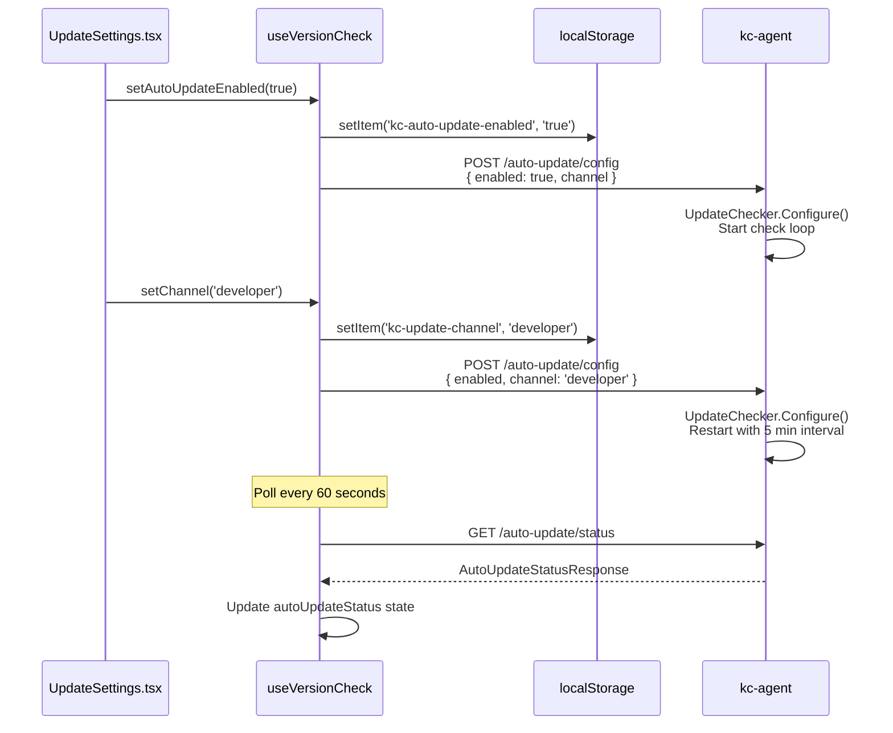

**Initialization Sequence:**
1. `useVersionCheck` hook loads `loadChannel()` and `loadAutoUpdateEnabled()` from localStorage on mount
2. Calls `fetchAgentInfo()` to get install method from `localhost:8080/health`
3. Calls `fetchAutoUpdateStatus()` to sync with kc-agent state
4. Sets up 60-second polling interval for status updates

**State Priority:**
- localStorage is source of truth for channel and enabled settings
- kc-agent status provides install method, repo path, SHA comparison
- Frontend state reflects combined view for UI rendering

**Sources:**
- [web/src/hooks/useVersionCheck.tsx:261-342]()
- [pkg/agent/update_checker.go:80-96]()

---

## Integration Points

### UpdateIndicator Component

The navbar displays a green badge with pulsing dot when an update is available:

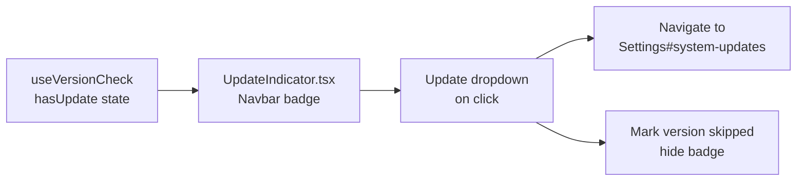

**Badge Visibility Logic:**
- `hasUpdate === true` from `useVersionCheck` hook
- For developer channel: `currentSHA !== latestSHA`
- For release channels: `latestRelease` exists and `isNewerVersion()` returns true
- Hidden if user has skipped the current `latestRelease.tag`

**Dropdown Actions:**
- **View Details**: Navigates to `/settings#system-updates-settings` using `getSettingsWithHash()`
- **Skip**: Calls `skipVersion(latestRelease.tag)` which adds tag to `kc-skipped-versions` localStorage array

**Sources:**
- [web/src/components/layout/navbar/UpdateIndicator.tsx:1-91]()
- [web/src/hooks/useVersionCheck.tsx:713-718]()

### Settings Page Integration

The UpdateSettings component is embedded in the Settings page under the "Utilities" group:

**Settings Navigation Structure:**
```javascript
{
  groupKey: 'settings.groups.utilities',
  items: [
    { id: 'settings-backup', labelKey: 'settings.nav.backupSync', icon: HardDrive },
    { id: 'local-clusters-settings', labelKey: 'settings.nav.localClusters', icon: Container },
    { id: 'permissions-settings', labelKey: 'settings.nav.permissions', icon: Shield },
    { id: 'analytics-settings', labelKey: 'settings.nav.analytics', icon: BarChart3 },
    { id: 'system-updates-settings', labelKey: 'settings.nav.updates', icon: Download },
  ],
}
```

**Deep Linking:**
- URL hash: `/settings#system-updates-settings`
- Scrolls to element with `id="system-updates-settings"`
- Adds temporary ring animation for visual focus
- Handles KeepAlive transitions with retry logic (5 attempts using `requestAnimationFrame`)

**Sources:**
- [web/src/components/settings/Settings.tsx:84-92]()
- [web/src/components/settings/Settings.tsx:141-165]()
- [web/src/components/settings/Settings.tsx:362-374]()

### UpdateProgressBanner Component

An optional global banner component for showing update progress at the top of the application:

**Usage Pattern:**
```tsx
import { useUpdateProgress } from './hooks/useUpdateProgress'
import { UpdateProgressBanner } from './components/updates/UpdateProgressBanner'

function App() {
  const { progress, dismiss } = useUpdateProgress()
  
  return (
    <>
      <UpdateProgressBanner progress={progress} onDismiss={dismiss} />
      {/* Rest of app */}
    </>
  )
}
```

**Behavior:**
- Shows when `progress.status` is not `'idle'`
- Auto-dismisses after 5 seconds when `status === 'done'`
- Color-coded: blue (active), green (done), red (failed)
- Displays progress bar during active updates
- Dismiss button available at all times

**Note:** This component is defined but not currently integrated in the main App.tsx layout. The update progress is instead displayed inline within UpdateSettings.

**Sources:**
- [web/src/components/updates/UpdateProgressBanner.tsx:1-68]()
- [web/src/hooks/useUpdateProgress.ts:9-99]()

---

