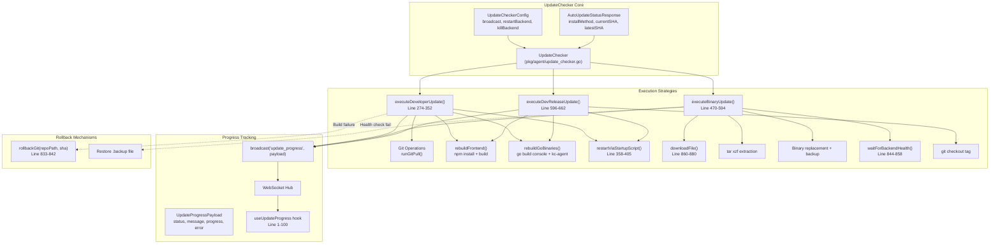
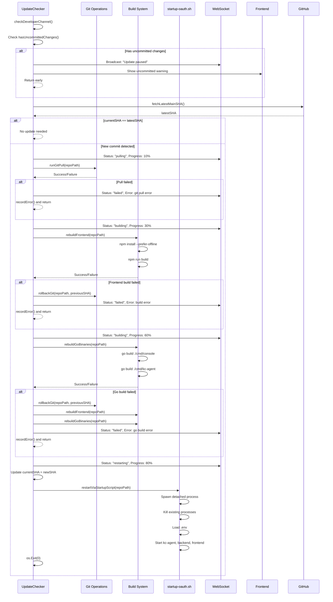
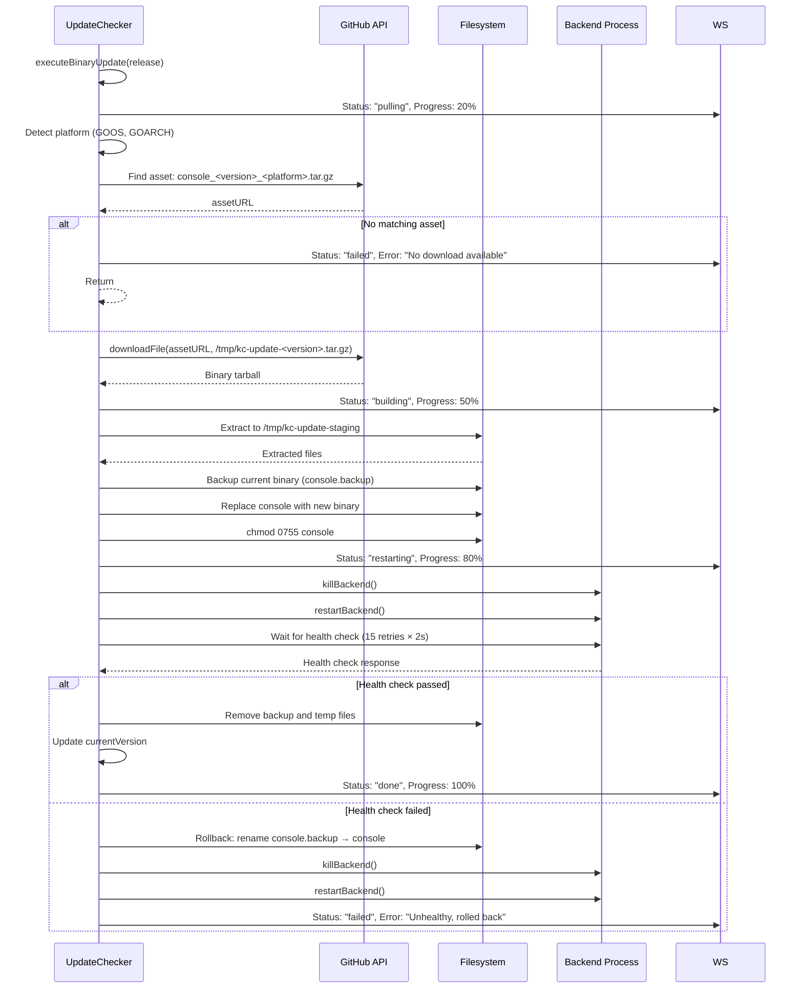
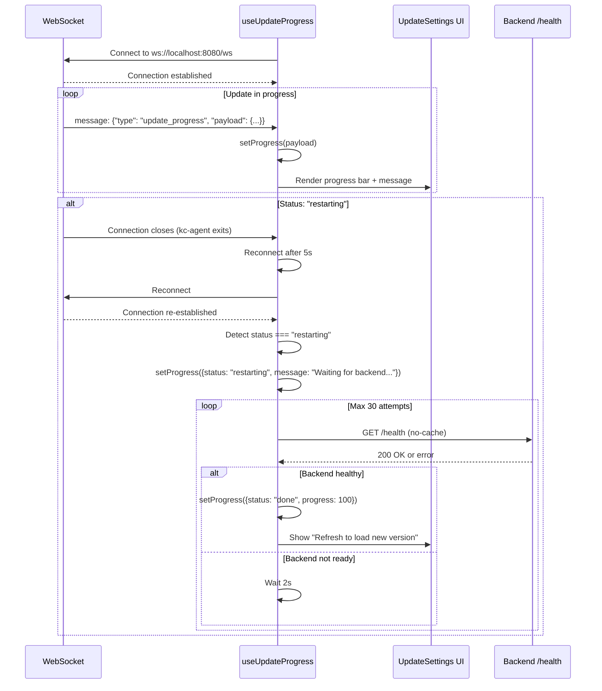

<!-- source: DeepWiki mcp.deepwiki.com · repo kubestellar/console · page 8.2 Auto-Update Execution · fetched 2026-10-26 -->

# Auto-Update Execution

<details>
<summary>Relevant source files</summary>

The following files were used as context for generating this wiki page:

- [pkg/agent/update_checker.go](pkg/agent/update_checker.go)
- [pkg/settings/types.go](pkg/settings/types.go)
- [web/src/components/layout/navbar/UpdateIndicator.tsx](web/src/components/layout/navbar/UpdateIndicator.tsx)
- [web/src/components/settings/Settings.tsx](web/src/components/settings/Settings.tsx)
- [web/src/components/settings/UpdateSettings.tsx](web/src/components/settings/UpdateSettings.tsx)
- [web/src/components/settings/sections/AnalyticsSection.tsx](web/src/components/settings/sections/AnalyticsSection.tsx)
- [web/src/components/settings/sections/index.ts](web/src/components/settings/sections/index.ts)
- [web/src/components/updates/UpdateProgressBanner.tsx](web/src/components/updates/UpdateProgressBanner.tsx)
- [web/src/hooks/useUpdateProgress.ts](web/src/hooks/useUpdateProgress.ts)
- [web/src/hooks/useVersionCheck.tsx](web/src/hooks/useVersionCheck.tsx)
- [web/src/types/updates.ts](web/src/types/updates.ts)

</details>


This document describes the execution strategies and implementation details for automatic software updates in the KubeStellar Console. It covers the core update orchestration logic, progress tracking, rollback mechanisms, and restart coordination.

For information about version detection and update checking, see [Version Detection & Checking](#8.1). For UI components and user configuration, see [Update UI & Progress](#8.3). For rollback strategies, see [Rollback & Recovery](#8.4).

## Purpose and Scope

Auto-update execution is implemented in the `kc-agent` component and provides three distinct update strategies based on the detected installation method:

- **Developer installations** (`dev`): Updates from the main branch using git operations, rebuilds frontend and backend, then restarts via `startup-oauth.sh`
- **Binary installations** (`binary`): Downloads platform-specific release tarballs, replaces executables, validates health, and restarts
- **Helm installations** (`helm`): Auto-updates are disabled; users must manually upgrade via `helm upgrade`

The execution logic handles partial failures through rollback mechanisms, broadcasts progress via WebSocket, and performs health validation before finalizing updates.

## Update Execution Architecture



**Sources:**
- [pkg/agent/update_checker.go:28-96]()
- [pkg/agent/update_checker.go:222-238]()
- [pkg/agent/update_checker.go:274-662]()
- [web/src/hooks/useUpdateProgress.ts:1-100]()

## UpdateChecker State Machine

The `UpdateChecker` struct maintains state across periodic checks and manual triggers:

| Field | Type | Purpose |
|-------|------|---------|
| `enabled` | `bool` | Auto-update toggle, synced from frontend |
| `channel` | `string` | `"stable"`, `"unstable"`, or `"developer"` |
| `installMethod` | `string` | `"dev"`, `"binary"`, or `"helm"` (detected once at startup) |
| `repoPath` | `string` | Git repository root (empty for binary installs) |
| `currentVersion` | `string` | Current release tag or "dev" |
| `currentSHA` | `string` | Current git commit (developer channel only) |
| `lastUpdateTime` | `time.Time` | Timestamp of last successful/failed update |
| `lastUpdateError` | `string` | Error message from last failed update |

**Sources:**
- [pkg/agent/update_checker.go:29-43]()
- [pkg/agent/update_checker.go:80-96]()

## Developer Channel Execution

Developer channel updates track the `main` branch by commit SHA and execute when a new commit is detected. This flow is designed for contributors running from source.

### Developer Update Flow Diagram



**Sources:**
- [pkg/agent/update_checker.go:240-272]()
- [pkg/agent/update_checker.go:274-352]()
- [pkg/agent/update_checker.go:358-405]()

### Uncommitted Changes Detection

Before executing a developer channel update, the system checks for uncommitted changes:

```go
func hasUncommittedChanges(repoPath string) bool {
    cmd := exec.Command("git", "status", "--porcelain", "-uno")
    cmd.Dir = repoPath
    out, err := cmd.Output()
    if err != nil {
        return true // assume dirty on error
    }
    return len(strings.TrimSpace(string(out))) > 0
}
```

The `-uno` flag ignores untracked files, only checking tracked file modifications. If uncommitted changes exist, the update is skipped and a message is broadcast via WebSocket.

**Sources:**
- [pkg/agent/update_checker.go:758-769]()
- [pkg/agent/update_checker.go:251-258]()

### Build System Integration

The update process rebuilds both frontend and backend components:

#### Frontend Build (`rebuildFrontend`)

```
repoPath/web/
    npm install --prefer-offline
    npm run build
    → Generates dist/ directory
```

The `--prefer-offline` flag speeds up installs by using the local npm cache when possible.

**Sources:**
- [pkg/agent/update_checker.go:779-799]()

#### Backend Build (`rebuildGoBinaries`)

```
GOWORK=off go build -o ./console ./cmd/console
GOWORK=off go build -o ./kc-agent ./cmd/kc-agent
```

The `GOWORK=off` environment variable prevents Go workspace mode from interfering with the build. Binaries are written to their current locations (determined by `exec.LookPath()`).

**Sources:**
- [pkg/agent/update_checker.go:801-831]()

### Restart Coordination via startup-oauth.sh

After building, the update process spawns `startup-oauth.sh` as a detached process and exits:

```mermaid
graph LR
    A["kc-agent<br/>(current process)"] -->|spawn| B["startup-oauth.sh<br/>(detached)"]
    A -->|os.Exit(0)| C[Process terminates]
    B -->|1. Kill old processes| D["pkill console, kc-agent, npm"]
    D -->|2. Port cleanup| E["lsof -ti :8080, :5173"]
    E -->|3. Load .env| F["source .env"]
    F -->|4. Start kc-agent| G["./kc-agent &"]
    G -->|5. Start backend| H["./console &"]
    H -->|6. Start frontend| I["cd web && npm run dev &"]
```

**Key implementation details:**

1. **Process group isolation**: The script is spawned with `Setpgid: true` so it survives the parent's exit
2. **Output redirection**: stdout/stderr are redirected to `data/auto-update-restart.log` to prevent broken pipe signals
3. **Immediate exit**: The current process exits after spawning to allow the script to replace it cleanly

**Sources:**
- [pkg/agent/update_checker.go:354-405]()

### Fallback: Self-Update via exec

If `startup-oauth.sh` is not found, the update falls back to a simpler strategy:

1. Kill and restart the backend using `restartBackend()` callback
2. Replace the current process atomically via `syscall.Exec()`

This replaces the `kc-agent` process in-place with the newly built binary, preserving the process ID and environment.

**Sources:**
- [pkg/agent/update_checker.go:409-429]()

## Release Channel Execution

Release channels (`stable` and `unstable`) update to tagged GitHub releases. The execution strategy depends on the installation method.

### Binary Installation Update Flow

For users who installed via the `start.sh` script (binary method):



**Sources:**
- [pkg/agent/update_checker.go:470-594]()

### Health Check Validation

The `waitForBackendHealth()` function performs 15 health checks with 2-second delays:

```go
func waitForBackendHealth() bool {
    client := &http.Client{Timeout: healthCheckTimeout}
    for i := 0; i < healthCheckRetries; i++ {
        resp, err := client.Get(defaultHealthCheckURL)
        if err == nil && resp.StatusCode == http.StatusOK {
            resp.Body.Close()
            return true
        }
        if resp != nil {
            resp.Body.Close()
        }
        time.Sleep(healthCheckDelay)
    }
    return false
}
```

Constants:
- `healthCheckRetries = 15`
- `healthCheckDelay = 2 * time.Second`
- Total timeout: 30 seconds

**Sources:**
- [pkg/agent/update_checker.go:22-23]()
- [pkg/agent/update_checker.go:844-858]()

### Dev Installation Release Update

For developer installations tracking release channels (rare but supported):

1. Fetch the release tag from GitHub
2. `git checkout <tag>`
3. Rebuild frontend and backend
4. Restart via `startup-oauth.sh`

This is identical to developer channel updates except it checks out a specific tag instead of pulling from main.

**Sources:**
- [pkg/agent/update_checker.go:596-662]()

## Progress Broadcasting

Update progress is broadcast to the frontend via WebSocket messages with the `update_progress` event type:

### UpdateProgressPayload Structure

```go
type UpdateProgressPayload struct {
    Status   string `json:"status"`   // "idle", "pulling", "building", "restarting", "done", "failed"
    Message  string `json:"message"`  // Human-readable progress message
    Progress int    `json:"progress"` // 0-100 percentage
    Error    string `json:"error,omitempty"` // Error details for failed status
}
```

**Sources:**
- [pkg/agent/update_checker.go:52-58]()

### Progress Broadcast Points

| Stage | Status | Progress % | Message Example |
|-------|--------|-----------|-----------------|
| Git pull start | `pulling` | 10 | "Pulling abc1234 from main..." |
| Frontend build start | `building` | 30 | "Installing dependencies and building frontend..." |
| Go build start | `building` | 60 | "Building Go binaries..." |
| Restart script spawn | `restarting` | 80 | "Restarting via startup-oauth.sh..." |
| Update complete | `done` | 100 | "Update complete — restart successful" |
| Any error | `failed` | varies | "git pull failed", "Build failed, rolling back..." |

**Sources:**
- [pkg/agent/update_checker.go:280-351]()

### Frontend Progress Monitoring

The frontend uses the `useUpdateProgress` hook to listen for WebSocket messages:



**Key behaviors:**

- Reconnects automatically after 5 seconds if WebSocket disconnects
- When status is `restarting` and WebSocket reconnects, polls backend `/health` endpoint
- Waits up to 60 seconds (30 × 2s) for backend to become healthy
- Shows "Refresh to load new version" button only after backend responds

**Sources:**
- [web/src/hooks/useUpdateProgress.ts:1-100]()
- [web/src/components/settings/UpdateSettings.tsx:84-85]()
- [web/src/components/settings/UpdateSettings.tsx:458-523]()

## Rollback Mechanisms

Updates implement rollback strategies to recover from failures at each stage:

### Git Rollback

If frontend or Go builds fail after `git pull`, the repository is reset to the previous SHA:

```go
func rollbackGit(repoPath, sha string) {
    if sha == "" {
        return
    }
    cmd := exec.Command("git", "reset", "--hard", sha)
    cmd.Dir = repoPath
    if err := cmd.Run(); err != nil {
        log.Printf("[AutoUpdate] Rollback to %s failed: %v", short(sha), err)
    }
}
```

After rollback, the build steps are re-executed to restore the working state.

**Rollback trigger points:**

1. Frontend build fails → rollback git, return
2. Go build fails → rollback git, rebuild frontend, rebuild go, return

**Sources:**
- [pkg/agent/update_checker.go:833-842]()
- [pkg/agent/update_checker.go:308-331]()

### Binary Rollback

For binary updates, the original executable is backed up before replacement:

```go
os.Rename(consolePath, consolePath+".backup")
os.Rename(stagingDir+"/console", consolePath)
os.Chmod(consolePath, 0755)
```

If health checks fail after restart:

```go
os.Rename(consolePath+".backup", consolePath)
uc.killBackend()
uc.restartBackend()
```

The backup is only removed after successful health validation.

**Sources:**
- [pkg/agent/update_checker.go:540-544]()
- [pkg/agent/update_checker.go:565-574]()

### Error State Persistence

Failed updates are recorded in the `UpdateChecker` state:

```go
func (uc *UpdateChecker) recordError(msg string) {
    uc.mu.Lock()
    uc.lastUpdateError = msg
    uc.lastUpdateTime = time.Now()
    uc.mu.Unlock()
    log.Printf("[AutoUpdate] Error: %s", msg)
}
```

This state is exposed via the `/auto-update/status` API endpoint and displayed in the UI.

**Sources:**
- [pkg/agent/update_checker.go:664-670]()
- [pkg/agent/update_checker.go:136-166]()

## API Endpoints

The `UpdateChecker` exposes three API endpoints in `kc-agent`:

| Endpoint | Method | Purpose |
|----------|--------|---------|
| `/auto-update/status` | GET | Returns `AutoUpdateStatusResponse` with current state |
| `/auto-update/config` | POST | Updates `enabled` and `channel` settings |
| `/auto-update/trigger` | POST | Triggers immediate update (bypasses periodic check) |

### Status Response Structure

```go
type AutoUpdateStatusResponse struct {
    InstallMethod         string `json:"installMethod"`
    RepoPath              string `json:"repoPath"`
    CurrentSHA            string `json:"currentSHA"`
    LatestSHA             string `json:"latestSHA"`
    HasUpdate             bool   `json:"hasUpdate"`
    HasUncommittedChanges bool   `json:"hasUncommittedChanges"`
    AutoUpdateEnabled     bool   `json:"autoUpdateEnabled"`
    Channel               string `json:"channel"`
    LastUpdateTime        string `json:"lastUpdateTime,omitempty"`
    LastUpdateResult      string `json:"lastUpdateResult,omitempty"`
}
```

**Sources:**
- [pkg/agent/update_checker.go:60-72]()
- [pkg/agent/update_checker.go:136-166]()

### Manual Update Trigger

The frontend can trigger an immediate update via the `/auto-update/trigger` endpoint:

```typescript
const triggerUpdate = useCallback(async (): Promise<{ success: boolean; error?: string }> => {
    const resp = await fetch(`${LOCAL_AGENT_HTTP_URL}/auto-update/trigger`, {
        method: 'POST',
        headers: { 'Content-Type': 'application/json' },
        body: JSON.stringify({ channel }),
        signal: AbortSignal.timeout(30000),
    })
    if (resp.ok) {
        return { success: true }
    }
    const errText = resp.status === 404
        ? 'kc-agent does not support auto-update yet'
        : `kc-agent returned ${resp.status}`
    return { success: false, error: errText }
}, [channel])
```

The trigger runs asynchronously via `go uc.checkAndUpdate()` and returns immediately.

**Sources:**
- [pkg/agent/update_checker.go:168-187]()
- [web/src/hooks/useVersionCheck.tsx:537-560]()

## Installation Method Detection

The `UpdateChecker` auto-detects the installation method at startup:

```go
func detectAgentInstallMethod() string {
    if os.Getenv("KUBERNETES_SERVICE_HOST") != "" {
        return "helm"
    }
    if _, err := os.Stat("go.mod"); err == nil {
        return "dev"
    }
    return "binary"
}
```

**Detection logic:**

1. **Helm**: Presence of `KUBERNETES_SERVICE_HOST` environment variable (in-cluster)
2. **Dev**: Presence of `go.mod` file in working directory
3. **Binary**: Default fallback

This determines which execution strategy to use.

**Sources:**
- [pkg/agent/update_checker.go:688-696]()
- [pkg/agent/update_checker.go:82-84]()

## Periodic Update Checks

The `UpdateChecker` runs periodic checks on a background goroutine:

```go
func (uc *UpdateChecker) run(ctx context.Context) {
    uc.mu.Lock()
    interval := releaseCheckInterval
    if uc.channel == "developer" {
        interval = developerCheckInterval
    }
    uc.mu.Unlock()

    // Initial delay to let everything start up
    select {
    case <-ctx.Done():
        return
    case <-time.After(30 * time.Second):
    }

    ticker := time.NewTicker(interval)
    defer ticker.Stop()

    for {
        select {
        case <-ctx.Done():
            return
        case <-ticker.C:
            uc.mu.Lock()
            enabled := uc.enabled
            uc.mu.Unlock()
            if enabled {
                uc.checkAndUpdate()
            }
        }
    }
}
```

**Check intervals:**

- `developerCheckInterval = 5 * time.Minute` (developer channel)
- `releaseCheckInterval = 60 * time.Minute` (stable/unstable channels)

**Initial delay:** 30 seconds after agent startup to allow services to stabilize.

**Sources:**
- [pkg/agent/update_checker.go:19-21]()
- [pkg/agent/update_checker.go:189-220]()

## Configuration Persistence

Auto-update settings are persisted to `~/.kc/settings.json` via the Settings API:

```typescript
const setAutoUpdateEnabled = useCallback(async (enabled: boolean) => {
    setAutoUpdateEnabledState(enabled)
    localStorage.setItem(UPDATE_STORAGE_KEYS.AUTO_UPDATE_ENABLED, String(enabled))

    // Sync to kc-agent
    try {
        await fetch(`${LOCAL_AGENT_HTTP_URL}/auto-update/config`, {
            method: 'POST',
            headers: { 'Content-Type': 'application/json' },
            body: JSON.stringify({ enabled, channel }),
            signal: AbortSignal.timeout(3000),
        })
    } catch {
        // Agent not available
    }
}, [channel])
```

The frontend maintains a copy in `localStorage` for immediate UI updates, then syncs to the agent asynchronously.

**Sources:**
- [web/src/hooks/useVersionCheck.tsx:516-531]()
- [web/src/hooks/useVersionCheck.tsx:496-511]()
- [web/src/types/updates.ts:114-120]()

---

