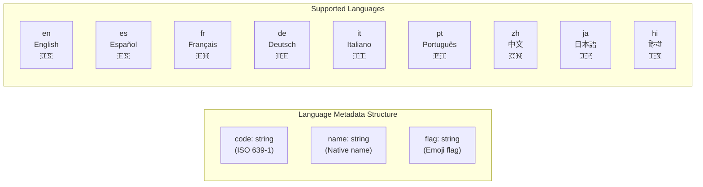
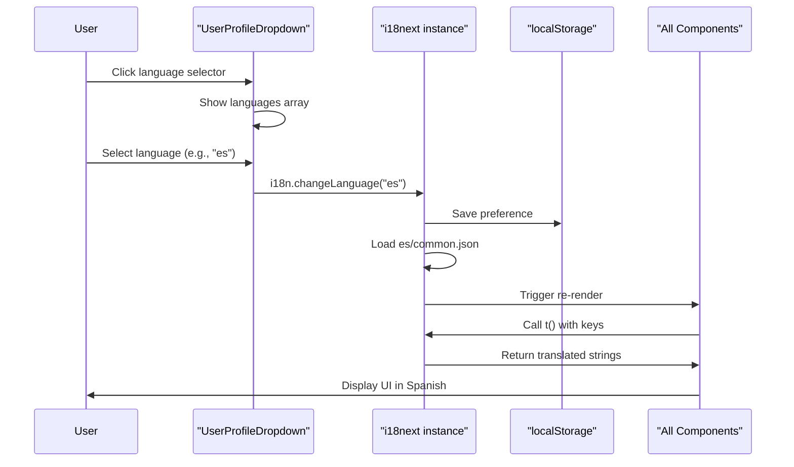

<!-- source: DeepWiki mcp.deepwiki.com · repo kubestellar/console · page 9 Localization System · fetched 2026-10-26 -->

# Localization System

<details>
<summary>Relevant source files</summary>

The following files were used as context for generating this wiki page:

- [web/src/components/layout/UserProfileDropdown.tsx](web/src/components/layout/UserProfileDropdown.tsx)
- [web/src/locales/de/common.json](web/src/locales/de/common.json)
- [web/src/locales/en/common.json](web/src/locales/en/common.json)
- [web/src/locales/es/common.json](web/src/locales/es/common.json)
- [web/src/locales/fr/common.json](web/src/locales/fr/common.json)
- [web/src/locales/hi/common.json](web/src/locales/hi/common.json)
- [web/src/locales/it/common.json](web/src/locales/it/common.json)
- [web/src/locales/ja/common.json](web/src/locales/ja/common.json)
- [web/src/locales/pt/common.json](web/src/locales/pt/common.json)
- [web/src/locales/zh/common.json](web/src/locales/zh/common.json)

</details>


The KubeStellar Console implements a comprehensive internationalization (i18n) system that supports 9 languages with over 1,500 translation keys organized by functional domain. The system uses react-i18next for runtime translation management and supports advanced features including interpolation, pluralization, and context-specific translations.

**Related Pages:** For information about the Settings System where language preferences are managed, see [Settings System](#10).

---

## Translation File Architecture

Translation files are stored in JSON format at [web/src/locales/{lang}/common.json](). Each language has an identical key structure to ensure translation completeness and consistency across all supported locales.

```mermaid
graph TB
    subgraph "Translation File Structure"
        LocalesDir["web/src/locales/"]
        
        EnFile["en/common.json<br/>(English - Base)"]
        EsFile["es/common.json<br/>(Spanish)"]
        DeFile["de/common.json<br/>(German)"]
        FrFile["fr/common.json<br/>(French)"]
        ItFile["it/common.json<br/>(Italian)"]
        PtFile["pt/common.json<br/>(Portuguese)"]
        JaFile["ja/common.json<br/>(Japanese)"]
        ZhFile["zh/common.json<br/>(Chinese)"]
        HiFile["hi/common.json<br/>(Hindi)"]
        
        LocalesDir --> EnFile
        LocalesDir --> EsFile
        LocalesDir --> DeFile
        LocalesDir --> FrFile
        LocalesDir --> ItFile
        LocalesDir --> PtFile
        LocalesDir --> JaFile
        LocalesDir --> ZhFile
        LocalesDir --> HiFile
    end
    
    subgraph "i18n Configuration"
        I18nLib["web/src/lib/i18n.ts"]
        LanguagesArray["languages array"]
        I18nInstance["i18next instance"]
        
        I18nLib --> LanguagesArray
        I18nLib --> I18nInstance
    end
    
    EnFile -.loaded by.-> I18nInstance
    EsFile -.loaded by.-> I18nInstance
    DeFile -.loaded by.-> I18nInstance
    FrFile -.loaded by.-> I18nInstance
    ItFile -.loaded by.-> I18nInstance
    PtFile -.loaded by.-> I18nInstance
    JaFile -.loaded by.-> I18nInstance
    ZhFile -.loaded by.-> I18nInstance
    HiFile -.loaded by.-> I18nInstance
```



**Sources:** [web/src/locales/en/common.json](), [web/src/locales/es/common.json](), [web/src/locales/de/common.json](), [web/src/locales/fr/common.json](), [web/src/locales/it/common.json](), [web/src/locales/pt/common.json](), [web/src/locales/ja/common.json](), [web/src/locales/zh/common.json](), [web/src/locales/hi/common.json]()

---

## Translation Key Organization

Translation keys are organized hierarchically by functional domain. This structure enables component-scoped translations and makes it easy to locate specific strings.

### Primary Translation Domains

| Domain | Purpose | Example Keys | Line Reference |
|--------|---------|--------------|----------------|
| `navigation` | Top-level navigation menu items | `dashboard`, `clusters`, `applications`, `events`, `security`, `gitops`, `history`, `settings` | [web/src/locales/en/common.json:2-11]() |
| `actions` | Common action verbs | `add`, `remove`, `edit`, `save`, `cancel`, `close`, `refresh`, `configure`, `delete`, `copy`, `apply` | [web/src/locales/en/common.json:12-37]() |
| `buttons` | Button-specific labels | `addCard`, `templates`, `customize`, `snoozeHour`, `swapNow`, `replaceCard` | [web/src/locales/en/common.json:38-49]() |
| `labels` | Generic UI labels | `loading`, `noData`, `clusterStatus`, `healthy`, `unhealthy`, `offline`, `warning`, `critical` | [web/src/locales/en/common.json:50-62]() |
| `time` | Time-relative strings | `justNow`, `minutesAgo`, `hoursAgo`, `daysAgo`, `never` | [web/src/locales/en/common.json:63-78]() |
| `sidebar` | Sidebar UI elements | `snoozedCards`, `customizer`, `activeViewers` | [web/src/locales/en/common.json:79-143]() |
| `settings` | Settings page content | `title`, `subtitle`, `appearance`, `accessibility`, `analytics`, `nav`, `aiMode`, `agent`, `tokens`, `github`, `predictions`, `profile`, `notifications`, `persistence`, `localClusters`, `backup`, `permissions`, `widget`, `updates`, `theme` | [web/src/locales/en/common.json:144-562]() |
| `dashboard` | Dashboard-specific UI | `actions`, `welcome`, `missions`, `recommendations`, `reset`, `create`, `templates`, `addCard`, `configure`, `replace` | [web/src/locales/en/common.json:636-906]() |
| `cards` | Card type metadata | `clusterHealth`, `eventTimeline`, `gpuStatus`, `helmReleases`, `podStatus`, and 80+ card types | [web/src/locales/en/common.json:907-1683]() |

### Nested Structure Example

Translation keys use dot notation for nested access:

```json
{
  "settings": {
    "agent": {
      "title": "Local Agent",
      "subtitle": "Connect to your local kubeconfig and Claude Code",
      "connected": "Connected",
      "notConnected": "Not Connected",
      "agentVersion": "Agent v{{version}}",
      "clustersCount": "{{count}} clusters",
      "clustersCount_one": "{{count}} cluster",
      "clustersCount_other": "{{count}} clusters"
    }
  }
}
```

Components access these via: `t('settings.agent.title')`, `t('settings.agent.connected')`, etc.

**Sources:** [web/src/locales/en/common.json:1-2200]()

---

## Supported Languages

The console supports 9 languages with complete translation coverage. Language metadata is defined in the `languages` array.

### Language Configuration



### Language List

| Code | Name | Flag | File Path |
|------|------|------|-----------|
| `en` | English | 🇺🇸 | `web/src/locales/en/common.json` |
| `es` | Español | 🇪🇸 | `web/src/locales/es/common.json` |
| `fr` | Français | 🇫🇷 | `web/src/locales/fr/common.json` |
| `de` | Deutsch | 🇩🇪 | `web/src/locales/de/common.json` |
| `it` | Italiano | 🇮🇹 | `web/src/locales/it/common.json` |
| `pt` | Português | 🇵🇹 | `web/src/locales/pt/common.json` |
| `zh` | 中文 | 🇨🇳 | `web/src/locales/zh/common.json` |
| `ja` | 日本語 | 🇯🇵 | `web/src/locales/ja/common.json` |
| `hi` | हिन्दी | 🇮🇳 | `web/src/locales/hi/common.json` |

**Sources:** [web/src/components/layout/UserProfileDropdown.tsx:7]()

---

## Language Selection Mechanism

Users select their preferred language through a dropdown in the user profile menu. The selection is persisted to localStorage and applied globally via the i18next instance.



### Language Selection Implementation

The language selector is implemented in the `UserProfileDropdown` component:

**Language Retrieval:**
```typescript
// Get current language metadata
const currentLanguage = languages.find(l => l.code === i18n.language) || languages[0]
```
[web/src/components/layout/UserProfileDropdown.tsx:43]()

**Language Change Handler:**
```typescript
const handleLanguageChange = (langCode: string) => {
  i18n.changeLanguage(langCode)
  setShowLanguageSubmenu(false)
}
```
[web/src/components/layout/UserProfileDropdown.tsx:45-48]()

**Language Selector UI:**
The dropdown displays all available languages with their flags and checks the currently selected one:
[web/src/components/layout/UserProfileDropdown.tsx:179-213]()

### Component Translation Usage

Components access translations via the `useTranslation` hook from react-i18next:

```typescript
import { useTranslation } from 'react-i18next'

function MyComponent() {
  const { t, i18n } = useTranslation()
  
  return (
    <div>
      <h1>{t('navigation.dashboard')}</h1>
      <button>{t('actions.save')}</button>
      <p>{t('settings.agent.agentVersion', { version: '1.2.3' })}</p>
    </div>
  )
}
```

**Sources:** [web/src/components/layout/UserProfileDropdown.tsx:2](), [web/src/components/layout/UserProfileDropdown.tsx:41](), [web/src/components/layout/UserProfileDropdown.tsx:43-48](), [web/src/components/layout/UserProfileDropdown.tsx:179-213]()

---

## Translation Features

### Variable Interpolation

Translations support dynamic values via double-curly-brace syntax:

```json
{
  "settings": {
    "agent": {
      "agentVersion": "Agent v{{version}}",
      "clustersCount": "{{count}} clusters"
    }
  }
}
```

Usage in components:
```typescript
t('settings.agent.agentVersion', { version: '1.2.3' })
// Output: "Agent v1.2.3"

t('settings.agent.clustersCount', { count: 5 })
// Output: "5 clusters"
```

**Sources:** [web/src/locales/en/common.json:229](), [web/src/locales/en/common.json:231]()

### Pluralization

i18next automatically handles plural forms using `_one` and `_other` suffixes:

```json
{
  "time": {
    "minutesAgo": "{{count}}m ago",
    "minutesAgo_one": "{{count}}m ago",
    "minutesAgo_other": "{{count}}m ago"
  },
  "settings": {
    "agent": {
      "clustersCount": "{{count}} clusters",
      "clustersCount_one": "{{count}} cluster",
      "clustersCount_other": "{{count}} clusters"
    }
  }
}
```

Usage:
```typescript
t('settings.agent.clustersCount', { count: 1 })
// Output: "1 cluster"

t('settings.agent.clustersCount', { count: 5 })
// Output: "5 clusters"
```

The system automatically selects the correct plural form based on the `count` variable.

**Sources:** [web/src/locales/en/common.json:66-68](), [web/src/locales/en/common.json:231-233]()

### Context and Formatting

Translations support context-specific variations and can include formatting hints:

```json
{
  "sidebar": {
    "activeViewers_one": "{{count}} active viewer",
    "activeViewers_other": "{{count}} active viewers"
  },
  "dashboard": {
    "missions": {
      "critical_one": "{{count}} critical",
      "critical_other": "{{count}} critical"
    }
  }
}
```

**Sources:** [web/src/locales/en/common.json:93-94](), [web/src/locales/en/common.json:680-682]()

---

## Adding New Translations

### Adding a New Language

To add a new language to the console:

1. **Create translation file**: Copy `web/src/locales/en/common.json` to `web/src/locales/{newLangCode}/common.json`

2. **Translate all keys**: Maintain the exact JSON structure, translating only the values:
   ```json
   {
     "navigation": {
       "dashboard": "Tableau de bord",  // French translation
       "clusters": "Mes clusters"
     }
   }
   ```

3. **Register language**: Add language metadata to the `languages` array in `web/src/lib/i18n.ts`:
   ```typescript
   export const languages = [
     { code: 'en', name: 'English', flag: '🇺🇸' },
     { code: 'fr', name: 'Français', flag: '🇫🇷' },
     // Add new language here
     { code: 'ko', name: '한국어', flag: '🇰🇷' }
   ]
   ```

4. **Import translations**: Add import statement in i18n configuration:
   ```typescript
   import koTranslations from './locales/ko/common.json'
   ```

5. **Register with i18next**: Add resource to i18next initialization:
   ```typescript
   i18n.init({
     resources: {
       en: { translation: enTranslations },
       ko: { translation: koTranslations }  // Add here
     }
   })
   ```

### Adding New Translation Keys

When adding new UI features, follow this workflow:

1. **Add to base language** (`en/common.json`):
   ```json
   {
     "newFeature": {
       "title": "New Feature",
       "description": "This is a new feature",
       "action": "Try it now"
     }
   }
   ```

2. **Add to all other language files**: Copy the structure to all 8 other language files and translate

3. **Verify consistency**: Ensure the key path is identical across all languages:
   ```bash
   # All files should have same structure
   web/src/locales/en/common.json
   web/src/locales/es/common.json
   web/src/locales/de/common.json
   # ... etc
   ```

4. **Use in component**:
   ```typescript
   const { t } = useTranslation()
   return <h1>{t('newFeature.title')}</h1>
   ```

### Translation Key Naming Conventions

- **Use camelCase** for key names: `agentVersion`, not `agent-version` or `agent_version`
- **Nest by feature domain**: Group related translations under feature keys
- **Include context in nested keys**: `settings.agent.connected` is clearer than `settings.connected`
- **Separate singular/plural**: Use `_one` and `_other` suffixes for pluralization
- **Keep keys stable**: Avoid renaming keys as it requires updating all 9 language files

### Maintaining Translation Coverage

To verify translation completeness:

1. **JSON structure validation**: All language files must have identical key structures
2. **Missing key detection**: i18next will fall back to the key name if translation is missing
3. **Interpolation variables**: Ensure variable names (like `{{count}}`, `{{version}}`) are consistent

**File Structure Reference:**
```
web/src/locales/
├── en/common.json (base language, 2200+ lines)
├── es/common.json (Spanish)
├── fr/common.json (French)
├── de/common.json (German)
├── it/common.json (Italian)
├── pt/common.json (Portuguese)
├── ja/common.json (Japanese)
├── zh/common.json (Chinese)
└── hi/common.json (Hindi)
```

**Sources:** [web/src/locales/en/common.json:1-2200](), [web/src/locales/es/common.json:1-2200](), [web/src/locales/de/common.json:1-2200](), [web/src/locales/fr/common.json:1-2200](), [web/src/locales/it/common.json:1-2200](), [web/src/locales/pt/common.json:1-2200](), [web/src/locales/ja/common.json:1-2200](), [web/src/locales/zh/common.json:1-2200](), [web/src/locales/hi/common.json:1-2200]()

---

