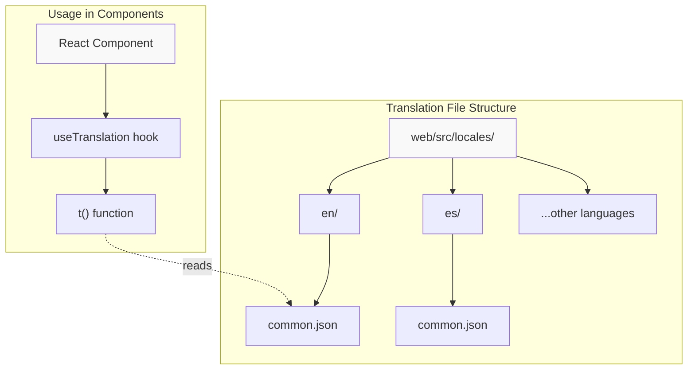
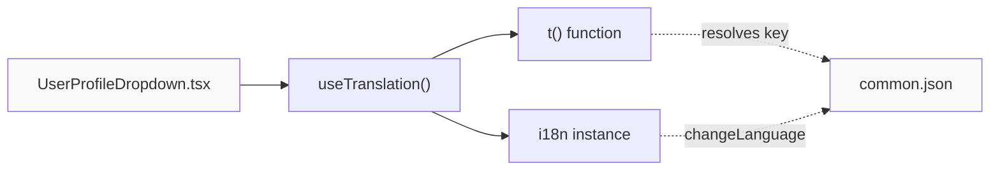
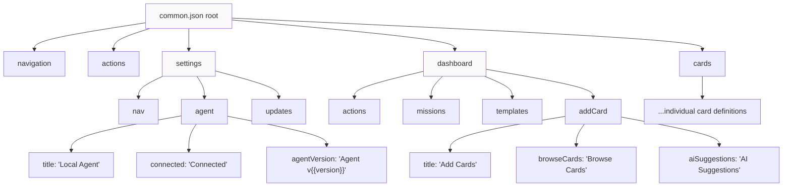

<!-- source: DeepWiki mcp.deepwiki.com · repo kubestellar/console · page 9.1 Translation Structure · fetched 2026-10-26 -->

# Translation Structure

<details>
<summary>Relevant source files</summary>

The following files were used as context for generating this wiki page:

- [web/src/components/layout/UserProfileDropdown.tsx](web/src/components/layout/UserProfileDropdown.tsx)
- [web/src/locales/de/common.json](web/src/locales/de/common.json)
- [web/src/locales/en/common.json](web/src/locales/en/common.json)
- [web/src/locales/es/common.json](web/src/locales/es/common.json)
- [web/src/locales/fr/common.json](web/src/locales/fr/common.json)
- [web/src/locales/hi/common.json](web/src/locales/hi/common.json)
- [web/src/locales/it/common.json](web/src/locales/it/common.json)
- [web/src/locales/ja/common.json](web/src/locales/ja/common.json)
- [web/src/locales/pt/common.json](web/src/locales/pt/common.json)
- [web/src/locales/zh/common.json](web/src/locales/zh/common.json)

</details>


This document explains how translation keys are organized in the KubeStellar Console's internationalization (i18n) system. Translation strings are grouped by functional domain (navigation, actions, settings, cards, etc.) within JSON files for each supported language. For information about supported languages and language selection, see [Supported Languages](#9.2). For guidance on adding new translations, see [Adding New Translations](#9.3).

## File Organization

Translation files are stored in `web/src/locales/{language}/common.json`, where `{language}` is a two-letter ISO language code. Each language maintains an identical key structure to ensure consistency across localizations.



**Sources:** [web/src/locales/en/common.json:1-5000](), [web/src/components/layout/UserProfileDropdown.tsx:1-42]()

## Top-Level Domain Structure

Translation keys are organized into top-level domains that group related strings by functional area. Each domain is a top-level object key in the JSON structure.

| Domain | Purpose | Example Keys |
|--------|---------|--------------|
| `navigation` | Main navigation menu items | `dashboard`, `clusters`, `applications` |
| `actions` | Common action verbs and commands | `add`, `remove`, `edit`, `save`, `cancel` |
| `buttons` | Button-specific labels | `addCard`, `templates`, `customize` |
| `labels` | General UI labels and status text | `loading`, `healthy`, `offline`, `warning` |
| `time` | Time-related formatting strings | `justNow`, `minutesAgo`, `hoursAgo` |
| `sidebar` | Sidebar-specific UI elements | `snoozedCards`, `customizer` |
| `settings` | All settings-related strings | `title`, `appearance`, `aiMode`, `agent` |
| `filters` | Filtering UI elements | `allClusters`, `clusterFilter` |
| `profile` | User profile information labels | `email`, `slack`, `role`, `coins` |
| `developer` | Developer mode strings | `oauthConfigured`, `setupInstructions` |
| `language` | Language selection UI | `select` |
| `gpu` | GPU-specific messages | `noPendingRequests` |
| `gitops` | GitOps-related strings | `synced`, `drifted`, `applications` |
| `dashboard` | Dashboard UI strings | `title`, `actions`, `missions`, `templates` |
| `feedback` | Feedback and feature request UI | `feedback`, `bugReport`, `featureRequest` |
| `cards` | Card-specific labels and descriptions | Individual card names and descriptions |
| `errors` | Error messages | `generic`, `network`, `authentication` |
| `notifications` | Notification messages | `success`, `warning`, `error` |
| `missions` | Mission/task-related strings | `actions`, `repair`, `dismiss` |
| `nightly` | Nightly build monitoring | `status`, `failures`, `diagnosis` |

**Sources:** [web/src/locales/en/common.json:1-1200]()

## Nested Domain Structure

Many domains contain nested sub-domains for better organization. The `settings` domain demonstrates this pattern extensively:

```mermaid
graph TD
    Settings["settings"]
    
    Settings --> Title["title"]
    Settings --> Subtitle["subtitle"]
    Settings --> Groups["groups"]
    Settings --> Nav["nav"]
    Settings --> SyncStatus["syncStatus"]
    Settings --> AIMode["aiMode"]
    Settings --> APIKeys["apiKeys"]
    Settings --> Agent["agent"]
    Settings --> Tokens["tokens"]
    Settings --> GitHub["github"]
    Settings --> Predictions["predictions"]
    Settings --> Profile["profile"]
    Settings --> Notifications["notifications"]
    Settings --> Persistence["persistence"]
    Settings --> LocalClusters["localClusters"]
    Settings --> Backup["backup"]
    Settings --> Permissions["permissions"]
    Settings --> Widget["widget"]
    Settings --> Updates["updates"]
    Settings --> Theme["theme"]
    Settings --> Appearance["appearance"]
    Settings --> Accessibility["accessibility"]
    Settings --> Analytics["analytics"]
    
    Groups --> AIIntelligence["aiIntelligence"]
    Groups --> Integrations["integrations"]
    Groups --> UserAlerts["userAlerts"]
    Groups --> AppearanceGroup["appearance"]
    Groups --> Utilities["utilities"]
    
    Nav --> NavAIMode["aiMode"]
    Nav --> NavPredictions["predictions"]
    Nav --> NavLocalAgent["localAgent"]
    Nav --> NavAPIKeys["apiKeys"]
    
    Agent --> AgentTitle["title"]
    Agent --> AgentSubtitle["subtitle"]
    Agent --> AgentConnected["connected"]
    Agent --> AgentNotConnected["notConnected"]
    Agent --> ClustersCount["clustersCount"]
    Agent --> ClaudeAvailable["claudeAvailable"]
    
    style Settings fill:#f9f9f9
    style Groups fill:#f9f9f9
    style Nav fill:#f9f9f9
    style Agent fill:#f9f9f9
```



**Sources:** [web/src/locales/en/common.json:144-561]()

## Key Naming Conventions

Translation keys follow consistent naming patterns:

### Camel Case Naming

All keys use camelCase format:
```json
{
  "navigation": {
    "dashboard": "Dashboard",
    "clusters": "My Clusters",
    "applications": "Applications"
  }
}
```

### Descriptive Key Names

Keys describe the content or context, not the UI position:
```json
{
  "actions": {
    "add": "Add",
    "remove": "Remove",
    "viewDetails": "View Details"
  }
}
```

### Grouped by Feature

Related strings are grouped in nested objects:
```json
{
  "settings": {
    "agent": {
      "title": "Local Agent",
      "connected": "Connected",
      "notConnected": "Not Connected",
      "agentVersion": "Agent v{{version}}"
    }
  }
}
```

**Sources:** [web/src/locales/en/common.json:1-100]()

## Pluralization Support

The i18n system supports pluralization using the ICU message format with `_one` and `_other` suffixes:

```json
{
  "time": {
    "minutesAgo_one": "{{count}} minute ago",
    "minutesAgo_other": "{{count}} minutes ago",
    "hoursAgo_one": "{{count}} hour ago",
    "hoursAgo_other": "{{count}} hours ago"
  },
  "sidebar": {
    "customizer": {
      "cardsCount_one": "{{count}} card",
      "cardsCount_other": "{{count}} cards",
      "dashboardsSelected_one": "{{count}} dashboard{{plural}} selected",
      "dashboardsSelected_other": "{{count}} dashboard{{plural}} selected"
    }
  }
}
```

The system automatically selects the correct plural form based on the `count` variable passed to the translation function.

**Sources:** [web/src/locales/en/common.json:63-77](), [web/src/locales/en/common.json:126-134]()

## Variable Interpolation

Translation strings support variable interpolation using double curly braces `{{variableName}}`:

```json
{
  "labels": {
    "swappingTo": "Swapping to \"{{cardName}}\" in 30s"
  },
  "sidebar": {
    "snoozeExpires": "Expires {{time}}"
  },
  "settings": {
    "agent": {
      "agentVersion": "Agent v{{version}}",
      "clustersCount": "{{count}} clusters"
    },
    "updates": {
      "devVersion": "Running development version. Set {{envVar}} to test update detection.",
      "recentCommits": "{{count}} new commit(s) on main"
    }
  }
}
```

Variables can be combined with pluralization:
```json
{
  "dashboard": {
    "demoData": {
      "description_one": "{{count}} card displaying simulated data.",
      "description_other": "{{count}} cards displaying simulated data."
    }
  }
}
```

**Sources:** [web/src/locales/en/common.json:61](), [web/src/locales/en/common.json:82](), [web/src/locales/en/common.json:229-233]()

## Usage in React Components

Components access translations using the `useTranslation` hook from `react-i18next`:



**Example Usage:**
[web/src/components/layout/UserProfileDropdown.tsx:41-43]()
```typescript
const { t, i18n } = useTranslation()
```

Accessing translation keys:
[web/src/components/layout/UserProfileDropdown.tsx:137-148]()
```typescript
<p className="text-sm text-muted-foreground">
  {user.email || t('profile.noEmail')}
</p>
```

Nested key access:
[web/src/components/layout/UserProfileDropdown.tsx:224]()
```typescript
<span className="text-foreground">{t('developer.title')}</span>
```

Variable interpolation:
[web/src/components/layout/UserProfileDropdown.tsx:235]()
```typescript
{__APP_VERSION__.startsWith('v') ? __APP_VERSION__ : `v${__APP_VERSION__}`}
```

Language switching:
[web/src/components/layout/UserProfileDropdown.tsx:45-48]()
```typescript
const handleLanguageChange = (langCode: string) => {
  i18n.changeLanguage(langCode)
  setShowLanguageSubmenu(false)
}
```

**Sources:** [web/src/components/layout/UserProfileDropdown.tsx:1-415]()

## Special Domain Structures

### Dashboard Domain

The `dashboard` domain has extensive nested structures for different dashboard features:

```json
{
  "dashboard": {
    "title": "Dashboard",
    "actions": {
      "import": "Import",
      "export": "Export",
      "reset": "Reset"
    },
    "welcome": {
      "gettingStarted": "Getting Started",
      "step1Title": "Console is running"
    },
    "missions": {
      "actions": "Actions:",
      "repair": "Repair",
      "dismiss": "Dismiss"
    },
    "recommendations": {
      "addCard": "Add \"{{title}}\" card to dashboard"
    },
    "templates": {
      "title": "Dashboard Templates",
      "layoutPreview": "Layout Preview"
    },
    "addCard": {
      "title": "Add Cards",
      "browseCards": "Browse Cards",
      "aiSuggestions": "AI Suggestions"
    }
  }
}
```

**Sources:** [web/src/locales/en/common.json:636-824]()

### Settings Domain

The `settings` domain is the largest, containing configuration strings for all settings panels:

| Sub-domain | Purpose | Key Count |
|------------|---------|-----------|
| `appearance` | Theme and visual settings | ~10 |
| `accessibility` | Accessibility features | ~10 |
| `analytics` | Usage analytics | ~5 |
| `nav` | Settings navigation | ~17 |
| `aiMode` | AI usage configuration | ~10 |
| `agent` | Local agent settings | ~20 |
| `tokens` | Token usage limits | ~10 |
| `github` | GitHub integration | ~20 |
| `predictions` | AI prediction settings | ~30 |
| `notifications` | Alert channels | ~25 |
| `persistence` | Deploy persistence | ~20 |
| `localClusters` | Local cluster management | ~15 |
| `backup` | Backup and sync | ~15 |
| `updates` | System updates | ~60 |
| `widget` | Desktop widget | ~20 |

**Sources:** [web/src/locales/en/common.json:144-561]()

### Sidebar Customizer Sub-domain

The `sidebar.customizer` sub-domain demonstrates deep nesting:

```json
{
  "sidebar": {
    "customizer": {
      "title": "Customize Sidebar",
      "description": "Add, remove, or reorder menu items",
      "primaryNavigation": "Primary Navigation",
      "secondaryNavigation": "Secondary Navigation",
      "dashboardCards": "Dashboard Cards",
      "cardsCount_one": "{{count}} card",
      "cardsCount_other": "{{count}} cards",
      "analyzed_one": "Analyzed {{count}} page visit.",
      "analyzed_other": "Analyzed {{count}} page visits."
    }
  }
}
```

**Sources:** [web/src/locales/en/common.json:95-142]()

## Translation Key Hierarchy



**Sources:** [web/src/locales/en/common.json:1-2000]()

## Cards Domain Structure

The `cards` domain contains translations for all dashboard cards. Each card has a standardized structure:

```json
{
  "cards": {
    "cardName": {
      "title": "Card Title",
      "description": "Card description for selection modal",
      "emptyState": "Message when no data available",
      "error": "Error message if data fetch fails",
      "labels": {
        "specific": "Card-specific labels"
      }
    }
  }
}
```

**Example card translations:**
```json
{
  "cards": {
    "clusterHealth": {
      "title": "Cluster Health",
      "description": "Real-time health status of all clusters",
      "allHealthy": "All clusters healthy",
      "issuesDetected": "{{count}} issue(s) detected"
    }
  }
}
```

**Sources:** [web/src/locales/en/common.json:1500-2500]()

## Consistency Requirements

All language files must maintain identical key structures. Missing keys in any language will fall back to the English translation. The structure enforces:

1. **Identical key paths** across all languages
2. **Same variable placeholders** in interpolated strings
3. **Matching pluralization keys** (`_one` and `_other`)
4. **Consistent nesting depth** for all domains

This structural consistency enables seamless language switching without UI layout changes or missing translations.

**Sources:** [web/src/locales/en/common.json:1-5000](), [web/src/locales/es/common.json:1-5000](), [web/src/locales/de/common.json:1-5000]()

---

