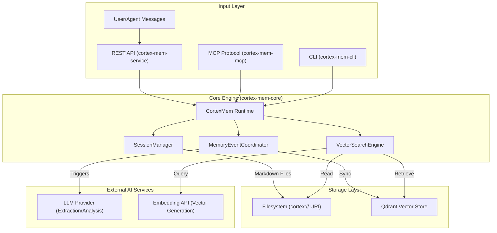
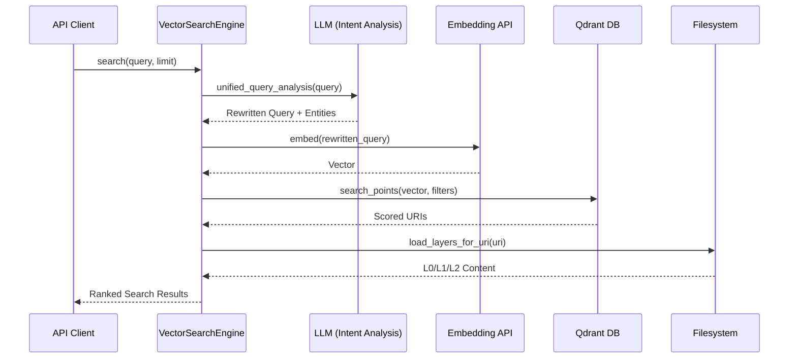
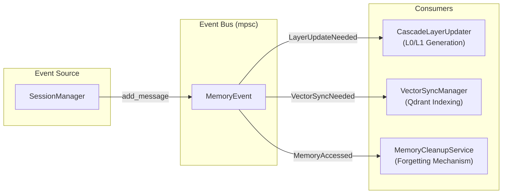

<!-- source: DeepWiki mcp.deepwiki.com · repo sopaco/cortex-mem · page 1.1 System Architecture · fetched 2026-10-26 -->

# System Architecture

Relevant source files

The following files were used as context for generating this wiki page:

- [Cargo.toml](Cargo.toml)
- [README.md](README.md)
- [README_zh.md](README_zh.md)
- [cortex-mem-config/Cargo.toml](cortex-mem-config/Cargo.toml)
- [cortex-mem-core/Cargo.toml](cortex-mem-core/Cargo.toml)
- [cortex-mem-core/src/incremental_memory_updater.rs](cortex-mem-core/src/incremental_memory_updater.rs)
- [cortex-mem-core/src/llm/prompts.rs](cortex-mem-core/src/llm/prompts.rs)
- [cortex-mem-core/src/search/vector_engine.rs](cortex-mem-core/src/search/vector_engine.rs)
- [cortex-mem-mcp/Cargo.toml](cortex-mem-mcp/Cargo.toml)
- [cortex-mem-rig/Cargo.toml](cortex-mem-rig/Cargo.toml)
- [cortex-mem-service/Cargo.toml](cortex-mem-service/Cargo.toml)
- [cortex-mem-service/src/handlers/automation.rs](cortex-mem-service/src/handlers/automation.rs)
- [cortex-mem-service/src/handlers/search.rs](cortex-mem-service/src/handlers/search.rs)
- [cortex-mem-service/src/handlers/sessions.rs](cortex-mem-service/src/handlers/sessions.rs)
- [cortex-mem-service/src/routes/automation.rs](cortex-mem-service/src/routes/automation.rs)
- [cortex-mem-service/src/state.rs](cortex-mem-service/src/state.rs)
- [cortex-mem-tools/Cargo.toml](cortex-mem-tools/Cargo.toml)
- [examples/@memclaw/bin-darwin-arm64/bin/README.md](examples/@memclaw/bin-darwin-arm64/bin/README.md)
- [examples/cortex-mem-tars/config.example.toml](examples/cortex-mem-tars/config.example.toml)
- [examples/locomo-evaluation/eval.py](examples/locomo-evaluation/eval.py)
- [litho.docs/en/2.Architecture.md](litho.docs/en/2.Architecture.md)
- [litho.docs/en/3.Workflow.md](litho.docs/en/3.Workflow.md)
- [litho.docs/en/4.Deep-Exploration/Core Infrastructure Domain.md](litho.docs/en/4.Deep-Exploration/Core Infrastructure Domain.md)
- [litho.docs/en/4.Deep-Exploration/Extraction Engine Domain.md](litho.docs/en/4.Deep-Exploration/Extraction Engine Domain.md)
- [litho.docs/en/4.Deep-Exploration/Search Engine Domain.md](litho.docs/en/4.Deep-Exploration/Search Engine Domain.md)

## Purpose and Scope

This document explains the three-domain architecture of Cortex Memory (Configuration Domain, Core Memory Domain, Tool Support Domain) and how components interact through a modular monolith pattern. The system provides a unified core library (`cortex-mem-core`) accessed through multiple interface layers including a REST API, MCP Server, CLI, and the TARS TUI application.

Cortex Memory implements a **hierarchical three-tier memory architecture** (L0 Abstract → L1 Overview → L2 Detail) that optimizes LLM context usage while providing deep retrieval capabilities [README.md:27-32]().

## Three-Domain Architecture Pattern

The system is organized into three functional domains to separate infrastructure, logic, and presentation:

### 1. Configuration Domain
Provides centralized configuration management, loading settings from `config.toml` and `bots.json`. It handles validation and initialization parameters for the runtime [litho.docs/en/2.Architecture.md:178-185]().

**Key Components**:
- `cortex-mem-config`: Handles TOML configuration loading [Cargo.toml:5]().
- `AppState`: Manages the global state, loading configurations for LLM, embeddings, and Qdrant during service startup [cortex-mem-service/src/state.rs:43-54]().

### 2. Core Memory Domain
The intelligence layer containing all memory management logic. It orchestrates the memory pipeline including extraction, indexing, and search [README.md:148-153]().

**Key Components**:
- `CortexMem`: The central runtime engine built via `CortexMemBuilder` [cortex-mem-service/src/state.rs:134-152]().
- `SessionManager`: Manages conversation lifecycles and triggers extraction events [cortex-mem-service/src/state.rs:18-19]().
- `VectorSearchEngine`: Orchestrates layered (L0/L1/L2) semantic search [cortex-mem-core/src/search/vector_engine.rs:56-71]().
- `MemoryEventCoordinator`: An event-driven system that keeps memory layers in sync automatically [README.md:113-114]().

### 3. Tool Support Domain
Provides multiple access interfaces for different integration scenarios, all sharing the same core engine [litho.docs/en/2.Architecture.md:17-21]().

**Key Components**:
- `cortex-mem-service`: Axum-based REST API [Cargo.toml:8]().
- `cortex-mem-mcp`: Model Context Protocol server for AI agent integration [Cargo.toml:10]().
- `cortex-mem-cli`: Command-line interface for direct operations [Cargo.toml:9]().
- `cortex-mem-tars`: Multi-agent TUI application [Cargo.toml:11]().

**Sources**: [README.md:27-32](), [cortex-mem-service/src/state.rs:13-41](), [litho.docs/en/2.Architecture.md:11-32](), [Cargo.toml:1-12]()

## Modular Monolith Pattern

Cortex Memory follows a modular monolith architecture where a shared core library provides the "Source of Truth," while specialized crates provide interface-specific logic:

1.  **Shared Core (`cortex-mem-core`)**: Contains the `VectorStore` and `LLMClient` trait abstractions [cortex-mem-service/src/state.rs:1-6]().
2.  **Hybrid Persistence**: Combines a filesystem-based source of truth using the `cortex://` URI scheme with vector-based semantic search in Qdrant [README.md:31-32]().
3.  **Event-Driven Automation**: Uses a `MemoryEventCoordinator` to handle background tasks like L0/L1 generation and vector synchronization [cortex-mem-service/src/handlers/automation.rs:13-22]().

### System Architecture Overview

**Sources**: [README.md:138-184](), [cortex-mem-service/src/state.rs:77-91](), [litho.docs/en/2.Architecture.md:129-166]()

## Memory Hierarchy and Data Flow

Cortex Memory organizes information into three layers to optimize retrieval performance and cost [README.md:200-205]():

| Layer | Purpose | Content Type |
| :--- | :--- | :--- |
| **L0 (Abstract)** | Quick relevance checking | ~100 token concise summary |
| **L1 (Overview)** | Decision-making context | ~2K token structured markdown |
| **L2 (Detail)** | Full source of truth | Raw conversation or document |

### Semantic Search Data Flow

The `VectorSearchEngine` implements a multi-path retrieval strategy to maximize recall, especially for complex user queries [cortex-mem-service/src/handlers/search.rs:81-113]().

**Key Implementation Details**:
- **Intent Analysis**: The system uses `unified_query_analysis` to expand queries with synonyms and extract entities before embedding [cortex-mem-core/src/llm/prompts.rs:132-150]().
- **Layered Search**: The `layered_semantic_search` function prioritizes retrieval across the L0/L1/L2 hierarchy [cortex-mem-service/src/handlers/search.rs:81-84]().
- **Lexical Fallback**: If vector search yields insufficient results, the system falls back to a filesystem-based lexical scan [cortex-mem-service/src/handlers/search.rs:172-182]().

**Sources**: [cortex-mem-core/src/search/vector_engine.rs:56-71](), [cortex-mem-core/src/llm/prompts.rs:5-87](), [cortex-mem-service/src/handlers/search.rs:39-122](), [README.md:200-205]()

## Event-Driven Automation

The architecture relies on an asynchronous event bus to decouple heavy AI processing from the request-response cycle.

### Memory Update Pipeline

When a message is added to a session via `SessionManager::add_message`, the system triggers a chain of events [cortex-mem-service/src/handlers/sessions.rs:152-173]():

1.  **MessageAdded**: Dispatched by `SessionManager`.
2.  **LayerUpdateNeeded**: Emitted to `MemoryEventCoordinator` to regenerate L0/L1 summaries for the session timeline [cortex-mem-service/src/handlers/sessions.rs:185-191]().
3.  **VectorSyncNeeded**: Handled by `SyncManager` to ensure the new content is indexed in Qdrant [cortex-mem-service/src/state.rs:4-5]().

**Key Components**:
- **CascadeLayerUpdater**: Automatically keeps L0/L1 layers in sync as L2 (raw) memories change [README.md:113-114]().
- **MemoryCleanupService**: Implements the Ebbinghaus forgetting curve to archive or delete low-strength memories [README.md:115-116]().

**Sources**: [cortex-mem-service/src/handlers/sessions.rs:123-157](), [cortex-mem-service/src/state.rs:32-33](), [cortex-mem-service/src/handlers/automation.rs:13-22](), [README.md:113-116]()

---

