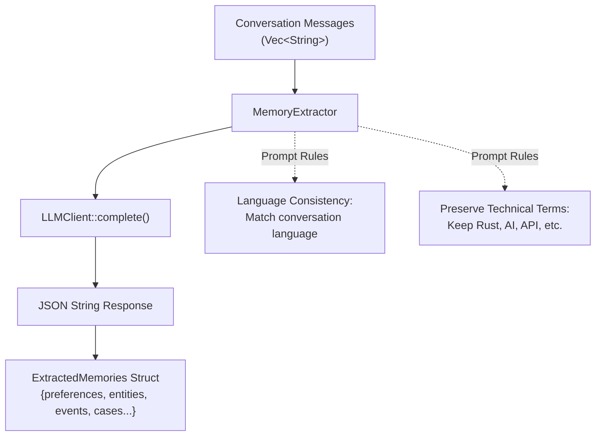
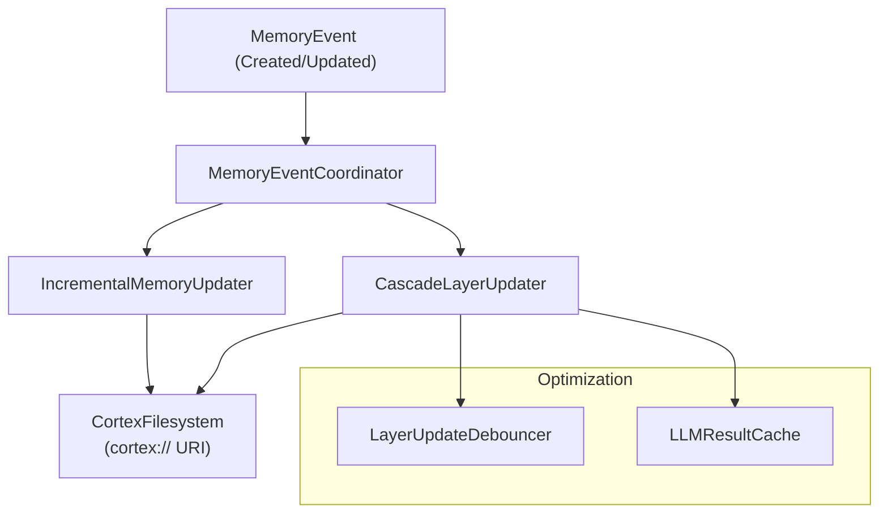
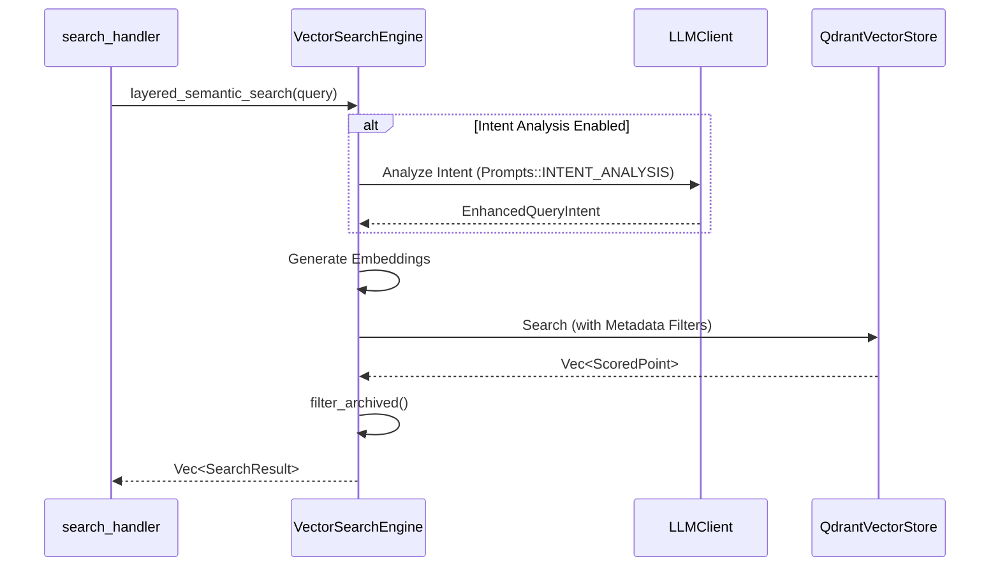

<!-- source: DeepWiki mcp.deepwiki.com · repo sopaco/cortex-mem · page 1.2 Key Features · fetched 2026-10-26 -->

# Key Features

Relevant source files

The following files were used as context for generating this wiki page:

- [README.md](README.md)
- [README_zh.md](README_zh.md)
- [cortex-mem-core/src/automation/indexer.rs](cortex-mem-core/src/automation/indexer.rs)
- [cortex-mem-core/src/automation/layer_generator.rs](cortex-mem-core/src/automation/layer_generator.rs)
- [cortex-mem-core/src/automation/manager.rs](cortex-mem-core/src/automation/manager.rs)
- [cortex-mem-core/src/automation/mod.rs](cortex-mem-core/src/automation/mod.rs)
- [cortex-mem-core/src/automation/sync.rs](cortex-mem-core/src/automation/sync.rs)
- [cortex-mem-core/src/cascade_layer_updater.rs](cortex-mem-core/src/cascade_layer_updater.rs)
- [cortex-mem-core/src/incremental_memory_updater.rs](cortex-mem-core/src/incremental_memory_updater.rs)
- [cortex-mem-core/src/layers/generator.rs](cortex-mem-core/src/layers/generator.rs)
- [cortex-mem-core/src/layers/manager.rs](cortex-mem-core/src/layers/manager.rs)
- [cortex-mem-core/src/llm/client.rs](cortex-mem-core/src/llm/client.rs)
- [cortex-mem-core/src/llm/prompts.rs](cortex-mem-core/src/llm/prompts.rs)
- [cortex-mem-core/src/memory_event_coordinator.rs](cortex-mem-core/src/memory_event_coordinator.rs)
- [cortex-mem-core/src/search/vector_engine.rs](cortex-mem-core/src/search/vector_engine.rs)
- [cortex-mem-core/src/session/extraction.rs](cortex-mem-core/src/session/extraction.rs)
- [cortex-mem-core/src/session/message.rs](cortex-mem-core/src/session/message.rs)
- [cortex-mem-core/src/types.rs](cortex-mem-core/src/types.rs)
- [cortex-mem-core/src/vector_store/qdrant.rs](cortex-mem-core/src/vector_store/qdrant.rs)
- [cortex-mem-service/src/handlers/automation.rs](cortex-mem-service/src/handlers/automation.rs)
- [cortex-mem-service/src/handlers/search.rs](cortex-mem-service/src/handlers/search.rs)
- [cortex-mem-service/src/handlers/sessions.rs](cortex-mem-service/src/handlers/sessions.rs)
- [cortex-mem-service/src/routes/automation.rs](cortex-mem-service/src/routes/automation.rs)
- [cortex-mem-service/src/state.rs](cortex-mem-service/src/state.rs)
- [examples/@memclaw/bin-darwin-arm64/bin/README.md](examples/@memclaw/bin-darwin-arm64/bin/README.md)
- [examples/locomo-evaluation/eval.py](examples/locomo-evaluation/eval.py)

This document provides a comprehensive overview of Cortex Memory's core capabilities, explaining how the system transforms unstructured conversations into intelligent, persistent memory. This page focuses on **what** the system can do and **how** it accomplishes these tasks through its modular architecture.

For architectural details about the three-domain pattern, see [System Architecture](#1.1). For deployment patterns and infrastructure setup, see [Deployment Guide](#9).

---

## Core Intelligence Features

Cortex Memory employs a suite of AI-powered modules that work in concert to process, classify, and optimize memory content. These capabilities are orchestrated by the `MemoryManager` (integrated within `CortexMem`) in the `cortex-mem-core` crate.

### Automatic Fact Extraction

The system automatically converts unstructured conversation text into discrete, structured facts using LLM-powered extraction. This process is handled by the `MemoryExtractor` module, which parses messages and produces `ExtractedMemories` objects containing categorized factual content.

**Fact Extraction Pipeline**

**Sources:** [cortex-mem-core/src/session/extraction.rs:143-200](), [README.md:106-107]()

**Key Characteristics:**
- **Categorized Extraction**: Automatically sorts info into `preferences`, `entities`, `events`, `cases`, `personal_info`, `work_history`, `relationships`, and `goals` [cortex-mem-core/src/session/extraction.rs:15-40]().
- **Language Awareness**: Mandates extraction in the same language as the conversation (e.g., Chinese conversation results in Chinese memories) [cortex-mem-core/src/session/extraction.rs:211-215]().
- **Confidence Scoring**: Each extracted item includes a `confidence` float to qualify the extraction quality [cortex-mem-core/src/session/extraction.rs:76-140]().

---

### Layered Memory Hierarchy (L0/L1/L2)

Cortex Memory implements a unique three-tier architecture to optimize LLM context window usage and retrieval precision.

| Layer | Type | Description | Implementation |
|-------|------|-------------|----------------|
| **L0** | **Abstract** | High-level summary of a directory/scope. | `CascadeLayerUpdater` [cortex-mem-core/src/cascade_layer_updater.rs]() |
| **L1** | **Overview** | Mid-level overview of specific memory files. | `CascadeLayerUpdater` [cortex-mem-core/src/cascade_layer_updater.rs]() |
| **L2** | **Detail** | The raw memory content or message. | `MessageStorage` / `Filesystem` [cortex-mem-core/src/session/message.rs]() |

**Incremental Update Data Flow**

**Sources:** [cortex-mem-core/src/memory_event_coordinator.rs:62-89](), [README.md:109-114]()

**Implementation Details:**
The `MemoryEventCoordinator` listens for filesystem changes and triggers the `CascadeLayerUpdater`. To prevent "token storms," a `LayerUpdateDebouncer` batches requests for the same directory (default 30s delay) [cortex-mem-core/src/memory_event_coordinator.rs:6-12]().

---

### Memory Forgetting Mechanism

To prevent storage bloat and maintain relevance, the system implements an automated cleanup service based on the **Ebbinghaus Forgetting Curve**.

**Forgetting Logic:**
- **Access Tracking**: Every time a memory is retrieved via `VectorSearchEngine`, a `MemoryAccessed` event is emitted [cortex-mem-core/src/search/vector_engine.rs:63-64]().
- **Cleanup Service**: The `MemoryCleanupService` periodically scans memories. Low-strength memories (those not accessed frequently) are automatically archived or deleted [README.md:115-116]().
- **Archived Filtering**: The `VectorSearchEngine` uses `MemoryIndexManager` to filter out archived memories from search results, ensuring they don't surface to the LLM [cortex-mem-core/src/search/vector_engine.rs:139-199]().

---

## Storage and Retrieval Architecture

Cortex Memory implements a hybrid search system combining vector similarity with intent analysis and metadata filtering.

### Vector-Based Semantic Search

The `VectorSearchEngine` orchestrates the retrieval process. It supports standard semantic search and a specialized "layered" search that navigates the L0/L1/L2 hierarchy.

**Search Implementation Flow**

**Sources:** [cortex-mem-core/src/search/vector_engine.rs:57-132](), [cortex-mem-service/src/handlers/search.rs:39-107]()

**Intent Analysis:**
When `enable_intent_analysis` is true (default), the engine calls the LLM to rewrite the query and tune similarity thresholds before hitting the vector store [cortex-mem-core/src/search/vector_engine.rs:67-71](). This reduces search latency from ~20s to <500ms when disabled [cortex-mem-core/src/search/vector_engine.rs:112-113]().

---

### Multi-Tenancy and Isolation

The system achieves isolation through **Tenant-Aware Collection Naming** and the **Virtual Filesystem (VFS)**.

- **Qdrant Isolation**: If a `tenant_id` is provided in `QdrantConfig`, the collection name is suffixed (e.g., `cortex_mem_tenant123`) [cortex-mem-core/src/vector_store/qdrant.rs:34-48]().
- **Filesystem Isolation**: The `AppState` manages a `current_tenant_root` path. All `cortex://` URIs are resolved relative to this tenant-specific directory [cortex-mem-service/src/state.rs:29-31]().
- **Runtime Rebuilding**: On a tenant switch, the `CortexMem` runtime is rebuilt atomically to ensure no "split-brain" state between the vector store and filesystem [cortex-mem-service/src/state.rs:15-17]().

---

## Multi-Interface Access

Cortex Memory is designed as a "modular monolith," exposing its core through various specialized interfaces.

### Service Interfaces

| Interface | Component | Purpose |
|-----------|-----------|---------|
| **REST API** | `cortex-mem-service` | Standard integration for web apps and external services [cortex-mem-service/src/handlers/search.rs]() |
| **MCP Server** | `cortex-mem-mcp` | Direct tool usage for AI agents (Claude, Cursor) [README.md:108]() |
| **CLI** | `cortex-mem-cli` | Administrative tasks and manual memory management [README.md:108]() |
| **Web Dashboard** | `cortex-mem-insights` | Visual monitoring, tenant management, and search visualization [README_zh.md:132]() |
| **TUI App** | `cortex-mem-tars` | Multi-agent terminal chat application with persistent memory [README.md:44-54]() |

### Event-Driven Automation

The `AutomationManager` and `MemoryEventCoordinator` provide background synchronization that keeps the system consistent across interfaces.

**Automation Responsibilities:**
- **L2 Indexing**: `AutomationManager` listens for `MessageAdded` events and triggers `VectorSyncNeeded` [cortex-mem-core/src/automation/manager.rs:37-51]().
- **Session Extraction**: Triggered via `trigger_extraction` endpoint, which sends a `SessionClosed` event handled by the coordinator [cortex-mem-service/src/handlers/automation.rs:23-40]().
- **Full Reindexing**: `VectorSyncManager` can perform a full scan of the `cortex://` filesystem to recover missing vector indices [cortex-mem-service/src/handlers/automation.rs:72-85]().

**Sources:** [cortex-mem-core/src/automation/manager.rs](), [cortex-mem-service/src/handlers/automation.rs]()

---

## Performance and Optimization

### LLM Result Caching
To minimize API costs and latency, the system implements an `LLMResultCache` with **LRU (Least Recently Used)** eviction and **TTL (Time To Live)** expiration [README.md:113](). This is primarily used by the `CascadeLayerUpdater` to avoid re-summarizing unchanged memory blocks [cortex-mem-core/src/memory_event_coordinator.rs:142-153]().

### Search Reranking
The `search_layered` function in the service layer performs a multi-stage retrieval:
1. **Layered Search**: High-level context retrieval.
2. **Semantic Search**: Detailed fact retrieval.
3. **Lexical Fallback**: Keyword-based search when vector results are sparse [cortex-mem-service/src/handlers/search.rs:170-182]().
4. **User-Scope Supplement**: Specifically targets `cortex://user` to ensure personal facts (preferences, identity) are never missed [cortex-mem-service/src/handlers/search.rs:150-168]().

**Sources:** [cortex-mem-service/src/handlers/search.rs](), [cortex-mem-core/src/search/vector_engine.rs]()

---

