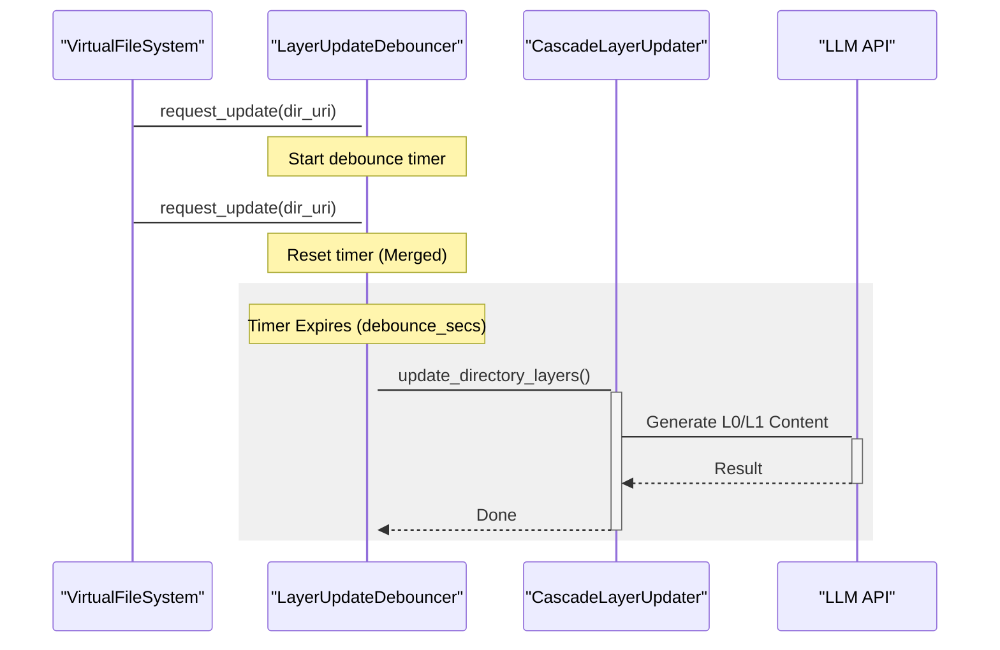
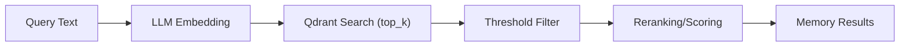

<!-- source: DeepWiki mcp.deepwiki.com · repo sopaco/cortex-mem · page 10.3 Performance Optimization · fetched 2026-10-26 -->

# Performance Optimization

<details>
<summary>Relevant source files</summary>

The following files were used as context for generating this wiki page:

- [cortex-mem-core/src/cascade_layer_debouncer.rs](cortex-mem-core/src/cascade_layer_debouncer.rs)
- [cortex-mem-core/src/llm_result_cache.rs](cortex-mem-core/src/llm_result_cache.rs)

</details>


This document provides technical guidance on optimizing the performance of Cortex Memory deployments. It covers configuration tuning, LLM call reduction via debouncing and caching, vector search parameters, and batch processing strategies to achieve optimal throughput and latency.

---

## 1. Overview

Cortex Memory's performance is primarily bound by external I/O: LLM API calls (embeddings/completions) and vector database operations in Qdrant. The system implements several advanced mechanisms to minimize these bottlenecks:

- **Request Debouncing**: Merging multiple filesystem or memory updates into single operations.
- **Result Caching**: Storing LLM-generated layer content to avoid redundant expensive calls.
- **Batch Processing**: Amortizing overhead across multiple embedding operations.
- **Vector Search Tuning**: Balancing precision and recall through similarity thresholds.

---

## 2. LLM Call Optimization

LLM calls are the most expensive part of the pipeline in terms of both latency (2-5 seconds) and cost. Cortex Memory uses two primary strategies to optimize this: debouncing and caching.

### 2.1 Cascade Layer Debouncing

The `LayerUpdateDebouncer` implements a "quiet period" strategy for directory updates. When multiple entities within a directory change rapidly, the system waits for activity to settle before regenerating the L0/L1 summary layers.



**Implementation Details:**
- **Debounce Window**: Controlled by `debounce_secs` (default 30s) [cortex-mem-core/src/cascade_layer_debouncer.rs:48]().
- **Force Update**: `max_delay_secs` (default 120s) ensures updates aren't delayed indefinitely by constant activity [cortex-mem-core/src/cascade_layer_debouncer.rs:49]().
- **Key Function**: `process_due_updates` filters pending requests where `since_last >= debounce_threshold` [cortex-mem-core/src/cascade_layer_debouncer.rs:128-146]().

**Sources:** [cortex-mem-core/src/cascade_layer_debouncer.rs:35-52](), [cortex-mem-core/src/cascade_layer_debouncer.rs:128-186]()

### 2.2 LLM Result Caching

The `LlmResultCache` provides an LRU (Least Recently Used) cache with TTL (Time-To-Live) for generated content. This is highly effective when the same set of entities is summarized repeatedly across different sessions.

| Feature | Implementation | Source |
|---------|----------------|--------|
| **Eviction** | LRU (Least Recently Used) | [cortex-mem-core/src/llm_result_cache.rs:215-234]() |
| **Expiration** | TTL-based (default 3600s) | [cortex-mem-core/src/llm_result_cache.rs:42]() |
| **Capacity** | Default 1000 entries | [cortex-mem-core/src/llm_result_cache.rs:41]() |

**Data Flow:**
1. Before calling the LLM, the system checks `LlmResultCache::get(key)` [cortex-mem-core/src/llm_result_cache.rs:149]().
2. If a hit occurs, `access_count` is incremented and the result is returned [cortex-mem-core/src/llm_result_cache.rs:172-182]().
3. On a miss, the LLM is called, and the result is stored via `LlmResultCache::put(key, content)` [cortex-mem-core/src/llm_result_cache.rs:192]().

**Sources:** [cortex-mem-core/src/llm_result_cache.rs:26-45](), [cortex-mem-core/src/llm_result_cache.rs:149-189]()

---

## 3. Embedding and Vector Store Tuning

### 3.1 Embedding Batch Configuration

The `EmbeddingConfig` controls how text is vectorized. Batching is critical for high-throughput ingestion.

```toml
[embedding]
batch_size = 100          # Number of texts per API call
timeout_secs = 30         # API timeout
```

**Tuning Impact:**
- **Latency**: Smaller batches (1-10) reduce the time to the first vector but increase total overhead.
- **Throughput**: Larger batches (100+) maximize tokens-per-second by minimizing HTTP handshake overhead.

**Sources:** [litho.docs/4.Deep-Exploration/Configuration Domain.md:84-90]()

### 3.2 Vector Search Parameters

Search performance and quality are balanced through the following parameters in `config.toml`:

| Parameter | Section | Role |
|-----------|---------|------|
| `max_search_results` | `[memory]` | Limits the `top_k` returned by Qdrant. [litho.docs/4.Deep-Exploration/Configuration Domain.md:93]() |
| `search_similarity_threshold` | `[memory]` | Filters results below this cosine similarity. [litho.docs/4.Deep-Exploration/Configuration Domain.md:94]() |
| `merge_threshold` | `[memory]` | Similarity required to trigger a duplicate merge. [litho.docs/4.Deep-Exploration/Configuration Domain.md:125]() |

**Search Execution Flow:**


**Sources:** [litho.docs/4.Deep-Exploration/Configuration Domain.md:93-135](), [litho.docs/4.Deep-Exploration/Core Memory Domain.md:212-222]()

---

## 4. Batch Processing Strategies

The system supports bulk operations, particularly useful during initial data ingestion or evaluation runs.

### 4.1 Memory Addition Batching

In the evaluation framework, messages are batched before processing to reduce the number of individual "add" requests.

```python
# From langmem_eval/add.py
def add_memories_for_speaker(self, speaker, messages, timestamp, desc):
    # Calculate total batches based on configured batch_size
    for i in range(0, len(messages), self.batch_size):
        batch_messages = messages[i : i + self.batch_size]
        # Concatenate content for single processing
        content = "\n".join([msg.get("content", "") for msg in batch_messages])
        self.add_memory(speaker, content, timestamp)
```

**Sources:** [examples/lomoco-evaluation/src/langmem_eval/add.py:36-37](), [examples/lomoco-evaluation/src/langmem_eval/add.py:256-283]()

### 4.2 Rate Limiting

To prevent `429 Too Many Requests` from LLM providers, a token-bucket-style rate limiter is used in client-side tools.

**Implementation:**
The `RateLimiter` ensures that the time between calls is at least `60 / max_calls_per_minute`. If a call is made too soon, the thread sleeps for the remaining duration.

**Sources:** [examples/lomoco-evaluation/src/langmem_eval/rate_limiter.py:10-52]()

---

## 5. Performance Monitoring and Benchmarking

### 5.1 Cache Statistics

The `LlmResultCache` tracks its own efficiency, which can be inspected to tune `max_entries` and `ttl_secs`.

| Metric | Description | Source |
|--------|-------------|--------|
| `lookups` | Total search attempts | [cortex-mem-core/src/llm_result_cache.rs:88]() |
| `hits` | Successful cache retrievals | [cortex-mem-core/src/llm_result_cache.rs:91]() |
| `evictions` | Entries removed due to LRU | [cortex-mem-core/src/llm_result_cache.rs:97]() |
| `expirations` | Entries removed due to TTL | [cortex-mem-core/src/llm_result_cache.rs:100]() |

### 5.2 Evaluation Framework

The `lomoco-evaluation` framework provides the standard way to measure system performance under load.

```bash
# Run performance evaluation for memory addition
python3 run_langmem_evaluation.py --method add --data dataset/locomo10.json
```

**Key Metrics Captured:**
- **Total Memories**: Count of successfully processed items.
- **Success Rate**: Percentage of operations completing without API or DB errors.
- **Processing Time**: Total wall-clock time for the batch.

**Sources:** [examples/lomoco-evaluation/src/langmem_eval/add.py:46-54](), [examples/lomoco-evaluation/README.md:112-163]()

---

