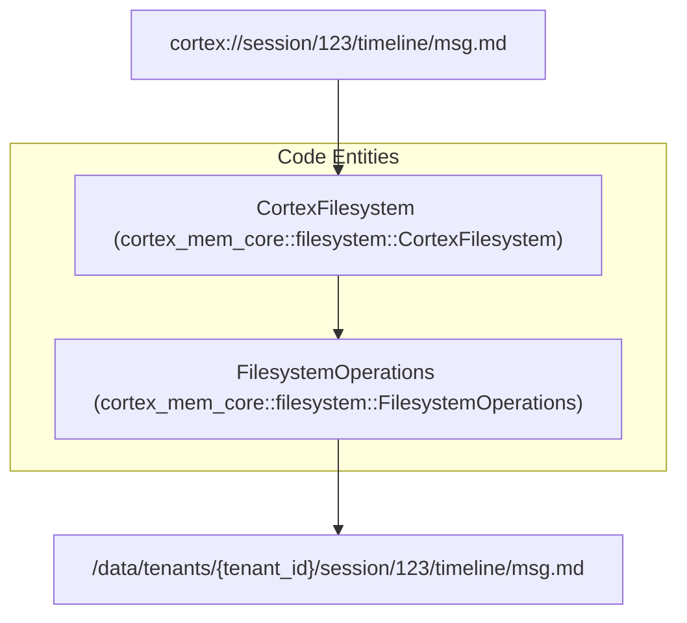
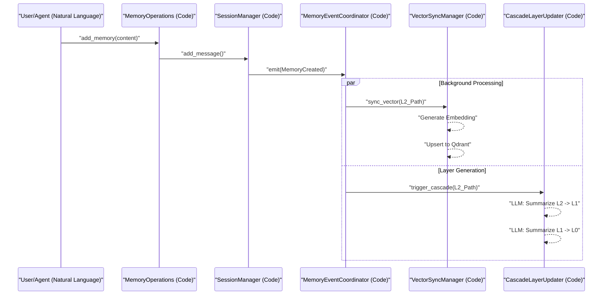

<!-- source: DeepWiki mcp.deepwiki.com · repo sopaco/cortex-mem · page 11 Glossary · fetched 2026-10-26 -->

# Glossary

Relevant source files

The following files were used as context for generating this wiki page:

- [README.md](README.md)
- [README_zh.md](README_zh.md)
- [cortex-mem-core/src/automation/layer_generator.rs](cortex-mem-core/src/automation/layer_generator.rs)
- [cortex-mem-core/src/automation/manager.rs](cortex-mem-core/src/automation/manager.rs)
- [cortex-mem-core/src/cascade_layer_updater.rs](cortex-mem-core/src/cascade_layer_updater.rs)
- [cortex-mem-core/src/filesystem/operations.rs](cortex-mem-core/src/filesystem/operations.rs)
- [cortex-mem-core/src/incremental_memory_updater.rs](cortex-mem-core/src/incremental_memory_updater.rs)
- [cortex-mem-core/src/layers/generator.rs](cortex-mem-core/src/layers/generator.rs)
- [cortex-mem-core/src/layers/manager.rs](cortex-mem-core/src/layers/manager.rs)
- [cortex-mem-core/src/lib.rs](cortex-mem-core/src/lib.rs)
- [cortex-mem-core/src/llm/client.rs](cortex-mem-core/src/llm/client.rs)
- [cortex-mem-core/src/llm/prompts.rs](cortex-mem-core/src/llm/prompts.rs)
- [cortex-mem-core/src/memory_event_coordinator.rs](cortex-mem-core/src/memory_event_coordinator.rs)
- [cortex-mem-core/src/search/vector_engine.rs](cortex-mem-core/src/search/vector_engine.rs)
- [cortex-mem-core/src/session/extraction.rs](cortex-mem-core/src/session/extraction.rs)
- [cortex-mem-core/src/session/manager.rs](cortex-mem-core/src/session/manager.rs)
- [cortex-mem-core/src/session/message.rs](cortex-mem-core/src/session/message.rs)
- [cortex-mem-mcp/src/main.rs](cortex-mem-mcp/src/main.rs)
- [cortex-mem-service/src/handlers/automation.rs](cortex-mem-service/src/handlers/automation.rs)
- [cortex-mem-service/src/handlers/search.rs](cortex-mem-service/src/handlers/search.rs)
- [cortex-mem-service/src/handlers/sessions.rs](cortex-mem-service/src/handlers/sessions.rs)
- [cortex-mem-service/src/routes/automation.rs](cortex-mem-service/src/routes/automation.rs)
- [cortex-mem-service/src/state.rs](cortex-mem-service/src/state.rs)
- [cortex-mem-tools/src/errors.rs](cortex-mem-tools/src/errors.rs)
- [cortex-mem-tools/src/lib.rs](cortex-mem-tools/src/lib.rs)
- [cortex-mem-tools/src/operations.rs](cortex-mem-tools/src/operations.rs)
- [cortex-mem-tools/src/tools/storage.rs](cortex-mem-tools/src/tools/storage.rs)
- [cortex-mem-tools/src/types.rs](cortex-mem-tools/src/types.rs)
- [examples/@memclaw/bin-darwin-arm64/bin/README.md](examples/@memclaw/bin-darwin-arm64/bin/README.md)
- [examples/@memclaw/plugin/README.md](examples/@memclaw/plugin/README.md)
- [examples/@memclaw/plugin/README_zh.md](examples/@memclaw/plugin/README_zh.md)
- [examples/@memclaw/plugin/skills/memclaw-maintance/SKILL.md](examples/@memclaw/plugin/skills/memclaw-maintance/SKILL.md)
- [examples/@memclaw/plugin/skills/memclaw-maintance/references/tools.md](examples/@memclaw/plugin/skills/memclaw-maintance/references/tools.md)
- [examples/@memclaw/plugin/skills/memclaw-maintance/references/troubleshooting.md](examples/@memclaw/plugin/skills/memclaw-maintance/references/troubleshooting.md)
- [examples/@memclaw/plugin/skills/memclaw/SKILL.md](examples/@memclaw/plugin/skills/memclaw/SKILL.md)
- [examples/cortex-mem-tars/src/agent.rs](examples/cortex-mem-tars/src/agent.rs)
- [examples/cortex-mem-tars/src/app.rs](examples/cortex-mem-tars/src/app.rs)
- [examples/locomo-evaluation/eval.py](examples/locomo-evaluation/eval.py)

This glossary defines the technical terms, architectural layers, and domain-specific jargon used within the Cortex Memory framework. It is intended for onboarding engineers to bridge the gap between high-level concepts and the concrete implementation in the Rust codebase.

## Architectural Layers (L0, L1, L2)

Cortex Memory employs a **Three-Tier Memory Hierarchy** designed to optimize the LLM context window by providing progressive disclosure of information.

| Layer | Technical Term | Token Size | Purpose | Implementation Pointer |
| :--- | :--- | :--- | :--- | :--- |
| **L0** | Abstract | ~100 | High-level summary for quick relevance filtering. | `cortex_mem_core::layers::Layer::L0` [cortex-mem-core/src/lib.rs:186-188]() |
| **L1** | Overview | ~2000 | Structured key points and context for deep refinement. | `cortex_mem_core::layers::Layer::L1` [cortex-mem-core/src/lib.rs:190-192]() |
| **L2** | Detail | Original | The raw, unedited content (Markdown). | `cortex_mem_core::layers::Layer::L2` [cortex-mem-core/src/lib.rs:194-196]() |

**Sources:** [README.md:29-33](), [cortex-mem-core/src/lib.rs:180-200](), [examples/@memclaw/plugin/README.md:23-32]()

---

## Virtual File System (VFS) & `cortex://`

The system treats memory as a structured filesystem. All memories are addressed via a unique URI scheme that allows for logical organization across different dimensions.

### URI Structure
`cortex://{dimension}/{tenant_id}/{category}/{id}.md`

*   **Dimensions**:
    *   `session/`: Ephemeral conversation history and timelines [README.md:44]().
    *   `user/`: Long-term user preferences, entities, and events [README.md:45]().
    *   `agent/`: Agent-specific experiences and solved cases [README.md:46]().
    *   `resources/`: Shared knowledge base files [README.md:47]().

### Code Entity Space: VFS Components
The following diagram illustrates how the `cortex://` URI strings are resolved to physical paths and managed by code entities.

**VFS Resolution Logic**

**Sources:** [README.md:37-54](), [cortex-mem-core/src/filesystem/mod.rs:1-50](), [cortex-mem-tools/src/operations.rs:114-117]()

---

## Core Components

### MemoryEventCoordinator
The central hub for reactive memory processing. It listens for `MemoryEvent` (Created, Updated, Deleted) and orchestrates background tasks like vector synchronization and layer updates.
*   **Implementation**: [cortex-mem-core/src/memory_event_coordinator.rs:62-89]()
*   **Key Function**: `start()` begins the event loop that dispatches events to sub-updaters [cortex-mem-core/src/memory_event_coordinator.rs:200-220]().

### CascadeLayerUpdater
Responsible for the "Cascading Update" logic. When an L2 (raw) file is modified, this component triggers the LLM to regenerate the L1 (Overview) and L0 (Abstract) layers to ensure consistency.
*   **Implementation**: [cortex-mem-core/src/cascade_layer_updater.rs:10-25]()
*   **Optimization**: Uses a `LayerUpdateDebouncer` to prevent redundant LLM calls when multiple files in a directory change rapidly [cortex-mem-core/src/memory_event_coordinator.rs:6-9]().

### Tenant Isolation
A security and organizational pattern where each "tenant" (e.g., a specific user or application instance) has a completely isolated storage directory and vector collection.
*   **Logic**: `QdrantVectorStore` uses `tenant_id` to prefix collection names or filter results [cortex-mem-tools/src/operations.rs:131-137]().

**Sources:** [cortex-mem-core/src/memory_event_coordinator.rs:1-150](), [cortex-mem-tools/src/operations.rs:100-140]()

---

## Domain Concepts

### Ebbinghaus Forgetting Curve
A mechanism implemented in the `MemoryCleanupService` to manage storage growth. Memories are assigned a "strength" score; low-strength memories are automatically archived or deleted over time to simulate human-like forgetting and maintain system performance.
*   **Implementation Pointer**: `MemoryCleanupService` (referenced in [README.md:115]()).

### Intent Analysis
An LLM-powered pre-processing step for searches. Instead of searching for the raw user query, the system analyzes the user's *intent* to generate more effective search parameters.
*   **Flag**: `enable_intent_analysis` in `VectorSearchEngine` [cortex-mem-service/src/state.rs:121-122]().

### MCP (Model Context Protocol)
A standard protocol used to expose Cortex Memory tools to AI agents (like Claude or Cursor).
*   **Server**: `cortex-mem-mcp` [cortex-mem-mcp/src/main.rs:15-18]().
*   **Service**: `MemoryMcpService` [cortex-mem-mcp/src/service.rs]().

### RIG Framework
The "Rust Integrated Graph" framework used by `cortex-mem-tars` to build agentic workflows.
*   **Integration**: `cortex-mem-rig` provides the `MemoryTools` wrapper for RIG agents [examples/cortex-mem-tars/src/agent.rs:121-149]().

---

## Data Flow: From Interaction to Persistence

This diagram bridges the **Natural Language Space** (what the user/agent does) to the **Code Entity Space** (what classes handle the data).

**Memory Processing Pipeline**

**Sources:** [cortex-mem-tools/src/operations.rs:53-120](), [cortex-mem-core/src/memory_event_coordinator.rs:130-160](), [README_zh.md:138-184]()