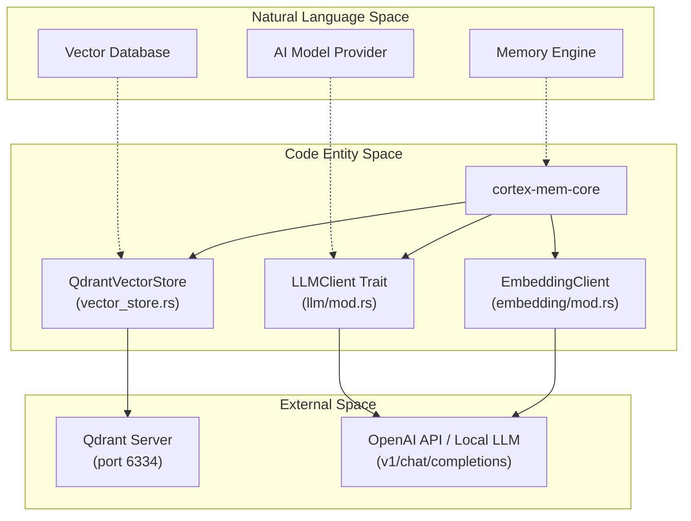
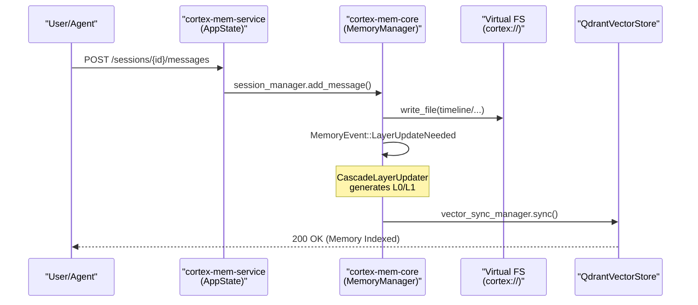

<!-- source: DeepWiki mcp.deepwiki.com · repo sopaco/cortex-mem · page 2.1 Installation · fetched 2026-10-26 -->

# Installation

<details>
<summary>Relevant source files</summary>

The following files were used as context for generating this wiki page:

- [Cargo.toml](Cargo.toml)
- [README.md](README.md)
- [README_zh.md](README_zh.md)
- [cortex-mem-cli/README.md](cortex-mem-cli/README.md)
- [cortex-mem-cli/tests/cli_commands_test.rs](cortex-mem-cli/tests/cli_commands_test.rs)
- [cortex-mem-config/Cargo.toml](cortex-mem-config/Cargo.toml)
- [cortex-mem-config/README.md](cortex-mem-config/README.md)
- [cortex-mem-core/Cargo.toml](cortex-mem-core/Cargo.toml)
- [cortex-mem-core/README.md](cortex-mem-core/README.md)
- [cortex-mem-core/src/incremental_memory_updater.rs](cortex-mem-core/src/incremental_memory_updater.rs)
- [cortex-mem-core/src/llm/prompts.rs](cortex-mem-core/src/llm/prompts.rs)
- [cortex-mem-core/src/search/vector_engine.rs](cortex-mem-core/src/search/vector_engine.rs)
- [cortex-mem-mcp/Cargo.toml](cortex-mem-mcp/Cargo.toml)
- [cortex-mem-mcp/README.md](cortex-mem-mcp/README.md)
- [cortex-mem-rig/Cargo.toml](cortex-mem-rig/Cargo.toml)
- [cortex-mem-rig/README.md](cortex-mem-rig/README.md)
- [cortex-mem-service/Cargo.toml](cortex-mem-service/Cargo.toml)
- [cortex-mem-service/README.md](cortex-mem-service/README.md)
- [cortex-mem-service/src/handlers/automation.rs](cortex-mem-service/src/handlers/automation.rs)
- [cortex-mem-service/src/handlers/search.rs](cortex-mem-service/src/handlers/search.rs)
- [cortex-mem-service/src/handlers/sessions.rs](cortex-mem-service/src/handlers/sessions.rs)
- [cortex-mem-service/src/routes/automation.rs](cortex-mem-service/src/routes/automation.rs)
- [cortex-mem-service/src/state.rs](cortex-mem-service/src/state.rs)
- [cortex-mem-tools/Cargo.toml](cortex-mem-tools/Cargo.toml)
- [cortex-mem-tools/README.md](cortex-mem-tools/README.md)
- [examples/@memclaw/bin-darwin-arm64/bin/README.md](examples/@memclaw/bin-darwin-arm64/bin/README.md)
- [examples/cortex-mem-tars/README.md](examples/cortex-mem-tars/README.md)
- [examples/cortex-mem-tars/config.example.toml](examples/cortex-mem-tars/config.example.toml)
- [examples/locomo-evaluation/eval.py](examples/locomo-evaluation/eval.py)

</details>


## Purpose and Scope

This page provides technical instructions for installing the Cortex Memory framework, including all crates, applications, and their required dependencies. It covers the setup of the Rust toolchain, the Qdrant vector database, LLM API configurations, and the installation of the core ecosystem components: `cortex-mem-core`, `cortex-mem-service`, `cortex-mem-mcp`, `cortex-mem-cli`, and the `cortex-mem-tars` TUI application.

---

## Prerequisites

Cortex Memory is built with high-performance Rust and requires specific infrastructure for semantic search and AI processing.

| Requirement | Minimum Version | Purpose |
|------------|-----------------|---------|
| **Rust** | 1.86+ | Compilation and runtime [Cargo.toml:17]() |
| **Qdrant** | 1.7+ | Vector database for semantic search [README.md:107]() |
| **LLM API** | OpenAI Compatible | Fact extraction, analysis, and embeddings [README.md:161]() |

### System Dependency Mapping

The following diagram bridges the high-level system components to the specific code entities and external dependencies.

**Diagram: Natural Language to Code Entity Space (Infrastructure)**



**Sources:** [README.md:148-184](), [cortex-mem-core/src/search/vector_engine.rs:57-71]()

---

## External Dependency Setup

### 1. Qdrant Vector Database
Cortex Memory uses Qdrant for high-performance similarity search. The `QdrantVectorStore` implementation interacts with Qdrant via gRPC.

**Docker Installation (Recommended):**
```bash
docker run -p 6333:6333 -p 6334:6334 \
    -v $(pwd)/qdrant_storage:/qdrant/storage \
    qdrant/qdrant
```
*   **Port 6333:** HTTP API (Dashboard)
*   **Port 6334:** gRPC API (Used by `cortex-mem-core`) [examples/cortex-mem-tars/config.example.toml:90]()

### 2. LLM and Embedding API
You must have access to an OpenAI-compatible API (OpenAI, Azure, or local providers like Ollama/vLLM).

**Required Environment Variables:**
```bash
export OPENAI_API_KEY="sk-..."
export LLM_API_BASE_URL="https://api.openai.com/v1"
```

---

## Installing Cortex Memory Components

The project is structured as a Cargo workspace containing multiple specialized crates.

### 1. Build from Source
To install all applications, clone the repository and build the release binaries.

```bash
git clone https://github.com/sopaco/cortex-mem.git
cd cortex-mem
cargo build --release
```

**Binary Locations after build:**
*   `target/release/cortex-mem-service`: The HTTP REST API server.
*   `target/release/cortex-mem-mcp`: The Model Context Protocol server.
*   `target/release/cortex-mem-cli`: The command-line management tool.
*   `target/release/cortex-mem-tars`: The interactive TUI assistant.

### 2. Component Installation Details

#### HTTP Service (`cortex-mem-service`)
The service provides a RESTful interface for memory operations. It uses `axum` for routing and maintains a shared `AppState`.

**Installation:**
```bash
cargo install --path cortex-mem-service
```
**Data Flow:**
1.  Requests hit `axum` handlers (e.g., `search` in `handlers/search.rs`).
2.  Handlers access `AppState.cortex` (an `Arc<CortexMem>`). [cortex-mem-service/src/state.rs:17]()
3.  `CortexMem` coordinates with `VectorSearchEngine` and `SessionManager`. [cortex-mem-service/src/state.rs:71-75]()

#### MCP Server (`cortex-mem-mcp`)
Enables AI agents (like Claude Desktop) to use Cortex Memory as a tool via the Model Context Protocol.

**Installation:**
```bash
cargo install --path cortex-mem-mcp
```
**Key Functions:**
*   `store_memory`: Persists conversation snippets. [cortex-mem-mcp/README.md:18]()
*   `query_memory`: Performs layered L0/L1/L2 search. [cortex-mem-mcp/README.md:52]()

#### TARS TUI (`cortex-mem-tars`)
A terminal-based interactive agent with audio support.

**System Dependencies (Linux only):**
```bash
sudo apt-get install libasound2-dev libxcb-shape0-dev libxcb-xfixes0-dev
```
**Installation:**
```bash
cd examples/cortex-mem-tars
cargo build --release
```
**Sources:** [examples/cortex-mem-tars/README.md:50-69]()

---

## Implementation & Data Flow

The installation process sets up a "Modular Monolith" where `cortex-mem-core` acts as the engine for all interfaces.

**Diagram: Code Entity Interaction & Data Flow**



**Sources:** [cortex-mem-service/src/handlers/sessions.rs:152-192](), [cortex-mem-core/src/search/vector_engine.rs:118-122]()

---

## Verification

After installation, verify the setup by running the service and checking the health endpoint.

### 1. Initialize Configuration
Create a `config.toml` in your working directory based on the provided template. [examples/cortex-mem-tars/config.example.toml]()

### 2. Start the Service
```bash
cortex-mem-service --config config.toml
```

### 3. Verify Vector Store Connectivity
The service will log successful initialization of the `MemoryEventCoordinator` and vector store.
```text
INFO Initializing Cortex Memory with unified automation...
INFO ✅ Cortex Memory initialized with MemoryEventCoordinator
```
**Sources:** [cortex-mem-service/src/state.rs:48-69]()

### 4. Test Search Latency
If LLM intent analysis is enabled, search may take several seconds. To optimize for low-latency installation, verify the `enable_intent_analysis` flag in `config.toml`. [cortex-mem-core/src/search/vector_engine.rs:109-116]()

---

## Troubleshooting

*   **Missing LLM Config:** If the service fails to start, ensure `LLM_API_KEY` is set. [cortex-mem-service/src/handlers/automation.rs:28-34]()
*   **Port Conflicts:** `cortex-mem-service` defaults to port 8080. `cortex-mem-tars` API defaults to 8085. [examples/cortex-mem-tars/config.example.toml:113]()
*   **Vector Sync Issues:** Use the `/automation/reindex` endpoint to force a full sync of the `cortex://` filesystem to Qdrant. [cortex-mem-service/src/handlers/automation.rs:56-98]()

**Sources:** [cortex-mem-service/src/state.rs](), [cortex-mem-core/src/search/vector_engine.rs](), [README.md]()

---

