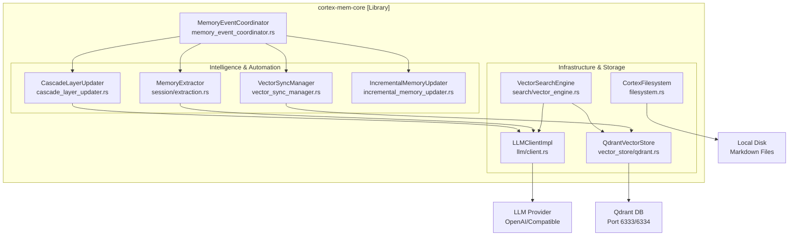

<!-- source: DeepWiki mcp.deepwiki.com · repo sopaco/cortex-mem · page 3 Core Architecture · fetched 2026-10-26 -->

# Core Architecture

Relevant source files

The following files were used as context for generating this wiki page:

- [README.md](README.md)
- [README_zh.md](README_zh.md)
- [cortex-mem-core/src/automation/indexer.rs](cortex-mem-core/src/automation/indexer.rs)
- [cortex-mem-core/src/automation/layer_generator.rs](cortex-mem-core/src/automation/layer_generator.rs)
- [cortex-mem-core/src/automation/manager.rs](cortex-mem-core/src/automation/manager.rs)
- [cortex-mem-core/src/automation/mod.rs](cortex-mem-core/src/automation/mod.rs)
- [cortex-mem-core/src/automation/sync.rs](cortex-mem-core/src/automation/sync.rs)
- [cortex-mem-core/src/cascade_layer_updater.rs](cortex-mem-core/src/cascade_layer_updater.rs)
- [cortex-mem-core/src/incremental_memory_updater.rs](cortex-mem-core/src/incremental_memory_updater.rs)
- [cortex-mem-core/src/layers/generator.rs](cortex-mem-core/src/layers/generator.rs)
- [cortex-mem-core/src/layers/manager.rs](cortex-mem-core/src/layers/manager.rs)
- [cortex-mem-core/src/llm/client.rs](cortex-mem-core/src/llm/client.rs)
- [cortex-mem-core/src/llm/prompts.rs](cortex-mem-core/src/llm/prompts.rs)
- [cortex-mem-core/src/memory_event_coordinator.rs](cortex-mem-core/src/memory_event_coordinator.rs)
- [cortex-mem-core/src/search/vector_engine.rs](cortex-mem-core/src/search/vector_engine.rs)
- [cortex-mem-core/src/session/extraction.rs](cortex-mem-core/src/session/extraction.rs)
- [cortex-mem-core/src/session/message.rs](cortex-mem-core/src/session/message.rs)
- [cortex-mem-core/src/types.rs](cortex-mem-core/src/types.rs)
- [cortex-mem-core/src/vector_store/qdrant.rs](cortex-mem-core/src/vector_store/qdrant.rs)
- [cortex-mem-service/src/handlers/automation.rs](cortex-mem-service/src/handlers/automation.rs)
- [cortex-mem-service/src/handlers/search.rs](cortex-mem-service/src/handlers/search.rs)
- [cortex-mem-service/src/handlers/sessions.rs](cortex-mem-service/src/handlers/sessions.rs)
- [cortex-mem-service/src/routes/automation.rs](cortex-mem-service/src/routes/automation.rs)
- [cortex-mem-service/src/state.rs](cortex-mem-service/src/state.rs)
- [examples/@memclaw/bin-darwin-arm64/bin/README.md](examples/@memclaw/bin-darwin-arm64/bin/README.md)
- [examples/locomo-evaluation/eval.py](examples/locomo-evaluation/eval.py)

This page provides a deep dive into the `cortex-mem-core` library, the foundational memory management engine of the Cortex Memory system. It explains the memory processing pipeline, AI-powered intelligence modules, and the hybrid storage architecture that combines a virtual filesystem with vector-based semantic search.

For information about how interfaces interact with the core, see [Service Interfaces](#4). For details on the central orchestrator, see [Memory Manager](#3.1).

## Overview

The `cortex-mem-core` library implements a modular architecture centered around the `MemoryManager` and the `MemoryEventCoordinator`. The system follows a **modular monolith** pattern, separating concerns between intelligence (fact extraction, layered generation), infrastructure (LLM clients, vector stores), and orchestration.

### Core Architecture Diagram

This diagram bridges the conceptual "Natural Language Space" of user interactions to the "Code Entity Space" within `cortex-mem-core`.

**Sources:** [cortex-mem-core/src/memory_event_coordinator.rs:62-89](), [cortex-mem-core/src/search/vector_engine.rs:57-71](), [cortex-mem-core/src/session/extraction.rs:143-151](), [README_zh.md:138-184]()

### Component Responsibilities

| Component | File Path | Primary Responsibility |
|-----------|-----------|----------------------|
| `MemoryEventCoordinator` | `memory_event_coordinator.rs` | Central hub for all memory operations; orchestrates events between extraction, indexing, and layer updates. |
| `MemoryExtractor` | `session/extraction.rs` | Converts unstructured conversations into structured facts (preferences, entities, events) using LLMs. |
| `CascadeLayerUpdater` | `cascade_layer_updater.rs` | Manages the L0/L1/L2 hierarchy; generates summaries for directories and files. |
| `VectorSearchEngine` | `search/vector_engine.rs` | Handles layered semantic search, intent analysis, and result re-ranking. |
| `VectorSyncManager` | `vector_sync_manager.rs` | Ensures the vector database (Qdrant) stays in sync with the filesystem-based memories. |
| `CortexFilesystem` | `filesystem.rs` | Manages the `cortex://` URI scheme and physical storage of memories as Markdown. |

**Sources:** [cortex-mem-core/src/memory_event_coordinator.rs:55-61](), [cortex-mem-core/src/search/vector_engine.rs:57-71](), [cortex-mem-core/src/session/extraction.rs:1-7]()

## Memory Manager & Event Coordination

The `MemoryManager` (and the lower-level `MemoryEventCoordinator`) acts as the central orchestrator. It listens for `MemoryEvent` signals—such as `MemoryCreated`, `SessionClosed`, or `LayerUpdateNeeded`—to trigger background processing.

### Event-Driven Pipeline

When a session is closed or a message is added, the following flow occurs:

1. **Event Dispatch**: A `SessionClosed` event is sent to the `MemoryEventCoordinator` [cortex-mem-service/src/handlers/automation.rs:36-40]().
2. **Extraction**: `MemoryExtractor` uses an LLM to pull facts and entities from the conversation [cortex-mem-core/src/session/extraction.rs:170-185]().
3. **Layer Update**: `CascadeLayerUpdater` updates the L1 (Overview) and L0 (Abstract) layers for the affected directory [cortex-mem-core/src/memory_event_coordinator.rs:148-153]().
4. **Vector Sync**: `VectorSyncManager` generates embeddings and upserts the new data into Qdrant [cortex-mem-core/src/vector_sync_manager.rs:24-28]().

For details on orchestration, see [Memory Manager](#3.1).

**Sources:** [cortex-mem-core/src/memory_event_coordinator.rs:91-198](), [cortex-mem-service/src/handlers/automation.rs:23-50]()

## Hybrid Storage: Filesystem & Vector Store

Cortex Memory uses a unique hybrid storage approach. All "truth" is stored as Markdown files on a filesystem using the `cortex://` URI scheme, while a vector database provides fast semantic indexing.

### The `cortex://` URI Scheme
The system organizes data into dimensions:
- `cortex://session/{id}`: Conversation history and timelines.
- `cortex://user/{id}`: Preferences, entities, and personal facts.
- `cortex://agent/{id}`: Skills and case studies.

### Vector Store Integration
The `VectorStore` trait abstracts the underlying database. The primary implementation is `QdrantVectorStore`, which handles:
- **Tenant Isolation**: Collection names are suffixed with `_{tenant_id}` to ensure data separation [cortex-mem-core/src/vector_store/qdrant.rs:34-36]().
- **Automatic Schema Management**: The store can auto-detect embedding dimensions and create collections at runtime [cortex-mem-core/src/vector_store/qdrant.rs:109-114]().

For details, see [Vector Store Integration](#3.2).

**Sources:** [README.md:37-54](), [cortex-mem-core/src/vector_store/qdrant.rs:22-62]()

## AI Processing & Search Engine

The intelligence of the system is powered by the `LLMClient` and the `VectorSearchEngine`.

### Layered Semantic Search
The `VectorSearchEngine` performs "Layered Search," which optimizes context window usage by retrieving data across three tiers:
- **L0 (Abstract)**: Broad summaries for quick orientation.
- **L1 (Overview)**: Mid-level directory summaries.
- **L2 (Detail)**: Raw memory content or message history.

### Intent Analysis
Before performing a search, the engine can optionally use an LLM to perform **Intent Analysis** [cortex-mem-core/src/search/vector_engine.rs:67-70](). This rewrites the user's raw query into a more effective search string and determines if specific filters (like time constraints) should be applied.

For details, see [LLM Client & AI Processing](#3.3).

**Sources:** [cortex-mem-core/src/search/vector_engine.rs:81-116](), [README_zh.md:200-210]()

## Memory Operations & Automation

Cortex Memory is designed to be "hands-off" for the developer. Automation is baked into the core via the `AutomationManager` and the `MemoryCleanupService`.

### Automation Features
- **Incremental Updates**: The `IncrementalMemoryUpdater` keeps L0/L1 layers in sync as memories change, avoiding full re-summarization [cortex-mem-core/src/memory_event_coordinator.rs:114-115]().
- **Debouncing**: To save on API costs, the `LayerUpdateDebouncer` batches multiple file changes into a single summary update, reducing LLM calls by 70-90% [cortex-mem-core/src/memory_event_coordinator.rs:6-9]().
- **Forgetting Mechanism**: The `MemoryCleanupService` implements an Ebbinghaus forgetting curve, archiving low-strength memories to prevent storage bloat [README.md:115-116]().

For details, see [Memory Operations & Shared Tools](#3.4) and [Optimization Engine](#3.5).

**Sources:** [cortex-mem-core/src/memory_event_coordinator.rs:162-173](), [cortex-mem-core/src/automation/manager.rs:51-59]()

---

