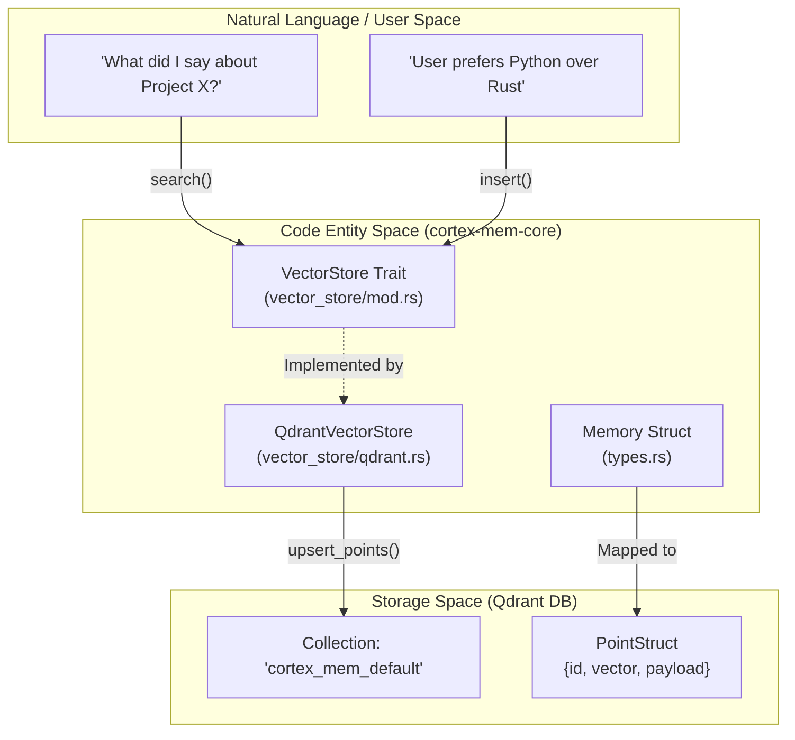
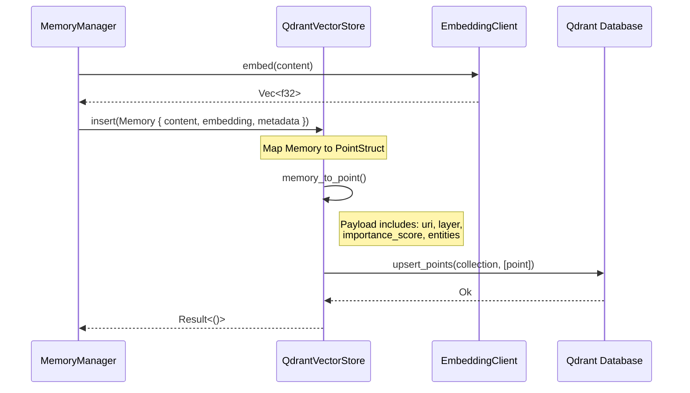

<!-- source: DeepWiki mcp.deepwiki.com · repo sopaco/cortex-mem · page 3.2 Vector Store Integration · fetched 2026-10-26 -->

# Vector Store Integration

Relevant source files

The following files were used as context for generating this wiki page:

- [cortex-mem-core/src/automation/indexer.rs](cortex-mem-core/src/automation/indexer.rs)
- [cortex-mem-core/src/automation/mod.rs](cortex-mem-core/src/automation/mod.rs)
- [cortex-mem-core/src/automation/sync.rs](cortex-mem-core/src/automation/sync.rs)
- [cortex-mem-core/src/builder.rs](cortex-mem-core/src/builder.rs)
- [cortex-mem-core/src/embedding/client.rs](cortex-mem-core/src/embedding/client.rs)
- [cortex-mem-core/src/types.rs](cortex-mem-core/src/types.rs)
- [cortex-mem-core/src/vector_store/qdrant.rs](cortex-mem-core/src/vector_store/qdrant.rs)
- [cortex-mem-insights/src/lib/api.ts](cortex-mem-insights/src/lib/api.ts)
- [cortex-mem-insights/src/lib/pages/Dashboard.svelte](cortex-mem-insights/src/lib/pages/Dashboard.svelte)
- [cortex-mem-insights/src/lib/pages/Search.svelte](cortex-mem-insights/src/lib/pages/Search.svelte)
- [cortex-mem-insights/src/lib/stores/search.ts](cortex-mem-insights/src/lib/stores/search.ts)
- [cortex-mem-insights/src/lib/stores/tenant.ts](cortex-mem-insights/src/lib/stores/tenant.ts)
- [cortex-mem-service/src/main.rs](cortex-mem-service/src/main.rs)
- [examples/locomo-evaluation/benchmark/index.html](examples/locomo-evaluation/benchmark/index.html)

## Purpose and Scope

The Vector Store Integration provides the persistent storage and semantic retrieval layer for Cortex Memory. It abstracts vector database operations behind the `VectorStore` trait [cortex-mem-core/src/vector_store/mod.rs:1-20](), allowing the core system to remain decoupled from specific database implementations. The primary implementation uses **Qdrant**, a high-performance vector database that supports complex metadata filtering and multi-tenant isolation [cortex-mem-core/src/vector_store/qdrant.rs:21-26]().

This component handles:
*   **Schema Management**: Automatic collection creation and dimension verification [cortex-mem-core/src/vector_store/qdrant.rs:109-152]().
*   **Data Mapping**: Converting internal `Memory` structures to vector database points [cortex-mem-core/src/vector_store/qdrant.rs:276-320]().
*   **Semantic Search**: Executing similarity queries with advanced metadata filtering [cortex-mem-core/src/vector_store/qdrant.rs:370-420]().
*   **Tenant Isolation**: Managing separate collections or namespaces for different users/applications [cortex-mem-core/src/vector_store/qdrant.rs:34-48]().

Sources: [cortex-mem-core/src/vector_store/mod.rs:1-20](), [cortex-mem-core/src/vector_store/qdrant.rs:21-62]()

---

## Architecture and Trait Abstraction

The system uses a trait-based repository pattern. The `MemoryManager` (or `AutoIndexer`) interacts with an `Arc<dyn VectorStore>` [cortex-mem-core/src/builder.rs:99-115](), ensuring that the underlying storage can be swapped without changing business logic.

### System Entity Mapping: Logic to Storage

The following diagram bridges the Natural Language concepts (Memories, Sessions) to the Code Entities and their storage representations.

**Natural Language to Code Entity Space**

Sources: [cortex-mem-core/src/types.rs:189-197](), [cortex-mem-core/src/vector_store/mod.rs:1-20](), [cortex-mem-core/src/vector_store/qdrant.rs:276-320]()

### The VectorStore Trait
The `VectorStore` trait defines the core contract for the system [cortex-mem-core/src/vector_store/mod.rs:1-20]():

| Method | Description | Source |
| :--- | :--- | :--- |
| `insert(memory)` | Upserts a memory point and its embedding. | [cortex-mem-core/src/vector_store/mod.rs:12-12]() |
| `search(vector, filters, limit)` | Returns top-K similar memories. | [cortex-mem-core/src/vector_store/mod.rs:13-13]() |
| `get(id)` | Retrieves a specific memory by its unique ID. | [cortex-mem-core/src/vector_store/mod.rs:15-15]() |
| `delete(id)` | Removes a memory point from the store. | [cortex-mem-core/src/vector_store/mod.rs:17-17]() |
| `list(filters)` | Scans points matching specific metadata. | [cortex-mem-core/src/vector_store/mod.rs:16-16]() |

---

## Qdrant Implementation Details

The `QdrantVectorStore` utilizes the `qdrant-client` crate to communicate with a Qdrant instance via gRPC/HTTP [cortex-mem-core/src/vector_store/qdrant.rs:2-10]().

### Initialization and Schema Sync
During startup, the store ensures the target collection exists and matches the required embedding dimension [cortex-mem-core/src/vector_store/qdrant.rs:155-198]().

1.  **Tenant Awareness**: If a `tenant_id` is provided in the `QdrantConfig`, the collection name is suffixed (e.g., `cortex_mem_user123`) [cortex-mem-core/src/vector_store/qdrant.rs:34-48]().
2.  **Dimension Probing**: If `embedding_dim` is missing from the config, the system can attempt to probe it at runtime, though it currently requires explicit configuration for safety [cortex-mem-core/src/vector_store/qdrant.rs:91-101]().
3.  **Collection Setup**: Collections are created with **Cosine Distance** and **HNSW indexing** for optimized semantic search [cortex-mem-core/src/vector_store/qdrant.rs:131-137]().

Sources: [cortex-mem-core/src/vector_store/qdrant.rs:28-62](), [cortex-mem-core/src/vector_store/qdrant.rs:109-152]()

### Data Flow: Memory to Vector Point
When a memory is stored, it undergoes a transformation from a high-level Rust struct to a Qdrant `PointStruct` [cortex-mem-core/src/vector_store/qdrant.rs:276-320]().

**Memory Persistence Data Flow**

Sources: [cortex-mem-core/src/vector_store/qdrant.rs:276-320](), [cortex-mem-core/src/automation/indexer.rs:78-113]()

---

## Schema and Metadata Management

Cortex Memory stores significant context in the Qdrant "Payload". This allows for highly granular filtering during retrieval without needing to query a separate relational database.

### Payload Structure
The following metadata fields are indexed and searchable [cortex-mem-core/src/types.rs:89-103]():

| Field | Description | Type |
| :--- | :--- | :--- |
| `uri` | The unique resource identifier (e.g., `cortex://session/...`). | String |
| `layer` | The memory tier: `L0` (Abstract), `L1` (Overview), or `L2` (Detail). | String |
| `importance_score` | LLM-evaluated score (0.0 to 1.0). | Float |
| `entities` | List of extracted named entities. | List<String> |
| `topics` | Categorized topics for the memory. | List<String> |
| `run_id` | Typically the `thread_id` for session-based memories. | String |

Sources: [cortex-mem-core/src/types.rs:89-103](), [cortex-mem-core/src/vector_store/qdrant.rs:335-368]()

### Filtering Logic
The `Filters` struct [cortex-mem-core/src/types.rs:208-225]() is converted into Qdrant `Filter` objects using `Must` and `Should` conditions [cortex-mem-core/src/vector_store/qdrant.rs:422-520](). This supports:
*   **Layer Filtering**: Searching only `L1Overview` for quick summaries [cortex-mem-core/src/types.rs:234-240]().
*   **Temporal Filtering**: Finding memories created within a specific time range [cortex-mem-core/src/vector_store/qdrant.rs:480-498]().
*   **Semantic Scope**: Using `uri_prefix` to limit search to a specific session or user directory [cortex-mem-core/src/types.rs:223-223]().

Sources: [cortex-mem-core/src/vector_store/qdrant.rs:422-520](), [cortex-mem-core/src/types.rs:208-241]()

---

## Automated Indexing Patterns

Vector storage is often populated automatically by the `AutomationManager` and `SyncManager`.

### The AutoIndexer
The `AutoIndexer` listens for `MessageAdded` events and performs real-time indexing of conversation history [cortex-mem-core/src/automation/indexer.rs:48-59]().
*   **Batch Indexing**: Supports re-indexing entire threads [cortex-mem-core/src/automation/indexer.rs:116-120]().
*   **Deduplication**: Checks `get_indexed_message_ids` before processing to avoid redundant embeddings [cortex-mem-core/src/automation/indexer.rs:144-148]().

### SyncManager
The `SyncManager` performs bulk synchronization of the `CortexFilesystem` to the vector store [cortex-mem-core/src/automation/sync.rs:25-31](). It recursively scans directories like `cortex://user` and `cortex://agent`, generating embeddings for any `.md` files that are missing from the vector index [cortex-mem-core/src/automation/sync.rs:98-147]().

Sources: [cortex-mem-core/src/automation/indexer.rs:48-75](), [cortex-mem-core/src/automation/sync.rs:25-46](), [cortex-mem-core/src/automation/sync.rs:98-147]()

---

