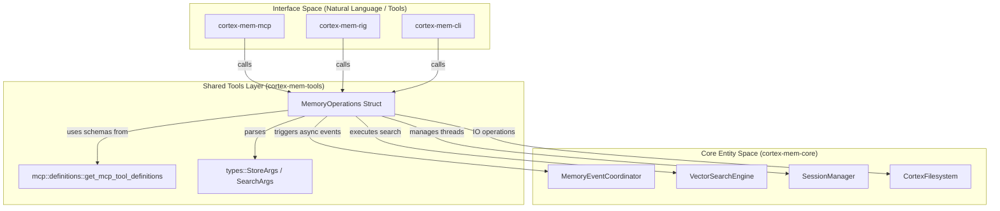
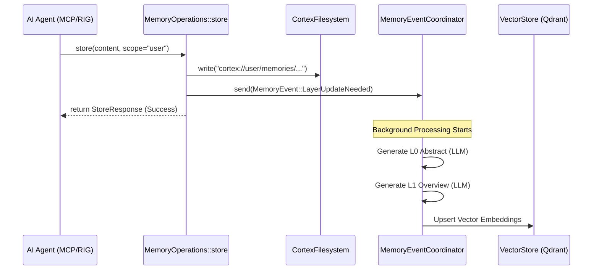

<!-- source: DeepWiki mcp.deepwiki.com · repo sopaco/cortex-mem · page 3.4 Memory Operations & Shared Tools · fetched 2026-10-26 -->

# Memory Operations & Shared Tools

<details>
<summary>Relevant source files</summary>

The following files were used as context for generating this wiki page:

- [cortex-mem-core/src/lib.rs](cortex-mem-core/src/lib.rs)
- [cortex-mem-core/src/llm/mod.rs](cortex-mem-core/src/llm/mod.rs)
- [cortex-mem-core/src/session/manager.rs](cortex-mem-core/src/session/manager.rs)
- [cortex-mem-mcp/src/service.rs](cortex-mem-mcp/src/service.rs)
- [cortex-mem-tools/src/docs/commit.md](cortex-mem-tools/src/docs/commit.md)
- [cortex-mem-tools/src/docs/explore.md](cortex-mem-tools/src/docs/explore.md)
- [cortex-mem-tools/src/docs/ls.md](cortex-mem-tools/src/docs/ls.md)
- [cortex-mem-tools/src/docs/recall.md](cortex-mem-tools/src/docs/recall.md)
- [cortex-mem-tools/src/docs/search.md](cortex-mem-tools/src/docs/search.md)
- [cortex-mem-tools/src/docs/store.md](cortex-mem-tools/src/docs/store.md)
- [cortex-mem-tools/src/mcp/definitions.rs](cortex-mem-tools/src/mcp/definitions.rs)
- [cortex-mem-tools/src/operations.rs](cortex-mem-tools/src/operations.rs)
- [cortex-mem-tools/src/tools/mod.rs](cortex-mem-tools/src/tools/mod.rs)
- [cortex-mem-tools/src/tools/recall.rs](cortex-mem-tools/src/tools/recall.rs)
- [cortex-mem-tools/src/tools/search.rs](cortex-mem-tools/src/tools/search.rs)
- [cortex-mem-tools/src/tools/storage.rs](cortex-mem-tools/src/tools/storage.rs)
- [examples/cortex-mem-tars/src/agent.rs](examples/cortex-mem-tars/src/agent.rs)
- [examples/cortex-mem-tars/src/app.rs](examples/cortex-mem-tars/src/app.rs)
- [litho.docs/en/1.Overview.md](litho.docs/en/1.Overview.md)
- [litho.docs/en/5.Boundary-Interfaces.md](litho.docs/en/5.Boundary-Interfaces.md)

</details>


## Purpose and Scope

The `cortex-mem-tools` library serves as the high-level orchestration layer for the Cortex Memory ecosystem. It provides the `MemoryOperations` API, which abstracts the complexities of the core engine into a unified interface for memory storage, semantic search, and tiered content access. This shared abstraction ensures consistent behavior across different interfaces, including the **HTTP API Service**, **MCP Server**, **CLI**, and **RIG Framework** integration.

By centralizing operation logic, `cortex-mem-tools` manages the coordination between the virtual filesystem, vector search engines, session management, and the asynchronous background processing pipeline.

---

## Architectural Context

### Design Rationale

The `cortex-mem-tools` layer sits between the low-level `cortex-mem-core` components and the high-level boundary interfaces. It provides a "Modular Monolith" pattern where core logic is implemented once and exposed through multiple protocols.

**Key Responsibilities:**
- **Unified API**: Providing a single `MemoryOperations` struct that handles all high-level requests. [cortex-mem-tools/src/operations.rs:29-51]()
- **Asynchronous Orchestration**: Offloading heavy tasks like embedding generation and LLM-based layer creation to the `MemoryEventCoordinator`. [cortex-mem-tools/src/operations.rs:178-193]()
- **Tenant Isolation**: Ensuring that filesystem paths and vector store queries are scoped to specific tenants. [cortex-mem-tools/src/operations.rs:114-116]()
- **Schema Standardization**: Defining tool schemas (search, store, ls) used by both MCP and RIG. [cortex-mem-tools/src/mcp/definitions.rs:24-25]()

### Component Interaction

The following diagram illustrates how `MemoryOperations` bridges the gap between AI agents (via MCP/RIG) and the core memory infrastructure.

**Diagram: Memory Operations Bridge**



Sources: [cortex-mem-tools/src/operations.rs:29-51](), [cortex-mem-mcp/src/service.rs:1-10](), [examples/cortex-mem-tars/src/agent.rs:83-106]()

---

## The MemoryOperations API

The `MemoryOperations` struct is the primary entry point for any application integrating Cortex Memory. It is typically initialized with a tenant ID and a set of LLM/Vector configurations.

### Initialization

Initialization involves setting up the `CortexFilesystem` for the specific tenant and establishing a connection to the Qdrant vector store. [cortex-mem-tools/src/operations.rs:100-113]()

```rust
pub async fn new(
    data_dir: &str,
    tenant_id: impl Into<String>,
    llm_client: Arc<dyn LLMClient>,
    qdrant_url: &str,
    // ... embedding & vector params
) -> Result<Self>
```

During initialization, it also creates the `MemoryEventCoordinator`, which starts a background event loop to process memory updates (indexing and layer generation) without blocking the main request thread. [cortex-mem-tools/src/operations.rs:178-193]()

### Core Methods

| Method | Purpose | Key Dependency |
|--------|---------|----------------|
| `store` | Persists content to a URI and triggers async layer generation. | `SessionManager`, `MemoryEventCoordinator` |
| `search` | Performs layered semantic search (L0->L1->L2). | `VectorSearchEngine`, `LayerManager` |
| `find` | Simplified search returning only L0 abstracts. | `VectorSearchEngine` |
| `ls` | Lists memories in the `cortex://` virtual filesystem. | `CortexFilesystem` |

Sources: [cortex-mem-tools/src/tools/storage.rs:16-17](), [cortex-mem-tools/src/tools/search.rs:15-16](), [cortex-mem-tools/src/tools/search.rs:50-51]()

---

## Memory Storage & Asynchronous Processing

When the `store` method is called, the system prioritizes low latency for the caller (the AI agent) by offloading processing.

### Storage Logic Flow

1. **URI Generation**: Based on the scope (`user`, `session`, or `agent`), a `cortex://` URI is generated. [cortex-mem-tools/src/tools/storage.rs:24-81]()
2. **Persistence**:
    - For `session` scope: Content is added to the `SessionManager` as a message. [cortex-mem-tools/src/tools/storage.rs:127-133]()
    - For `user`/`agent` scope: Content is written directly to the `CortexFilesystem`. [cortex-mem-tools/src/tools/storage.rs:151-154]()
3. **Event Triggering**: Instead of generating L0/L1 layers immediately, a `MemoryEvent` of type `LayerUpdateNeeded` is sent to the `memory_event_tx` channel. [cortex-mem-tools/src/tools/storage.rs:166-173]()

**Diagram: Asynchronous Storage Pipeline**



Sources: [cortex-mem-tools/src/tools/storage.rs:156-175](), [cortex-mem-core/src/memory_event_coordinator.rs:179-193]()

---

## Semantic Search & Tiered Retrieval

The `search` operation implements a layered retrieval strategy. It does not just return raw text; it provides context at different granularities (L0, L1, L2).

### Layered Search Strategy

The search process follows these steps:
1. **Normalization**: The `scope` (e.g., `cortex://user`) is normalized to ensure valid URI structures. [cortex-mem-tools/src/tools/search.rs:17-23]()
2. **Vector Search**: The `VectorSearchEngine` executes a query against Qdrant, returning URIs and similarity scores. [cortex-mem-tools/src/tools/search.rs:114-126]()
3. **Enrichment**: For each result, the `LayerManager` loads the requested layers (e.g., L0 abstracts for quick browsing). [cortex-mem-tools/src/tools/search.rs:138-177]()

### Data Structures for Search

The `SearchArgs` structure allows agents to control the depth of information retrieved. [cortex-mem-tools/src/mcp/definitions.rs:51-59]()

| Parameter | Type | Description |
|-----------|------|-------------|
| `query` | `String` | Natural language search string. |
| `scope` | `String` | URI prefix to limit search (e.g., `cortex://session/{id}`). |
| `return_layers` | `Vec<String>` | List of layers to return: `["L0"]`, `["L1"]`, or `["L2"]`. |
| `limit` | `usize` | Maximum number of results (default: 10). |

Sources: [cortex-mem-tools/src/tools/search.rs:15-47](), [cortex-mem-tools/src/mcp/definitions.rs:27-63]()

---

## Shared Tool Definitions

Cortex Memory provides a set of unified tool definitions via `get_mcp_tool_definitions`. This ensures that an AI agent sees the same tool descriptions and parameter schemas whether it is connecting via **MCP** (Model Context Protocol) or using **RIG** (Rust Integrated Graph). [cortex-mem-tools/src/mcp/definitions.rs:24-25]()

### Standard Tools Table

| Tool Name | Purpose | Implementation File |
|-----------|---------|---------------------|
| `search` | Semantic vector search across all layers. | [cortex-mem-tools/src/tools/search.rs]() |
| `store` | Save new information into long-term memory. | [cortex-mem-tools/src/tools/storage.rs]() |
| `ls` | Browse the memory hierarchy like a filesystem. | [cortex-mem-tools/src/tools/filesystem.rs]() |
| `abstract` | Retrieve only the L0 (~100 token) summary. | [cortex-mem-tools/src/tools/tiered.rs]() |
| `overview` | Retrieve the L1 (~2000 token) structured overview. | [cortex-mem-tools/src/tools/tiered.rs]() |
| `recall` | Convenience tool for full content retrieval (L0 + L2). | [cortex-mem-tools/src/tools/recall.rs]() |

Sources: [cortex-mem-tools/src/mcp/definitions.rs:24-180](), [cortex-mem-tools/src/tools/mod.rs:1-8]()

---

## Integration Patterns

### MCP Server Integration
The `cortex-mem-mcp` service maps MCP tool calls directly to `MemoryOperations`. It includes an `AutoTriggerConfig` to handle clients that do not explicitly close sessions, ensuring memories are eventually extracted and indexed based on message counts or inactivity. [cortex-mem-mcp/src/service.rs:21-32]()

### RIG Framework Integration
The `cortex-mem-rig` library provides a `create_memory_tools_with_config` helper. It instantiates `MemoryOperations` and wraps it in Rig's `Tool` trait, allowing agents to call these tools autonomously during a conversation. [examples/cortex-mem-tars/src/agent.rs:83-97]()

### TARS Application Usage
In the TARS TUI application, `MemoryOperations` is used to manage "Tenant Isolation." Each bot in TARS can have its own isolated memory space by passing a unique `agent_id` and `user_id` to the `MemoryOperations` constructor. [examples/cortex-mem-tars/src/agent.rs:57-64]()

Sources: [cortex-mem-mcp/src/service.rs:15-43](), [examples/cortex-mem-tars/src/agent.rs:108-119](), [cortex-mem-tools/src/operations.rs:100-113]()

---

