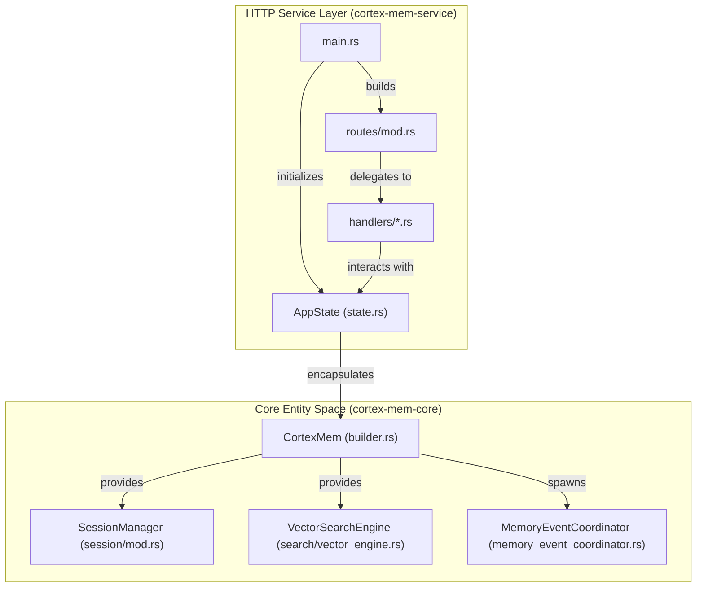
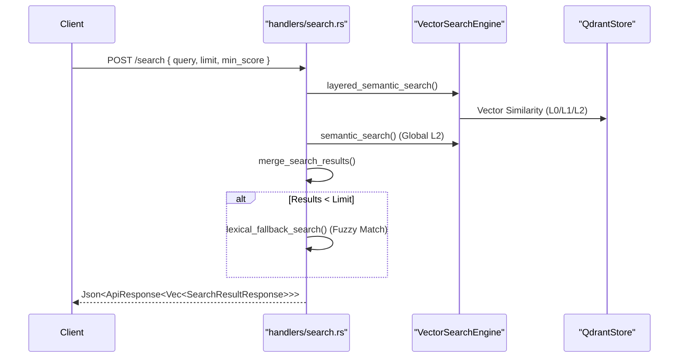

<!-- source: DeepWiki mcp.deepwiki.com · repo sopaco/cortex-mem · page 4.1 HTTP API Service · fetched 2026-10-26 -->

# HTTP API Service

<details>
<summary>Relevant source files</summary>

The following files were used as context for generating this wiki page:

- [README.md](README.md)
- [README_zh.md](README_zh.md)
- [cortex-mem-core/src/builder.rs](cortex-mem-core/src/builder.rs)
- [cortex-mem-core/src/embedding/client.rs](cortex-mem-core/src/embedding/client.rs)
- [cortex-mem-core/src/incremental_memory_updater.rs](cortex-mem-core/src/incremental_memory_updater.rs)
- [cortex-mem-core/src/llm/prompts.rs](cortex-mem-core/src/llm/prompts.rs)
- [cortex-mem-core/src/search/vector_engine.rs](cortex-mem-core/src/search/vector_engine.rs)
- [cortex-mem-insights/src/lib/api.ts](cortex-mem-insights/src/lib/api.ts)
- [cortex-mem-insights/src/lib/pages/Dashboard.svelte](cortex-mem-insights/src/lib/pages/Dashboard.svelte)
- [cortex-mem-insights/src/lib/pages/Search.svelte](cortex-mem-insights/src/lib/pages/Search.svelte)
- [cortex-mem-insights/src/lib/stores/search.ts](cortex-mem-insights/src/lib/stores/search.ts)
- [cortex-mem-insights/src/lib/stores/tenant.ts](cortex-mem-insights/src/lib/stores/tenant.ts)
- [cortex-mem-insights/src/lib/types.ts](cortex-mem-insights/src/lib/types.ts)
- [cortex-mem-service/src/handlers/automation.rs](cortex-mem-service/src/handlers/automation.rs)
- [cortex-mem-service/src/handlers/filesystem.rs](cortex-mem-service/src/handlers/filesystem.rs)
- [cortex-mem-service/src/handlers/mod.rs](cortex-mem-service/src/handlers/mod.rs)
- [cortex-mem-service/src/handlers/search.rs](cortex-mem-service/src/handlers/search.rs)
- [cortex-mem-service/src/handlers/sessions.rs](cortex-mem-service/src/handlers/sessions.rs)
- [cortex-mem-service/src/main.rs](cortex-mem-service/src/main.rs)
- [cortex-mem-service/src/models.rs](cortex-mem-service/src/models.rs)
- [cortex-mem-service/src/routes/automation.rs](cortex-mem-service/src/routes/automation.rs)
- [cortex-mem-service/src/routes/filesystem.rs](cortex-mem-service/src/routes/filesystem.rs)
- [cortex-mem-service/src/routes/mod.rs](cortex-mem-service/src/routes/mod.rs)
- [cortex-mem-service/src/state.rs](cortex-mem-service/src/state.rs)
- [examples/@memclaw/bin-darwin-arm64/bin/README.md](examples/@memclaw/bin-darwin-arm64/bin/README.md)
- [examples/@memclaw/plugin/skills/memclaw/references/best-practices.md](examples/@memclaw/plugin/skills/memclaw/references/best-practices.md)
- [examples/locomo-evaluation/benchmark/index.html](examples/locomo-evaluation/benchmark/index.html)
- [examples/locomo-evaluation/eval.py](examples/locomo-evaluation/eval.py)

</details>


The HTTP API Service (`cortex-mem-service`) provides a RESTful interface for memory operations, serving as the primary programmatic access point for external applications. It wraps the `cortex-mem-core` library into a high-performance, asynchronous server built with the Axum framework, exposing endpoints for session management, semantic search, and filesystem access.

## Architecture and State Management

The service is designed around a shared `AppState` that manages the lifecycle of the `CortexMem` runtime. A key feature is the support for multi-tenancy through dynamic tenant switching, which rebuilds the core runtime components to ensure isolation.

### Code Entity Mapping


**Sources:** [cortex-mem-service/src/main.rs:122-139](), [cortex-mem-service/src/state.rs:15-41](), [cortex-mem-core/src/builder.rs:74-145]()

### Application State (`AppState`)
The `AppState` struct holds thread-safe references to core components. It is wrapped in an `Arc` and shared across all Axum handlers.
- `cortex`: An `Arc<RwLock<Arc<CortexMem>>>` allowing atomic updates to the runtime [cortex-mem-service/src/state.rs:17]().
- `vector_engine`: Supports layered search (L0/L1/L2) and intent analysis [cortex-mem-service/src/state.rs:25]().
- `memory_event_tx`: A channel sender used to dispatch events like `LayerUpdateNeeded` to the background coordinator [cortex-mem-service/src/state.rs:33]().

**Sources:** [cortex-mem-service/src/state.rs:15-41]()

## Endpoint Reference

The service organizes endpoints into logical groups nested under `/api/v2`.

### Session Management
| Endpoint | Method | Function |
|----------|--------|----------|
| `/sessions` | `GET` | Lists all sessions by scanning the `.session.json` metadata files [cortex-mem-service/src/handlers/sessions.rs:69-120](). |
| `/sessions` | `POST` | Creates a new session with optional `thread_id`, `user_id`, and `agent_id` [cortex-mem-service/src/handlers/sessions.rs:26-66](). |
| `/sessions/:id/messages` | `POST` | Adds a message to a session. This triggers a `LayerUpdateNeeded` event [cortex-mem-service/src/handlers/sessions.rs:123-205](). |

**Sources:** [cortex-mem-service/src/handlers/sessions.rs:1-205]()

### Semantic Search
The `/search` endpoint implements a sophisticated multi-stage retrieval pipeline.


**Sources:** [cortex-mem-service/src/handlers/search.rs:17-113](), [cortex-mem-core/src/search/vector_engine.rs:202-230]()

### Filesystem & Automation
- **Filesystem**: Provides `read`, `write`, and `list` operations for the `cortex://` URI scheme [cortex-mem-service/src/routes/filesystem.rs:1-15]().
- **Automation**: Allows manual triggering of memory extraction and vector reindexing [cortex-mem-service/src/handlers/automation.rs:23-99]().

## Core Processing Logic

### Intent Analysis & Search Optimization
The `VectorSearchEngine` can be configured with `enable_intent_analysis`. When active, it uses an LLM to rewrite queries before searching [cortex-mem-core/src/search/vector_engine.rs:109-116]().
- **Latency Trade-off**: Intent analysis adds ~15-25s but improves recall. Disabling it reduces latency to <500ms [cortex-mem-core/src/search/vector_engine.rs:112-113]().
- **Archived Filtering**: The engine automatically filters out memories marked as `archived` in the `MemoryIndex` to prevent stale data from surfacing [cortex-mem-core/src/search/vector_engine.rs:139-199]().

**Sources:** [cortex-mem-core/src/search/vector_engine.rs:57-199]()

### Event-Driven Updates
When a message is added via the API, the service doesn't just write a file. It emits a `MemoryEvent` [cortex-mem-service/src/handlers/sessions.rs:185-191]().
1. `SessionManager::add_message` is called [cortex-mem-service/src/handlers/sessions.rs:156]().
2. A `LayerUpdateNeeded` event is dispatched to the `MemoryEventCoordinator` [cortex-mem-service/src/handlers/sessions.rs:185]().
3. The coordinator asynchronously regenerates L0 (Abstract) and L1 (Overview) layers using the LLM [cortex-mem-core/src/builder.rs:122-141]().

**Sources:** [cortex-mem-service/src/handlers/sessions.rs:152-195](), [cortex-mem-core/src/builder.rs:122-145]()

## Usage Examples

### Starting the Service
The service can be started via CLI with configurable data directories and ports.
```bash
cortex-mem-service --data-dir ./my-data --port 8085 --verbose
```
**Sources:** [cortex-mem-service/src/main.rs:20-49]()

### API Request: Semantic Search
```bash
curl -X POST http://localhost:8085/api/v2/search \
  -H "Content-Type: application/json" \
  -d '{
    "query": "What are the user preferences for dark mode?",
    "limit": 5,
    "min_score": 0.7,
    "return_layers": ["l0", "l1"]
  }'
```
**Sources:** [cortex-mem-service/src/handlers/search.rs:17-36](), [cortex-mem-insights/src/lib/api.ts:109-125]()

### Error Handling
The service uses a unified `AppError` enum that maps internal errors to appropriate HTTP status codes [cortex-mem-service/src/error.rs]().
- `400 Bad Request`: Missing configuration or invalid parameters [cortex-mem-service/src/handlers/automation.rs:28-34]().
- `500 Internal Server Error`: Vector store unavailability or runtime failures [cortex-mem-service/src/handlers/automation.rs:61-63]().

**Sources:** [cortex-mem-service/src/error.rs:1-20](), [cortex-mem-service/src/handlers/automation.rs:28-68]()

---

