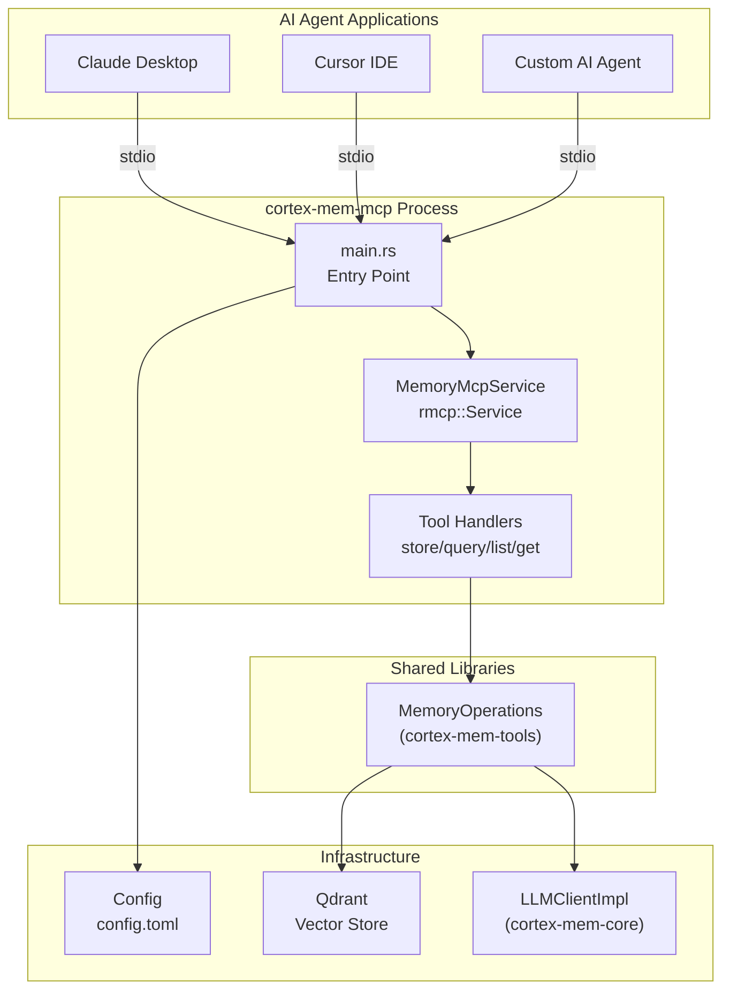
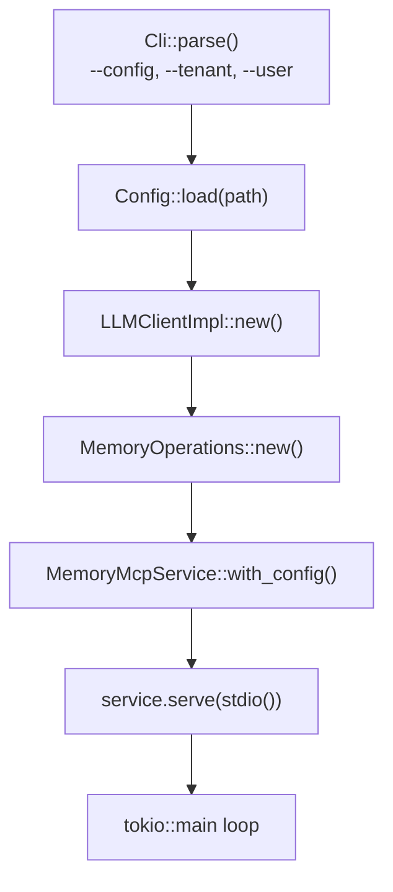
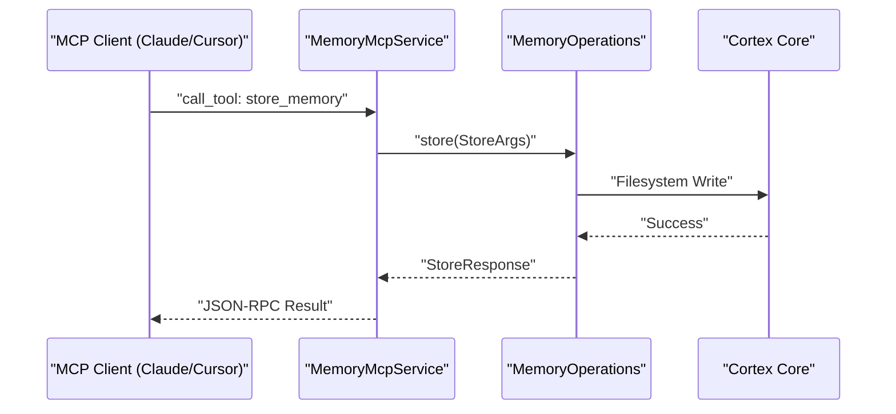

<!-- source: DeepWiki mcp.deepwiki.com · repo sopaco/cortex-mem · page 4.2 MCP Server · fetched 2026-10-26 -->

# MCP Server

<details>
<summary>Relevant source files</summary>

The following files were used as context for generating this wiki page:

- [cortex-mem-cli/README.md](cortex-mem-cli/README.md)
- [cortex-mem-cli/tests/cli_commands_test.rs](cortex-mem-cli/tests/cli_commands_test.rs)
- [cortex-mem-config/README.md](cortex-mem-config/README.md)
- [cortex-mem-core/README.md](cortex-mem-core/README.md)
- [cortex-mem-core/src/filesystem/operations.rs](cortex-mem-core/src/filesystem/operations.rs)
- [cortex-mem-mcp/README.md](cortex-mem-mcp/README.md)
- [cortex-mem-mcp/skill/SKILL.md](cortex-mem-mcp/skill/SKILL.md)
- [cortex-mem-mcp/src/main.rs](cortex-mem-mcp/src/main.rs)
- [cortex-mem-mcp/src/service.rs](cortex-mem-mcp/src/service.rs)
- [cortex-mem-rig/README.md](cortex-mem-rig/README.md)
- [cortex-mem-service/README.md](cortex-mem-service/README.md)
- [cortex-mem-tools/README.md](cortex-mem-tools/README.md)
- [cortex-mem-tools/src/docs/commit.md](cortex-mem-tools/src/docs/commit.md)
- [cortex-mem-tools/src/docs/explore.md](cortex-mem-tools/src/docs/explore.md)
- [cortex-mem-tools/src/docs/ls.md](cortex-mem-tools/src/docs/ls.md)
- [cortex-mem-tools/src/docs/recall.md](cortex-mem-tools/src/docs/recall.md)
- [cortex-mem-tools/src/docs/search.md](cortex-mem-tools/src/docs/search.md)
- [cortex-mem-tools/src/docs/store.md](cortex-mem-tools/src/docs/store.md)
- [cortex-mem-tools/src/errors.rs](cortex-mem-tools/src/errors.rs)
- [cortex-mem-tools/src/lib.rs](cortex-mem-tools/src/lib.rs)
- [cortex-mem-tools/src/mcp/definitions.rs](cortex-mem-tools/src/mcp/definitions.rs)
- [cortex-mem-tools/src/tools/mod.rs](cortex-mem-tools/src/tools/mod.rs)
- [cortex-mem-tools/src/tools/recall.rs](cortex-mem-tools/src/tools/recall.rs)
- [cortex-mem-tools/src/tools/search.rs](cortex-mem-tools/src/tools/search.rs)
- [cortex-mem-tools/src/types.rs](cortex-mem-tools/src/types.rs)
- [examples/cortex-mem-tars/README.md](examples/cortex-mem-tars/README.md)

</details>


This document covers the `cortex-mem-mcp` crate, which provides a Model Context Protocol (MCP) server for exposing memory management capabilities to AI agents through stdio transport. The MCP server enables AI agents like Claude and Cursor to store, query, and manage memories using standardized tool invocations.

## Architecture Overview

The MCP server acts as a bridge between AI agents and the core memory management system, translating MCP tool calls into memory operations. It operates as a standalone process communicating via stdin/stdout, making it compatible with MCP-aware applications.

### System Context Diagram



Sources: [cortex-mem-mcp/src/main.rs:1-164](), [cortex-mem-mcp/src/service.rs:1-350]()

### Core Components

The MCP server consists of three primary components:

| Component | File | Purpose |
|-----------|------|---------|
| **`main.rs`** | [cortex-mem-mcp/src/main.rs:59-164]() | CLI argument parsing, logging initialization, and service startup. |
| **`MemoryMcpService`** | [cortex-mem-mcp/src/service.rs:242-260]() | Routes MCP tool calls to `MemoryOperations`. |
| **`MemoryOperations`** | [cortex-mem-tools/src/operations.rs:1-100]() | Unified API for memory operations with payload conversion. |

Sources: [cortex-mem-mcp/src/main.rs:1-164](), [cortex-mem-mcp/src/service.rs:1-260]()

## Service Implementation

### Initialization Process

The server is initialized by loading a `Config` object and setting up the `MemoryOperations` orchestrator.



Sources: [cortex-mem-mcp/src/main.rs:59-151]()

### Auto-Trigger Mechanism

The MCP server includes an `AutoTriggerConfig` to handle clients (like Zed) that do not explicitly close sessions. This mechanism triggers memory processing (extraction and indexing) based on message counts or inactivity.

| Parameter | Default | Description |
|-----------|---------|-------------|
| `message_count_threshold` | `10` | Trigger after N messages are stored. |
| `min_process_interval_secs` | `300` | Minimum time between triggers. |
| `inactivity_timeout_secs` | `120` | Trigger if no activity for N seconds. |

Sources: [cortex-mem-mcp/src/service.rs:22-43](), [cortex-mem-mcp/src/main.rs:127-147]()

### Tool Execution Flow

The server uses the `rmcp` crate to route JSON-RPC requests to specific tool handlers.



Sources: [cortex-mem-mcp/src/service.rs:262-350](), [cortex-mem-mcp/src/main.rs:150-161]()

## Tool Definitions

The MCP server exposes a set of tools that allow agents to interact with the tiered memory system (L0 Abstract, L1 Overview, L2 Full Content).

### Available Tools

| Tool Name | Handler | Purpose |
|-----------|---------|---------|
| `store_memory` | `store_memory` | Store new content in a session/thread. |
| `query_memory` | `query_memory` | Semantic vector search across layers. |
| `list_memories` | `ls_memories` | Browse memory URIs (cortex://). |
| `get_memory` | `get_content` | Retrieve full L2 content. |
| `get_abstract` | `get_abstract` | Retrieve L0 summary (~100 tokens). |
| `get_overview` | `get_overview` | Retrieve L1 structured overview. |

Sources: [cortex-mem-mcp/src/service.rs:262-350](), [cortex-mem-mcp/README.md:16-160]()

### Parameter Mapping and Defaults

The server maps MCP arguments to internal tool structures. A key feature is the handling of `tenant` and `user` IDs:

*   **Tenant ID**: Used for infrastructure isolation (e.g., `local-agent`). Set via CLI `--tenant`. [cortex-mem-mcp/src/main.rs:24-26]()
*   **User ID**: The identity for the memory URI (`cortex://user/{user_id}/...`). If not provided via CLI `--user`, it defaults to `"default"` within `MemoryOperations`. [cortex-mem-mcp/src/main.rs:28-34](), [cortex-mem-mcp/src/main.rs:119-119]()

## Configuration

### CLI Arguments

| Argument | Default | Description |
|----------|---------|-------------|
| `--config` | `config.toml` | Path to the system configuration. |
| `--tenant` | `default` | Tenant ID for memory isolation. |
| `--user` | `None` | Default user ID for storage. |
| `--log-file` | `None` | File path for logs (stdio is reserved for MCP). |
| `--no-auto-trigger`| `false` | Disable automatic background processing. |

Sources: [cortex-mem-mcp/src/main.rs:19-56]()

### Logging and Diagnostics

Because MCP uses `stdio` for JSON-RPC communication, standard output (`stdout`) cannot be used for logging.
*   **Logging to File**: If `--log-file` is provided, the server initializes `tracing_subscriber` to write to that file. [cortex-mem-mcp/src/main.rs:64-79]()
*   **Standard Error**: If no log file is provided, logging is effectively disabled or redirected to `stderr` depending on the environment. [cortex-mem-mcp/src/main.rs:52-54]()

## Integration Patterns

### Claude Desktop Integration

To use Cortex Memory with Claude Desktop, add the following to `claude_desktop_config.json`:

```json
{
  "mcpServers": {
    "cortex-memory": {
      "command": "cortex-mem-mcp",
      "args": [
        "--config", "/path/to/config.toml",
        "--tenant", "my-tenant-id",
        "--log-file", "/path/to/mcp.log"
      ]
    }
  }
}
```

Sources: [cortex-mem-mcp/README.md:275-290]()

### Memory URI Scoping

Agents can use URIs to scope their operations. The MCP server supports standard patterns:
*   `cortex://session`: All session-related memories.
*   `cortex://user/{user-id}`: Memories specific to a user.
*   `cortex://agent/{agent-id}`: Memories specific to an agent.

Sources: [cortex-mem-mcp/README.md:116-124]()

---

