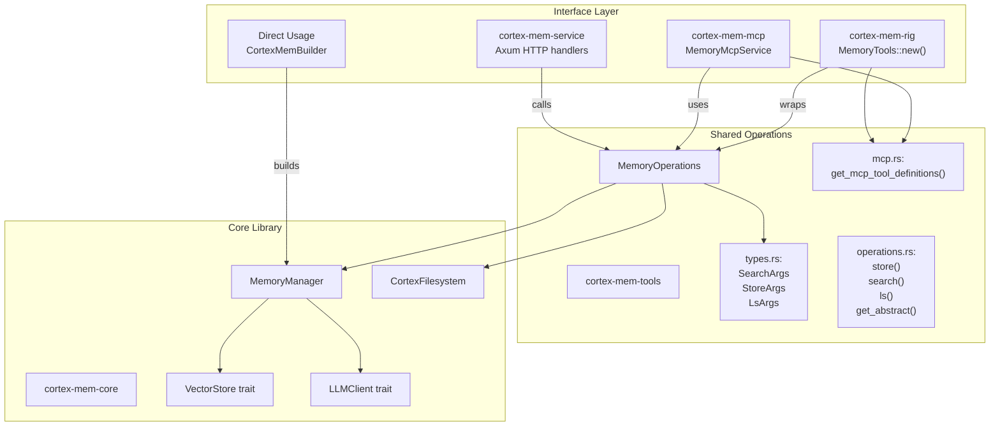
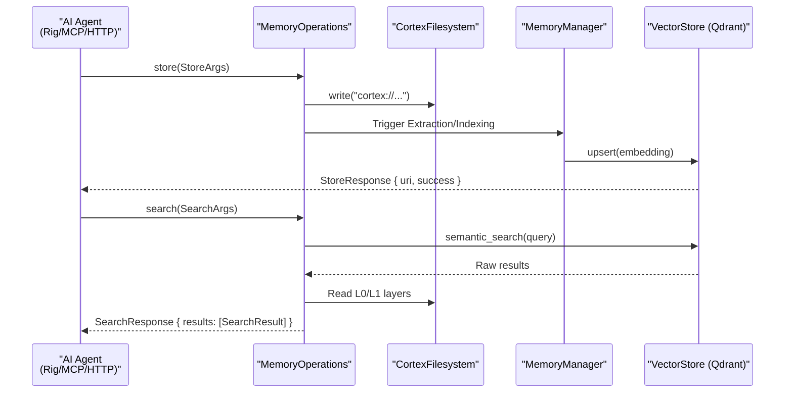
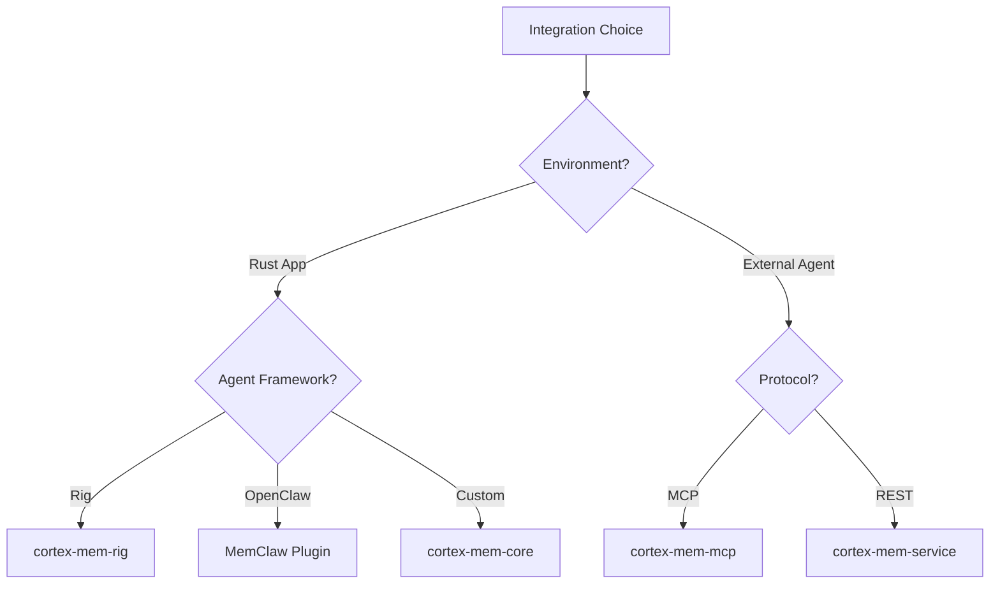

<!-- source: DeepWiki mcp.deepwiki.com · repo sopaco/cortex-mem · page 5 Integration Guides · fetched 2026-10-26 -->

# Integration Guides

Relevant source files

The following files were used as context for generating this wiki page:

- [cortex-mem-cli/README.md](cortex-mem-cli/README.md)
- [cortex-mem-cli/tests/cli_commands_test.rs](cortex-mem-cli/tests/cli_commands_test.rs)
- [cortex-mem-config/README.md](cortex-mem-config/README.md)
- [cortex-mem-core/README.md](cortex-mem-core/README.md)
- [cortex-mem-core/src/filesystem/operations.rs](cortex-mem-core/src/filesystem/operations.rs)
- [cortex-mem-mcp/README.md](cortex-mem-mcp/README.md)
- [cortex-mem-mcp/src/main.rs](cortex-mem-mcp/src/main.rs)
- [cortex-mem-rig/README.md](cortex-mem-rig/README.md)
- [cortex-mem-service/README.md](cortex-mem-service/README.md)
- [cortex-mem-tools/README.md](cortex-mem-tools/README.md)
- [cortex-mem-tools/src/errors.rs](cortex-mem-tools/src/errors.rs)
- [cortex-mem-tools/src/lib.rs](cortex-mem-tools/src/lib.rs)
- [cortex-mem-tools/src/types.rs](cortex-mem-tools/src/types.rs)
- [examples/cortex-mem-tars/README.md](examples/cortex-mem-tars/README.md)

This page provides integration guides for developers building applications with Cortex Memory. The system exposes its memory management capabilities through five primary integration methods, each optimized for different development scenarios and frameworks.

## Integration Methods Overview

| Method | Best For | Protocol | Language Support |
|--------|----------|----------|------------------|
| **RIG Framework** | Rust AI agents with autonomous memory | Native Rust library | Rust |
| **MCP Protocol** | AI agents (Claude, Cursor, etc.) | stdio JSON-RPC | Language-agnostic |
| **HTTP API** | Web services, microservices | REST over HTTP | Any (client libraries available) |
| **Direct Library** | Custom Rust applications | In-process function calls | Rust |
| **OpenClaw Plugin** | OpenClaw agent framework | Plugin architecture | Rust / Python |

For detailed implementation guides:
- [RIG Framework Integration](#5.1) — Building memory-enabled agents with RIG.
- [MCP Client Integration](#5.2) — Connecting AI tools via Model Context Protocol.
- [HTTP Client Integration](#5.3) — REST API integration for web services.
- [Direct Library Integration](#5.4) — Using `cortex-mem-core` directly in Rust.
- [OpenClaw Plugin Integration](#5.5) — Integrating via the MemClaw plugin.

For the underlying operations API, see [Memory Operations & Shared Tools](#3.4).

---

## Integration Architecture

### Architecture Diagram: Code Entity Mapping

**Sources:** [cortex-mem-tools/src/lib.rs:1-19](), [cortex-mem-rig/src/lib.rs:90-117](), [cortex-mem-mcp/src/main.rs:108-142](), [cortex-mem-core/src/builder/mod.rs:1-100]()

### Key Architectural Components

| Component | Module Path | Purpose |
|-----------|-------------|---------|
| `MemoryOperations` | `cortex_mem_tools::operations` | High-level interface for unified access to tiered memory (L0/L1/L2) |
| `StoreArgs` / `SearchArgs` | `cortex_mem_tools::types` | Type-safe argument structures for memory operations |
| `get_mcp_tool_definitions()` | `cortex_mem_tools::mcp` | Generates standard tool schemas for MCP and RIG |
| `MemoryMcpService` | `cortex_mem_mcp::service` | MCP server implementing tool execution and auto-triggering |
| `MemoryTools` | `cortex_mem_rig` | Factory providing Rig-compatible tool implementations |
| `CortexMemBuilder` | `cortex_mem_core::builder` | Unified initialization API for core library components |

**Sources:** [cortex-mem-tools/src/operations.rs:1-200](), [cortex-mem-tools/src/types.rs:1-220](), [cortex-mem-mcp/src/main.rs:127-143](), [cortex-mem-rig/src/lib.rs:85-117](), [cortex-mem-core/README.md:47-80]()

---

## The Shared Tools Layer

The `cortex-mem-tools` crate provides the foundation for all integrations. It implements tiered access (L0/L1/L2) and ensures identical behavior across all interfaces.

### Tiered Access Architecture

| Layer | Size | Purpose | Primary Method |
|-------|------|---------|----------------|
| **L0 Abstract** | ~100 tokens | Quick relevance judgment | `get_abstract()` |
| **L1 Overview** | ~2000 tokens | Partial context understanding | `get_overview()` |
| **L2 Full** | Complete | Deep analysis and processing | `read_file()` |

**Sources:** [cortex-mem-tools/README.md:139-146](), [cortex-mem-rig/README.md:9-16]()

### Standard Operation Flow

**Sources:** [cortex-mem-tools/src/operations.rs:50-150](), [cortex-mem-tools/README.md:147-188](), [cortex-mem-core/README.md:148-183]()

---

## Choosing an Integration Method

### Decision Matrix

### Integration Comparison

| Aspect | RIG Framework | MCP Protocol | HTTP API | Direct Library |
|--------|---------------|--------------|----------|----------------|
| **Primary Use** | Rig-based Agents | Claude/Cursor | Web/Mobile Apps | Custom Rust Logic |
| **Protocol** | Native Rust | stdio JSON-RPC | REST / JSON | Function Calls |
| **Isolation** | Tenant-based | Tenant-based | Multi-tenant | Manual |
| **Auto-Extraction** | On Close | Inactivity/Threshold | Triggered | Manual |

**Sources:** [cortex-mem-rig/README.md:1-24](), [cortex-mem-mcp/README.md:1-16](), [cortex-mem-service/README.md:1-14](), [cortex-mem-mcp/src/main.rs:126-140]()

---

## Common Integration Concepts

### Tenant and User Isolation
All integrations utilize the `tenant_id` for infrastructure isolation (mapping to physical directories and vector collections) and `user_id` for logical identity within the `cortex://user/{user_id}` URI scheme.

- **Tenant ID**: Configured at startup via `--tenant` or `Config`. [cortex-mem-mcp/src/main.rs:24-32]()
- **User ID**: Optional per-operation identifier. If omitted, defaults to "default". [cortex-mem-mcp/src/main.rs:33-35]()

### URI Scheme (`cortex://`)
All interfaces interact with the virtual filesystem using standard URIs:
- `cortex://session/{thread_id}/timeline` — Conversational history.
- `cortex://user/{user_id}/` — User-specific long-term facts.
- `cortex://agent/{agent_id}/` — Agent-specific knowledge.

**Sources:** [cortex-mem-core/README.md:185-200](), [cortex-mem-mcp/README.md:117-124]()

---

## Next Steps

- To integrate with the **Rig** framework, see [RIG Framework Integration](#5.1).
- To connect **Claude Desktop** or **Cursor**, see [MCP Client Integration](#5.2).
- To build a **Web Dashboard**, see [HTTP Client Integration](#5.3).
- To embed memory in a **CLI tool**, see [Direct Library Integration](#5.4).

---

