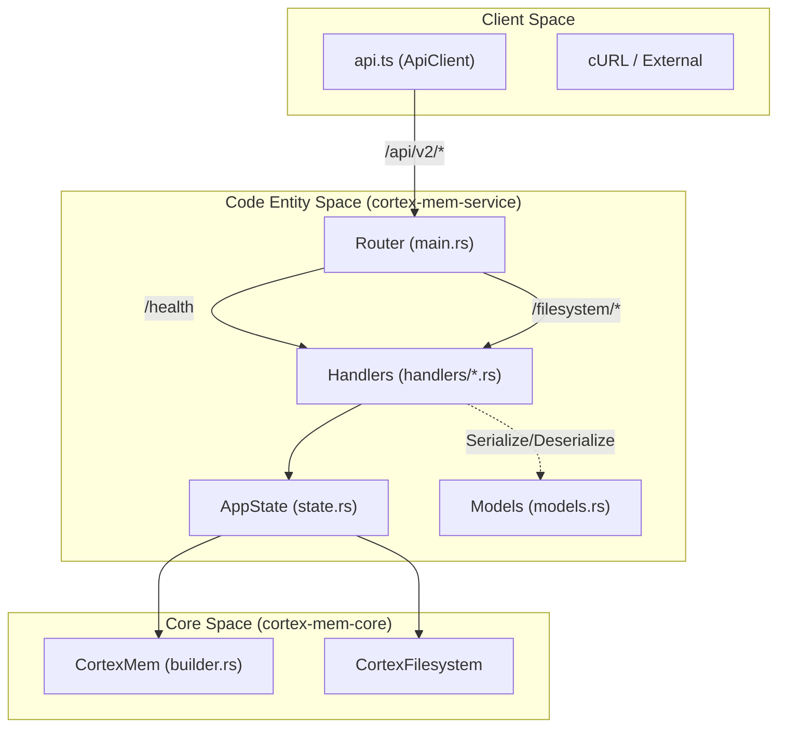
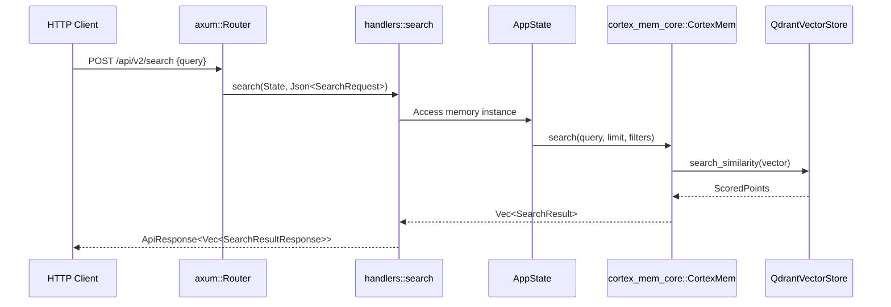

<!-- source: DeepWiki mcp.deepwiki.com · repo sopaco/cortex-mem · page 5.3 HTTP Client Integration · fetched 2026-10-26 -->

# HTTP Client Integration

<details>
<summary>Relevant source files</summary>

The following files were used as context for generating this wiki page:

- [cortex-mem-core/src/builder.rs](cortex-mem-core/src/builder.rs)
- [cortex-mem-core/src/embedding/client.rs](cortex-mem-core/src/embedding/client.rs)
- [cortex-mem-insights/src/lib/api.ts](cortex-mem-insights/src/lib/api.ts)
- [cortex-mem-insights/src/lib/pages/Dashboard.svelte](cortex-mem-insights/src/lib/pages/Dashboard.svelte)
- [cortex-mem-insights/src/lib/pages/Search.svelte](cortex-mem-insights/src/lib/pages/Search.svelte)
- [cortex-mem-insights/src/lib/stores/search.ts](cortex-mem-insights/src/lib/stores/search.ts)
- [cortex-mem-insights/src/lib/stores/tenant.ts](cortex-mem-insights/src/lib/stores/tenant.ts)
- [cortex-mem-insights/src/lib/types.ts](cortex-mem-insights/src/lib/types.ts)
- [cortex-mem-service/src/handlers/filesystem.rs](cortex-mem-service/src/handlers/filesystem.rs)
- [cortex-mem-service/src/handlers/mod.rs](cortex-mem-service/src/handlers/mod.rs)
- [cortex-mem-service/src/main.rs](cortex-mem-service/src/main.rs)
- [cortex-mem-service/src/models.rs](cortex-mem-service/src/models.rs)
- [cortex-mem-service/src/routes/filesystem.rs](cortex-mem-service/src/routes/filesystem.rs)
- [cortex-mem-service/src/routes/mod.rs](cortex-mem-service/src/routes/mod.rs)
- [examples/@memclaw/plugin/skills/memclaw/references/best-practices.md](examples/@memclaw/plugin/skills/memclaw/references/best-practices.md)
- [examples/locomo-evaluation/benchmark/index.html](examples/locomo-evaluation/benchmark/index.html)

</details>


This document provides a technical guide for building HTTP clients to interact with the Cortex Memory system via the `cortex-mem-service`. It covers authentication, request formats, error handling patterns, and language-specific implementation details.

The `cortex-mem-service` acts as a RESTful wrapper around the `cortex-mem-core` library, exposing memory management capabilities over HTTP using the Axum framework.

## Connection Setup

The service is initialized in `cortex-mem-service/src/main.rs` and provides a multi-tenant capable API.

### Service Configuration
The service is typically started with a data directory and an optional configuration file.
- **Default Port**: 8085 [cortex-mem-service/src/main.rs:39-40]()
- **Default Host**: localhost [cortex-mem-service/src/main.rs:35-36]()
- **Base API Path**: `/api/v2` [cortex-mem-service/src/main.rs:136-136]()

### System Entity Mapping
The following diagram bridges the high-level HTTP concepts to the specific code entities in the `cortex-mem-service` crate.


**Diagram: Entity Mapping from Client to Core Service**  
Sources: [cortex-mem-service/src/main.rs:129-139](), [cortex-mem-service/src/state.rs:1-20](), [cortex-mem-insights/src/lib/api.ts:15-21]()

## Authentication and Multi-Tenancy

Cortex Memory implements tenant isolation through directory-based scoping. While the current service uses permissive CORS for development, it supports switching between different tenant contexts.

### Tenant Management
Clients can list and switch tenants to scope their filesystem and memory operations.
- **List Tenants**: `GET /api/v2/tenants` [cortex-mem-insights/src/lib/api.ts:59-61]()
- **Switch Tenant**: `POST /api/v2/tenants/switch` with body `{"tenant_id": "string"}` [cortex-mem-insights/src/lib/api.ts:63-70]()

### Security Configuration
The service applies a permissive CORS layer by default to facilitate integration with web dashboards like `cortex-mem-insights`.
Sources: [cortex-mem-service/src/main.rs:137-137]()

## Request and Response Formats

All API interactions use JSON. The service employs a standard response envelope to ensure consistent error handling across clients.

### Standard Response Envelope
Defined in `cortex-mem-service/src/models.rs`, the `ApiResponse<T>` structure is used for all successful and failed requests.

| Field | Type | Description |
| :--- | :--- | :--- |
| `success` | Boolean | Indicates if the operation completed without errors. |
| `data` | T \| null | The payload of the response (generic). |
| `error` | String \| null | Error message if `success` is false. |
| `timestamp` | DateTime | RFC3339 timestamp of the response. |

Sources: [cortex-mem-service/src/models.rs:5-11](), [cortex-mem-insights/src/lib/api.ts:8-13]()

## Core API Operations

### 1. Semantic Search
Semantic search allows querying memories using natural language. It requires both an Embedding service and a Vector Store (Qdrant) to be configured.

**Endpoint**: `POST /api/v2/search`  
**Request Model**: `SearchRequest` [cortex-mem-service/src/models.rs:111-120]()
- `query`: The search string.
- `limit`: Max results (default 10).
- `return_layers`: Array of layers to return (e.g., `["L0", "L1"]`). Defaults to `["L0"]`. [cortex-mem-service/src/models.rs:118-124]()

**Response**: `SearchResultResponse` [cortex-mem-service/src/models.rs:128-142]()

### 2. Filesystem Operations
Cortex uses a virtual filesystem scheme (`cortex://`).

- **List Directory**: `GET /api/v2/filesystem/list?uri=cortex://session` [cortex-mem-service/src/handlers/filesystem.rs:18-21]()
- **Read File**: `GET /api/v2/filesystem/read/{path}` [cortex-mem-service/src/handlers/filesystem.rs:128-131]()
- **Write File**: `POST /api/v2/filesystem/write` [cortex-mem-service/src/handlers/filesystem.rs:155-158]()

### 3. Session Management
- **List Sessions**: `GET /api/v2/sessions` [cortex-mem-insights/src/lib/api.ts:104-106]()
- **Close and Wait**: `POST /api/v2/sessions/{id}/close-and-wait` - Used to ensure background extraction and indexing are complete before returning. [cortex-mem-service/src/models.rs:62-69]()

## Error Handling

The service uses a custom `AppError` enum to map internal logic failures to HTTP status codes.

| Error Scenario | HTTP Status | Response `error` field |
| :--- | :--- | :--- |
| Vector Store not configured | 500 | "Search service is not configured..." |
| File not found | 404 | "Failed to read file..." |
| Internal Task Failure | 500 | "Failed to list directory..." |

Sources: [cortex-mem-insights/src/lib/pages/Search.svelte:29-33](), [cortex-mem-service/src/handlers/filesystem.rs:57-57]()

## Implementation Examples

### TypeScript (Axios/Fetch Pattern)
The `ApiClient` in the insights dashboard provides a robust pattern for handling the standard envelope and tenant switching.

```typescript
// Example search implementation
async search(keyword: string, scope: string = 'all', limit: number = 10) {
    const body = {
        query: keyword,
        limit: limit,
        thread: scope === 'all' ? null : scope
    };
    
    const response = await fetch('/api/v2/search', {
        method: 'POST',
        headers: { 'Content-Type': 'application/json' },
        body: JSON.stringify(body)
    });
    
    const json = await response.json();
    if (!json.success) throw new Error(json.error);
    return json.data;
}
```
Sources: [cortex-mem-insights/src/lib/api.ts:109-125]()

### Rust (Direct Integration via Core)
If building a Rust-based service, use the `CortexMemBuilder` to initialize the core logic directly instead of calling the HTTP API.

```rust
let memory = CortexMemBuilder::new("./data")
    .with_qdrant(qdrant_config)
    .with_llm(llm_client)
    .build()
    .await?;
```
Sources: [cortex-mem-core/src/builder.rs:20-74]()

## Data Flow: Search Request
The following diagram illustrates the flow of a search request from the HTTP client through the service layers to the vector database.


Sources: [cortex-mem-service/src/main.rs:134-139](), [cortex-mem-core/src/builder.rs:99-115](), [cortex-mem-insights/src/lib/api.ts:109-125]()

---

