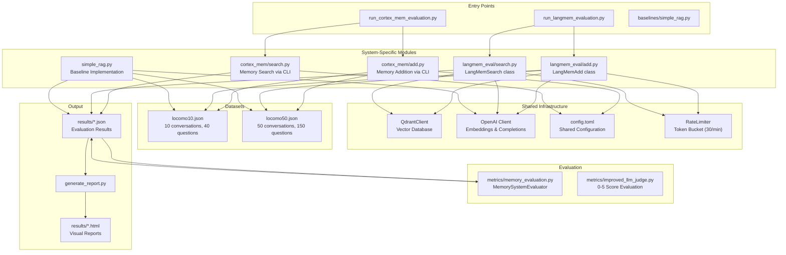
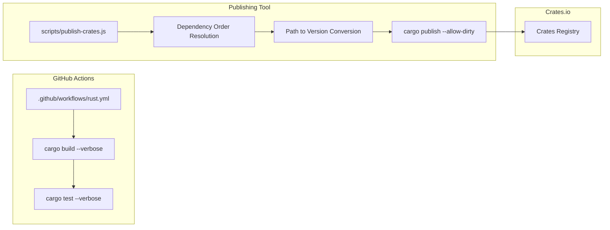

<!-- source: DeepWiki mcp.deepwiki.com · repo sopaco/cortex-mem · page 6 Development & Testing · fetched 2026-10-26 -->

# Development & Testing

Relevant source files

The following files were used as context for generating this wiki page:

- [.github/workflows/rust.yml](.github/workflows/rust.yml)
- [scripts/publish-crates.js](scripts/publish-crates.js)

This section provides resources for developers contributing to Cortex Memory and researchers evaluating memory system performance. It covers the evaluation framework, architecture decisions, and contribution guidelines.

For integration with external frameworks, see [Integration Guides](#5). For API usage, see [API Reference](#7).

## Overview

Cortex Memory includes a comprehensive evaluation framework for benchmarking memory system performance against industry standards. The system enables:

- **Comparative Benchmarking**: Test Cortex Memory against LangMem, Simple RAG, and other memory systems.
- **Standard Metrics**: Recall@K, Precision@K, MRR, NDCG, semantic similarity, and keyword F1 scores.
- **Multiple Datasets**: Small (10 conversations, 40 questions) and full (50 conversations, 150 questions) test sets.
- **HTML Reports**: Visual comparison reports with statistical analysis and confidence intervals.

The evaluation framework is located in `examples/lomoco-evaluation/` and is Python-based to facilitate interoperability with multiple memory system implementations.

**Sources:** [examples/lomoco-evaluation/README.md:1-50]()

## Evaluation Framework Architecture

The `lomoco-evaluation` framework is designed for cross-system comparison, enabling benchmarking of Cortex Memory against other memory management systems using identical test datasets and evaluation metrics.

**Evaluation Framework Architecture**

**Sources:** [examples/lomoco-evaluation/README.md:17-45](), [examples/lomoco-evaluation/src/langmem_eval/add.py:1-68](), [examples/lomoco-evaluation/src/langmem_eval/search.py:1-104]()

## CI/CD and Publishing

Cortex Memory utilizes GitHub Actions for continuous integration and custom Node.js scripts for managing workspace-wide crate publishing to crates.io.

**CI and Publishing Workflow**

### Automated Testing
The project maintains a Rust CI workflow [`.github/workflows/rust.yml:1-27`]() that triggers on every push and pull request to the `main` branch. It installs necessary system dependencies like `libasound2-dev` and `libxcb1-dev` [`.github/workflows/rust.yml:19-22`]() before executing `cargo build` and `cargo test` [`.github/workflows/rust.yml:23-26`]().

### Workspace Publishing
The `scripts/publish-crates.js` utility automates the release of the modular monolith crates in a specific dependency order to satisfy registry requirements [`scripts/publish-crates.js:27-38`]().

1.  **Dependency Ordering**: Crates are published in the order: `config` -> `core` -> `tools` -> `rig` -> (`service`, `cli`, `mcp`) [`scripts/publish-crates.js:28-38`]().
2.  **Path Dependency Conversion**: The script dynamically converts local path dependencies (e.g., `{ path = "../cortex-mem-core" }`) into versioned dependencies (e.g., `{ version = "0.1.0" }`) before publishing [`scripts/publish-crates.js:87-130`]().
3.  **Registry Verification**: It polls the crates.io API to ensure a crate is fully available before attempting to publish its dependents [`scripts/publish-crates.js:179-205`]().

**Sources:** [scripts/publish-crates.js:27-38](), [scripts/publish-crates.js:87-130](), [scripts/publish-crates.js:179-205](), [.github/workflows/rust.yml:1-27]()

## Child Pages

For deep technical details on specific development areas, refer to the following sub-pages:

- **[Evaluation Framework](#6.1)**: Detailed architecture of the `lomoco-evaluation` framework, dataset schemas, and performance comparison methodology.
- **[Architecture Decisions](#6.2)**: Documentation of key design choices including the use of MCP, the modular monolith pattern, and lazy agent loading.
- **[Contributing Guidelines](#6.3)**: Comprehensive guide for contributors, covering code style, PR processes, and detailed usage of the `scripts/publish-crates.js` tool.

**Sources:** [scripts/publish-crates.js:220-223](), [examples/lomoco-evaluation/README.md:431-456]()

---

