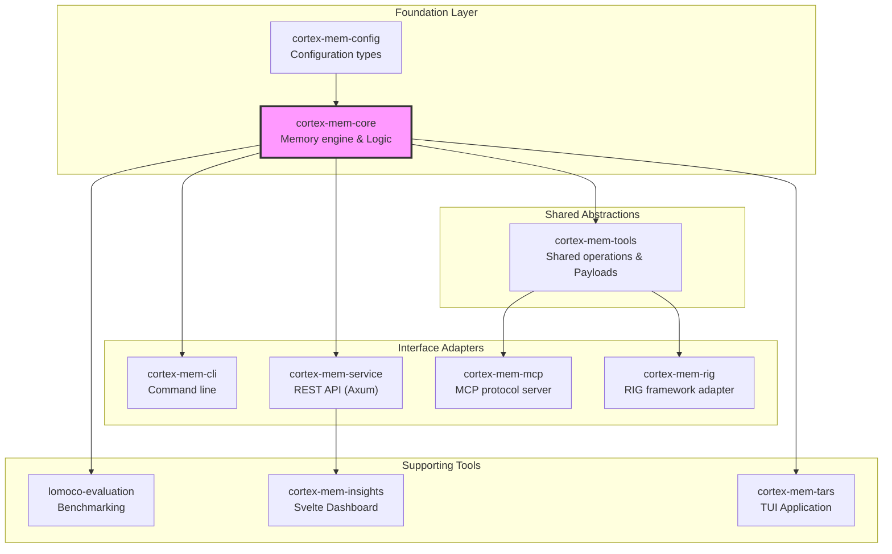
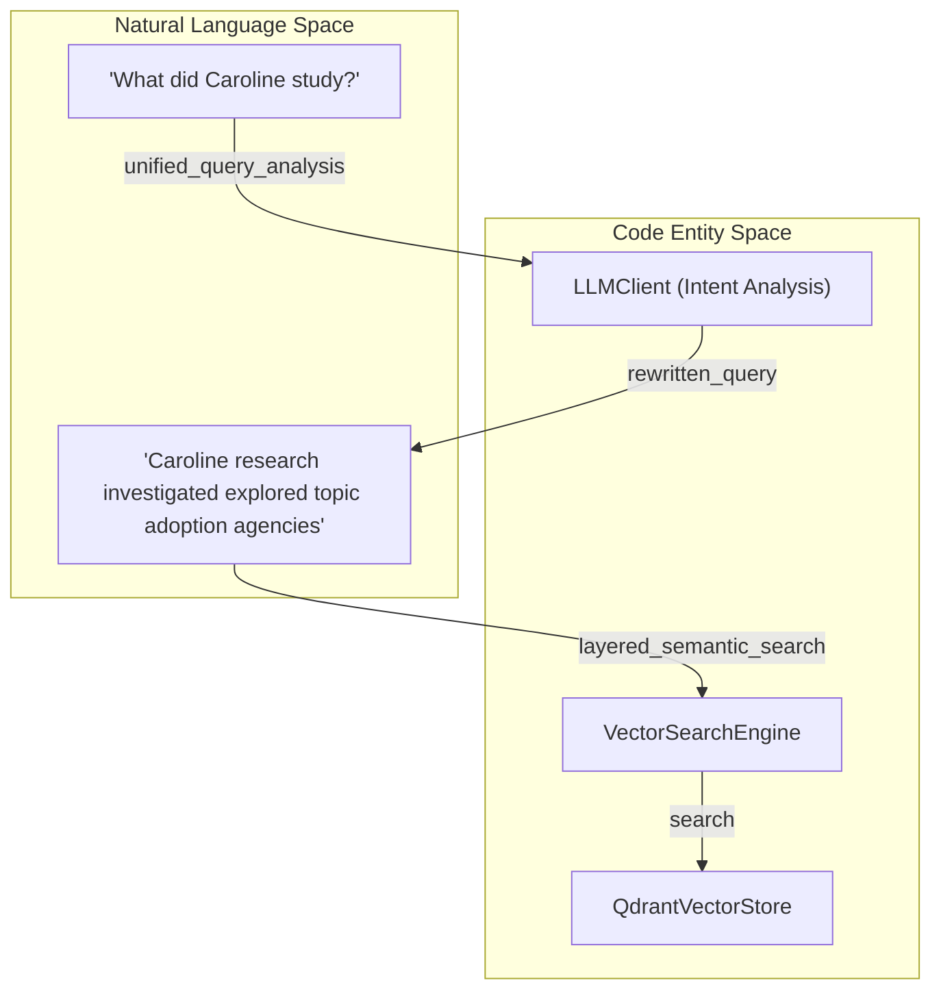

<!-- source: DeepWiki mcp.deepwiki.com · repo sopaco/cortex-mem · page 6.2 Architecture Decisions · fetched 2026-10-26 -->

# Architecture Decisions

Relevant source files

The following files were used as context for generating this wiki page:

- [README.md](README.md)
- [README_zh.md](README_zh.md)
- [cortex-mem-core/src/incremental_memory_updater.rs](cortex-mem-core/src/incremental_memory_updater.rs)
- [cortex-mem-core/src/llm/prompts.rs](cortex-mem-core/src/llm/prompts.rs)
- [cortex-mem-core/src/search/vector_engine.rs](cortex-mem-core/src/search/vector_engine.rs)
- [cortex-mem-service/src/handlers/automation.rs](cortex-mem-service/src/handlers/automation.rs)
- [cortex-mem-service/src/handlers/search.rs](cortex-mem-service/src/handlers/search.rs)
- [cortex-mem-service/src/handlers/sessions.rs](cortex-mem-service/src/handlers/sessions.rs)
- [cortex-mem-service/src/routes/automation.rs](cortex-mem-service/src/routes/automation.rs)
- [cortex-mem-service/src/state.rs](cortex-mem-service/src/state.rs)
- [examples/@memclaw/bin-darwin-arm64/bin/README.md](examples/@memclaw/bin-darwin-arm64/bin/README.md)
- [examples/locomo-evaluation/eval.py](examples/locomo-evaluation/eval.py)
- [litho.docs/en/2.Architecture.md](litho.docs/en/2.Architecture.md)
- [litho.docs/en/3.Workflow.md](litho.docs/en/3.Workflow.md)
- [litho.docs/en/4.Deep-Exploration/Core Infrastructure Domain.md](litho.docs/en/4.Deep-Exploration/Core Infrastructure Domain.md)
- [litho.docs/en/4.Deep-Exploration/Extraction Engine Domain.md](litho.docs/en/4.Deep-Exploration/Extraction Engine Domain.md)
- [litho.docs/en/4.Deep-Exploration/Search Engine Domain.md](litho.docs/en/4.Deep-Exploration/Search Engine Domain.md)

## Purpose and Scope

This document explains the key architectural decisions made in the Cortex Memory system, including the rationale behind design patterns, trade-offs considered, and structural choices. It focuses on **why** certain approaches were taken rather than **how** the system works. For information about the overall system structure, see [System Architecture](). For implementation details of specific components, see [Core Architecture]().

---

## 1. Modular Monolith & Crate Architecture

### Decision: Multi-Crate Workspace Structure

The Cortex Memory project is organized as a Cargo workspace with specialized crates. While it functions as a "modular monolith" in deployment (often running as a single process), the code is strictly partitioned to enforce boundaries.

**Rationale:**
1. **Separation of Concerns**: `cortex-mem-core` contains the business logic (extraction, indexing), while `cortex-mem-service` handles HTTP concerns [litho.docs/en/2.Architecture.md:17-21]().
2. **Independent Deployment**: Users can choose to deploy only the MCP server (`cortex-mem-mcp`) or the full TUI (`cortex-mem-tars`).
3. **Build Velocity**: Rust's incremental compilation benefits from smaller, decoupled crates.

**Sources:** [litho.docs/en/2.Architecture.md:175-180](), [cortex-mem-service/src/state.rs:1-11]()

---

## 2. Model Context Protocol (MCP) Integration

### Decision: Native MCP Support

Cortex Memory implements the Model Context Protocol (MCP) to serve as a standardized memory provider for AI agents (like Claude Desktop or Cursor).

**Rationale:**
1. **Interoperability**: MCP allows any compliant AI client to use Cortex Memory as a "tool" without custom integration code.
2. **Standardized Tooling**: Tools like `query_memory` and `store_memory` are exposed via JSON-RPC over stdio, making the memory system "agent-native" [litho.docs/en/2.Architecture.md:150-153]().

**Sources:** [litho.docs/en/2.Architecture.md:103-104](), [README.md:108-109]()

---

## 3. Layered Retrieval & Intent Analysis

### Decision: Token-Efficient Tiered Search (L0/L1/L2)

To solve the "context window" problem, the system uses a three-tier hierarchy:
- **L0 (Abstract)**: ~100 tokens for quick relevance [cortex-mem-core/src/llm/prompts.rs:8-10]().
- **L1 (Overview)**: ~500-2000 tokens structured markdown [cortex-mem-core/src/llm/prompts.rs:38-42]().
- **L2 (Detail)**: Full original content.

**Rationale:**
1. **Cost Reduction**: By searching L0/L1 first, the system avoids feeding massive L2 documents into the LLM unless necessary, saving up to 95% in token costs [README_zh.md:57-60]().
2. **Intent Analysis**: The `VectorSearchEngine` uses an LLM to rewrite queries before searching to improve recall (e.g., adding synonyms) [cortex-mem-core/src/llm/prompts.rs:132-136]().
3. **Lazy Loading**: L0/L1 layers are generated only when needed or triggered by events [cortex-mem-service/src/handlers/sessions.rs:169-172]().

**Sources:** [cortex-mem-core/src/search/vector_engine.rs:56-71](), [cortex-mem-service/src/handlers/search.rs:38-55](), [cortex-mem-core/src/llm/prompts.rs:152-158]()

---

## 4. Event-Driven Incremental Updates

### Decision: Decoupled Background Processing

Memory extraction and indexing are handled asynchronously via a `MemoryEventCoordinator`.

**Rationale:**
1. **User Experience**: When a session closes, the API returns immediately while background tasks handle the heavy LLM extraction [cortex-mem-service/src/handlers/automation.rs:36-40]().
2. **Reliability**: If an LLM call fails during extraction, the system can retry without blocking the main interaction thread.
3. **Consistency**: The `CascadeLayerUpdater` ensures that when an L2 memory is added, the corresponding L1 overview and L0 abstract are automatically refreshed [README.md:114-115]().

**Sources:** [cortex-mem-service/src/state.rs:68-70](), [cortex-mem-service/src/handlers/sessions.rs:152-157]()

---

## 5. Generic Memory Processing

### Decision: Trait-Based Memory Items

To avoid boilerplate for different memory types (Preferences, Entities, Events), the system uses a `MemoryItem` trait.

**Rationale:**
1. **Extensibility**: Adding a new memory type only requires implementing the `MemoryItem` trait [cortex-mem-core/src/incremental_memory_updater.rs:35-53]().
2. **Uniform Pipeline**: All items follow the same `find_existing → hash → should_update?` logic [cortex-mem-core/src/incremental_memory_updater.rs:8-11]().

**Sources:** [cortex-mem-core/src/incremental_memory_updater.rs:57-178]()

---

## 6. Multi-Tenancy & Isolation

### Decision: Directory and Collection Partitioning

Cortex Memory supports multiple tenants (users/agents) within a single instance.

**Rationale:**
1. **Security**: Data is isolated at the filesystem level (tenant root directories) and vector level (tenant-specific collection suffixes) [litho.docs/en/2.Architecture.md:19-20]().
2. **Dynamic Switching**: The `AppState` allows switching tenants at runtime, rebuilding the `CortexMem` runtime for the specific tenant [cortex-mem-service/src/state.rs:16-19]().

**Sources:** [cortex-mem-service/src/state.rs:128-150](), [litho.docs/en/3.Workflow.md:32-33]()

---

## 7. Memory Forgetting Mechanism

### Decision: Ebbinghaus-Based Retention

To prevent "memory bloat" in long-running agents, the system implements an automated forgetting mechanism.

**Rationale:**
1. **Relevance**: Low-strength memories (rarely accessed or low importance) are archived [README.md:115-116]().
2. **Performance**: Searching through millions of irrelevant memories slows down retrieval; `filter_archived` ensures only active memories surface [cortex-mem-core/src/search/vector_engine.rs:139-144]().

**Sources:** [cortex-mem-core/src/search/vector_engine.rs:175-180](), [README_zh.md:130-131]()

---

## 8. Technology Stack Decisions

| Component | Choice | Rationale |
|-----------|--------|-----------|
| **Language** | Rust | Memory safety, performance, and concurrency [litho.docs/en/2.Architecture.md:71-72](). |
| **Vector DB** | Qdrant | Native Rust client, metadata filtering, and multi-tenant support [litho.docs/en/2.Architecture.md:72-73](). |
| **Web Framework** | Axum | Built on the Tower ecosystem; excellent for middleware and async [litho.docs/en/2.Architecture.md:73-74](). |
| **Frontend** | Svelte 5 | Reactive UI with minimal bundle size for the Insights dashboard [litho.docs/en/2.Architecture.md:74-75](). |
| **Storage** | Hybrid (FS + Vector) | Filesystem (`cortex://` URI) is the source of truth; Qdrant is the index [litho.docs/en/2.Architecture.md:20-21](). |

**Sources:** [litho.docs/en/2.Architecture.md:36-68](), [README.md:37-41]()

---

