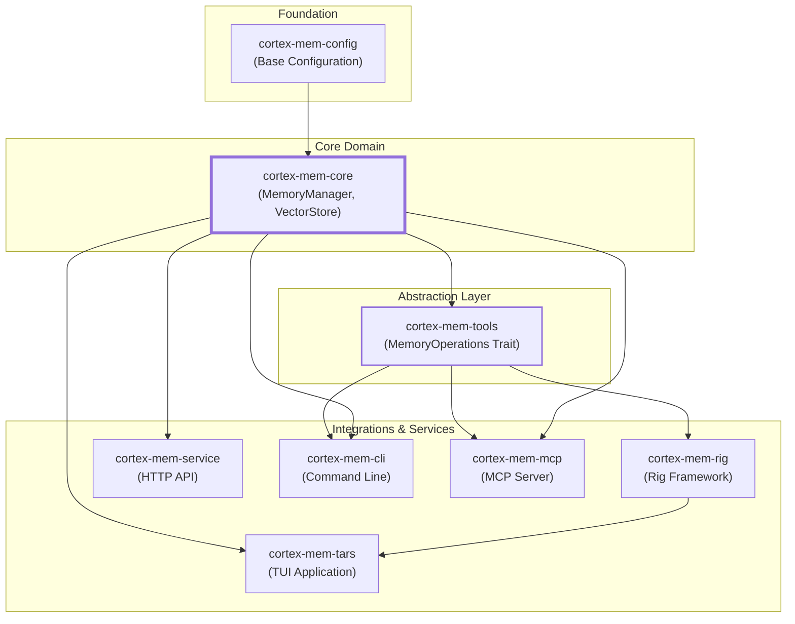

<!-- source: DeepWiki mcp.deepwiki.com · repo sopaco/cortex-mem · page 6.3 Contributing Guidelines · fetched 2026-10-26 -->

# Contributing Guidelines

<details>
<summary>Relevant source files</summary>

The following files were used as context for generating this wiki page:

- [.github/workflows/rust.yml](.github/workflows/rust.yml)
- [cortex-mem-core/src/llm/mod.rs](cortex-mem-core/src/llm/mod.rs)
- [litho.docs/en/1.Overview.md](litho.docs/en/1.Overview.md)
- [litho.docs/en/5.Boundary-Interfaces.md](litho.docs/en/5.Boundary-Interfaces.md)
- [scripts/.gitignore](scripts/.gitignore)
- [scripts/README.md](scripts/README.md)
- [scripts/package.json](scripts/package.json)
- [scripts/publish-crates.js](scripts/publish-crates.js)
- [scripts/update-versions.js](scripts/update-versions.js)

</details>


This document provides technical guidelines for contributing code, documentation, and tests to the `cortex-mem` project. It covers the development workflow, automation tooling for releases, and testing requirements.

---

## Repository Structure

The `cortex-mem` codebase is organized as a Cargo workspace. The system follows a modular monolith pattern where core logic is centralized in `cortex-mem-core` and exposed through specialized interfaces.

### Dependency Flow and Crate Hierarchy

The following diagram illustrates the internal dependency graph. This order is critical for the automated publishing process.

**Crate Dependency and Publishing Order**



**Sources:** [scripts/publish-crates.js:27-38](), [scripts/README.md:93-102]()

---

## Development Automation Tools

The project includes a suite of Node.js scripts in the `scripts/` directory to manage workspace-wide versions and the `crates.io` publishing pipeline.

### 1. Version Management (`update-versions.js`)

This script synchronizes version numbers across all `Cargo.toml` files in the workspace. It reads the master version from the root `Cargo.toml` (`[workspace.package].version`) and applies it to all sub-crates.

*   **Key Functions**:
    *   `getWorkspaceVersion()`: Extracts the source of truth version [scripts/update-versions.js:11-20]().
    *   `updateVersionInCargoToml(filePath)`: Updates the `[package].version` field unless `version.workspace = true` is set [scripts/update-versions.js:71-105]().
    *   `updateInternalDependencies(filePath)`: Updates the version strings for internal crate references (e.g., `cortex-mem-core = { version = "X.X.X" }`) [scripts/update-versions.js:108-152]().

**Usage**:
```bash
cd scripts && npm install
npm run update-versions
```

### 2. Publishing Pipeline (`publish-crates.js`)

The publishing tool automates the sequential release of crates to `crates.io`. Because crates depend on each other, they must be published in a specific order, waiting for each to become available on the registry before proceeding.

*   **Path Dependency Conversion**: `crates.io` does not allow path dependencies (e.g., `path = "../core"`). The script `prepareForPublishing` temporarily converts these to version dependencies before running `cargo publish` [scripts/publish-crates.js:88-130]().
*   **Availability Polling**: The `waitForCrateAvailability` function polls the `crates.io` API to ensure a crate is indexable before the next dependent crate attempts to publish [scripts/publish-crates.js:180-205]().
*   **Dependency Order**: The sequence is strictly: `config` -> `core` -> `tools` -> `rig` -> `service` -> `cli` -> `mcp` [scripts/publish-crates.js:30-38]().

**Sources:** [scripts/publish-crates.js:1-220](), [scripts/README.md:15-22]()

---

## Code Standards & CI

### Rust Standards

*   **Formatting**: All code must be formatted via `rustfmt`. The CI environment checks this using `cargo fmt --check` [.github/workflows/rust.yml:23-24]().
*   **Linting**: Use `cargo clippy`. PRs should not introduce new warnings.
*   **Testing**: Unit tests are required for all core logic. The CI pipeline executes `cargo test --verbose` on every push to `main` and on pull requests [.github/workflows/rust.yml:25-26]().

### Mocking for Tests

When writing tests that involve AI logic, use the `MockLLMClient` provided in the core library to avoid external API calls and costs.

*   **Location**: `cortex-mem-core/src/llm/mod.rs`
*   **Usage**: `MockLLMClient::with_response("expected output")` allows you to simulate specific LLM behaviors for unit testing [cortex-mem-core/src/llm/mod.rs:16-34]().

---

## Testing Frameworks

### Rust Unit & Integration Tests
Rust tests are located within the respective crate directories. For the `cortex-mem-service`, integration tests cover HTTP endpoints defined in `main.rs` and the various handlers [litho.docs/en/5.Boundary-Interfaces.md:69-216]().

### Evaluation Framework (`lomoco-evaluation`)
For performance and accuracy benchmarking, the system uses a Python-based evaluation suite.
*   **Data Flow**: The framework takes datasets (e.g., `locomo50.json`), processes them through system adapters (like `cortex_mem/add.py`), and calculates metrics such as Recall@K and MRR using `metrics/memory_evaluation.py`.
*   **Visual Reporting**: `generate_report.py` transforms raw JSON metrics into HTML visualizations for comparison between `cortex-mem` and baselines.

**Sources:** [litho.docs/en/1.Overview.md:107-108](), [scripts/README.md:125-127]()

---

## PR Process

1.  **Branching**: Create a feature branch from `main`.
2.  **Local Validation**:
    *   Run `cargo test --all`.
    *   Run `cargo clippy --all`.
3.  **Documentation**: If changing public interfaces, update the relevant `.md` files in `litho.docs/en/`.
4.  **Submission**: Open a PR. Ensure the GitHub Actions "Rust" workflow passes [.github/workflows/rust.yml:1-27]().
5.  **Review**: Address maintainer feedback.
6.  **Version Bump**: If the PR is ready for release, a maintainer will run the `update-versions.js` script to increment the workspace version.

**Sources:** [scripts/README.md:117-128](), [.github/workflows/rust.yml:3-8]()

---

