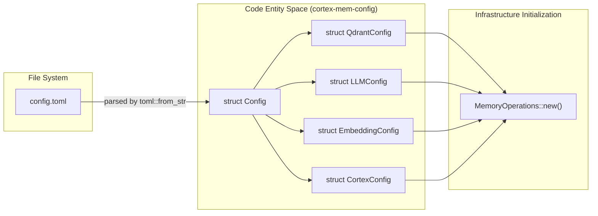
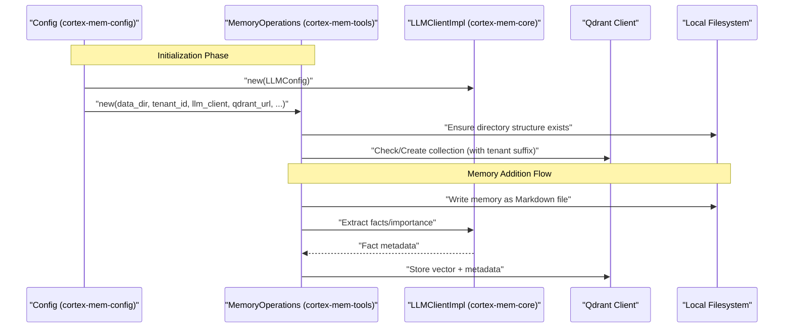

<!-- source: DeepWiki mcp.deepwiki.com · repo sopaco/cortex-mem · page 8.1 Core Configuration · fetched 2026-10-26 -->

# Core Configuration

Relevant source files

The following files were used as context for generating this wiki page:

- [cortex-mem-cli/src/main.rs](cortex-mem-cli/src/main.rs)
- [cortex-mem-config/src/lib.rs](cortex-mem-config/src/lib.rs)
- [cortex-mem-core/src/config.rs](cortex-mem-core/src/config.rs)
- [cortex-mem-rig/src/lib.rs](cortex-mem-rig/src/lib.rs)
- [examples/cortex-mem-tars/src/config.rs](examples/cortex-mem-tars/src/config.rs)
- [examples/cortex-mem-tars/src/infrastructure.rs](examples/cortex-mem-tars/src/infrastructure.rs)

This page documents the core configuration sections of `config.toml` that define how `cortex-mem-core` connects to external services and manages memory operations. These sections are required for all deployments and interfaces (CLI, HTTP API, MCP, TARS application).

The configuration system is designed to be flexible, supporting local development via relative paths and production deployments via environment variables.

## Configuration File Structure

The configuration is stored in a TOML file conventionally named `config.toml`. The system searches for this file based on the application context:

1.  **CLI/Service**: Defaults to `config.toml` in the current directory but can be overridden via the `--config` flag [cortex-mem-cli/src/main.rs:18-19]().
2.  **TARS Application**: Uses system application data directories (e.g., `~/Library/Application Support/com.cortex-mem.tars` on macOS) to ensure persistence across sessions [examples/cortex-mem-tars/src/config.rs:44-48]().

The configuration is parsed into a `Config` struct defined in `cortex-mem-config` that aggregates subsystem configurations:

**Configuration Schema Mapping**

Sources: [cortex-mem-config/src/lib.rs:7-14](), [examples/cortex-mem-tars/src/config.rs:88-114](), [cortex-mem-cli/src/main.rs:197-205]()

## [qdrant] Section

The `[qdrant]` section configures the connection to the Qdrant vector database, which stores all memory embeddings and metadata.

### Fields

| Field | Type | Required | Default | Description |
|-------|------|----------|---------|-------------|
| `url` | string | Yes | `http://localhost:6334` | URL of Qdrant instance (gRPC or HTTP) |
| `collection_name` | string | Yes | `cortex_mem` | Base name of the collection |
| `timeout_secs` | integer | Yes | `30` | Timeout for database operations |
| `embedding_dim` | integer | No | `None` | Vector dimension (e.g., 1536) |
| `api_key` | string | No | `None` | API key for cloud/protected instances |

### Field Details

**`url`**: The endpoint for Qdrant. While HTTP usually runs on 6333, the system defaults to 6334 (gRPC) for better performance [cortex-mem-core/src/config.rs:19]().

**`collection_name`**: The base identifier for the vector collection. Note that when using tenant isolation, the system automatically suffixes this name: `{collection_name}_{tenant_id}` [cortex-mem-core/src/config.rs:31-37]().

**`embedding_dim`**: If provided, it enforces a specific vector size. If omitted, the system typically relies on the embedding model's output [cortex-mem-config/src/lib.rs:71]().

Sources: [cortex-mem-config/src/lib.rs:68-75](), [cortex-mem-core/src/config.rs:5-14](), [examples/cortex-mem-tars/src/config.rs:89-95]()

## [llm] Section

The `[llm]` section configures the Large Language Model service used for reasoning tasks including fact extraction and intent analysis.

### Fields

| Field | Type | Required | Default | Description |
|-------|------|----------|---------|-------------|
| `api_base_url` | string | Yes | - | Base URL of the LLM API (OpenAI compatible) |
| `api_key` | string | Yes | - | API key for authentication |
| `model_efficient` | string | Yes | - | Model for extraction (e.g., `gpt-4o-mini`) |
| `temperature` | float | Yes | `0.7` | Sampling randomness |
| `max_tokens` | integer | Yes | `2000` | Maximum generation length |

### Field Details

**`model_efficient`**: This model is used by the `FactExtractor` and `MemoryClassifier` in the core pipeline. It should be a fast, instruction-following model [cortex-mem-config/src/lib.rs:107]().

Sources: [cortex-mem-config/src/lib.rs:103-110](), [examples/cortex-mem-tars/src/config.rs:97-103]()

## [embedding] Section

The `[embedding]` section configures the service used to convert text into vector representations for semantic search.

### Fields

| Field | Type | Required | Default | Description |
|-------|------|----------|---------|-------------|
| `api_base_url` | string | Yes | `https://api.openai.com/v1` | Embedding API endpoint |
| `api_key` | string | Yes | `""` | API key |
| `model_name` | string | Yes | `text-embedding-3-small` | Embedding model identifier |
| `batch_size` | integer | Yes | `10` | Records per request |
| `timeout_secs` | integer | Yes | `30` | Request timeout |

### Field Details

**`batch_size`**: Controls how many text segments are sent to the embedding provider in a single round-trip. Increasing this can improve throughput during re-indexing [cortex-mem-config/src/lib.rs:96]().

Sources: [cortex-mem-config/src/lib.rs:78-85](), [cortex-mem-config/src/lib.rs:87-100]()

## [cortex] Section

The `[cortex]` section (referred to as `[memory]` in some contexts) manages the high-level behavior of the memory engine and data storage.

### Fields

| Field | Type | Required | Default | Description |
|-------|------|----------|---------|-------------|
| `data_dir` | string | No | `.` | Root directory for file-based memory storage |
| `enable_intent_analysis` | boolean | No | `true` | Enable LLM-based query rewriting |

### Field Details

**`data_dir`**: This is the most critical path setting. It determines where the "Natural Language Space" (the `.md` files) is stored. 
- In the CLI, it resolves relative to the `config.toml` location [cortex-mem-cli/src/main.rs:212-221]().
- It can be overridden by the `CORTEX_DATA_DIR` environment variable [cortex-mem-config/src/lib.rs:60-61]().

**`enable_intent_analysis`**: When `true`, every search request first goes to the LLM to rewrite the query and detect intent (e.g., temporal vs. factual). Disabling this reduces latency from ~20s to <500ms but may reduce recall quality [cortex-mem-config/src/lib.rs:24-38]().

Sources: [cortex-mem-config/src/lib.rs:18-39](), [cortex-mem-config/src/lib.rs:49-64](), [cortex-mem-cli/src/main.rs:214-227]()

## Data Flow & Component Initialization

The configuration is used to instantiate the `MemoryOperations` orchestrator, which bridges the file system and the vector database.

**Component Interaction Diagram**

Sources: [cortex-mem-tools/src/lib.rs] (referenced via [cortex-mem-cli/src/main.rs:251-267]()), [examples/cortex-mem-tars/src/infrastructure.rs:37-52](), [cortex-mem-rig/src/lib.rs:119-133]()

## Summary of Defaults

If a section is missing, the following defaults are applied via the `Default` implementation:

- **Qdrant**: `http://localhost:6334`, collection `cortex-mem` [cortex-mem-core/src/config.rs:16-27]().
- **Embedding**: OpenAI endpoint, `text-embedding-3-small`, batch size 10 [cortex-mem-config/src/lib.rs:87-100]().
- **Cortex**: `data_dir` = current directory, `enable_intent_analysis` = `true` [cortex-mem-config/src/lib.rs:147-154]().
- **Logging**: Disabled, level `info`, directory `logs` [cortex-mem-config/src/lib.rs:137-145]().

Sources: [cortex-mem-config/src/lib.rs:128-155](), [cortex-mem-core/src/config.rs:16-27]()

---

