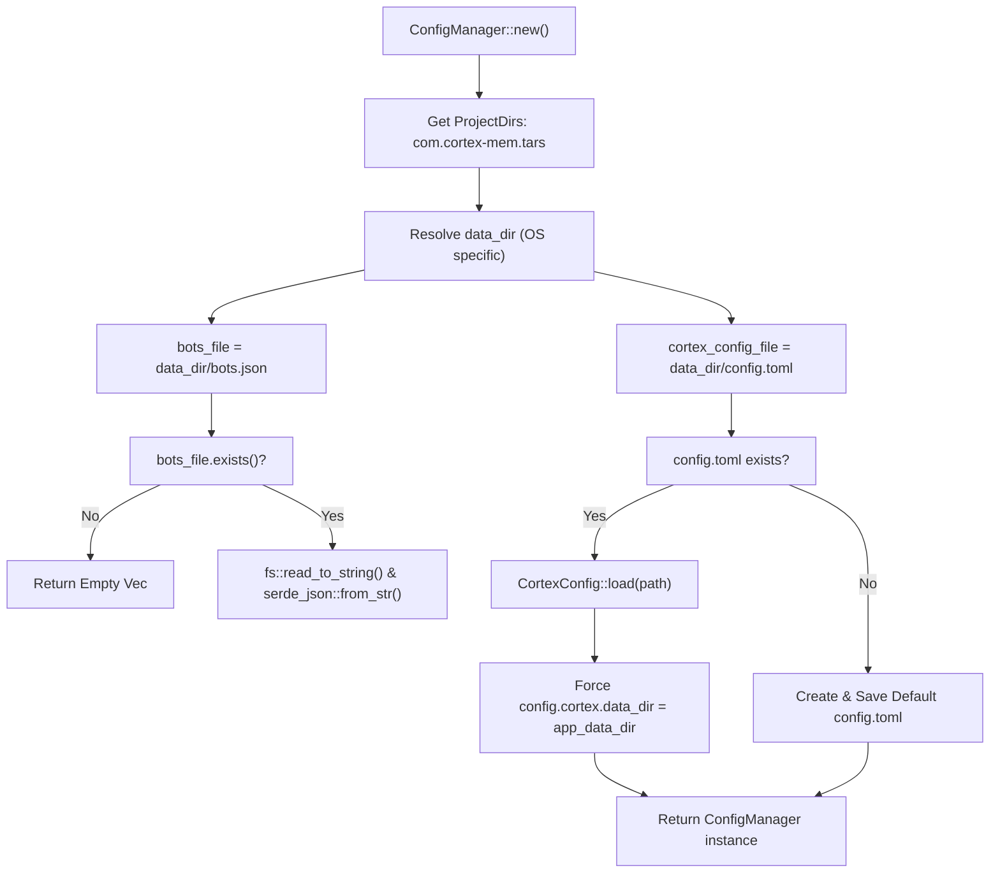
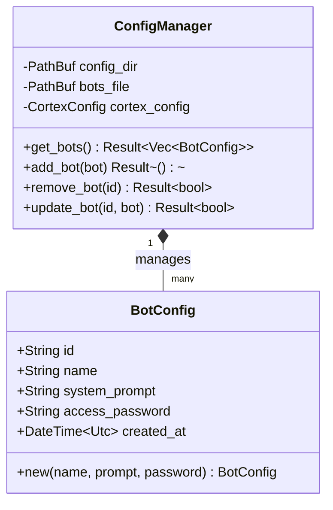
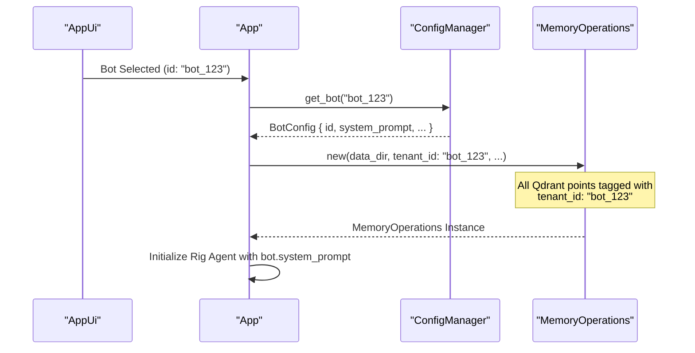

<!-- source: DeepWiki mcp.deepwiki.com · repo sopaco/cortex-mem · page 8.4 Bot Configuration · fetched 2026-10-26 -->

# Bot Configuration

<details>
<summary>Relevant source files</summary>

The following files were used as context for generating this wiki page:

- [Cargo.lock](Cargo.lock)
- [cortex-mem-cli/src/main.rs](cortex-mem-cli/src/main.rs)
- [cortex-mem-config/src/lib.rs](cortex-mem-config/src/lib.rs)
- [cortex-mem-core/src/config.rs](cortex-mem-core/src/config.rs)
- [cortex-mem-rig/src/lib.rs](cortex-mem-rig/src/lib.rs)
- [examples/cortex-mem-tars/.gitignore](examples/cortex-mem-tars/.gitignore)
- [examples/cortex-mem-tars/Cargo.lock](examples/cortex-mem-tars/Cargo.lock)
- [examples/cortex-mem-tars/Cargo.toml](examples/cortex-mem-tars/Cargo.toml)
- [examples/cortex-mem-tars/src/config.rs](examples/cortex-mem-tars/src/config.rs)
- [examples/cortex-mem-tars/src/infrastructure.rs](examples/cortex-mem-tars/src/infrastructure.rs)
- [examples/cortex-mem-tars/src/lib.rs](examples/cortex-mem-tars/src/lib.rs)
- [examples/cortex-mem-tars/src/logger.rs](examples/cortex-mem-tars/src/logger.rs)
- [examples/cortex-mem-tars/src/main.rs](examples/cortex-mem-tars/src/main.rs)
- [examples/cortex-mem-tars/src/ui.rs](examples/cortex-mem-tars/src/ui.rs)

</details>


## Purpose and Scope

This document describes the bot configuration system used by the **cortex-mem-tars** application. Bot configuration defines the profiles of AI agents (referred to as "bots") that users can interact with through the TARS Terminal User Interface (TUI). Each bot has a unique identity, system prompt, and optional password protection, enabling multi-agent conversations with persistent memory isolation via tenant-based data partitioning.

This page covers the structure of `bots.json`, the `BotConfig` data model, file location logic managed by `ConfigManager`, and UI-driven management operations. For general system configuration (Qdrant, LLM, memory settings), see **8.1 Core Configuration**.

**Sources:** [examples/cortex-mem-tars/src/config.rs](), [examples/cortex-mem-tars/src/ui.rs](), [examples/cortex-mem-tars/src/main.rs]()

---

## Configuration File Location

Bot profiles are stored in a JSON file named `bots.json`. The `ConfigManager` handles the resolution of this file path and the associated `config.toml` for the underlying Cortex framework.

### File Search and Initialization Logic



**Sources:** [examples/cortex-mem-tars/src/config.rs:43-126]()

### Location Logic

The `ConfigManager` uses the `directories` crate to ensure cross-platform compatibility for application data:

1. **Base Directory**: Determined by `ProjectDirs::from("com", "cortex-mem", "tars")`.
   - **macOS**: `~/Library/Application Support/com.cortex-mem.tars` [examples/cortex-mem-tars/src/config.rs:44-48]()
   - **Linux**: `~/.local/share/cortex-mem/tars`
   - **Windows**: `C:\Users\<User>\AppData\Roaming\cortex-mem\tars`
2. **Persistence**: The directory is created automatically via `fs::create_dir_all` if it does not exist [examples/cortex-mem-tars/src/config.rs:51]().
3. **Unified Storage**: TARS forces the `cortex.data_dir` in `config.toml` to match this application data directory to ensure memory files and bot profiles stay together [examples/cortex-mem-tars/src/config.rs:72-78]().

### Git Exclusion

The `bots.json` file is explicitly excluded from the repository to prevent accidental leakage of system prompts or passwords:

| File | Exclusion Rule |
|------|----------------|
| `examples/cortex-mem-tars/.gitignore` | `/target`, `bots.json` [examples/cortex-mem-tars/.gitignore:1-3]() |

---

## BotConfig Structure

Bot profiles are defined by the `BotConfig` struct. This struct serves as the template for individual agent identities within the TARS ecosystem.

### Data Model



**Sources:** [examples/cortex-mem-tars/src/config.rs:9-32](), [examples/cortex-mem-tars/src/config.rs:35-39]()

### Field Definitions

| Field | Type | Description |
|-------|------|-------------|
| `id` | `String` | Unique UUID v4 generated automatically upon creation [examples/cortex-mem-tars/src/config.rs:25](). |
| `name` | `String` | Display name used in the TUI selection list. |
| `system_prompt` | `String` | The core instructions provided to the LLM defining the bot's persona. |
| `access_password` | `String` | Optional string used for simple TUI-level access control. |
| `created_at` | `DateTime<Utc>` | Timestamp of creation [examples/cortex-mem-tars/src/config.rs:29](). |

### Default Bot Generation

On the first run, `main.rs` calls `create_default_bots`, which populates `bots.json` with a standard "TARS" profile if the file is missing.

**Sources:** [examples/cortex-mem-tars/src/main.rs:41](), [examples/cortex-mem-tars/src/app.rs:37-64]()

---

## ConfigManager Operations

The `ConfigManager` provides the CRUD interface for bot profiles, ensuring that every change is serialized back to the file system.

| Method | Logic |
|--------|-------|
| `get_bots()` | Reads `bots_file`, uses `serde_json::from_str` to return a `Vec<BotConfig>` [examples/cortex-mem-tars/src/config.rs:129-138](). |
| `add_bot()` | Appends a new `BotConfig` to the list and calls `save_bots` [examples/cortex-mem-tars/src/config.rs:148-156](). |
| `remove_bot()` | Filters the bot list by ID and persists the result [examples/cortex-mem-tars/src/config.rs:160-172](). |
| `update_bot()` | Finds a bot by ID in the list, replaces its fields, and saves [examples/cortex-mem-tars/src/config.rs:176-187](). |

**Sources:** [examples/cortex-mem-tars/src/config.rs:128-206]()

---

## Bot Lifecycle Management (TUI)

The TARS TUI implements a dedicated state machine for managing bots without leaving the terminal interface.

### UI State Integration

```mermaid
stateDiagram-v2
    [*] --> BotSelection: App Start
    BotSelection --> PasswordInput: Select Bot (with password)
    BotSelection --> Chat: Select Bot (no password)
    
    BotSelection --> BotManagement: Press 'm'
    state BotManagement {
        [*] --> List
        List --> Creating: Press 'c'
        List --> Editing: Press 'e'
        List --> ConfirmDelete: Press 'd'
        Creating --> List: KeyAction::SaveBot
        Editing --> List: KeyAction::SaveBot
        ConfirmDelete --> List: KeyAction::DeleteBot
    }
    BotManagement --> BotSelection: Esc / Close
```

**Sources:** [examples/cortex-mem-tars/src/ui.rs:170-177](), [examples/cortex-mem-tars/src/ui.rs:180-185]()

### UI Components for Management

The `AppUi` struct contains specific fields for the management modal:
- `bot_management_state`: Tracks if the user is listing, creating, or editing [examples/cortex-mem-tars/src/ui.rs:157]().
- `active_input_field`: Determines which `TextArea` (`bot_name_input`, `bot_prompt_input`, `bot_password_input`) receives keyboard focus [examples/cortex-mem-tars/src/ui.rs:162]().
- `bot_management_list_state`: Manages the selection index within the management modal's list [examples/cortex-mem-tars/src/ui.rs:161]().

**Sources:** [examples/cortex-mem-tars/src/ui.rs:156-162]()

---

## Password Protection

TARS provides a basic password verification layer before allowing a user to enter a chat session with a specific bot.

### Implementation Flow

1. **Detection**: When a bot is selected in `AppState::BotSelection`, the UI checks if `access_password` is non-empty [examples/cortex-mem-tars/src/ui.rs:22]().
2. **State Shift**: If a password is required, the app enters `AppState::PasswordInput` [examples/cortex-mem-tars/src/ui.rs:22]().
3. **Verification**: The `AppUi::handle_password_input_key` function compares the `password_input` buffer with the bot's stored password [examples/cortex-mem-tars/src/ui.rs:164-165]().
4. **Access**: Upon match, the state transitions to `AppState::Chat`.

**Sources:** [examples/cortex-mem-tars/src/ui.rs:20-24](), [examples/cortex-mem-tars/src/ui.rs:164-165]()

---

## Integration with Cortex Memory

The bot configuration is the primary driver for **Tenant Isolation** in the Cortex Memory framework.

### From Bot ID to Memory Isolation

When a bot is selected, TARS initializes the memory tools using the bot's unique ID as the `tenant_id`. This ensures that search and storage operations are strictly partitioned.



**Sources:** [examples/cortex-mem-tars/src/app.rs:466-510](), [examples/cortex-mem-tars/src/infrastructure.rs:37-52]()

### Infrastructure vs. Bot Tenants
- **Global Infrastructure**: TARS uses a "global" tenant for general system checks [examples/cortex-mem-tars/src/infrastructure.rs:39]().
- **Bot Sessions**: Each bot uses its own UUID as the tenant, ensuring that "Bot A" cannot retrieve memories created by "Bot B" [examples/cortex-mem-tars/src/config.rs:25]().

**Sources:** [examples/cortex-mem-tars/src/infrastructure.rs:36-40](), [examples/cortex-mem-tars/src/config.rs:11-16]()

---

