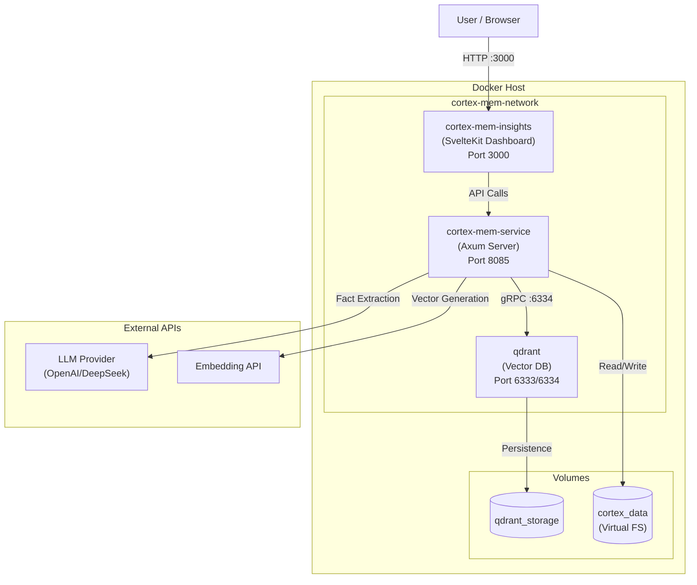
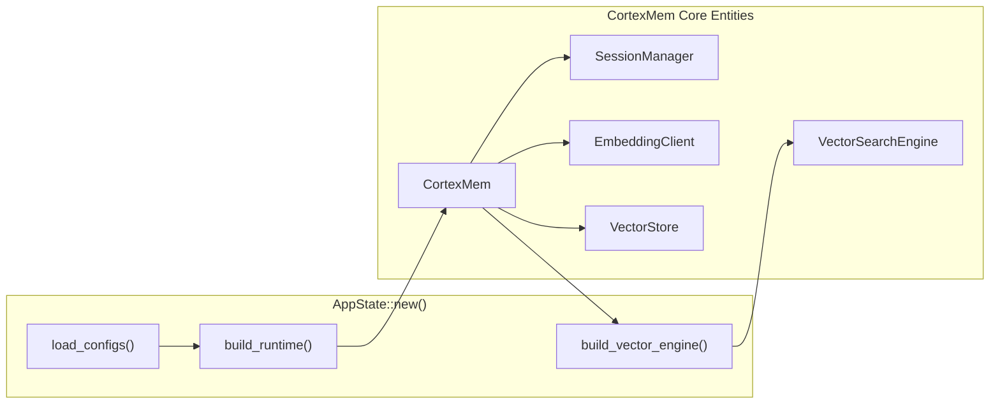

<!-- source: DeepWiki mcp.deepwiki.com · repo sopaco/cortex-mem · page 9.1 Docker Deployment · fetched 2026-10-26 -->

# Docker Deployment

<details>
<summary>Relevant source files</summary>

The following files were used as context for generating this wiki page:

- [README.md](README.md)
- [README_zh.md](README_zh.md)
- [cortex-mem-core/src/builder.rs](cortex-mem-core/src/builder.rs)
- [cortex-mem-core/src/embedding/client.rs](cortex-mem-core/src/embedding/client.rs)
- [cortex-mem-core/src/incremental_memory_updater.rs](cortex-mem-core/src/incremental_memory_updater.rs)
- [cortex-mem-core/src/llm/prompts.rs](cortex-mem-core/src/llm/prompts.rs)
- [cortex-mem-core/src/search/vector_engine.rs](cortex-mem-core/src/search/vector_engine.rs)
- [cortex-mem-insights/src/lib/api.ts](cortex-mem-insights/src/lib/api.ts)
- [cortex-mem-insights/src/lib/pages/Dashboard.svelte](cortex-mem-insights/src/lib/pages/Dashboard.svelte)
- [cortex-mem-insights/src/lib/pages/Search.svelte](cortex-mem-insights/src/lib/pages/Search.svelte)
- [cortex-mem-insights/src/lib/stores/search.ts](cortex-mem-insights/src/lib/stores/search.ts)
- [cortex-mem-insights/src/lib/stores/tenant.ts](cortex-mem-insights/src/lib/stores/tenant.ts)
- [cortex-mem-service/src/handlers/automation.rs](cortex-mem-service/src/handlers/automation.rs)
- [cortex-mem-service/src/handlers/search.rs](cortex-mem-service/src/handlers/search.rs)
- [cortex-mem-service/src/handlers/sessions.rs](cortex-mem-service/src/handlers/sessions.rs)
- [cortex-mem-service/src/main.rs](cortex-mem-service/src/main.rs)
- [cortex-mem-service/src/routes/automation.rs](cortex-mem-service/src/routes/automation.rs)
- [cortex-mem-service/src/state.rs](cortex-mem-service/src/state.rs)
- [examples/@memclaw/bin-darwin-arm64/bin/README.md](examples/@memclaw/bin-darwin-arm64/bin/README.md)
- [examples/locomo-evaluation/benchmark/index.html](examples/locomo-evaluation/benchmark/index.html)
- [examples/locomo-evaluation/eval.py](examples/locomo-evaluation/eval.py)

</details>


## Purpose and Scope

This document provides technical guidance for deploying the **Cortex Memory** framework in containerized environments using Docker and Docker Compose. It details the multi-service architecture, containerization of the Rust-based core services, networking between components, and persistent storage requirements for the vector database and virtual filesystem.

For production scaling and security hardening, see [Production Considerations](#9.2). For general installation without Docker, see [Installation](#2.1).

---

## Deployment Architecture Overview

The Cortex Memory system follows a modular monolith pattern where multiple interfaces can share a common core. In a Docker deployment, the system typically consists of:

- **Qdrant**: High-performance vector database for semantic search [cortex-mem-core/src/builder.rs:97-115]().
- **cortex-mem-service**: The Axum-based HTTP REST API server [cortex-mem-service/src/main.rs:134-140]().
- **cortex-mem-insights**: SvelteKit-based web dashboard for memory visualization [cortex-mem-insights/src/lib/api.ts:15-21]().
- **Filesystem**: A persistent volume for the `cortex://` virtual filesystem [cortex-mem-core/src/builder.rs:77-82]().

### Multi-Service Docker Architecture

The following diagram bridges the high-level services to their specific code entities and data flow.


**Sources:** [README.md:138-184](), [cortex-mem-service/src/main.rs:39-40](), [cortex-mem-core/src/builder.rs:77-115]()

---

## Docker Compose Configuration

### Complete Setup Example

A standard `docker-compose.yml` orchestrates the API service, the dashboard, and the vector store. Note that the `cortex-mem-service` requires access to a `config.toml` file and a data directory for the virtual filesystem.

```yaml
version: '3.8'

services:
  # Vector Database
  qdrant:
    image: qdrant/qdrant:latest
    container_name: qdrant
    ports:
      - "6333:6333"
      - "6334:6334"
    volumes:
      - qdrant_storage:/qdrant/storage
    healthcheck:
      test: ["CMD", "curl", "-f", "http://localhost:6333/healthz"]
      interval: 5s
      timeout: 5s
      retries: 5

  # HTTP API Service
  cortex-mem-service:
    build: 
      context: .
      dockerfile: ./cortex-mem-service/Dockerfile
    container_name: cortex-mem-service
    ports:
      - "8085:8085"
    environment:
      - RUST_LOG=info
      - LLM_API_KEY=${LLM_API_KEY}
    volumes:
      - ./cortex-data:/app/cortex-data
      - ./config.toml:/app/config.toml:ro
    depends_on:
      qdrant:
        condition: service_healthy
    command: ["/app/cortex-mem-service", "--data-dir", "/app/cortex-data", "--config", "/app/config.toml", "--host", "0.0.0.0"]

  # Web Dashboard
  cortex-mem-insights:
    build:
      context: ./cortex-mem-insights
    container_name: cortex-mem-insights
    ports:
      - "3000:3000"
    environment:
      - PUBLIC_API_BASE=http://cortex-mem-service:8085
    depends_on:
      - cortex-mem-service

volumes:
  qdrant_storage:
  cortex_data:
```

**Sources:** [cortex-mem-service/src/main.rs:24-49](), [cortex-mem-insights/src/lib/api.ts:5-13]()

---

## Service Container Configuration

### cortex-mem-service Runtime State

When the service container starts, it initializes the `AppState` which encapsulates the core engine components.


**Sources:** [cortex-mem-service/src/state.rs:43-92](), [cortex-mem-service/src/state.rs:128-166]()

### Configuration Resolution
The service resolves its configuration path with the following priority [cortex-mem-service/src/main.rs:56-73]():
1. Explicit `--config` argument.
2. `config.toml` inside the `--data-dir`.
3. `config.toml` in the current working directory.

In Docker, it is recommended to mount the configuration at `/app/config.toml` and the data directory at `/app/cortex-data` [cortex-mem-service/src/main.rs:26-32]().

---

## Network and Service Discovery

Within the Docker network, services use hostnames defined in the compose file.

| Source | Target | Endpoint | Purpose |
| :--- | :--- | :--- | :--- |
| `cortex-mem-insights` | `cortex-mem-service` | `http://cortex-mem-service:8085/api/v2` | UI Data Fetching [cortex-mem-insights/src/lib/api.ts:5-13]() |
| `cortex-mem-service` | `qdrant` | `http://qdrant:6333` | Vector Operations [cortex-mem-core/src/builder.rs:100-107]() |
| `cortex-mem-service` | `LLM Provider` | `https://api.openai.com/v1` | AI Processing [cortex-mem-core/src/embedding/client.rs:220-222]() |

### Health Checks
The service provides a `/health` endpoint [cortex-mem-service/src/main.rs:135]() that returns the status of the service and LLM availability [cortex-mem-insights/src/lib/api.ts:45-56](). This should be used by Docker to ensure the service is ready before starting the dashboard.

---

## Volume Management and Persistence

Cortex Memory relies on two distinct storage types that must be persisted via Docker volumes:

1.  **Virtual Filesystem (`cortex_data`)**: Stores the raw memory content as Markdown files and metadata as JSON. This directory contains the `session/`, `user/`, and `agent/` dimensions [README.md:37-54]().
2.  **Vector Store (`qdrant_storage`)**: Stores the high-dimensional embeddings and point metadata for semantic retrieval.

### Data Directory Structure
When mounted at `/app/cortex-data`, the structure follows the `cortex://` URI scheme [README.md:37-54]():
- `/app/cortex-data/session/{thread_id}/`
- `/app/cortex-data/user/preferences/`
- `/app/cortex-data/agent/cases/`

**Sources:** [cortex-mem-service/src/handlers/sessions.rs:72-81](), [cortex-mem-core/src/builder.rs:77-82]()

---

## Environment Variables and Secrets

The following environment variables are commonly used to override `config.toml` settings or provide secrets in containerized environments:

| Variable | Description | Source |
| :--- | :--- | :--- |
| `LLM_API_KEY` | API key for the LLM provider (OpenAI/DeepSeek) | [cortex-mem-core/src/embedding/client.rs:221]() |
| `LLM_API_BASE_URL` | Base URL for the LLM provider | [cortex-mem-core/src/embedding/client.rs:220]() |
| `RUST_LOG` | Logging level (e.g., `info`, `debug`) | [cortex-mem-service/src/main.rs:80-84]() |
| `CORTEX_DATA_DIR` | Path to the data directory | [cortex-mem-service/src/main.rs:26-27]() |

### Rate Limiting
The `EmbeddingClient` uses a global rate limiter to prevent `429 Too Many Requests` errors from LLM providers [cortex-mem-core/src/embedding/client.rs:11-19](). In a Docker environment with multiple tenants, the system ensures that all `EmbeddingClient` instances sharing the same API key coordinate their requests [cortex-mem-core/src/embedding/client.rs:32-57]().

---

## Troubleshooting Docker Deployments

### Common Connection Issues
If the service cannot reach Qdrant, check the `qdrant` section in `config.toml`. The URL must use the container name:
```toml
[qdrant]
url = "http://qdrant:6333"
```
**Sources:** [cortex-mem-core/src/builder.rs:100-107]()

### Reindexing Memories
If the vector store becomes out of sync with the filesystem (e.g., after a crash), use the reindex endpoint:
- **Endpoint**: `POST /api/v2/automation/reindex`
- **Function**: `trigger_reindex` [cortex-mem-service/src/handlers/automation.rs:56-99]()
- **Behavior**: Scans the filesystem and updates the vector store in the background.

### Memory Event Coordination
The `MemoryEventCoordinator` handles incremental updates asynchronously [cortex-mem-core/src/builder.rs:122-145](). If memories are not appearing in search immediately, ensure the coordinator is started and the `memory_event_tx` is correctly wired in `AppState` [cortex-mem-service/src/state.rs:33]().

**Sources:** [cortex-mem-service/src/state.rs:69](), [cortex-mem-core/src/builder.rs:138-139]()

---

