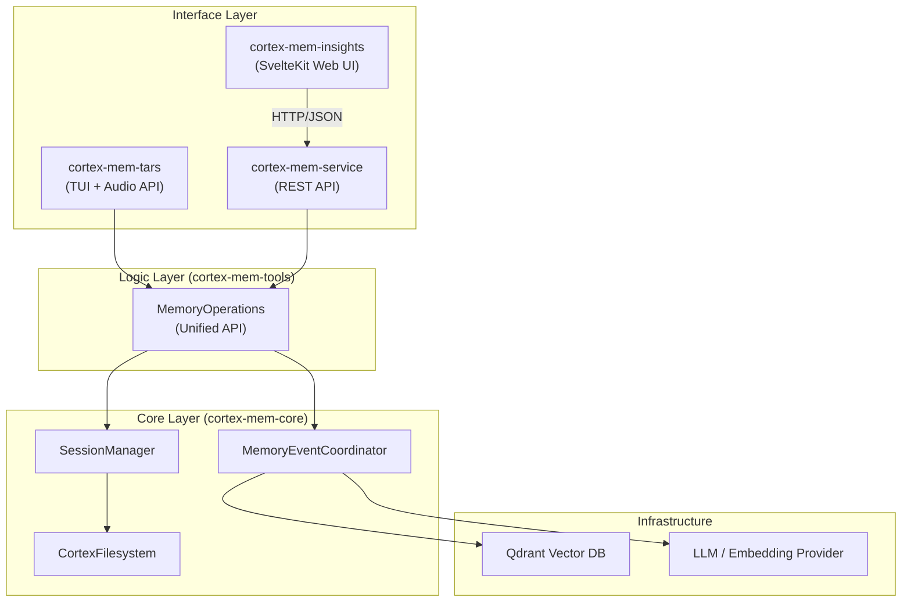
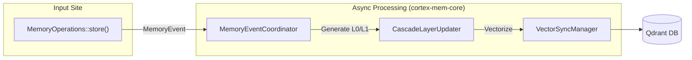
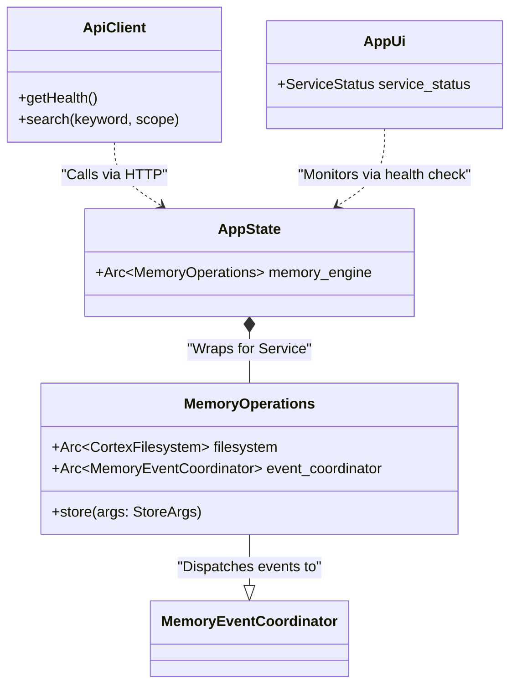

<!-- source: DeepWiki mcp.deepwiki.com · repo sopaco/cortex-mem · page 9.3 Multi-Service Architecture · fetched 2026-10-26 -->

# Multi-Service Architecture

Relevant source files

The following files were used as context for generating this wiki page:

- [cortex-mem-core/src/builder.rs](cortex-mem-core/src/builder.rs)
- [cortex-mem-core/src/embedding/client.rs](cortex-mem-core/src/embedding/client.rs)
- [cortex-mem-core/src/lib.rs](cortex-mem-core/src/lib.rs)
- [cortex-mem-core/src/session/manager.rs](cortex-mem-core/src/session/manager.rs)
- [cortex-mem-insights/bun.lock](cortex-mem-insights/bun.lock)
- [cortex-mem-insights/src/lib/api.ts](cortex-mem-insights/src/lib/api.ts)
- [cortex-mem-insights/src/lib/pages/Dashboard.svelte](cortex-mem-insights/src/lib/pages/Dashboard.svelte)
- [cortex-mem-insights/src/lib/pages/Search.svelte](cortex-mem-insights/src/lib/pages/Search.svelte)
- [cortex-mem-insights/src/lib/stores/search.ts](cortex-mem-insights/src/lib/stores/search.ts)
- [cortex-mem-insights/src/lib/stores/tenant.ts](cortex-mem-insights/src/lib/stores/tenant.ts)
- [cortex-mem-insights/svelte.config.js](cortex-mem-insights/svelte.config.js)
- [cortex-mem-insights/vite.config.ts](cortex-mem-insights/vite.config.ts)
- [cortex-mem-service/src/main.rs](cortex-mem-service/src/main.rs)
- [cortex-mem-tools/src/operations.rs](cortex-mem-tools/src/operations.rs)
- [cortex-mem-tools/src/tools/storage.rs](cortex-mem-tools/src/tools/storage.rs)
- [examples/cortex-mem-tars/src/agent.rs](examples/cortex-mem-tars/src/agent.rs)
- [examples/cortex-mem-tars/src/app.rs](examples/cortex-mem-tars/src/app.rs)
- [examples/locomo-evaluation/benchmark/index.html](examples/locomo-evaluation/benchmark/index.html)

This document describes the deployment and coordination of multiple services within the Cortex Memory ecosystem. It covers the interaction between the TARS multi-agent TUI, the HTTP REST API service, and the Insights dashboard, all while utilizing shared infrastructure.

---

## Service Topology and Interaction

Cortex Memory is designed as a modular system where different interfaces can coexist, sharing the same underlying data and AI infrastructure.

### System Architecture Overview

**Sources:** [cortex-mem-tools/src/operations.rs:29-51](), [cortex-mem-service/src/main.rs:133-139](), [examples/cortex-mem-tars/src/app.rs:28-51]()

---

## Service Components

### 1. HTTP API Service (`cortex-mem-service`)
The primary gateway for external applications and the Insights dashboard. It encapsulates `MemoryOperations` into a networked service.

*   **Host/Port:** Defaults to `localhost:8085`. [cortex-mem-service/src/main.rs:39-40]()
*   **State Management:** Uses `AppState` to share the memory engine across Axum handlers. [cortex-mem-service/src/main.rs:130-131]()
*   **CORS:** Permissive by default to allow the Insights dashboard to connect. [cortex-mem-service/src/main.rs:137]()

**Sources:** [cortex-mem-service/src/main.rs:34-40](), [cortex-mem-service/src/main.rs:130-143]()

### 2. TARS Application (`cortex-mem-tars`)
A terminal-based multi-agent environment that integrates persistent memory and audio processing.

*   **Agent Management:** Uses `rebuild_rig_agent` to create Rig agents with specialized memory tools (`search`, `find`, `read`, etc.). [examples/cortex-mem-tars/src/agent.rs:113-149]()
*   **Infrastructure Check:** Periodically pings the LLM `api_base_url` to ensure service availability. [examples/cortex-mem-tars/src/app.rs:117-155]()
*   **Audio Integration:** Supports Whisper-based transcription that feeds directly into the memory system. [examples/cortex-mem-tars/src/app.rs:45-50]()

**Sources:** [examples/cortex-mem-tars/src/app.rs:117-155](), [examples/cortex-mem-tars/src/agent.rs:138-149]()

### 3. Insights Dashboard (`cortex-mem-insights`)
A SvelteKit-based visualization tool for browsing and managing memories.

*   **API Proxy:** Configured via Vite to proxy requests from `/api/v2` to the `cortex-mem-service` at `localhost:8085`. [cortex-mem-insights/vite.config.ts:9-13]()
*   **Tenant Support:** Allows switching between different isolated memory tenants. [cortex-mem-insights/src/lib/api.ts:63-70]()
*   **Search Interface:** Provides a frontend for the semantic search capabilities of the core engine. [cortex-mem-insights/src/lib/api.ts:109-125]()

**Sources:** [cortex-mem-insights/vite.config.ts:7-19](), [cortex-mem-insights/src/lib/api.ts:109-125]()

---

## Shared Infrastructure Coordination

When running multiple services, the `MemoryOperations` class acts as the central orchestrator, ensuring that background tasks like layer generation and vector indexing are handled consistently.

### The Memory Event Pipeline

The following diagram illustrates how a memory stored via TARS or the HTTP API is processed asynchronously across the system.

*   **Asynchronous Storage:** When `MemoryOperations::store` is called, it immediately writes the content to the `CortexFilesystem` and dispatches a `MemoryEvent` to the `MemoryEventCoordinator`. [cortex-mem-tools/src/tools/storage.rs:151-166]()
*   **Background Tasks:** The `MemoryEventCoordinator` runs in a background task, handling LLM-intensive layer generation (L0/L1) without blocking the user interface or API response. [cortex-mem-tools/src/operations.rs:189-195]()

**Sources:** [cortex-mem-tools/src/tools/storage.rs:151-166](), [cortex-mem-tools/src/operations.rs:178-195]()

---

## Configuration and Deployment

### Shared Configuration
All services rely on a unified `config.toml`. The `cortex-mem-service` resolves this path with a specific priority:
1.  Explicit `--config` flag.
2.  `config.toml` inside the specified `--data-dir`.
3.  `config.toml` in the current working directory.

**Sources:** [cortex-mem-service/src/main.rs:56-73]()

### Port Allocation

| Service | Default Port | Protocol | Configuration Key |
| :--- | :--- | :--- | :--- |
| **HTTP API** | `8085` | HTTP/JSON | `--port` |
| **Insights** | `8082` | HTTP/Web | `server.port` (Vite) |
| **Qdrant** | `6333` | HTTP/REST | `[qdrant].url` |
| **TARS API** | `8080` | HTTP/JSON | TARS internal config |

**Sources:** [cortex-mem-service/src/main.rs:39-40](), [cortex-mem-insights/vite.config.ts:8]()

---

## Code Entity Bridge: Multi-Service Interaction

This diagram maps system behaviors to specific code entities across the service boundary.

*   **`AppState`**: Located in `cortex-mem-service`, it holds the shared `MemoryOperations` instance. [cortex-mem-service/src/state.rs]()
*   **`ApiClient`**: Located in `cortex-mem-insights`, it defines the frontend's interaction with the backend handlers. [cortex-mem-insights/src/lib/api.ts:15-126]()
*   **`AppUi`**: In TARS, this tracks the `service_status` based on connectivity to the configured LLM endpoint. [examples/cortex-mem-tars/src/app.rs:138-146]()

**Sources:** [cortex-mem-service/src/main.rs:130-131](), [cortex-mem-insights/src/lib/api.ts:15-126](), [examples/cortex-mem-tars/src/app.rs:138-146]()

---

