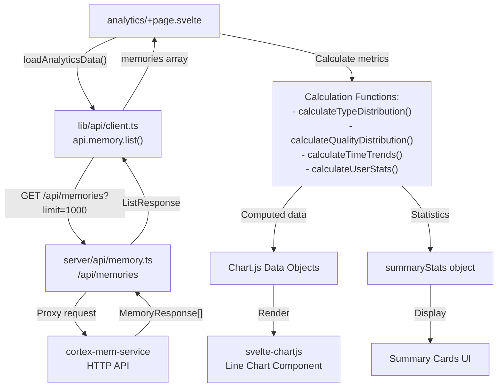
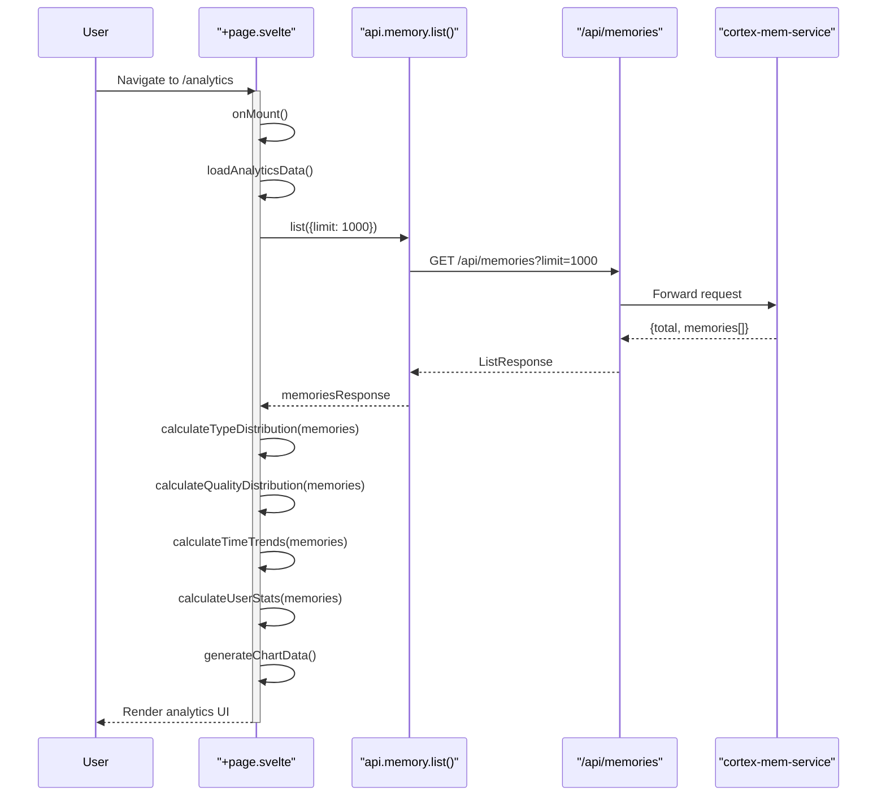

<!-- source: DeepWiki mcp.deepwiki.com · repo sopaco/cortex-mem · extra page Analytics & Statistics · fetched 2026-10-26 -->

# Analytics & Statistics

Relevant source files

The following files were used as context for generating this wiki page:

- [cortex-mem-insights/.gitignore](cortex-mem-insights/.gitignore)

This page documents the analytics and statistics interface within the `cortex-mem-insights` web dashboard, which provides comprehensive data analysis and visualization capabilities for memory system usage, quality, and trends. The analytics page enables administrators and researchers to understand memory distribution patterns, assess system health, and identify optimization opportunities.

---

## Overview

The Analytics & Statistics page (`/analytics`) provides a multi-dimensional view of memory data through calculated metrics, interactive charts, and statistical breakdowns. The interface performs client-side analysis on memory data retrieved from the API to generate insights without requiring backend processing for every chart update.

**Key Capabilities:**
- **Summary statistics**: Total memories, average quality, active users, and optimization counts. [cortex-mem-insights/src/routes/analytics/+page.svelte:234-269]()
- **Type distribution**: Analysis of memory categories with percentage breakdowns. [cortex-mem-insights/src/routes/analytics/+page.svelte:281-299]()
- **Quality metrics**: Distribution across defined importance ranges (90-100%, 70-89%, 50-69%, 0-49%). [cortex-mem-insights/src/routes/analytics/+page.svelte:301-328]()
- **Time trends**: Visualization of memory creation trends for the last 7 days. [cortex-mem-insights/src/routes/analytics/+page.svelte:330-351]()
- **User statistics**: Aggregated metrics per `user_id`. [cortex-mem-insights/src/routes/analytics/+page.svelte:353-375]()

Sources: [cortex-mem-insights/src/routes/analytics/+page.svelte:1-744]()

---

## Architecture and Data Flow

### Component Structure

The analytics dashboard follows a reactive data flow where the frontend fetches a large sample of memories and computes derived statistics locally.

Sources: [cortex-mem-insights/src/routes/analytics/+page.svelte:136-185](), [cortex-mem-insights/src/server/api/memory.ts:49-77]()

### Data Loading Sequence

The `onMount` lifecycle hook triggers the data retrieval process, fetching up to 1,000 memories to ensure a representative statistical sample. [cortex-mem-insights/src/routes/analytics/+page.svelte:151]()

Sources: [cortex-mem-insights/src/routes/analytics/+page.svelte:136-185](), [cortex-mem-insights/src/server/api/memory.ts:49-77]()

---

## Statistics Calculation Engine

### Summary Statistics

The page computes key summary metrics from the loaded memory array:

| Metric | Calculation Function | Description |
|--------|---------------------|-------------|
| `totalMemories` | `memories.length` | Total count of memories in the sample. |
| `averageQuality` | `calculateAverageQuality(memories)` | Mean importance score across all memories. |
| `activeUsers` | `calculateActiveUsers(memories)` | Count of unique `user_id` values in metadata. |
| `optimizationCount` | Static/Placeholder | Number of optimization operations performed. |

**Quality Score Calculation:**
The `calculateImportanceScore()` function implements a weighted scoring algorithm used for visualization:
- **Base score**: 0.5 [cortex-mem-insights/src/routes/analytics/+page.svelte:243]()
- **Type Weights**: Procedural/Workflow (+0.3), Personal (+0.2), Conversational (+0.1). [cortex-mem-insights/src/routes/analytics/+page.svelte:246-253]()
- **Role Weights**: Admin/System (+0.2), User (+0.1). [cortex-mem-insights/src/routes/analytics/+page.svelte:255-260]()
- **Custom Importance**: Adds `custom.importance * 0.3` if available. [cortex-mem-insights/src/routes/analytics/+page.svelte:262-264]()

Sources: [cortex-mem-insights/src/routes/analytics/+page.svelte:234-269]()

### Distribution and Trend Analysis

- **Type Distribution**: Aggregates memories by `metadata.memory_type`. If missing, it defaults to "Unknown". [cortex-mem-insights/src/routes/analytics/+page.svelte:281-299]()
- **Quality Bins**: Categorizes memories into four color-coded ranges: High (>=0.9, Green), Good (0.7-0.9, Blue), Medium (0.5-0.7, Yellow), and Low (<0.5, Red). [cortex-mem-insights/src/routes/analytics/+page.svelte:301-328]()
- **Time Trends**: Generates a 7-day histogram by parsing the `created_at` timestamp of each memory. [cortex-mem-insights/src/routes/analytics/+page.svelte:330-351]()
- **User Stats**: Groups memories by `user_id` to calculate per-user memory counts and average importance. [cortex-mem-insights/src/routes/analytics/+page.svelte:353-375]()

---

## Visualization Components

### Chart.js Integration

The dashboard uses `svelte-chartjs` with Chart.js 4.4.1. [cortex-mem-insights/src/routes/analytics/+page.svelte:4-27]()

**Time Trend Line Chart:**
The `generateChartData()` function creates a Chart.js dataset with a blue gradient area fill. [cortex-mem-insights/src/routes/analytics/+page.svelte:206-232]()

**Fallback Visualization:**
If Chart.js fails to load, a custom CSS-based bar chart is rendered as a fallback to ensure the UI remains functional. [cortex-mem-insights/src/routes/analytics/+page.svelte:544-575]()

### Distribution Visuals

- **Type Distribution Bars**: Horizontal progress bars showing the percentage of each memory type. Colors transition from Blue (>=30%) to Gray (<10%). [cortex-mem-insights/src/routes/analytics/+page.svelte:458-494]()
- **Quality Distribution Visual**: Displays proportion bars for each quality tier with count labels. [cortex-mem-insights/src/routes/analytics/+page.svelte:498-524]()

---

## User Interface Layout

The page is organized into a modular grid:

1.  **Summary Statistics Grid**: Four cards at the top for high-level metrics. [cortex-mem-insights/src/routes/analytics/+page.svelte:420-454]()
2.  **Charts Grid**: A 2x2 layout containing Type Distribution, Quality Distribution, Time Trends, and User Statistics. [cortex-mem-insights/src/routes/analytics/+page.svelte:456-685]()
3.  **User Statistics Table**: Displays top 5 users with memory counts and quality badges. [cortex-mem-insights/src/routes/analytics/+page.svelte:586-683]()
4.  **Analysis Tools**: Placeholder buttons for "Quality Analysis Report", "Trend Prediction", and "Comparison Analysis". [cortex-mem-insights/src/routes/analytics/+page.svelte:687-742]()

### Loading and Error States
The page manages its state using `isLoading` and `error` variables. During data retrieval, skeleton cards are displayed. [cortex-mem-insights/src/routes/analytics/+page.svelte:392-418]()

---

## Integration Points

### API Endpoints
The analytics page primarily consumes the memory list endpoint:
- `GET /api/memories?limit=1000`: Used for client-side aggregation. [cortex-mem-insights/src/server/api/memory.ts:49-77]()

The backend also provides specialized statistics endpoints that can be used for future performance optimizations:
- `/api/memories/stats/summary`: Provides server-side counts and distributions. [cortex-mem-insights/src/server/api/memory.ts:173-205]()
- `/api/memories/stats/types`: Provides specific type distribution data. [cortex-mem-insights/src/server/api/memory.ts:207-229]()

Sources: [cortex-mem-insights/src/server/api/memory.ts:49-229]()

---

