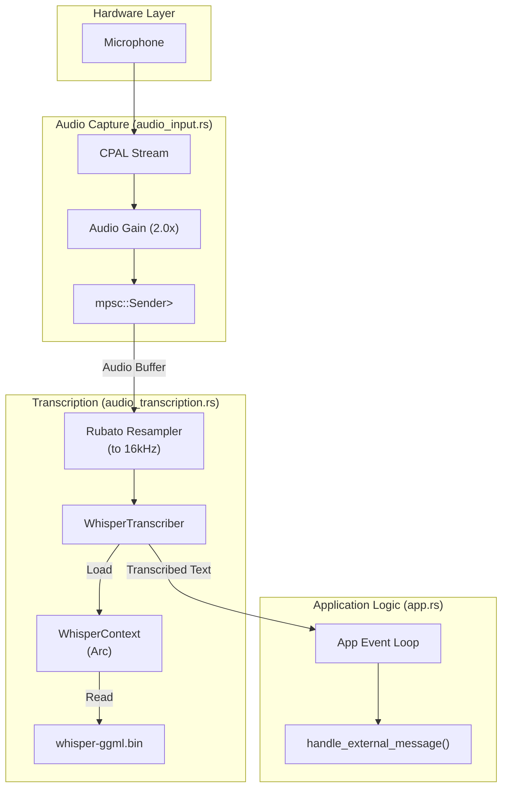
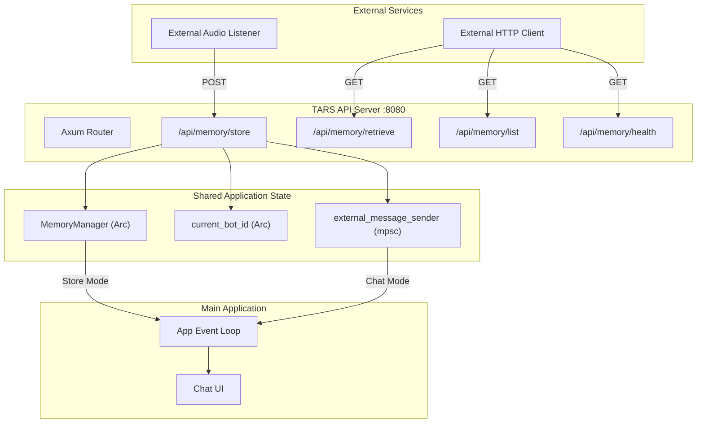
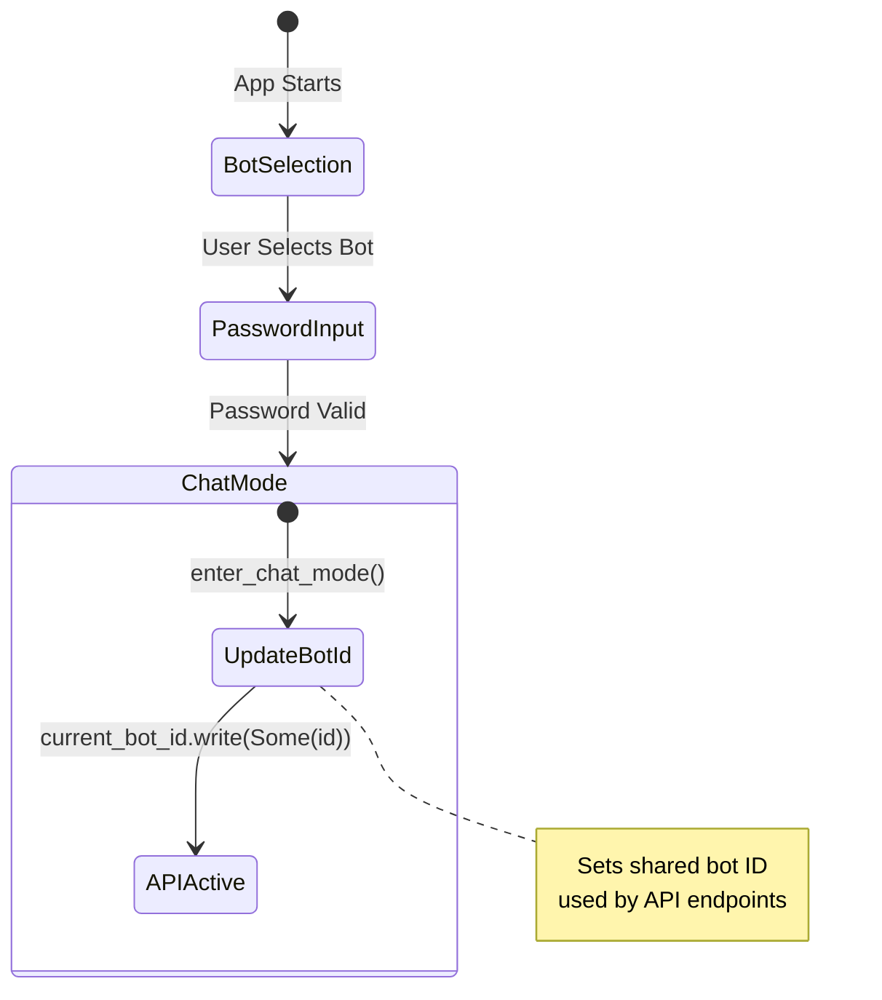

<!-- source: DeepWiki mcp.deepwiki.com · repo sopaco/cortex-mem · extra page Audio Integration API · fetched 2026-10-26 -->

# Audio Integration API

Relevant source files

The following files were used as context for generating this wiki page:

- [Cargo.lock](Cargo.lock)
- [examples/cortex-mem-tars/.gitignore](examples/cortex-mem-tars/.gitignore)
- [examples/cortex-mem-tars/Cargo.lock](examples/cortex-mem-tars/Cargo.lock)
- [examples/cortex-mem-tars/Cargo.toml](examples/cortex-mem-tars/Cargo.toml)
- [examples/cortex-mem-tars/src/audio_input.rs](examples/cortex-mem-tars/src/audio_input.rs)
- [examples/cortex-mem-tars/src/audio_transcription.rs](examples/cortex-mem-tars/src/audio_transcription.rs)
- [examples/cortex-mem-tars/src/lib.rs](examples/cortex-mem-tars/src/lib.rs)
- [examples/cortex-mem-tars/src/logger.rs](examples/cortex-mem-tars/src/logger.rs)
- [examples/cortex-mem-tars/src/main.rs](examples/cortex-mem-tars/src/main.rs)
- [examples/cortex-mem-tars/src/ui.rs](examples/cortex-mem-tars/src/ui.rs)

## Purpose and Scope

This document describes the TARS application's audio integration capabilities, including its embedded API server and local audio capture system. These features enable TARS to function as an AI-native interface that can perceive and remember spoken interactions.

The system supports two primary audio workflows:
1.  **Local Audio Capture**: Direct microphone input with local transcription using Whisper.
2.  **Remote Audio API**: An embedded Axum-based HTTP server that accepts transcriptions from external listeners (e.g., mobile apps or dedicated hardware).

For information about the core TUI interface and event handling, see [4.5.1 TUI Interface & State Management](). For details on bot configuration and agent isolation, see [4.5.2 Multi-Agent System]().

---

## Local Audio Capture System

TARS includes a built-in audio pipeline that captures microphone input and transcribes it locally. This system is managed by the `AudioStreamManager` and `WhisperTranscriber` components.

**Diagram: Local Audio Processing Pipeline**

### Audio Capture Implementation
The `AudioStreamManager` uses the `cpal` crate to interface with the system's default input device [examples/cortex-mem-tars/src/audio_input.rs:42-47](). It applies a constant gain of `2.0` to improve sensitivity [examples/cortex-mem-tars/src/audio_input.rs:8-9]() and sends audio buffers via an asynchronous channel [examples/cortex-mem-tars/src/audio_input.rs:71-81]().

### Local Transcription (Whisper)
Transcription is handled by `WhisperTranscriber`, which wraps the `whisper-rs` bindings [examples/cortex-mem-tars/src/audio_transcription.rs:98-101]().
- **Sampling Rate**: Whisper requires exactly 16kHz [examples/cortex-mem-tars/src/audio_transcription.rs:18](). If the hardware provides a different rate, the `rubato` crate is used for high-quality resamping [examples/cortex-mem-tars/src/audio_transcription.rs:209-231]().
- **Model Resolution**: The system searches for `whisper-ggml.bin` in the executable directory and the current working directory [examples/cortex-mem-tars/src/audio_transcription.rs:28-72]().
- **Performance**: Transcriptions are executed in a `tokio::task::spawn_blocking` pool to prevent UI freezes [examples/cortex-mem-tars/src/audio_transcription.rs:174-178]().

**Sources:** [examples/cortex-mem-tars/src/audio_input.rs:1-108](), [examples/cortex-mem-tars/src/audio_transcription.rs:1-260]()

---

## API Server Architecture

The TARS API server is an embedded service that allows external devices to push transcriptions into the memory system. It operates on port 8080 by default and shares state with the TUI application.

**Diagram: API Server Component Architecture**

**Sources:** [examples/cortex-mem-tars/src/app.rs:38-45](), [examples/cortex-mem-tars/src/main.rs:43-57]()

---

## Operating Modes

The API server supports two distinct operating modes:

### Store Mode
In **Store Mode**, incoming transcriptions are processed and stored directly into the long-term memory system using the `MemoryManager`. This is used for passive recording of conversations or ambient context.

**Flow:**
1. External service POSTs transcription to `/api/memory/store`.
2. API validates the request and extracts metadata (speaker type, confidence).
3. Content is formatted using a temporal context template: `"当前我所处的办公与会议环境中，时间是{timestamp}，能听到这样的声音：{content}"`.
4. `MemoryManager.add_memory()` is called to extract facts and store them in the vector database.

### Chat Mode
In **Chat Mode**, transcriptions are treated as simulated user input. They are injected into the TUI's message queue and trigger an immediate response from the active AI agent.

**Flow:**
1. External service POSTs transcription to `/api/memory/store`.
2. API sends the content to the `external_message_sender` channel.
3. The main application event loop receives the message and processes it via `handle_external_message()`.
4. The active agent generates a response as if the user had typed the message.

**Sources:** [examples/cortex-mem-tars/src/app.rs:246-252](), [examples/cortex-mem-tars/src/app.rs:768-837]()

---

## API Endpoints

### Health Check
**Endpoint:** `GET /api/memory/health`
Returns the status of the API service and infrastructure.

### Store Memory
**Endpoint:** `POST /api/memory/store`
Stores audio transcription as a memory or injects it as user input.

| Field | Type | Required | Description |
|-------|------|----------|-------------|
| `content` | string | Yes | Transcribed audio text |
| `source` | string | Yes | Must be `"audio_listener"` |
| `timestamp` | string | Yes | RFC 3339 format timestamp |
| `speaker_type` | string | No | `"user"` or `"other"` |
| `speaker_confidence` | float | No | 0.0 to 1.0 confidence score |

### Retrieve Memory
**Endpoint:** `GET /api/memory/retrieve`
Performs semantic search on stored memories using a natural language query.

### List Memory
**Endpoint:** `GET /api/memory/list`
Lists memories with optional filtering by `speaker_type` and pagination (`limit`/`offset`).

---

## Bot ID Management and Memory Isolation

The API server relies on the `current_bot_id` shared state to determine which agent's memory space should receive stored memories. This ensures that memories recorded via audio are isolated to the specific context of the active agent.

**State Management Flow:**

If a storage request arrives but no bot is selected (`current_bot_id` is `None`), the API will return an error, as it cannot determine the correct memory partition.

**Sources:** [examples/cortex-mem-tars/src/app.rs:469-474](), [examples/cortex-mem-tars/src/app.rs:776-779](), [examples/cortex-mem-tars/src/app.rs:38-45]()

---

## Logging and Monitoring

TARS uses a centralized logging system that bridges standard `log` calls to the `tracing` ecosystem [examples/cortex-mem-tars/src/logger.rs:154-162]().
- **File Logging**: All logs are written to `app.log` in the application's data directory [examples/cortex-mem-tars/src/logger.rs:20-32]().
- **Memory Buffer**: The last 1000 log lines are kept in an in-memory buffer [examples/cortex-mem-tars/src/logger.rs:108-114]().
- **UI Integration**: The `AppUi` component can display these logs in a dedicated panel within the TUI [examples/cortex-mem-tars/src/ui.rs:131-133]().

**Sources:** [examples/cortex-mem-tars/src/logger.rs:1-182](), [examples/cortex-mem-tars/src/ui.rs:119-168]()

---

