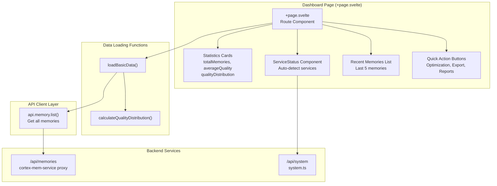
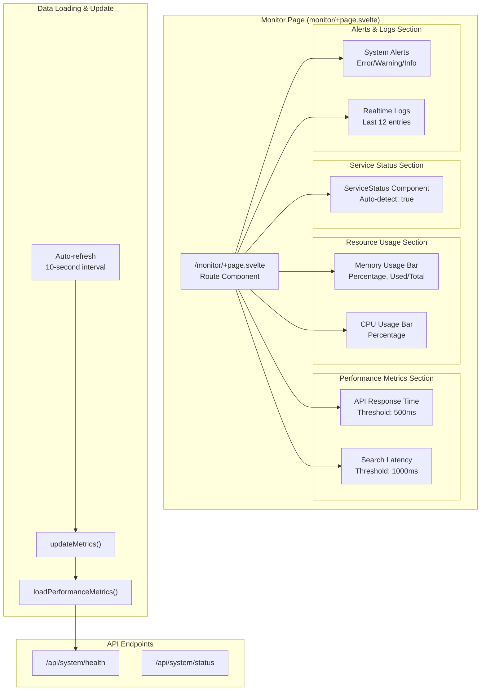
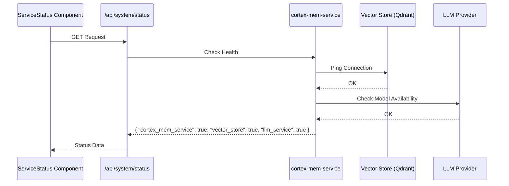

<!-- source: DeepWiki mcp.deepwiki.com · repo sopaco/cortex-mem · extra page Dashboard & Monitoring · fetched 2026-10-26 -->

# Dashboard & Monitoring

Relevant source files

The following files were used as context for generating this wiki page:

- [cortex-mem-insights/server.ts](cortex-mem-insights/server.ts)
- [litho.docs/en/4.Deep-Exploration/Automation Management Domain.md](litho.docs/en/4.Deep-Exploration/Automation Management Domain.md)
- [litho.docs/en/4.Deep-Exploration/Layer Management Domain.md](litho.docs/en/4.Deep-Exploration/Layer Management Domain.md)

This document describes the dashboard and monitoring capabilities of `cortex-mem-insights`, covering the home dashboard page (`/`) and dedicated monitoring page (`/monitor`). These pages provide system administrators with real-time visibility into service health, performance metrics, resource usage, and operational logs.

## Overview

The `cortex-mem-insights` dashboard serves two primary interfaces:
- **Dashboard Page** (`/`): Overview of memory statistics, service health, and recent activity.
- **Monitor Page** (`/monitor`): Detailed real-time monitoring with performance metrics, resource usage, alerts, and logs.

Both pages rely on a shared `ServiceStatus` component for service health detection and the `/api/system` backend routes for retrieving system information. The standalone host (`server.ts`) facilitates this by serving the static frontend and proxying API requests to the `cortex-mem-service` [cortex-mem-insights/server.ts:5-13]().

## Dashboard Page Architecture

The dashboard page provides a high-level overview with four key sections: statistics cards, service status, recent memories, and quick actions.

**Sources:** [cortex-mem-insights/src/routes/+page.svelte:1-479]()

### Statistics Calculation

The dashboard calculates memory statistics on mount by fetching all memories and computing aggregations. The quality distribution logic categorizes memories based on their `importance_score`:

| Statistic | Calculation Method | Thresholds |
|-----------|-------------------|------------|
| `high` | `importance_score >= 0.8` | High quality/importance |
| `medium` | `0.6 <= importance_score < 0.8` | Standard quality |
| `low` | `importance_score < 0.6` | Low importance |

**Sources:** [cortex-mem-insights/src/routes/+page.svelte:143-172]()

## Monitor Page Architecture

The monitor page provides comprehensive real-time system monitoring with automatic refresh capabilities. It integrates with the `cortex-mem-service` to track the status of core infrastructure, including the vector store and LLM clients.

**Sources:** [cortex-mem-insights/src/routes/monitor/+page.svelte:1-793](), [cortex-mem-insights/src/server/api/system.ts:1-355]()

### Performance Metrics Calculation

The monitor page calculates real-time performance metrics by measuring actual API latencies and comparing them against defined thresholds:

| Metric | Target | Threshold |
|--------|--------|-----------|
| API Response Time | `/api/memories` | 500ms |
| Search Latency | `api.memory.search` | 1000ms |
| Health Check | `/api/system/health` | 300ms |

**Sources:** [cortex-mem-insights/src/routes/monitor/+page.svelte:190-238]()

### Resource Usage Monitoring

The monitor page estimates resource usage based on system state:
- **Memory Usage**: Estimated based on the number of memory records (approx. 2.5 KB per record) against a 1 GB capacity [cortex-mem-insights/src/routes/monitor/+page.svelte:139-155]().
- **CPU Usage**: Calculated using a base system load plus a variable factor proportional to the total memory count [cortex-mem-insights/src/routes/monitor/+page.svelte:158-171]().

## ServiceStatus Component

The `ServiceStatus` component is a reusable health detector that monitors three critical system tiers:
1. **Cortex Memory Service**: The primary HTTP interface.
2. **Vector Store**: The Qdrant database backend.
3. **LLM Service**: The AI provider (e.g., OpenAI, Anthropic) for embeddings and completions.

**Sources:** [cortex-mem-insights/src/lib/components/ServiceStatus.svelte:1-473](), [cortex-mem-insights/src/server/api/system.ts:54-114]()

### Detailed LLM Monitoring

The backend `/api/system/llm/status` route provides granular details about the LLM integration, which are surfaced in the monitoring views:
- **Completion Model**: Provider, model name, and current latency [cortex-mem-insights/src/server/api/system.ts:148-154]().
- **Embedding Model**: Provider and model name used for vectorization [cortex-mem-insights/src/server/api/system.ts:155-161]().

**Sources:** [cortex-mem-insights/src/server/api/system.ts:146-167]()

## Standalone Host & Proxying

The `cortex-mem-insights` application is designed to run as a standalone host using Bun. It serves static assets and proxies requests to the backend service.

| Component | Code Entity | Role |
|-----------|-------------|------|
| Static Server | `getDistPath()` | Locates and serves the Vite-built `dist/` directory [cortex-mem-insights/server.ts:158-174](). |
| API Proxy | `proxyRequest()` | Forwards `/api/*` requests to the `API_TARGET` (default: `http://localhost:8085`) [cortex-mem-insights/server.ts:203-251](). |
| CLI Parser | `parseArgs()` | Handles `--port`, `--api-target`, and `--no-browser` flags [cortex-mem-insights/server.ts:67-117](). |

**Sources:** [cortex-mem-insights/server.ts:15-117](), [cortex-mem-insights/server.ts:203-251]()

---

