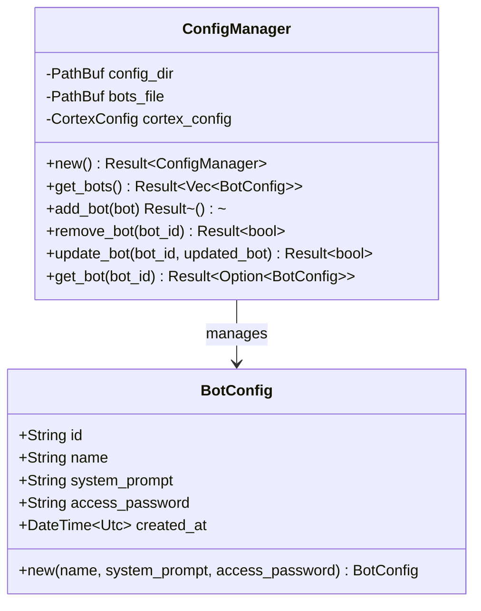
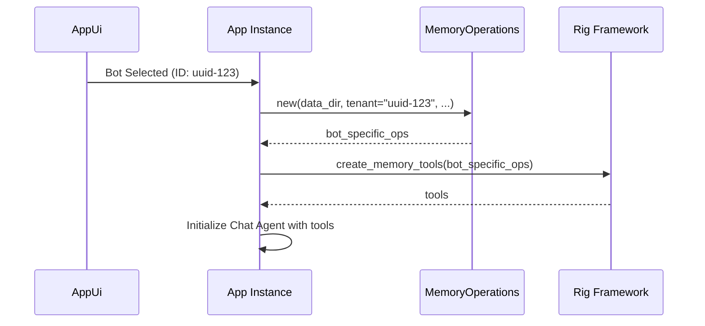
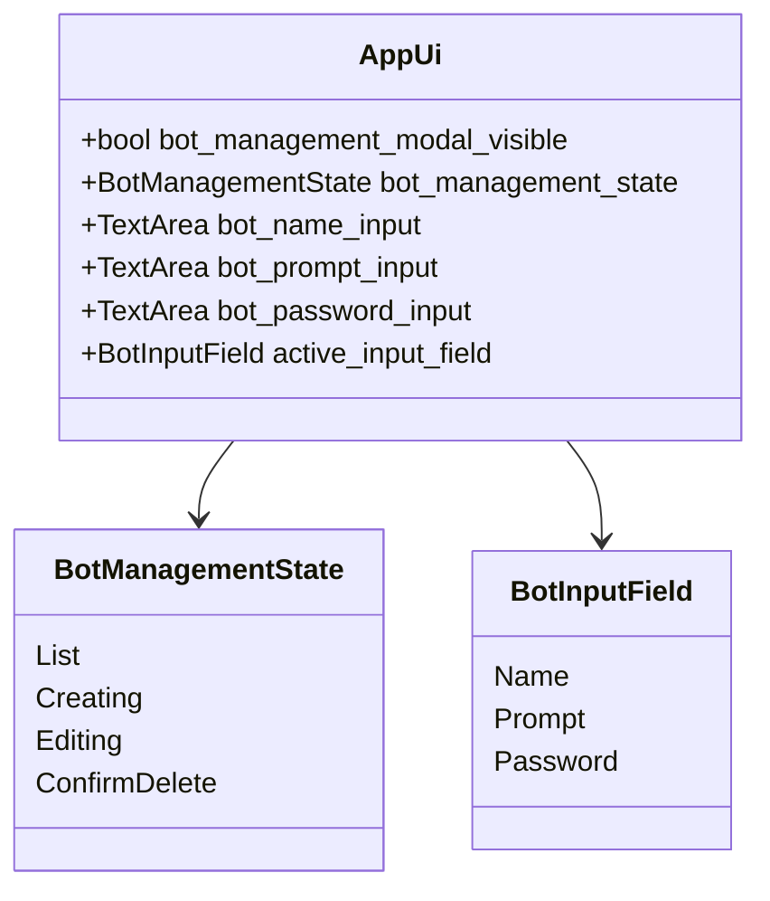

<!-- source: DeepWiki mcp.deepwiki.com · repo sopaco/cortex-mem · extra page Multi-Agent System · fetched 2026-10-26 -->

# Multi-Agent System

<details>
<summary>Relevant source files</summary>

The following files were used as context for generating this wiki page:

- [Cargo.lock](Cargo.lock)
- [cortex-mem-cli/src/main.rs](cortex-mem-cli/src/main.rs)
- [cortex-mem-config/src/lib.rs](cortex-mem-config/src/lib.rs)
- [cortex-mem-core/src/config.rs](cortex-mem-core/src/config.rs)
- [cortex-mem-rig/src/lib.rs](cortex-mem-rig/src/lib.rs)
- [examples/cortex-mem-tars/.gitignore](examples/cortex-mem-tars/.gitignore)
- [examples/cortex-mem-tars/Cargo.lock](examples/cortex-mem-tars/Cargo.lock)
- [examples/cortex-mem-tars/Cargo.toml](examples/cortex-mem-tars/Cargo.toml)
- [examples/cortex-mem-tars/src/config.rs](examples/cortex-mem-tars/src/config.rs)
- [examples/cortex-mem-tars/src/infrastructure.rs](examples/cortex-mem-tars/src/infrastructure.rs)
- [examples/cortex-mem-tars/src/lib.rs](examples/cortex-mem-tars/src/lib.rs)
- [examples/cortex-mem-tars/src/logger.rs](examples/cortex-mem-tars/src/logger.rs)
- [examples/cortex-mem-tars/src/main.rs](examples/cortex-mem-tars/src/main.rs)
- [examples/cortex-mem-tars/src/ui.rs](examples/cortex-mem-tars/src/ui.rs)

</details>


This document describes the multi-agent system in **cortex-mem-tars**, which enables multiple AI agents (called "bots") to coexist with isolated memory spaces. Each bot has its own identity, system prompt, and password-protected access. The system ensures memory isolation through tenant and agent metadata scoping and provides a comprehensive bot management interface within the TUI.

---

## Bot Configuration Structure

Each bot is represented by a `BotConfig` structure that stores identity, behavior, and access control information. Bot configurations are persisted in `bots.json` and managed by the `ConfigManager`.

### BotConfig Schema



**Sources:** [examples/cortex-mem-tars/src/config.rs:8-32]()

### Configuration Persistence (`bots.json`)

The `ConfigManager` handles the lifecycle of the `bots.json` file, typically located in the system application data directory (e.g., `~/Library/Application Support/com.cortex-mem.tars` on macOS).

| Method | Logic | Source |
|--------|-------|--------|
| `get_bots` | Reads and deserializes `bots.json` into `Vec<BotConfig>` | [examples/cortex-mem-tars/src/config.rs:129-138]() |
| `add_bot` | Appends a new bot and calls `save_bots` | [examples/cortex-mem-tars/src/config.rs:148-156]() |
| `update_bot` | Finds bot by ID and replaces its configuration | [examples/cortex-mem-tars/src/config.rs:176-187]() |
| `remove_bot` | Filters out the bot by ID and saves the remainder | [examples/cortex-mem-tars/src/config.rs:160-172]() |

**Sources:** [examples/cortex-mem-tars/src/config.rs:45-55](), [examples/cortex-mem-tars/src/config.rs:129-187]()

---

## Bot Lifecycle and State Management

The application uses an `AppState` machine to manage bot selection, authentication, and active chat sessions.

### State Machine Diagram

```mermaid
stateDiagram-v2
    [*] --> BotSelection : App::run()
    
    BotSelection --> PasswordInput : Select bot\n(if access_password set)
    BotSelection --> Chat : Select bot\n(if no password)
    BotSelection --> [*] : Quit (q)
    
    PasswordInput --> Chat : Password verified
    PasswordInput --> BotSelection : Esc pressed
    
    Chat --> BotSelection : Back to selection
    Chat --> [*] : Quit (q)
    
    note right of BotSelection
        UI: List of bots from bots.json
        Key: 'm' to manage bots
    end note
    
    note right of Chat
        Initializes MemoryOperations
        using bot.id as tenant/agent_id
    end note
```

**Sources:** [examples/cortex-mem-tars/src/ui.rs:19-24](), [examples/cortex-mem-tars/src/ui.rs:121-126]()

### Agent Initialization

When a bot is selected and authenticated, the `App` initializes the AI infrastructure. Unlike the global infrastructure used for system checks, each bot session creates its own `MemoryOperations` instance.



**Sources:** [examples/cortex-mem-tars/src/infrastructure.rs:12-16](), [examples/cortex-mem-tars/src/app.rs:60-65]()

---

## Agent Isolation and Memory Scoping

Isolation is enforced at the `MemoryOperations` level. When TARS initializes a bot, it uses the bot's unique ID as the `tenant_id`.

### Isolation Implementation

In `Infrastructure::new`, a "global" tenant is used for system-wide tasks, but the documentation explicitly notes that bots should use isolated instances.

| Level | Identifier | Scope |
|-------|------------|-------|
| **Tenant** | `BotConfig.id` | File system directory: `data_dir/tenants/{bot_id}/` |
| **Vector** | `tenant_id` | Qdrant point metadata filtering |
| **User** | `tars_user` | (Default) Secondary filtering within tenant |

**Sources:** [examples/cortex-mem-tars/src/infrastructure.rs:12-52](), [examples/cortex-mem-tars/src/config.rs:61-64]()

---

## Bot Management UI

The TARS TUI provides a dedicated interface for managing bots, accessible via the `BotSelection` state.

### UI Components

The `AppUi` struct maintains separate `TextArea` widgets for bot creation and editing to ensure clean input handling.



**Sources:** [examples/cortex-mem-tars/src/ui.rs:155-162](), [examples/cortex-mem-tars/src/ui.rs:171-185]()

### Keyboard Interaction (`KeyAction`)

The management interface responds to specific keys to trigger bot persistence:
- **`CreateBot`**: Initiates the creation flow.
- **`EditBot`**: Loads existing bot data into the input fields.
- **`SaveBot`**: Triggers `ConfigManager::add_bot` or `update_bot`.
- **`DeleteBot`**: Triggers `ConfigManager::remove_bot`.

**Sources:** [examples/cortex-mem-tars/src/ui.rs:188-204]()

---

## Password Protection

Access control is implemented via a simple password verification state. If a `BotConfig` has a non-empty `access_password`, the UI forces a transition to `AppState::PasswordInput`.

### Implementation Details

1. **Storage**: Passwords are stored in the `access_password` field of `BotConfig` within `bots.json`. [examples/cortex-mem-tars/src/config.rs:14]()
2. **Verification**: The `AppUi` captures input in `password_input` (a `TextArea`). [examples/cortex-mem-tars/src/ui.rs:164]()
3. **Session Masking**: While the TUI renders the password input, the `pending_bot` field in `AppUi` holds the target bot until verification is successful. [examples/cortex-mem-tars/src/ui.rs:165]()

**Sources:** [examples/cortex-mem-tars/src/ui.rs:22](), [examples/cortex-mem-tars/src/ui.rs:164-165]()

---

## Default Bot Provisioning

To ensure a smooth "out-of-the-box" experience, TARS automatically creates default bots if no configuration is found.

```rust
// Logic located in app::create_default_bots
// Called during main.rs execution
create_default_bots(&config_manager).context("无法创建默认机器人")?;
```

This ensures that even on a fresh installation, the `BotSelection` screen is populated with functional examples (e.g., a "Cortex Assistant").

**Sources:** [examples/cortex-mem-tars/src/main.rs:40-41](), [examples/cortex-mem-tars/src/app.rs:13]()

---

