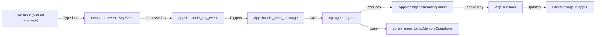

<!-- source: DeepWiki mcp.deepwiki.com · repo sopaco/cortex-mem · extra page TUI Interface & State Management · fetched 2026-10-26 -->

# TUI Interface & State Management

<details>
<summary>Relevant source files</summary>

The following files were used as context for generating this wiki page:

- [Cargo.lock](Cargo.lock)
- [cortex-mem-core/src/lib.rs](cortex-mem-core/src/lib.rs)
- [cortex-mem-core/src/session/manager.rs](cortex-mem-core/src/session/manager.rs)
- [cortex-mem-tools/src/operations.rs](cortex-mem-tools/src/operations.rs)
- [cortex-mem-tools/src/tools/storage.rs](cortex-mem-tools/src/tools/storage.rs)
- [examples/cortex-mem-tars/.gitignore](examples/cortex-mem-tars/.gitignore)
- [examples/cortex-mem-tars/Cargo.lock](examples/cortex-mem-tars/Cargo.lock)
- [examples/cortex-mem-tars/Cargo.toml](examples/cortex-mem-tars/Cargo.toml)
- [examples/cortex-mem-tars/src/agent.rs](examples/cortex-mem-tars/src/agent.rs)
- [examples/cortex-mem-tars/src/app.rs](examples/cortex-mem-tars/src/app.rs)
- [examples/cortex-mem-tars/src/lib.rs](examples/cortex-mem-tars/src/lib.rs)
- [examples/cortex-mem-tars/src/logger.rs](examples/cortex-mem-tars/src/logger.rs)
- [examples/cortex-mem-tars/src/main.rs](examples/cortex-mem-tars/src/main.rs)
- [examples/cortex-mem-tars/src/ui.rs](examples/cortex-mem-tars/src/ui.rs)

</details>


## Purpose and Scope

This document details the Terminal User Interface (TUI) implementation for the `cortex-mem-tars` application, focusing on the `AppState` machine, event handling, and rendering pipeline. The TUI is built using the `ratatui` library and provides an interactive multi-agent chat interface with persistent memory integration via `cortex-mem-core` and `rig`.

**Sources**: [examples/cortex-mem-tars/src/ui.rs:1-157](), [examples/cortex-mem-tars/src/app.rs:24-46]()

---

## State Machine Architecture

The TUI implements a hierarchical state machine that controls the user experience flow and interaction modes.

### Primary State Machine

```mermaid
stateDiagram-v2
    [*] --> BotSelection: "App::new()"
    
    BotSelection --> PasswordInput: "Select bot with password"
    BotSelection --> Chat: "Select bot without password"
    BotSelection --> BotSelection: "Navigate list (Up/Down)"
    BotSelection --> [*]: "Quit (q/Ctrl-C)"
    
    PasswordInput --> Chat: "Correct password"
    PasswordInput --> BotSelection: "Cancel (Esc)"
    
    Chat --> Chat: "Send messages / Scroll"
    Chat --> Chat: "Show help/themes (F1/F2)"
    Chat --> BotSelection: "Exit chat (/exit)"
```

**Sources**: [examples/cortex-mem-tars/src/ui.rs:18-24](), [examples/cortex-mem-tars/src/app.rs:334-395]()

### Code Entity Mapping: State Enums

| Enum Type | Variants | Purpose |
|-----------|----------|---------|
| `AppState` | `BotSelection`, `PasswordInput`, `Chat` | Primary application flow control |
| `ServiceStatus` | `Initing`, `Active`, `Inactive` | LLM service availability indicator |
| `ChatState` | `Normal`, `LogPanel`, `Selection` | Chat interface sub-states |
| `BotManagementState` | `List`, `Creating`, `Editing`, `ConfirmDelete` | Bot management modal states |
| `BotInputField` | `Name`, `Prompt`, `Password` | Active input field in bot management |

**Sources**: [examples/cortex-mem-tars/src/ui.rs:18-42](), [examples/cortex-mem-tars/src/ui.rs:171-185]()

---

## UI Component Structure

The `AppUi` struct is the central state container for all UI elements, maintaining separation between visual state and application logic.

### AppUi Component Diagram

```mermaid
graph TB
    AppUi["AppUi (examples/cortex-mem-tars/src/ui.rs)"]
    
    subgraph "State"
        State["state: AppState"]
        SrvStatus["service_status: ServiceStatus"]
    end
    
    subgraph "Chat Logic"
        Msgs["messages: Vec&lt;ChatMessage&gt;"]
        RenderCache["message_render_cache: Vec&lt;Option&lt;Vec&lt;String&gt;&gt;&gt;"]
        Input["input_textarea: TextArea"]
    end
    
    subgraph "Modals"
        Help["help_modal_visible: bool"]
        Theme["theme_modal_visible: bool"]
        BotMgmt["bot_management_modal_visible: bool"]
    end
    
    subgraph "Theme System"
        CurrentTheme["current_theme: Theme"]
        ThemeList["theme_list_state: ListState"]
    end
    
    AppUi --> State
    AppUi --> SrvStatus
    AppUi --> Msgs
    AppUi --> RenderCache
    AppUi --> Input
    AppUi --> Help
    AppUi --> Theme
    AppUi --> BotMgmt
    AppUi --> CurrentTheme
    AppUi --> ThemeList
```

**Sources**: [examples/cortex-mem-tars/src/ui.rs:120-168]()

### Key Implementation Details

*   **Markdown Rendering**: Uses `tui-markdown` via `from_str` to convert chat content into Ratatui spans. [examples/cortex-mem-tars/src/ui.rs:15]()
*   **Input Handling**: Uses `tui-textarea` for multi-line input support with custom block styling based on the current theme. [examples/cortex-mem-tars/src/ui.rs:211-219]()
*   **Render Caching**: `message_render_cache` stores parsed Markdown lines to avoid re-parsing the entire history during streaming updates. [examples/cortex-mem-tars/src/ui.rs:144-146]()

---

## Event Loop & Message Passing

The application uses an asynchronous event loop in `App::run` to coordinate between the UI thread and background agent tasks.

### Data Flow: Natural Language to Code Entities



**Sources**: [examples/cortex-mem-tars/src/app.rs:186-243](), [examples/cortex-mem-tars/src/agent.rs:138-149]()

### Message Types

The `AppMessage` enum facilitates communication between the main UI loop and background tasks:

```rust
pub enum AppMessage {
    Log(String),
    StreamingChunk { user: String, chunk: String },
    StreamingComplete { user: String, full_response: String },
}
```

**Sources**: [examples/cortex-mem-tars/src/app.rs:55-68]()

---

## Keyboard & Mouse Handling

### Keyboard Event Routing

Keyboard events are routed based on the current `AppState` and modal visibility.

| Priority | Handler | Condition |
|----------|---------|-----------|
| 1 | `handle_password_input_key` | `state == AppState::PasswordInput` |
| 2 | `handle_bot_management_key` | `bot_management_modal_visible == true` |
| 3 | `handle_help_modal_key` | `help_modal_visible == true` |
| 4 | `handle_chat_key` | `state == AppState::Chat` |

**Sources**: [examples/cortex-mem-tars/src/ui.rs:306-338]()

### Mouse Interaction

The TUI supports mouse scrolling and text selection. `AppUi` caches the `messages_area` Rect during the render pass to accurately map mouse coordinates to chat lines.

*   **Scrolling**: `MouseEventKind::ScrollUp/Down` modifies `scroll_offset` and disables `auto_scroll`. [examples/cortex-mem-tars/src/ui.rs:870-890]()
*   **Selection**: Tracks `selection_start` and `selection_end` as `(line_index, char_index)` tuples. [examples/cortex-mem-tars/src/ui.rs:900-940]()
*   **Clipboard**: Right-clicking copies the selected text to the system clipboard using the `clipboard` crate. [examples/cortex-mem-tars/src/ui.rs:945-957]()

---

## Theme System

The theme system defines visual styles through the `Theme` struct, providing consistent colors for borders, text, and highlights.

| Theme Name | Primary Color | Background (RGB) |
|------------|---------------|------------------|
| `DEFAULT` | Cyan | (20, 30, 40) |
| `DARK` | Gray | (10, 10, 15) |
| `FOREST` | Green | (20, 40, 20) |
| `OCEAN` | Blue | (20, 30, 50) |
| `SUNSET` | Orange | (40, 20, 10) |

**Sources**: [examples/cortex-mem-tars/src/ui.rs:45-117]()

---

## Summary of Key Functions

| Function | File | Role |
|----------|------|------|
| `App::run` | `app.rs` | Main event loop, handles polling and rendering. |
| `AppUi::render` | `ui.rs` | Entry point for drawing the UI based on current state. |
| `AppUi::handle_key_event` | `ui.rs` | Routes keyboard input to specific handlers. |
| `create_memory_agent` | `agent.rs` | Initializes the Rig agent with Cortex Memory tools. |
| `init_logger` | `logger.rs` | Sets up the tracing subscriber and file-based logging. |

**Sources**: [examples/cortex-mem-tars/src/app.rs:158](), [examples/cortex-mem-tars/src/ui.rs:993](), [examples/cortex-mem-tars/src/agent.rs:57](), [examples/cortex-mem-tars/src/logger.rs:154]()

---

