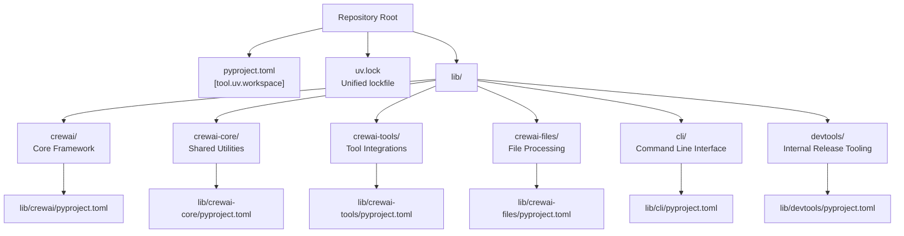
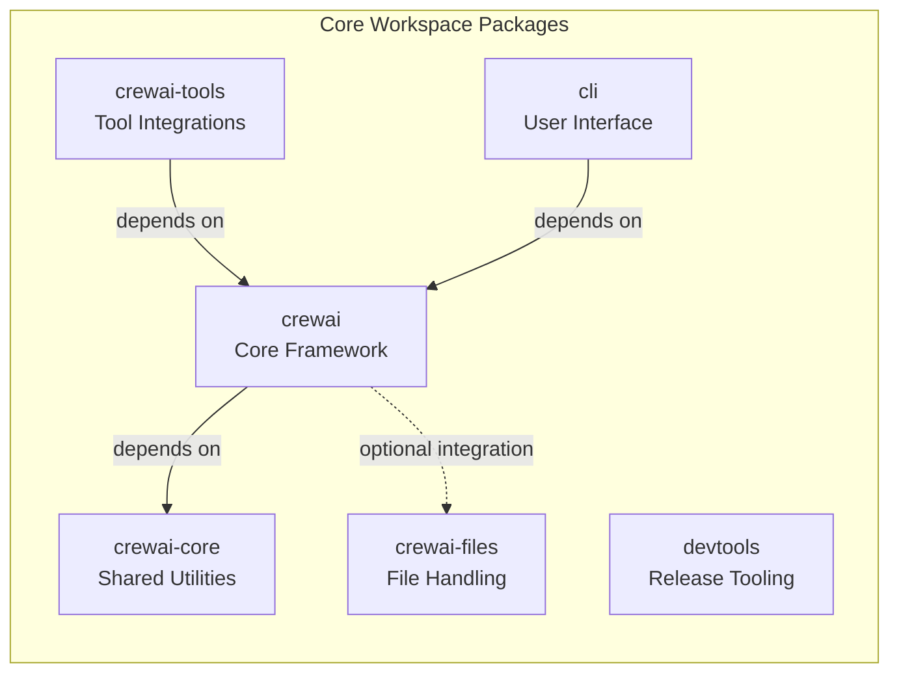

<!-- source: DeepWiki mcp.deepwiki.com · repo crewAIInc/crewAI · page 1.1 Workspace and Monorepo Architecture · fetched 2026-10-26 -->

# Workspace and Monorepo Architecture

Relevant source files

The following files were used as context for generating this wiki page:

- [.github/CONTRIBUTING.md](.github/CONTRIBUTING.md)
- [.github/codeql/codeql-config.yml](.github/codeql/codeql-config.yml)
- [AGENTS.md](AGENTS.md)

## Purpose and Scope

This document describes the UV-based workspace architecture of the CrewAI repository, including the internal framework packages (`crewai`, `crewai-tools`, `crewai-files`, `crewai-core`, `cli`, `devtools`), their dependency relationships, and how development tooling is configured at the workspace level. This architecture enables a monorepo workflow where multiple interdependent packages are developed, tested, and versioned in a unified environment.

Sources: [.github/CONTRIBUTING.md:1-40](), [.github/codeql/codeql-config.yml:1-33]()

## Workspace Structure

CrewAI uses [UV](https://github.com/astral-sh/uv) as its workspace manager, defining a monorepo with packages managed under the `lib/` directory [.github/CONTRIBUTING.md:30-40](). The workspace configuration ensures that all internal packages can reference each other as editable workspace members during development.

### Physical Directory Layout

The following diagram maps the physical file structure to the logical package entities defined in the codebase.

All workspace members share a single `uv.lock` file at the repository root, ensuring consistent dependency resolution across the entire suite of packages.

Sources: [.github/CONTRIBUTING.md:30-40](), [.github/codeql/codeql-config.yml:21-26]()

## Package Dependency Graph

The workspace packages are architected with specific inter-dependencies to maintain a separation of concerns between the core orchestration engine, shared utilities, external tool integrations, and multimodal file handling.

| Package | Path | Description |
| :--- | :--- | :--- |
| `crewai` | `lib/crewai/` | The core framework containing orchestration logic for Agents, Tasks, and Crews [.github/CONTRIBUTING.md:36](). |
| `crewai-core` | `lib/crewai-core/` | Shared utilities, base models, and internal logic used across the ecosystem [.github/codeql/codeql-config.yml:23](). |
| `crewai-tools` | `lib/crewai-tools/` | A collection of tool integrations and the `BaseTool` interface [.github/CONTRIBUTING.md:37](). |
| `crewai-files` | `lib/crewai-files/` | Specialized package for multimodal file handling and processing [.github/CONTRIBUTING.md:38](). |
| `cli` | `lib/cli/` | Command-line interface for project scaffolding, execution, and deployment [.github/codeql/codeql-config.yml:21](). |
| `devtools` | `lib/devtools/` | Internal utilities for release management and repository maintenance [.github/CONTRIBUTING.md:39](). |

Sources: [.github/CONTRIBUTING.md:34-40](), [.github/codeql/codeql-config.yml:21-26]()

## Development Workflow and Dependency Management

The monorepo uses `uv` to manage both runtime and development dependencies. Development tools are installed at the workspace level to ensure consistent linting and testing environments [.github/CONTRIBUTING.md:13-28]().

### Code Quality Stack

The repository enforces strict code quality standards through a centralized configuration in the root and package-level `pyproject.toml` files.

*   **Linting & Formatting**: `ruff` is used for linting and formatting across the `lib/` directory [.github/CONTRIBUTING.md:61-64]().
*   **Static Type Checking**: `mypy` is used for strict type checking. CI runs mypy on Python versions 3.10 through 3.13 for every PR [.github/CONTRIBUTING.md:126-137]().
*   **Git Hooks**: `pre-commit` is used to run `ruff` and `mypy` automatically before commits [.github/CONTRIBUTING.md:27-28]().

### Dependency Commands

Developers use the following `uv` commands to manage the workspace:

| Action | Command |
| :--- | :--- |
| **Initial Setup** | `uv sync --all-groups --all-extras` [.github/CONTRIBUTING.md:25]() |
| **Install Hooks** | `uv run pre-commit install` [.github/CONTRIBUTING.md:27]() |
| **Add Runtime Dep** | `uv add --package crewai <package>` [.github/CONTRIBUTING.md:155]() |
| **Add Dev Dep** | `uv add --dev <package>` [.github/CONTRIBUTING.md:158]() |
| **Run Tests** | `uv run pytest lib/crewai/tests/` [.github/CONTRIBUTING.md:113]() |

Sources: [.github/CONTRIBUTING.md:19-28](), [.github/CONTRIBUTING.md:57-69](), [.github/CONTRIBUTING.md:124-136](), [.github/CONTRIBUTING.md:150-161]()

## Continuous Integration and Security

The monorepo architecture is supported by automated workflows that validate code changes across all packages.

*   **CodeQL Analysis**: Configured to include all source code from `lib/cli/src/**`, `lib/crewai/src/**`, `lib/crewai-core/src/**`, `lib/crewai-tools/src/**`, `lib/crewai-files/src/**`, and `lib/devtools/src/**` [.github/codeql/codeql-config.yml:21-26](). It explicitly ignores experimental features like `a2a` (Agent-to-Agent) and test cassettes to focus on core logic [.github/codeql/codeql-config.yml:3-14]().
*   **Test Isolation**: Tests are organized by package, allowing for targeted execution (e.g., `uv run pytest lib/crewai-tools/tests/`) [.github/CONTRIBUTING.md:109-123]().

Sources: [.github/codeql/codeql-config.yml:1-33](), [.github/CONTRIBUTING.md:109-123]()

---

