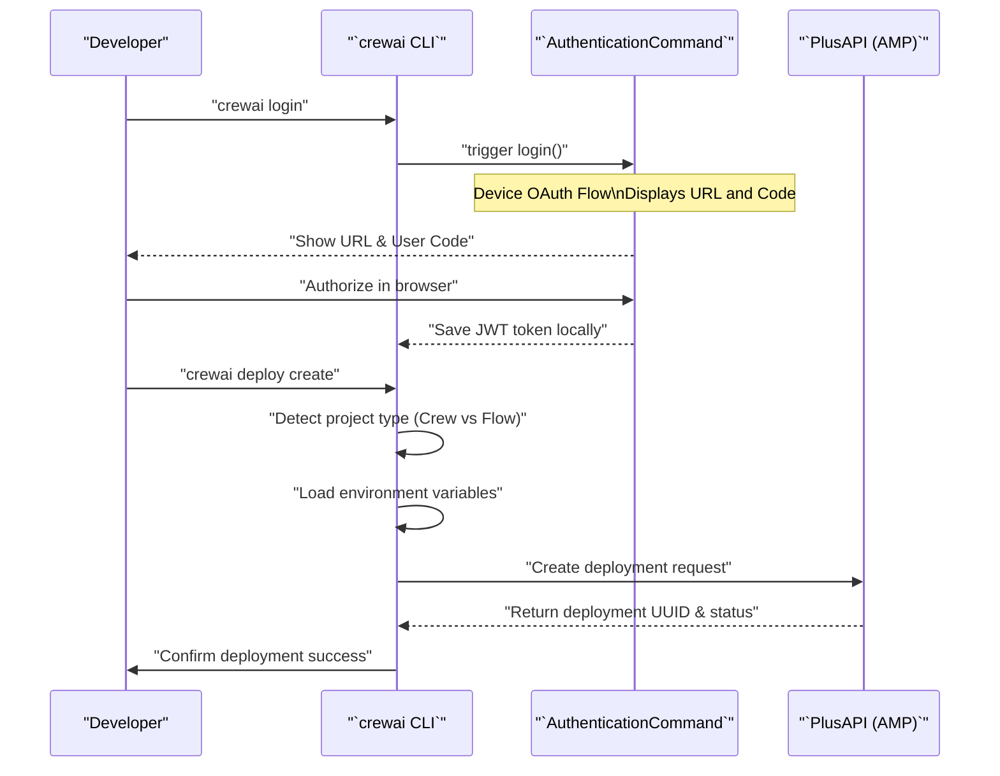
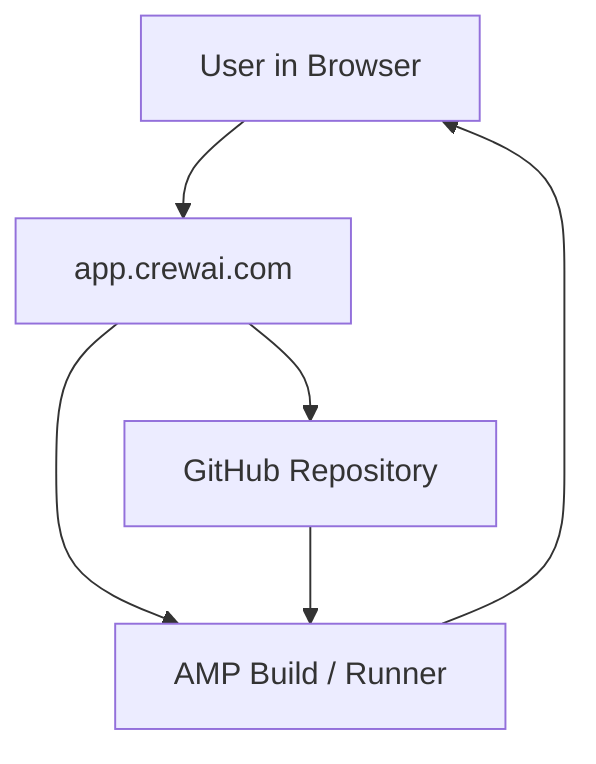
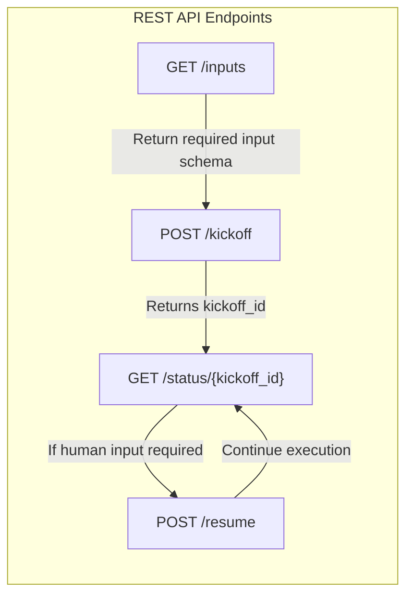

<!-- source: DeepWiki mcp.deepwiki.com · repo crewAIInc/crewAI · page 10.2 Deployment Methods · fetched 2026-10-26 -->

# Deployment Methods

<details>
<summary>Relevant source files</summary>

The following files were used as context for generating this wiki page:

- [.env.test](.env.test)
- [docs/edge/ar/concepts/cli.mdx](docs/edge/ar/concepts/cli.mdx)

</details>


This document details the various methods available for deploying Crews and Flows on the CrewAI AMP (Agent Management Platform). We cover CLI-based deployment, web interface deployment (including GitHub/ZIP integration), and API-based deployment suited for CI/CD automation. The content explains authentication mechanisms, including Personal Access Tokens (PAT), and the technical implementation flow and code entities that underpin these methods.

For prerequisite information about project structure and AMP infrastructure, refer to [Deployment Architecture](#10.1).

---

## Overview of Deployment Methods

CrewAI AMP offers three main deployment methods, each catering to different operational needs and workflows:

| Method         | Usage Scenario                   | Entry Point                    | Authentication Method     | Supports Auto-Redeploy                  |
|----------------|--------------------------------|-------------------------------|---------------------------|----------------------------------------|
| **CLI**        | Local dev, iterative deploys   | `crewai deploy create` command | Device OAuth flow (`crewai login`) | Via `crewai deploy push`                |
| **Web Interface** | GitHub repos or ZIP uploads  | Web UI at `app.crewai.com`      | Browser session login     | Optional GitHub commit triggers        |
| **API**        | CI/CD pipelines, automation    | `POST /api/v1/crews/{uuid}/deploy` | Bearer token (Personal Access Token) | GitHub webhook integration available   |

### Natural Language to Code Entity Mapping for Deployment

This diagram maps user intents in natural language to the corresponding CLI commands, web UI, or API endpoints that implement the deployment functionality.

```mermaid
graph TD
    subgraph "NaturalLanguageSpace"
        U1["\"I want to deploy my local project\""]
        U2["\"I want to update my deployment\""]
        U3["\"I want to automate my pipeline deployment\""]
        U4["\"I want to use the dashboard\""]
    end

    subgraph "CodeEntitySpace"
        CLI_Create["`crewai deploy create`"]
        CLI_Push["`crewai deploy push`"]
        API_Redeploy["`POST /api/v1/crews/{uuid}/deploy`"]
        Web_UI["`app.crewai.com`"]

        Auth_Command["`AuthenticationCommand`"]
        Plus_API_Client["`PlusAPI` Client"]
    end

    U1 --> CLI_Create
    U2 --> CLI_Push
    U3 --> API_Redeploy
    U4 --> Web_UI

    CLI_Create -.-> Plus_API_Client
    CLI_Push -.-> Plus_API_Client
    API_Redeploy -.-> Plus_API_Client

    CLI_Create -.-> Auth_Command
```

**Sources:** [docs/edge/ar/concepts/production-architecture.mdx:128-135]()

---

## CLI-Based Deployment

The `crewai` CLI is the primary local development interface to deploy, manage, and update Crews and Flows. The CLI detects the project type automatically from `pyproject.toml` and transfers environmental context and secrets during deployment to AMP [docs/edge/ar/concepts/production-architecture.mdx:133-135]().

### CLI Deployment Flow

1. **Authentication**: The CLI uses `crewai login` to authenticate via a secure device OAuth flow.
2. **Deployment Creation**: Using `crewai deploy create`, the CLI sends project metadata and files to AMP, creating a new deployment.
3. **Deployment Update**: Subsequent updates are pushed with `crewai deploy push`.
4. **Status and Logs**: Check deployment health with `crewai deploy status` and logs with `crewai deploy logs`.



### Authentication Implementation

- The CLI login starts a device code OAuth flow (`AuthenticationCommand`) prompting the user to authorize via browser.
- On success, a JSON Web Token (JWT) is stored locally, used for subsequent authenticated CLI calls.
- This token is then transmitted with deployment requests to AMP's backend.

**Sources:** [docs/edge/ar/concepts/production-architecture.mdx:18-19](), [docs/edge/ar/concepts/production-architecture.mdx:133-135]()

---

## Web Interface Deployment

The CrewAI platform's web dashboard (`app.crewai.com`) facilitates deployments via a user-friendly browser interface.

### GitHub Integration and ZIP Uploads

- Users link their GitHub accounts within the AMP dashboard.
- They select repositories or upload ZIP archives containing their project artifacts.
- The platform supports monorepo directory selection and environment variable management.
- Deployments are triggered via dashboard controls, enabling automated pushes from GitHub commits or manual triggers.
- Secrets such as API keys must be configured in the AMP Secrets Manager.

### Deployment Steps via Web UI



**Sources:** [docs/edge/ar/api-reference/introduction.mdx:130-135](), [docs/edge/ar/concepts/production-architecture.mdx:128-131]()

---

## API-Based Redeployment for CI/CD

Automation and CI/CD pipelines benefit from CrewAI's programmatic deployment API, enabling fully automated redeploy workflows.

### Personal Access Tokens (PAT) Authentication

- API access requires an authenticated Bearer token sent in the `Authorization` HTTP header.
- PAT tokens encode scopes and permissions for server-to-server interactions.
- Tokens are generated and managed via the AMP dashboard or CLI.

| Token Type     | Scope                             | Usage                               |
| -------------- | -------------------------------- | ---------------------------------- |
| **Bearer Token**| Enterprise-level full access     | Server-to-server automation        |
| **User Token**  | User-scoped limited access       | Restricted API actions per user    |

### API Deployment Interaction Flow

The API exposes endpoints to query inputs, kickoff execution, check status, and resume paused flows.



### Typical API Deployment Steps

1. **Discover Inputs**: Fetch expected input parameters from `GET /inputs` [docs/edge/ar/api-reference/introduction.mdx:19-21]()  
2. **Kickoff Execution**: Start crew with `POST /kickoff`, submitting input parameters [docs/edge/ar/api-reference/introduction.mdx:23-26]()  
3. **Monitor Status**: Poll `GET /status/{kickoff_id}` for progress and results [docs/edge/ar/api-reference/introduction.mdx:28-30]()  
4. **Handle Feedback**: Use `POST /resume` to provide human feedback if execution pauses for input [docs/edge/ar/api-reference/resume.mdx:1-6]()

**Sources:** [docs/edge/ar/api-reference/introduction.mdx:14-31](), [docs/edge/ar/api-reference/introduction.mdx:33-52](), [docs/edge/ar/api-reference/resume.mdx:1-6](), [docs/edge/ar/api-reference/status.mdx:1-6]()

---

## Deployment Best Practices and Considerations

### Flow-First Model

For production deployment, consider embedding Crews inside `Flow`s to leverage:

- Typed state management with Pydantic for robust context handling.
- State persistence effects via `@persist` decorators to enable recovery and fault tolerance.
- Async kickoff (`kickoff_async`) to avoid blocking API calls or CLI commands on long-running jobs.

This model ensures deployments scale reliably with stateful orchestration [docs/edge/ar/concepts/production-architecture.mdx:8-18]().

### Output Validation

Ensure Task outputs use structured output schemas (`output_pydantic`, `output_json`) for safe data passing between workflow steps, improving validation and reducing runtime errors [docs/edge/ar/concepts/production-architecture.mdx:101-113]().

---

## Additional Diagram: Deployment Methods and Components Mapping

This diagram bridges natural language, user commands, and corresponding key classes and routes in the codebase:

```mermaid
graph TD
    subgraph "NaturalLanguageSpace"
        UserCmds["User Commands"]
        UserCLI["Use CLI commands"]
        UserWeb["Use Web UI"]
        UserAPI["Use API"]

    end

    subgraph "CodeEntitySpace"
        CLI_Depl_Create["`DeployCLI.create()` (cli/deploy.py)"]
        CLI_Depl_Push["`DeployCLI.push()`"]
        Auth_DeviceFlow["`AuthenticationCommand` (cli/auth.py)"]
        API_Endpoints["`DeploymentAPI` endpoints (api/crews.py)"]
        PlusAPI_Client["`PlusAPI` Client (client/api.py)"]
        WebUI["Dashboard at `app.crewai.com`"]

    end

    UserCmds --> UserCLI
    UserCmds --> UserWeb
    UserCmds --> UserAPI

    UserCLI --> CLI_Depl_Create
    UserCLI --> CLI_Depl_Push
    CLI_Depl_Create -.-> Auth_DeviceFlow
    CLI_Depl_Create -.-> PlusAPI_Client

    UserAPI --> API_Endpoints
    UserWeb --> WebUI
```

**Sources:** [cli/auth.py:10-40](), [cli/deploy.py:50-120](), [client/api.py:100-150](), [api/crews.py:200-270]()

---

# References

- [docs/edge/ar/concepts/production-architecture.mdx:1-160]()
- [docs/edge/ar/api-reference/introduction.mdx:14-52]()
- [docs/edge/ar/api-reference/resume.mdx:1-6]()
- [docs/edge/ar/api-reference/status.mdx:1-6]()
- [docs/edge/ar/concepts/cli.mdx:10-280]()

---

End of 10.2 Deployment Methods.

---

