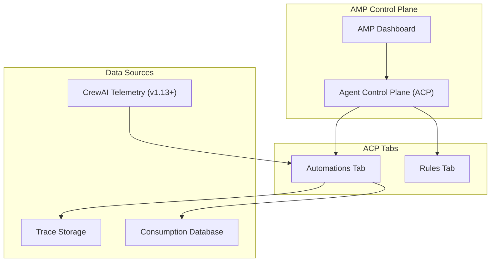
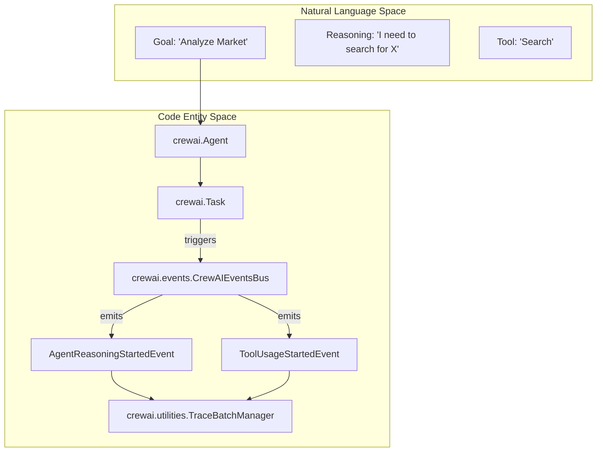
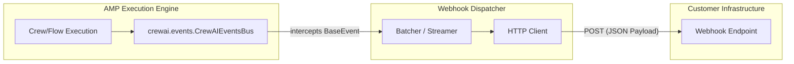

<!-- source: DeepWiki mcp.deepwiki.com · repo crewAIInc/crewAI · page 10.4 Control Plane and Monitoring · fetched 2026-10-26 -->

# Control Plane and Monitoring

Relevant source files

The following files were used as context for generating this wiki page:

- [docs/edge/ar/api-reference/status.mdx](docs/edge/ar/api-reference/status.mdx)
- [docs/edge/ar/concepts/event-listener.mdx](docs/edge/ar/concepts/event-listener.mdx)

This document describes the control plane and monitoring capabilities provided by CrewAI AMP (Agent Management Platform) for enterprise-grade production deployments. It covers the Agent Control Plane (ACP), dashboard features, observability integrations, and real-time event streaming via webhooks.

---

## Agent Control Plane (ACP) Overview

The **Agent Control Plane** (ACP) serves as a unified operations center for all automations running on CrewAI AMP. It provides a centralized view of fleet health, LLM consumption, and enterprise-wide policies.

The ACP is divided into two primary areas:
- **Automations**: Focused on operational health and cost monitoring [docs/edge/ar/enterprise/features/agent-control-plane/overview.mdx:35]().
- **Rules**: Focused on enforcing organizational policies, such as PII Redaction, across multiple deployments without requiring code changes [docs/edge/ar/enterprise/features/agent-control-plane/overview.mdx:36]().

### Requirements
ACP features require **crewAI v1.13 or later**. Deployments on older versions will appear in the dashboard but will not contribute metrics or health data [docs/edge/ar/enterprise/features/agent-control-plane/overview.mdx:41-42]().

**Control Plane Architecture**

Sources: [docs/edge/ar/enterprise/features/agent-control-plane/overview.mdx:18-51]()

---

## Monitoring and Dashboard Features

The monitoring interface provides high-level metrics and granular breakdowns of every deployed crew or flow.

### Automations Tab (Fleet Health)
The **Automations** sub-tab provides a "Health Status Breakdown" for the entire fleet [docs/edge/ar/enterprise/features/agent-control-plane/monitoring.mdx:49]().
- **Status Categories**: Executions are categorized as `Healthy`, `Warning`, or `Critical` [docs/edge/ar/enterprise/features/agent-control-plane/monitoring.mdx:35]().
- **Interactive Sankey**: A visualization mapping `Total Automations → Status Bundles`. Clicking a bundle filters the table to those specific deployments [docs/edge/ar/enterprise/features/agent-control-plane/monitoring.mdx:35]().
- **Fleet Metrics**: Displays active executions, total errors, and delta comparisons against previous time windows (24h, 7d, 30d) [docs/edge/ar/enterprise/features/agent-control-plane/monitoring.mdx:40-50]().

### Consumption Tab (Cost & Tokens)
The **Consumption** sub-tab details LLM spending and token usage [docs/edge/ar/enterprise/features/agent-control-plane/monitoring.mdx:70]().
- **Provider Breakdown**: Tracks costs and tokens per LLM provider (e.g., OpenAI, Anthropic) for each deployment [docs/edge/ar/enterprise/features/agent-control-plane/monitoring.mdx:80-81]().
- **Delta Tracking**: Shows cost increases or decreases compared to the previous period [docs/edge/ar/enterprise/features/agent-control-plane/monitoring.mdx:41]().

Sources: [docs/edge/ar/enterprise/features/agent-control-plane/monitoring.mdx:19-87]()

---

## Traces and Observability

Traces provide a deep-dive into individual executions, capturing the granular logic of agents and tools. CrewAI uses an event-driven architecture to power these insights [docs/edge/ar/concepts/event-listener.mdx:10-14]().

### Internal Event System
The observability stack is built on the `CrewAIEventsBus`, which manages the dispatching of internal events throughout the execution lifecycle [docs/edge/ar/concepts/event-listener.mdx:16-20]().

- **BaseEvent**: The root class for all system events, including `timestamp` and `type` [docs/edge/ar/concepts/event-listener.mdx:17,197-200]().
- **CrewAIEventsBus**: A unique event bus that handles registration and dispatch [docs/edge/ar/concepts/event-listener.mdx:16]().
- **BaseEventListener**: An abstract base class used to create custom listeners or integrate with external monitoring platforms [docs/edge/ar/concepts/event-listener.mdx:18,54-56]().

### Trace Components
Every execution trace in AMP captures [docs/edge/ar/enterprise/features/traces.mdx:14-22]():
- **Agent Reasoning**: Captured via `AgentReasoningStartedEvent` and `AgentReasoningCompletedEvent` [docs/edge/ar/concepts/event-listener.mdx:179-180]().
- **Tool Execution**: Detailed via `ToolUsageStartedEvent` and `ToolUsageFinishedEvent` [docs/edge/ar/concepts/event-listener.mdx:128-129]().
- **LLM Metrics**: Token usage and costs are tracked through `LLMCallCompletedEvent` [docs/edge/ar/concepts/event-listener.mdx:166]().
- **Execution Timeline**: A visual representation of task lifecycles using `TaskStartedEvent` and `TaskCompletedEvent` [docs/edge/ar/concepts/event-listener.mdx:122-123]().

### Trace Management
To maintain performance during high-volume operations, CrewAI uses a batching system:
- **TraceBatchManager**: Caches events locally and sends them in batches to the Plus API [docs/edge/ar/enterprise/features/traces.mdx:139-141]().
- **Reliability**: Reduces network overhead and ensures trace data is preserved even in unstable connections [docs/edge/ar/enterprise/features/traces.mdx:140-143]().

**Tracing Data Flow: Language to Code**

Sources: [docs/edge/ar/concepts/event-listener.mdx:10-189](), [docs/edge/ar/enterprise/features/traces.mdx:10-52](), [docs/edge/ar/enterprise/features/traces.mdx:137-143]()

---

## Webhook Streaming for Real-time Events

Enterprise Event Streaming allows external systems to receive real-time updates via webhooks. This is configured during the `kickoff` request [docs/edge/ar/enterprise/features/webhook-streaming.mdx:10-14]().

### Configuration
Users can define a `webhooks` object in the API request:
- **URL**: The target endpoint for event delivery [docs/edge/ar/enterprise/features/webhook-streaming.mdx:21]().
- **Realtime Mode**: If `realtime: true`, events are sent individually and immediately. If `false`, they are batched for better performance [docs/edge/ar/enterprise/features/webhook-streaming.mdx:22-31]().
- **Authentication**: Supports `bearer` token strategies for secure delivery [docs/edge/ar/enterprise/features/webhook-streaming.mdx:23-26]().

### Supported Event Types
The system supports a wide range of internal events [docs/edge/ar/enterprise/features/webhook-streaming.mdx:65-154]():
- **Flow Events**: `FlowStartedEvent`, `FlowFinishedEvent`, `FlowPausedEvent` [docs/edge/ar/concepts/event-listener.mdx:158-161]().
- **Agent Events**: `AgentExecutionStartedEvent`, `AgentExecutionCompletedEvent` [docs/edge/ar/concepts/event-listener.mdx:114-115]().
- **Tool Events**: `ToolUsageStartedEvent`, `ToolUsageErrorEvent` [docs/edge/ar/concepts/event-listener.mdx:128-130]().
- **LLM Events**: `LLMCallStartedEvent`, `LLMStreamChunkEvent` [docs/edge/ar/concepts/event-listener.mdx:165,168]().

**Webhook Event Delivery Flow**

Sources: [docs/edge/ar/concepts/event-listener.mdx:157-189](), [docs/edge/ar/enterprise/features/webhook-streaming.mdx:16-156]()

---

