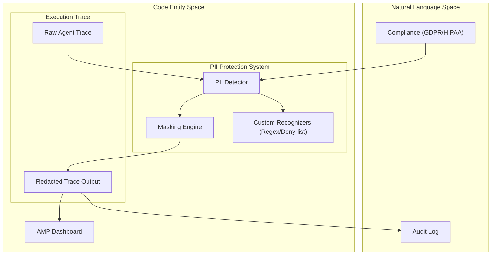

<!-- source: DeepWiki mcp.deepwiki.com · repo crewAIInc/crewAI · page 10.6 Enterprise Security and Governance · fetched 2026-10-26 -->

# Enterprise Security and Governance

<details>
<summary>Relevant source files</summary>

The following files were used as context for generating this wiki page:

- [.github/security.md](.github/security.md)
- [docs/edge/ar/guides/advanced/fingerprinting.mdx](docs/edge/ar/guides/advanced/fingerprinting.mdx)

</details>


The CrewAI Enterprise Security and Governance framework provides a robust suite of tools for managing access, protecting sensitive data, and maintaining a verifiable audit trail of agent activities. This system is primarily managed through the **CrewAI AMP (Agent Management Platform)** and core security primitives in the framework.

## Role-Based Access Control (RBAC)

RBAC in CrewAI AMP enables secure and scalable access management through two distinct layers: **Feature Permissions** and **Entity-Level Permissions** [docs/edge/ar/enterprise/features/rbac.mdx:8-14]().

### Users and Roles
Every member in a CrewAI workspace is assigned a role that determines their access level across platform features [docs/edge/ar/enterprise/features/rbac.mdx:19-21]().

*   **Predefined Roles:**
    *   **Owner:** Full access to all features and settings. Cannot be restricted [docs/edge/ar/enterprise/features/rbac.mdx:48]().
    *   **Member:** Default role with read access to most features and manage access for environment variables, LLM connections, and Studio projects [docs/edge/ar/enterprise/features/rbac.mdx:49]().
*   **Custom Roles:** Organizations can create tailored roles with specific permission sets [docs/edge/ar/enterprise/features/rbac.mdx:26]().

### Feature Permission Matrix
Permissions are categorized into three levels: **Manage** (Full CRUD), **Read** (View only), and **No access** (Hidden) [docs/edge/ar/enterprise/features/rbac.mdx:62-66]().

| Feature | Owner | Member (Default) | Description |
| :--- | :--- | :--- | :--- |
| `usage_dashboards` | Manage | Read | Usage metrics and analytics [docs/edge/ar/enterprise/features/rbac.mdx:70]() |
| `crews_dashboards` | Manage | Read | Deployment dashboards and automation details [docs/edge/ar/enterprise/features/rbac.mdx:71]() |
| `environment_variables`| Manage | Manage | CRUD for environment secrets [docs/edge/ar/enterprise/features/rbac.mdx:76]() |
| `llm_connections` | Manage | Manage | Configuration for LLM provider connections [docs/edge/ar/enterprise/features/rbac.mdx:77]() |
| `organization_settings`| Manage | No access | Billing, plans, and org configuration [docs/edge/ar/enterprise/features/rbac.mdx:79]() |

### Automation Visibility (Entity-Level RBAC)
Beyond global roles, individual automations support visibility settings to restrict access by specific users or roles [docs/edge/ar/enterprise/features/rbac.mdx:119-125](). Deployments can be set to **Private**, ensuring only whitelisted entities can interact with them [docs/edge/ar/enterprise/features/rbac.mdx:131]().

**Sources:** [docs/edge/ar/enterprise/features/rbac.mdx:8-14](), [docs/edge/ar/enterprise/features/rbac.mdx:19-21](), [docs/edge/ar/enterprise/features/rbac.mdx:48-49](), [docs/edge/ar/enterprise/features/rbac.mdx:62-79](), [docs/edge/ar/enterprise/features/rbac.mdx:119-131]()

## PII Trace Redactions

PII Redaction is an Enterprise-tier feature in CrewAI AMP that automatically detects and masks Personally Identifiable Information (PII) in agent execution traces [docs/edge/ar/enterprise/features/pii-trace-redactions.mdx:8-10]().

### Redaction Workflow
1.  **Detection:** Scans trace event data for known PII patterns [docs/edge/ar/enterprise/features/pii-trace-redactions.mdx:37]().
2.  **Classification:** Identifies the data type (e.g., Credit Card, SSN, Email) [docs/edge/ar/enterprise/features/pii-trace-redactions.mdx:38]().
3.  **Masking/Redaction:** Replaces sensitive data with a label (e.g., `<EMAIL_ADDRESS>`) or removes it entirely [docs/edge/ar/enterprise/features/pii-trace-redactions.mdx:39-44]().

### Supported Entities
The system supports global entities (Credit Cards, Crypto addresses, IP addresses, Names) and US-specific entities (SSN, Driver Licenses, Passports) [docs/edge/ar/enterprise/features/pii-trace-redactions.mdx:82-111]().

### Custom Recognizers
Organizations can define **Custom Recognizers** using two methods:
*   **Regex-based:** For structured data like Employee IDs or internal project codes [docs/edge/ar/enterprise/features/pii-trace-redactions.mdx:136]().
*   **Deny-list:** For exact text matching of sensitive terms or internal codenames [docs/edge/ar/enterprise/features/pii-trace-redactions.mdx:137]().

**Sources:** [docs/edge/ar/enterprise/features/pii-trace-redactions.mdx:8-10](), [docs/edge/ar/enterprise/features/pii-trace-redactions.mdx:37-44](), [docs/edge/ar/enterprise/features/pii-trace-redactions.mdx:82-111](), [docs/edge/ar/enterprise/features/pii-trace-redactions.mdx:136-137]()

## Agent Fingerprinting and Audit Trails

CrewAI implements a cryptographic fingerprinting system to uniquely identify and track components throughout their lifecycle [docs/edge/ar/guides/advanced/fingerprinting.mdx:8-10]().

### The `Fingerprint` Class
Located in the `crewai.security` module, the `Fingerprint` entity ensures component integrity [docs/edge/ar/guides/advanced/fingerprinting.mdx:20]().
*   **`uuid_str`**: A read-only unique identifier generated automatically [docs/edge/ar/guides/advanced/fingerprinting.mdx:22]().
*   **`created_at`**: An immutable timestamp of component creation [docs/edge/ar/guides/advanced/fingerprinting.mdx:23]().
*   **`metadata`**: A customizable dictionary for attaching context like department, version, or project ID [docs/edge/ar/guides/advanced/fingerprinting.mdx:24]().

### Fingerprint Persistence
Fingerprints are automatically assigned to `Agent`, `Crew`, and `Task` instances upon initialization [docs/edge/ar/guides/advanced/fingerprinting.mdx:35-51](). They remain constant even if component attributes (like an agent's goal) are modified, providing a stable anchor for audit logs [docs/edge/ar/guides/advanced/fingerprinting.mdx:80-91]().

### Deterministic Fingerprints
For scenarios requiring predictable IDs across different execution environments, the `Fingerprint.generate(seed="...")` method allows creating fingerprints based on a seed string [docs/edge/ar/guides/advanced/fingerprinting.mdx:94-113]().

**Sources:** [docs/edge/ar/guides/advanced/fingerprinting.mdx:8-24](), [docs/edge/ar/guides/advanced/fingerprinting.mdx:35-51](), [docs/edge/ar/guides/advanced/fingerprinting.mdx:80-91](), [docs/edge/ar/guides/advanced/fingerprinting.mdx:94-113]()

## Security Policy
CrewAI maintains a strict security policy. Vulnerabilities are managed through a dedicated Bugcrowd channel and should not be disclosed via public GitHub issues [.github/security.md:6-15]().

**Sources:** [.github/security.md:6-15]()

## System Architecture: Security and Governance

The following diagrams bridge the "Natural Language Space" of enterprise requirements to the "Code Entity Space" of the CrewAI implementation.

Title: Data Flow for PII Redaction in Traces

**Sources:** [docs/edge/ar/enterprise/features/pii-trace-redactions.mdx:35-44](), [docs/edge/ar/enterprise/features/pii-trace-redactions.mdx:130-138]()

Title: Agent Fingerprinting and Audit Trail Logic
```mermaid
graph TD
    subgraph "Natural Language Space"
        "Audit Trail"
        "Component Identity"
        "Governance"
    end

    subgraph "Code Entity Space"
        subgraph "crewai.security"
            Fingerprint["Fingerprint Class"]
            GenMethod["Fingerprint.generate(seed)"]
        end

        subgraph "Core Components"
            Agent["Agent Class"]
            Task["Task Class"]
            Crew["Crew Class"]
        end

        subgraph "Attributes"
            UUID["uuid_str (Immutable)"]
            TS["created_at (Immutable)"]
            Meta["metadata (Mutable)"]
        end
    end

    Agent --> Fingerprint
    Task --> Fingerprint
    Crew --> Fingerprint
    Fingerprint --> UUID
    Fingerprint --> TS
    Fingerprint --> Meta
    GenMethod --> Fingerprint
    "Component Identity" --> UUID
    "Audit Trail" --> Fingerprint
```
**Sources:** [docs/edge/ar/guides/advanced/fingerprinting.mdx:18-26](), [docs/edge/ar/guides/advanced/fingerprinting.mdx:94-113]()

## Summary of Enterprise Governance Features

| Feature | Description | Availability |
| :--- | :--- | :--- |
| **RBAC** | Granular role and entity permissions [docs/edge/ar/enterprise/features/rbac.mdx:10-14]() | AMP |
| **PII Redaction** | Automatic masking of sensitive data in traces [docs/edge/ar/enterprise/features/pii-trace-redactions.mdx:10]() | Enterprise Plan |
| **Fingerprinting** | Unique `uuid_str` and `created_at` for every component [docs/edge/ar/guides/advanced/fingerprinting.mdx:20-24]() | Core Framework |
| **Visibility Control** | Private vs Public automation access [docs/edge/ar/enterprise/features/rbac.mdx:131]() | AMP |
| **Security Reporting** | Formal Bugcrowd vulnerability disclosure [.github/security.md:10-11]() | All |

**Sources:** [docs/edge/ar/enterprise/features/rbac.mdx:10-14](), [docs/edge/ar/enterprise/features/pii-trace-redactions.mdx:10-124](), [docs/edge/ar/guides/advanced/fingerprinting.mdx:20-24](), [.github/security.md:10-11]()

---

