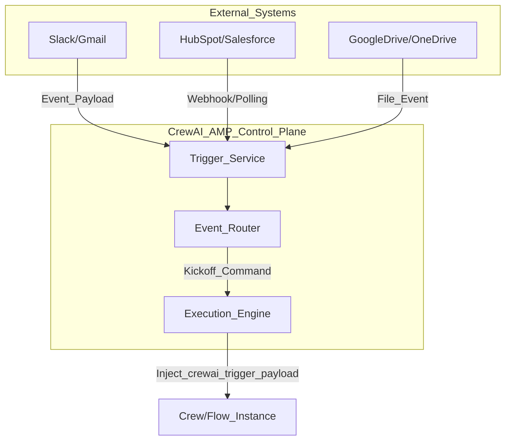
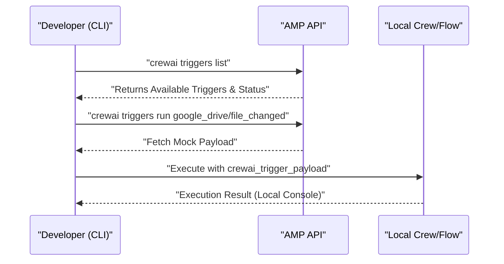
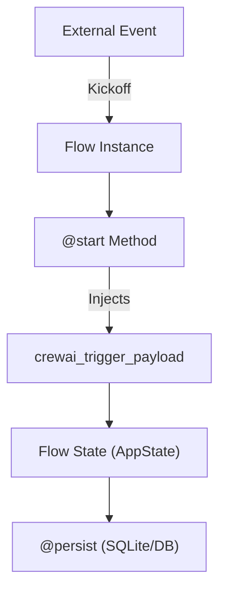

<!-- source: DeepWiki mcp.deepwiki.com · repo crewAIInc/crewAI · page 10.8 Automation Triggers and Integrations · fetched 2026-10-26 -->

# Automation Triggers and Integrations

<details>
<summary>Relevant source files</summary>

The following files were used as context for generating this wiki page:

- [.env.test](.env.test)
- [docs/edge/ar/concepts/cli.mdx](docs/edge/ar/concepts/cli.mdx)

</details>


Automation Triggers and Integrations in CrewAI AMP (Agent Management Platform) enable Crews and Flows to respond to external events from enterprise tools and services. These triggers bridge the gap between static execution and dynamic, event-driven agentic workflows by listening for changes in systems like Gmail, Slack, and Salesforce to initiate agentic processes automatically [docs/edge/ar/enterprise/guides/automation-triggers.mdx:8-12]().

## Automation Triggers Overview

AMP provides a suite of native triggers that allow agents to react to events in real-time across various platforms. These triggers eliminate the need for manual polling and allow for "set-and-forget" automation [docs/edge/ar/enterprise/guides/automation-triggers.mdx:8-12]().

### Supported Trigger Sources
*   **Communication:** Slack (messages, mentions), Gmail (new emails), Microsoft Teams (new chats), Outlook (new emails) [docs/edge/ar/enterprise/guides/automation-triggers.mdx:19-56]().
*   **Scheduling:** Google Calendar (new events, updates, cancellations), Outlook Calendar [docs/edge/ar/enterprise/guides/automation-triggers.mdx:24-42]().
*   **File Storage:** Google Drive (uploads, edits, deletions), OneDrive (file activity, sharing changes) [docs/edge/ar/enterprise/guides/automation-triggers.mdx:31-49]().
*   **CRM:** HubSpot (workflows, lifecycle events), Salesforce (CRM automation) [docs/edge/ar/enterprise/guides/automation-triggers.mdx:59-70]().
*   **Generic:** Webhooks (HTTP POST), Zapier (connecting to thousands of apps) [docs/edge/ar/enterprise/guides/automation-triggers.mdx:79-81]().

### Data Flow Architecture
When an external event occurs, the AMP Trigger Service captures the payload and initiates a Crew or Flow execution. The payload is injected into the execution context as `crewai_trigger_payload` [docs/edge/ar/enterprise/guides/automation-triggers.mdx:229-234]().

**Trigger Data Flow**


Sources: [docs/edge/ar/enterprise/guides/automation-triggers.mdx:8-12](), [docs/edge/ar/enterprise/guides/automation-triggers.mdx:229-234]()

## Integration Connectors

Connectors are the underlying authentication layer. AMP manages these credentials centrally under **Tools & Integrations**, ensuring that sensitive tokens are handled via OAuth or API keys [docs/edge/ar/enterprise/guides/automation-triggers.mdx:143-152]().

### Implementation and Logic
*   **Authentication:** Users must link the integration in the AMP dashboard and complete OAuth/API key authorization before a trigger can be enabled [docs/edge/ar/enterprise/guides/automation-triggers.mdx:146-147]().
*   **Payload Injection:** CrewAI automatically injects the trigger payload. In Crews, it is appended to the first task's description by default: `Trigger Payload: {crewai_trigger_payload}` [docs/edge/ar/enterprise/guides/automation-triggers.mdx:230-232]().
*   **Flow Integration:** Any function decorated with `@start()` in a Flow can accept `crewai_trigger_payload` as a parameter [docs/edge/ar/enterprise/guides/automation-triggers.mdx:233-234]().

### Code-to-System Mapping

| System Concept | Code Entity / CLI Symbol | Role |
| :--- | :--- | :--- |
| **Trigger Payload** | `crewai_trigger_payload` | The reserved input key containing the event data [docs/edge/ar/enterprise/guides/automation-triggers.mdx:230-234]() |
| **Context Control** | `allow_crewai_trigger_context` | Boolean flag to enable/disable automatic payload injection [docs/edge/ar/enterprise/guides/automation-triggers.mdx:150-151]() |
| **Local Simulation** | `crewai triggers run <name>` | CLI command to simulate a trigger event locally [docs/edge/ar/enterprise/guides/automation-triggers.mdx:176-184]() |
| **Trigger Discovery** | `crewai triggers list` | Lists available triggers for connected integrations [docs/edge/ar/enterprise/guides/automation-triggers.mdx:161-163]() |
| **Event Bus** | `CrewAIEventsBus` | Manages registration and dispatch of internal events [docs/edge/ar/concepts/event-listener.mdx:16-16]() |

Sources: [docs/edge/ar/enterprise/guides/automation-triggers.mdx:143-152](), [docs/edge/ar/enterprise/guides/automation-triggers.mdx:176-184](), [docs/edge/ar/enterprise/guides/automation-triggers.mdx:230-234](), [docs/edge/ar/concepts/event-listener.mdx:16-16]()

## Triggers CLI Commands

The `crewai` CLI provides commands to develop and test triggered automations locally without requiring a live deployment [docs/edge/ar/enterprise/guides/automation-triggers.mdx:153-155]().

### Local Development Workflow
1.  **List Triggers:** Run `crewai triggers list` to see triggers available for your connected tools [docs/edge/ar/enterprise/guides/automation-triggers.mdx:161-163]().
2.  **Simulate Event:** Use `crewai triggers run <trigger_name>` (e.g., `gmail/new_email_received`) to execute the local code with a realistic mock payload [docs/edge/ar/enterprise/guides/automation-triggers.mdx:176-184]().

**CLI Interaction Sequence**


Sources: [docs/edge/ar/enterprise/guides/automation-triggers.mdx:161-184](), [docs/edge/ar/enterprise/guides/gmail-trigger.mdx:64-70]()

## Trigger Implementation Patterns

### 1. Crew Payload Parsing
Agents must be configured to handle the incoming data. A common pattern involves a "Parser" task that extracts relevant fields from the JSON payload [docs/edge/ar/enterprise/guides/gmail-trigger.mdx:34-56]().

```python
@CrewBase
class GmailProcessingCrew:
    @task
    def parse_gmail_payload(self) -> Task:
        # CrewAI automatically injects payload into context
        return Task(
            config=self.tasks_config['parse_gmail_payload'],
            agent=self.parser(),
        )
```
Sources: [docs/edge/ar/enterprise/guides/gmail-trigger.mdx:34-56](), [docs/edge/ar/enterprise/guides/automation-triggers.mdx:203-225]()

### 2. Event-Driven Orchestration with Flows
Flows are recommended for production architectures involving triggers as they provide superior state management [docs/edge/ar/concepts/production-architecture.mdx:10-12](). Triggers can initiate a Flow, and the `@persist` decorator can be used to maintain state across event-driven steps [docs/edge/ar/concepts/production-architecture.mdx:143-147]().

**Flow Execution with Trigger Context**


Sources: [docs/edge/ar/concepts/production-architecture.mdx:10-12](), [docs/edge/ar/concepts/production-architecture.mdx:143-147](), [docs/edge/ar/enterprise/guides/automation-triggers.mdx:233-234]()

## Monitoring and Troubleshooting

The AMP Dashboard provides an **Executions** tab to monitor triggered runs [docs/edge/ar/enterprise/guides/automation-triggers.mdx:127-136]().

*   **Status Tracking:** View if a trigger-initiated run is "Online", "Failed", or "In Progress" [docs/edge/ar/enterprise/features/automations.mdx:65-73]().
*   **Payload Inspection:** Review the specific `crewai_trigger_payload` that was delivered for a specific execution [docs/edge/ar/enterprise/guides/google-calendar-trigger.mdx:66-75]().
*   **Event Tracing:** AMP leverages the `CrewAIEventsBus` to track commands and completions associated with triggers [docs/edge/ar/concepts/event-listener.mdx:22-23]().
*   **Common Issues:**
    *   **Missing Fields:** Some payloads (e.g., Calendar) use different formats for all-day events (`start.date`) vs timed events [docs/edge/ar/enterprise/guides/google-calendar-trigger.mdx:77-83]().
    *   **Permissions:** If payloads lack data (e.g., OneDrive permissions), ensure the connected account has sufficient scope [docs/edge/ar/enterprise/guides/onedrive-trigger.mdx:63-70]().

Sources: [docs/edge/ar/enterprise/features/automations.mdx:65-73](), [docs/edge/ar/enterprise/guides/automation-triggers.mdx:127-136](), [docs/edge/ar/enterprise/guides/google-calendar-trigger.mdx:77-83](), [docs/edge/ar/concepts/event-listener.mdx:22-23]()

---

