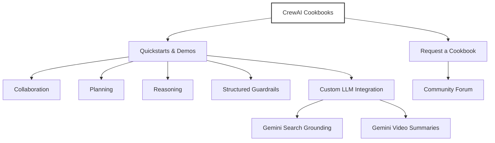

<!-- source: DeepWiki mcp.deepwiki.com · repo crewAIInc/crewAI · page 11 Guides and Migration · fetched 2026-10-26 -->

# Guides and Migration

<details>
<summary>Relevant source files</summary>

The following files were used as context for generating this wiki page:

- [docs/edge/ar/examples/cookbooks.mdx](docs/edge/ar/examples/cookbooks.mdx)
- [docs/edge/ar/guides/migration/upgrading-crewai.mdx](docs/edge/ar/guides/migration/upgrading-crewai.mdx)

</details>


This page provides a high-level overview of practical guides for working with CrewAI, including upgrading your projects, migrating from other frameworks, customizing prompts, and exploring examples. For detailed information on each topic, please refer to the linked child pages.

## Upgrading and Migration

Keeping your CrewAI projects up-to-date is crucial for accessing new features, performance improvements, and bug fixes. This section outlines the process for upgrading your CrewAI installation, both for the global CLI tool and your project's virtual environment. It also highlights common breaking changes and provides guidance for migrating from other agent orchestration frameworks like LangGraph.

Upgrading CrewAI involves updating your project's dependencies and potentially adjusting your code to accommodate changes in API or behavior. The `uv add` command is central to updating project dependencies, ensuring that both your `pyproject.toml` and `uv.lock` files are correctly updated [docs/edge/ar/guides/migration/upgrading-crewai.mdx:43-44](). For the global CLI, `uv tool install crewai --upgrade` handles the update [docs/edge/ar/guides/migration/upgrading-crewai.mdx:63]().

Common migration considerations include changes to import paths for tools, modifications to `Agent` and `Crew` constructor parameters, and structured output for `Task` objects. For instance, `BaseTool` and the `@tool` decorator are now located under `crewai.tools` [docs/edge/ar/guides/migration/upgrading-crewai.mdx:107]().

For details, see [Upgrading and Migration](#11.1).

### Diagram: CrewAI Upgrade Process

```mermaid
graph TD
    A["Start Upgrade"] --> B{{"Check Current Versions"}};
    B --> C["`crewai --version` (CLI)"];
    B --> D["`uv pip show crewai` (Project venv)"];

    C --> E{"CLI Upgrade Needed?"};
    E -- "Yes" --> F["`uv tool install crewai --upgrade`"];
    F --> G["`uv tool update-shell` (if PATH warning)"];

    D --> H{"Project venv Upgrade Needed?"};
    H -- "Yes" --> I["`uv add \"crewai[extras]>=X.Y.Z\"`"];
    I --> J["`crewai install`"];

    G --> K["Verify CLI: `crewai --version`"];
    J --> L["Verify Project: `uv pip show crewai`"];

    K --> M["End Upgrade"];
    L --> M;

    style A fill:#fff,stroke:#333,stroke-width:2px
    style M fill:#fff,stroke:#333,stroke-width:2px
```
Sources:
- [docs/edge/ar/guides/migration/upgrading-crewai.mdx:19-23]()
- [docs/edge/ar/guides/migration/upgrading-crewai.mdx:43-44]()
- [docs/edge/ar/guides/migration/upgrading-crewai.mdx:63]()
- [docs/edge/ar/guides/migration/upgrading-crewai.mdx:68-72]()
- [docs/edge/ar/guides/migration/upgrading-crewai.mdx:78-84]()

## Prompt Customization and Coding Agents

CrewAI offers extensive capabilities for customizing agent prompts and enabling agents to write and execute code. This section covers how to tailor the prompts that guide your agents' behavior, including localization and translation. It also delves into the concept of "coding agents," which are agents equipped with the ability to generate and run code, often leveraging specific tools and environments.

Prompt customization is key to fine-tuning agent responses and ensuring they align with specific task requirements. This can involve modifying system messages, few-shot examples, or even the underlying prompt templates. Coding agents, on the other hand, represent a powerful paradigm where agents can dynamically solve problems by writing and executing code, interacting with their environment through tools. The `AGENTS.md` file often contains guidelines and examples for building and utilizing such coding tools.

For details, see [Prompt Customization and Coding Agents](#11.2).

## Examples and Cookbooks

To help users quickly grasp CrewAI's capabilities and best practices, a collection of examples and cookbooks is provided. These resources demonstrate various patterns and use cases, ranging from basic agent collaboration to complex multi-stage planning and reasoning. Cookbooks are designed for quick learning of specific patterns, while full examples showcase production-ready applications.

The quickstarts and cookbooks cover diverse topics such as agent collaboration, planning, reasoning, and structured guardrails [docs/edge/ar/examples/cookbooks.mdx:11-21](). They also include examples of integrating with specific LLMs like Gemini for tasks such as search grounding and video summarization [docs/edge/ar/examples/cookbooks.mdx:24-35](). These resources are available in the `crewAI-quickstarts` GitHub repository [docs/edge/ar/examples/cookbooks.mdx:39-41]().

For details, see [Examples and Cookbooks](#11.3).

### Diagram: CrewAI Cookbook Categories


Sources:
- [docs/edge/ar/examples/cookbooks.mdx:11-21]()
- [docs/edge/ar/examples/cookbooks.mdx:24-35]()
- [docs/edge/ar/examples/cookbooks.mdx:39-41]()
- [docs/edge/ar/examples/cookbooks.mdx:42-44]()

---

