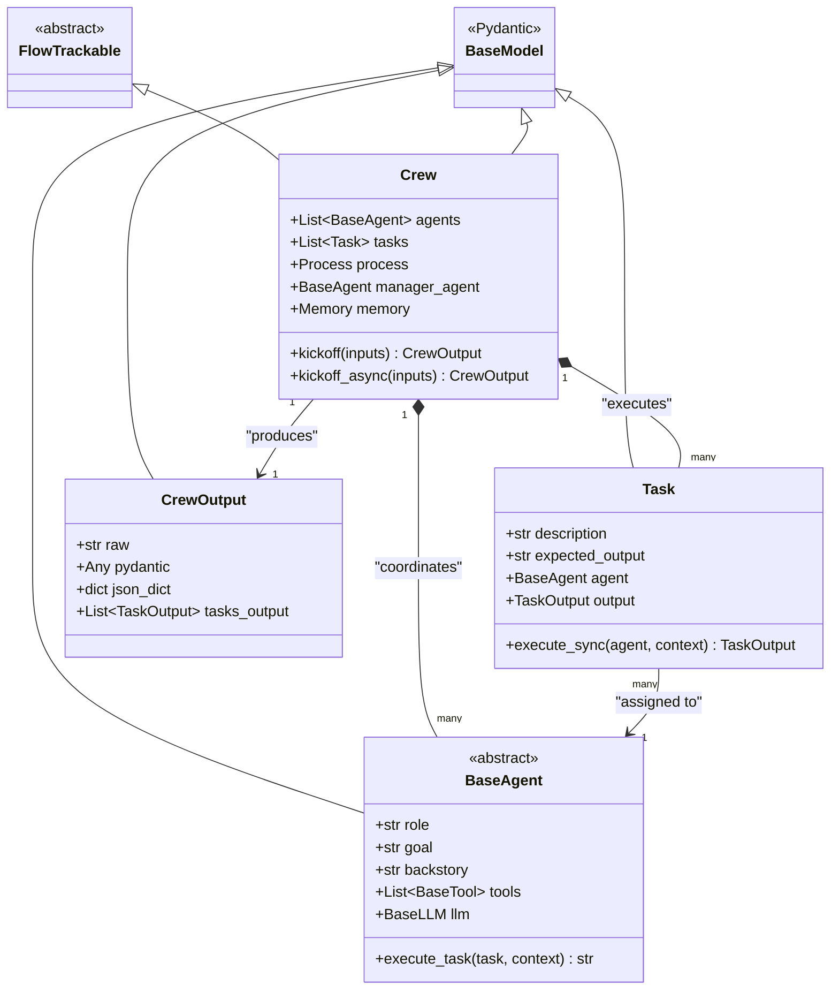
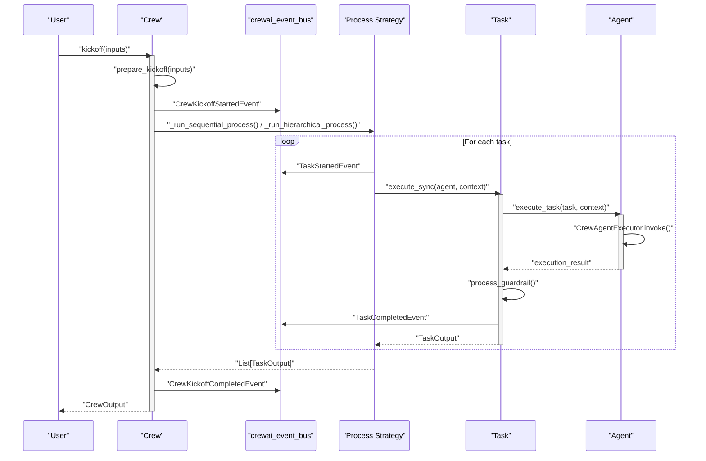

<!-- source: DeepWiki mcp.deepwiki.com · repo crewAIInc/crewAI · page 2 Crews: Autonomous Agent Orchestration · fetched 2026-10-26 -->

# Crews: Autonomous Agent Orchestration

Relevant source files

The following files were used as context for generating this wiki page:

- [docs/edge/ar/concepts/collaboration.mdx](docs/edge/ar/concepts/collaboration.mdx)
- [docs/edge/ar/concepts/crews.mdx](docs/edge/ar/concepts/crews.mdx)

## Purpose and Scope

This page provides a high-level overview of **Crews**, CrewAI's primary mechanism for orchestrating teams of autonomous AI agents to collaborate, execute tasks, and achieve complex goals [lib/crewai/src/crewai/crew.py:136-172](). As a parent architectural overview, this page introduces the core components of crew orchestration and links to specialized child pages for deep technical details.

For detailed information on specific subsystems, refer to the child pages:
- **Crew Configuration & Orchestration**: See [Crew Configuration and Orchestration](#2.1)
- **Agents**: See [Agents](#2.2)
- **Tasks**: See [Tasks](#2.3)
- **Agent-to-Agent (A2A) Protocol**: See [Agent-to-Agent (A2A) Protocol](#2.4)
- **Human-in-the-Loop & Collaboration**: See [Human-in-the-Loop and Collaboration](#2.5)
- **Agent Evaluation & Testing**: See [Agent Evaluation and Testing](#2.6)
- **Agent Skills**: See [Agent Skills](#2.7)

**Sources**: [lib/crewai/src/crewai/crew.py:136-172]()

---

## Crew System Architecture

The Crew system coordinates multi-agent workflows through three primary abstractions: `Crew`, `BaseAgent`, and `Task` [lib/crewai/src/crewai/crew.py:136-172](), [lib/crewai/src/crewai/agents/agent_builder/base_agent.py:73-121](), [lib/crewai/src/crewai/task.py:87-110]().

### Crew Class Hierarchy

**Sources**: [lib/crewai/src/crewai/crew.py:136-172](), [lib/crewai/src/crewai/agents/agent_builder/base_agent.py:73-121](), [lib/crewai/src/crewai/task.py:87-110]()

---

## Crew Execution Lifecycle

The execution pipeline manages input interpolation, process selection (`sequential` or `hierarchical`), task-level guardrail evaluation, and hook execution [lib/crewai/src/crewai/crew.py:668-748]().

### Execution Sequence

**Sources**: [lib/crewai/src/crewai/crew.py:668-748](), [lib/crewai/src/crewai/crews/utils.py:11-94]()

---

## Subsystem Overviews and Child Pages

### 2.1 Crew Configuration and Orchestration
Crews are configured either via Python code or modern JSONC/YAML configuration files [docs/edge/ar/concepts/crews.mdx:45-47](). They manage execution state, token usage, rate limits (`max_rpm`), caching, and process strategies (`sequential` or `hierarchical`) [docs/edge/ar/concepts/crews.mdx:14-35](). 
*For complete details on initialization options, kickoff methods, training, and async execution, see [Crew Configuration and Orchestration](#2.1).*

### 2.2 Agents
Agents represent autonomous actor entities configured with a specific `role`, `goal`, and `backstory` [lib/crewai/src/crewai/agents/agent_builder/base_agent.py:132-134](). They are equipped with tools and execute tasks via the `CrewAgentExecutor` reasoning loop.
*For details on agent configuration, tool assignment, execution engines, hooks, and `LiteAgent`, see [Agents](#2.2).*

### 2.3 Tasks
Tasks define discrete units of work with explicit descriptions, expected outputs, and assigned agents [lib/crewai/src/crewai/task.py:87-110](). They support execution guardrails, validation retry loops, and context passing between tasks.
*For details on task structure, the `@task` decorator, YAML configurations, and guardrails, see [Tasks](#2.3).*

### 2.4 Agent-to-Agent (A2A) Protocol
The Agent-to-Agent protocol enables secure delegation and communication between agents across different runtimes and enterprise boundaries, featuring `A2AClientConfig`, `A2AServerConfig`, and automatic `AgentCard` generation.
*For setup, authentication schemes, and enterprise A2A patterns, see [Agent-to-Agent (A2A) Protocol](#2.4).*

### 2.5 Human-in-the-Loop and Collaboration
Crews support collaborative patterns where agents dynamically delegate work or ask questions of coworkers [docs/edge/ar/concepts/collaboration.mdx:10-10](). Additionally, human-in-the-loop workflows pause execution for user review or feedback during task processing.
*For collaborative delegation models and human intervention hooks, see [Human-in-the-Loop and Collaboration](#2.5).*

### 2.6 Agent Evaluation and Testing
Evaluating agent reliability and performance is essential for production deployments. The experimental `AgentEvaluator` framework provides metrics, experiment runners, and automated testing utilities to benchmark agent behaviors.
*For testing methodologies and evaluation metrics, see [Agent Evaluation and Testing](#2.6).*

### 2.7 Agent Skills
The Skills system allows developers to inject domain-specific context and instructions directly into agent prompts using structured `SKILL.md` files with progressive disclosure levels managed by the skills loader.
*For prompt injection mechanics and skill management, see [Agent Skills](#2.7).*

**Sources**: [lib/crewai/src/crewai/crew.py:136-172](), [lib/crewai/src/crewai/agents/agent_builder/base_agent.py:73-121](), [lib/crewai/src/crewai/task.py:87-110](), [docs/edge/ar/concepts/crews.mdx:14-35](), [docs/edge/ar/concepts/collaboration.mdx:10-52]()

---

