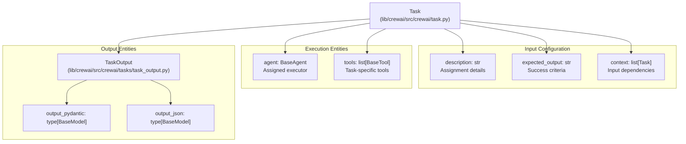
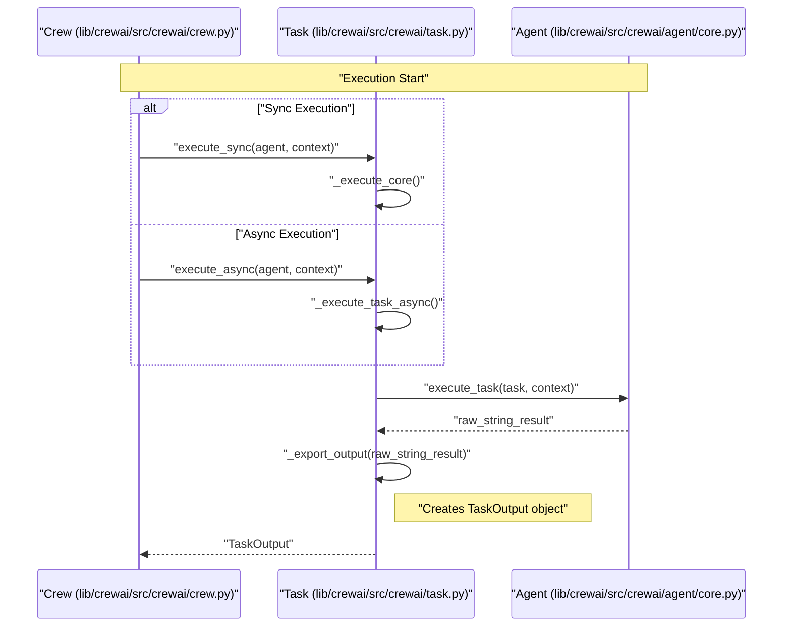

<!-- source: DeepWiki mcp.deepwiki.com · repo crewAIInc/crewAI · page 2.3 Tasks · fetched 2026-10-26 -->

# Tasks

Relevant source files

The following files were used as context for generating this wiki page:

- [docs/edge/ar/concepts/tasks.mdx](docs/edge/ar/concepts/tasks.mdx)
- [docs/edge/ar/learn/conditional-tasks.mdx](docs/edge/ar/learn/conditional-tasks.mdx)

## Purpose and Scope

In the CrewAI framework, a `Task` is a specific assignment completed by an `Agent`. Tasks provide all necessary details for execution, such as a description, the agent responsible, required tools, and more, facilitating a wide range of action complexities [docs/edge/ar/concepts/tasks.mdx:10-12]().

Tasks can be collaborative, requiring multiple agents to work together, and are orchestrated by the Crew's process [docs/edge/ar/concepts/tasks.mdx:14-15](). This document covers task definition, configuration, execution patterns, and output formats.

For details on validation and retry mechanisms, see [Task Guardrails and Validation](#2.3.1).

---

## Task Class Architecture

The `Task` class in `lib/crewai/src/crewai/task.py` is the core work unit implementation built on Pydantic's `BaseModel` for type safety and validation.

### Task Entity Relationship
This diagram bridges the Natural Language "Task" concept to the `Task` class and its primary associations.

**Sources:** [lib/crewai/src/crewai/task.py:63-205](), [lib/crewai/src/crewai/tasks/task_output.py:14-47](), [docs/edge/ar/concepts/tasks.mdx:48-67]()

---

## Task Definition and Configuration

### Configuration Formats
CrewAI supports multiple ways to define tasks depending on the project structure:
*   **JSONC (Recommended)**: New projects created via `crewai create crew` define tasks in `crew.jsonc` [docs/edge/ar/concepts/tasks.mdx:80-82]().
*   **YAML (Classic)**: Projects created with the `--classic` flag use `config/tasks.yaml`. Variables (e.g., `{topic}`) are replaced with values provided during `kickoff()` [docs/edge/ar/concepts/tasks.mdx:111-120]().

### The @task Decorator
In the `CrewBase` pattern, tasks are defined as methods decorated with `@task`. These methods typically return `Task` instances by loading configurations from `self.tasks_config` [docs/edge/ar/concepts/tasks.mdx:134-144]().

### Key Task Attributes

| Attribute | Type | Description |
| :--- | :--- | :--- |
| `description` | `str` | A clear statement of what the task entails [docs/edge/ar/concepts/tasks.mdx:50](). |
| `expected_output` | `str` | A detailed description of what completion looks like [docs/edge/ar/concepts/tasks.mdx:51](). |
| `agent` | `BaseAgent` | The agent responsible for execution [docs/edge/ar/concepts/tasks.mdx:53](). |
| `tools` | `List[BaseTool]` | Tools limited to this specific task [docs/edge/ar/concepts/tasks.mdx:54](). |
| `async_execution` | `bool` | Whether the task runs asynchronously (default: False) [docs/edge/ar/concepts/tasks.mdx:56](). |
| `context` | `List[Task]` | Other tasks whose outputs serve as context [docs/edge/ar/concepts/tasks.mdx:55](). |
| `guardrail` | `Callable` | Function to validate output before proceeding [docs/edge/ar/concepts/tasks.mdx:65](). |
| `guardrails` | `List[Callable]` | List of guardrails for validation [docs/edge/ar/concepts/tasks.mdx:66](). |

**Sources:** [docs/edge/ar/concepts/tasks.mdx:48-67](), [docs/edge/ar/concepts/tasks.mdx:134-144]()

---

## Execution Methods

Tasks are executed within a `Crew` context. The execution flow is determined by the `Process` type defined in the crew [docs/edge/ar/concepts/tasks.mdx:29-44]().

### Task Execution Flow
This diagram maps the high-level execution logic to the internal method calls within the `Task` class.

### Execution Patterns
*   **Sequential**: Tasks are executed in the order they are defined [docs/edge/ar/concepts/tasks.mdx:33]().
*   **Hierarchical**: Tasks are assigned to agents by a manager based on roles and expertise [docs/edge/ar/concepts/tasks.mdx:34]().
*   **Asynchronous**: Tasks with `async_execution=True` run in separate threads, allowing the crew to proceed while the task finishes in the background [lib/crewai/src/crewai/task.py:474-487]().
*   **Conditional**: `ConditionalTask` allows dynamic workflow adaptation based on the outcomes of previous tasks [docs/edge/ar/learn/conditional-tasks.mdx:10]().

### Tool Output as Result
It is possible to force a tool's output to be the final result of a task by setting `result_as_answer=True` when defining the tool for an agent [docs/edge/ar/learn/force-tool-output-as-result.mdx:10-14]().

**Sources:** [lib/crewai/src/crewai/task.py:451-510](), [docs/edge/ar/concepts/tasks.mdx:29-44](), [docs/edge/ar/learn/conditional-tasks.mdx:10](), [docs/edge/ar/learn/force-tool-output-as-result.mdx:10-14]()

---

## Task Outputs

Every task execution results in a `TaskOutput` object [lib/crewai/src/crewai/tasks/task_output.py:14-15]().

### TaskOutput Structure
The `TaskOutput` class encapsulates the following [lib/crewai/src/crewai/tasks/task_output.py:17-27]():
*   **raw**: The direct string output from the agent.
*   **pydantic**: A Pydantic model instance if `output_pydantic` was configured.
*   **json_dict**: A dictionary if `output_json` was configured.
*   **agent**: The role of the agent that executed the task.
*   **messages**: The list of `LLMMessage` objects exchanged during execution [lib/crewai/src/crewai/tasks/task_output.py:46]().

### Output Persistence
Tasks can save results to a file using `output_file` [docs/edge/ar/concepts/tasks.mdx:60](). The framework can automatically create directories if `create_directory` is enabled [docs/edge/ar/concepts/tasks.mdx:61]().

**Sources:** [lib/crewai/src/crewai/tasks/task_output.py:14-47](), [docs/edge/ar/concepts/tasks.mdx:60-63]()

---

