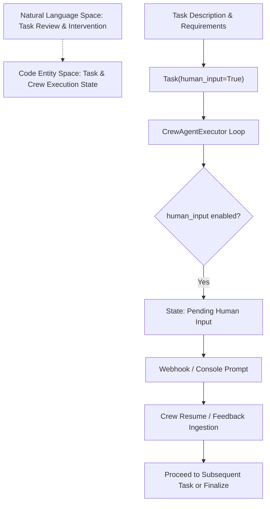
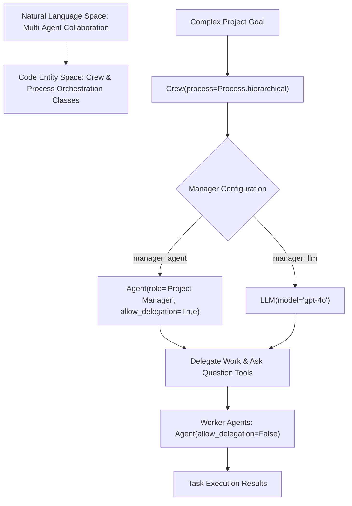

<!-- source: DeepWiki mcp.deepwiki.com · repo crewAIInc/crewAI · page 2.5 Human-in-the-Loop and Collaboration · fetched 2026-10-26 -->

# Human-in-the-Loop and Collaboration

<details>
<summary>Relevant source files</summary>

The following files were used as context for generating this wiki page:

- [docs/edge/ar/concepts/collaboration.mdx](docs/edge/ar/concepts/collaboration.mdx)
- [docs/edge/ar/learn/custom-manager-agent.mdx](docs/edge/ar/learn/custom-manager-agent.mdx)
- [docs/edge/ar/learn/human-in-the-loop.mdx](docs/edge/ar/learn/human-in-the-loop.mdx)
- [docs/edge/ar/learn/human-input-on-execution.mdx](docs/edge/ar/learn/human-input-on-execution.mdx)

</details>


## Purpose and Scope
This document covers the architectural patterns and implementation details for Human-in-the-Loop (HITL) workflows, agent-to-agent collaboration, delegation protocols, and custom manager agent configurations within CrewAI. It bridges the conceptual design of multi-agent collaboration with underlying codebase parameters and configuration interfaces.

Sources: `docs/edge/ar/concepts/collaboration.mdx:10-12`, `docs/edge/ar/learn/human-input-on-execution.mdx:8-12`

---

## 1. Human-in-the-Loop (HITL) Execution Mechanics

Human-in-the-Loop integration allows agents to pause execution, request user clarifications, or validate intermediate outputs before finalizing a `Task`. CrewAI supports multiple modalities for human intervention, ranging from runtime console prompts during local execution to webhook-driven interruptions for production environments.

### Task-Level Runtime Input (`human_input`)
When configuring a `Task`, setting the `human_input` parameter to `True` forces the execution engine to prompt the user for validation and context before the task output is marked complete [docs/edge/ar/learn/human-input-on-execution.mdx:15-16]. 

```python
task = Task(
    description="Analyze quantum computing market trends and formulate a report.",
    expected_output="Detailed research summary.",
    agent=researcher,
    human_input=True
)
```

### Webhook-Based and Flow-Based HITL
For asynchronous or enterprise deployments, HITL operates through state interruption:
1. **State Pause**: The system transitions to a `Pending Human Input` state upon reaching a designated review barrier [docs/edge/ar/learn/human-in-the-loop.mdx:39-40].
2. **Webhook Notification**: Payloads are emitted via configured webhook URLs containing task metadata and current outputs [docs/edge/ar/learn/human-in-the-loop.mdx:30-36].
3. **Resumption**: Execution resumes via resume endpoints or flow decorators (`@human_feedback`) once feedback is ingested [docs/edge/ar/learn/human-in-the-loop.mdx:43-48].

Sources: `docs/edge/ar/learn/human-in-the-loop.mdx:10-58`, `docs/edge/ar/learn/human-input-on-execution.mdx:13-72`


*Diagram 1: HITL Execution Topology bridging natural language verification requirements to codebase execution parameters.*

Sources: `docs/edge/ar/learn/human-in-the-loop.mdx:23-58`, `docs/edge/ar/learn/human-input-on-execution.mdx:62-72`

---

## 2. Agent-to-Agent (A2A) Collaboration and Delegation

Collaboration enables agents to dynamically assign sub-tasks, query peer agents, and share contextual expertise. When `allow_delegation=True` is configured on an `Agent` instance, the runtime automatically injects collaboration tool definitions into the agent's toolset [docs/edge/ar/concepts/collaboration.mdx:10-11].

### Injected Delegation Tools
1. **Delegate Work Tool**: Enables an agent to assign specific sub-tasks to a coworker with specialized expertise [docs/edge/ar/concepts/collaboration.mdx:46-52].
   - Signature pattern: `Delegate work to coworker(task: str, context: str, coworker: str)`
2. **Ask Question Tool**: Allows an agent to query a peer directly for information without transferring task ownership [docs/edge/ar/concepts/collaboration.mdx:57-60].
   - Signature pattern: `Ask question to coworker(question: str, context: str, coworker: str)`

```python
researcher = Agent(
    role="Research Specialist",
    goal="Gather accurate information",
    backstory="Expert data retriever.",
    allow_delegation=True
)
```

Sources: `docs/edge/ar/concepts/collaboration.mdx:10-60`

---

## 3. Custom Manager Agents and Hierarchical Orchestration

Under the hierarchical process model (`Process.hierarchical`), a coordinating entity oversees task allocation, quality assurance, and inter-agent synchronization [docs/edge/ar/concepts/collaboration.mdx:162-209]. This manager can be configured using either a dedicated custom `Agent` via `manager_agent` or an LLM reference via `manager_llm` [docs/edge/ar/learn/custom-manager-agent.mdx:12-76].

### Configuration Patterns
- **Custom Manager Agent**: Instantiated as a standard `Agent` with `allow_delegation=True` and passed to the `Crew` constructor [docs/edge/ar/learn/custom-manager-agent.mdx:39-51].
- **Manager LLM**: Directly passing an `LLM` instance when a specialized custom persona is unnecessary [docs/edge/ar/learn/custom-manager-agent.mdx:67-76].

```python
manager = Agent(
    role="Project Manager",
    goal="Coordinate team efforts and ensure project success",
    backstory="Experienced project manager skilled at delegation and quality control",
    allow_delegation=True
)

crew = Crew(
    agents=[researcher, writer],
    tasks=[task],
    manager_agent=manager,
    process=Process.hierarchical
)
```

Sources: `docs/edge/ar/concepts/collaboration.mdx:162-210`, `docs/edge/ar/learn/custom-manager-agent.mdx:12-81`


*Diagram 2: Hierarchical collaboration structure mapping high-level managerial intent to `Crew`, `Agent`, and `Process` entities.*

Sources: `docs/edge/ar/concepts/collaboration.mdx:162-210`, `docs/edge/ar/learn/custom-manager-agent.mdx:12-76`

---

## 4. Collaboration Patterns and Best Practices

When architecting multi-agent crews with delegation or hierarchical processes, adherence to strict role boundaries prevents recursive deadlock and hallucinated task handoffs.

### Recommended Collaboration Topologies
1. **Sequential Chaining with Context**: Utilizing `Task(context=[prev_task])` alongside `allow_delegation=False` for predictable linear data flows [docs/edge/ar/concepts/collaboration.mdx:125-146].
2. **Autonomous Peer Collaboration**: Designating a lead agent with `allow_delegation=True` to query specialized researchers and writers dynamically during execution [docs/edge/ar/concepts/collaboration.mdx:97-121].

Sources: `docs/edge/ar/concepts/collaboration.mdx:123-226`

---

