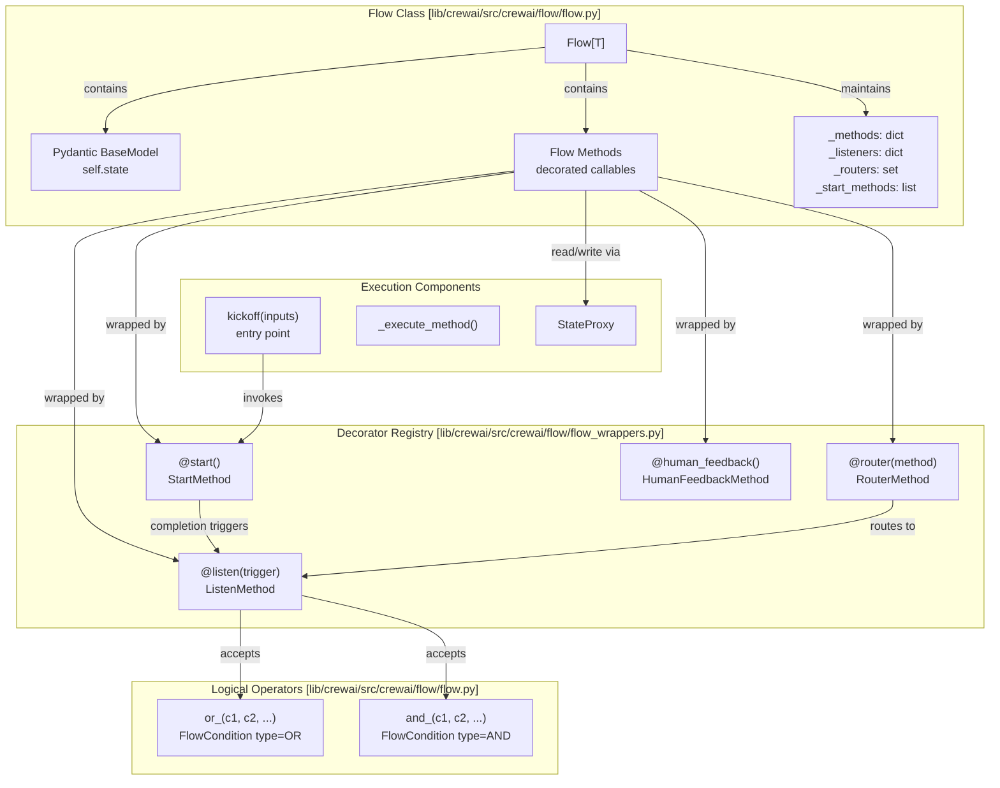
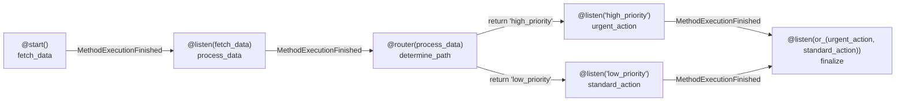
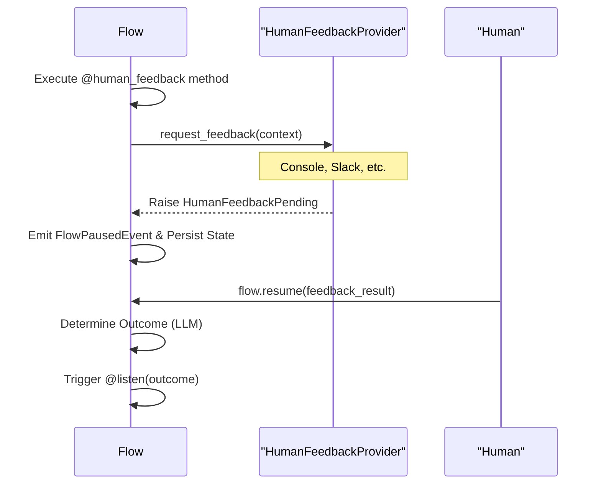

<!-- source: DeepWiki mcp.deepwiki.com · repo crewAIInc/crewAI · page 3 Flows: Event-Driven Orchestration · fetched 2026-10-26 -->

# Flows: Event-Driven Orchestration

Relevant source files

The following files were used as context for generating this wiki page:

- [docs/edge/ar/concepts/flows.mdx](docs/edge/ar/concepts/flows.mdx)
- [docs/edge/ar/concepts/production-architecture.mdx](docs/edge/ar/concepts/production-architecture.mdx)

## Purpose and Scope

Flows provide event-driven, deterministic workflow orchestration with precise control over execution paths, structured state management, and conditional branching. Unlike Crews, which emphasize autonomous agent collaboration ([Crews: Autonomous Agent Orchestration](#2)), Flows offer explicit control over when and how each step executes, making them the recommended production architecture for building robust AI applications [docs/edge/ar/concepts/production-architecture.mdx:8-12]().

This page introduces the Flows paradigm, its architecture, and core concepts. As a parent overview, this page summarizes the high-level design; detailed deep-dives are available in the child pages:
- Flow class structure and the Flow-First mindset: [Flow Creation and Structure](#3.1)
- Decorators and execution topology: [Flow Decorators](#3.2)
- Thread-safe state proxies and persistence: [State Management and Persistence](#3.3)
- Embedding Crews within Flows: [Composing Crews within Flows](#3.4)
- Visualization and lifecycle events: [Flow Visualization and Events](#3.5)
- Human feedback and resume mechanics: [Human Feedback in Flows](#3.6)

Sources: [docs/edge/ar/concepts/production-architecture.mdx:8-12]()

---

## Flow Architecture Overview

Flows are implemented as Python classes that inherit from `Flow[T]`, where `T` (the state) is typically a Pydantic `BaseModel` [lib/crewai/src/crewai/flow/flow.py:47](). Execution flow is controlled through core decorators: `@start`, `@listen`, and `@router` [lib/crewai/src/crewai/flow/flow.py:47]().

The flow execution model maintains internal registries to manage the execution topology, mapping methods, listeners, routers, and start methods [lib/crewai/src/crewai/flow/flow.py:47]().

**Diagram: Flow Class Architecture with Code Entity Mapping**

Sources: [lib/crewai/src/crewai/flow/flow.py:47](), [lib/crewai/src/crewai/flow/flow_wrappers.py:41-160](), [lib/crewai/src/crewai/flow/human_feedback.py:193-207]()

---

## 3.1 Flow Creation and Structure

Flow classes combine typed state (via Pydantic `BaseModel`) with event-driven methods to establish deterministic business logic. For production applications, the **Flow-First Mindset** recommends encapsulating Crews and individual processing steps inside structured `Flow` subclasses rather than standalone scripts [docs/edge/ar/concepts/production-architecture.mdx:8-12]().

For details on defining custom states, inheritance patterns, and structural best practices, see [Flow Creation and Structure](#3.1).

Sources: [docs/edge/ar/concepts/production-architecture.mdx:8-12](), [lib/crewai/src/crewai/flow/flow.py:47]()

---

## 3.2 Flow Decorators

Flow execution topology is entirely declared through Python decorators. `@start` marks entry points [lib/crewai/src/crewai/flow/flow.py:47](), `@listen` binds downstream steps to upstream completions [lib/crewai/src/crewai/flow/flow.py:47](), and `@router` enables conditional branching [lib/crewai/src/crewai/flow/flow.py:47](). Logical operators (`or_`, `and_`) allow complex multi-trigger dependencies.

**Diagram: Event-Driven Method Triggering with Router Branching**

For comprehensive details on decorator configurations and conditional logic, see [Flow Decorators](#3.2).

Sources: [lib/crewai/src/crewai/flow/flow.py:47](), [docs/edge/ar/concepts/flows.mdx:100-132]()

---

## 3.3 State Management and Persistence

Flow state is wrapped in a thread-safe `StateProxy` [lib/crewai/src/crewai/flow/flow.py:47]() that secures nested mutations using `LockedListProxy` and `LockedDictProxy` [lib/crewai/src/crewai/flow/flow.py:47](). The `@persist` decorator enables state snapshots to be saved to SQLite or custom databases, supporting flow recovery, checkpointing, and branch branching via `restore_from_state_id` [docs/edge/ar/concepts/production-architecture.mdx:143-155]().

For deep dives into persistence configuration and state locking, see [State Management and Persistence](#3.3).

Sources: [lib/crewai/src/crewai/flow/flow.py:47](), [docs/edge/ar/concepts/production-architecture.mdx:140-155]()

---

## 3.4 Composing Crews within Flows

While Flows manage control flow and state, Crews handle autonomous agent collaboration. Developers can embed Crews as steps inside Flow methods, passing state variables dynamically into crew inputs and writing results back into `self.state` [docs/edge/ar/concepts/production-architecture.mdx:68-80]().

For examples of mixing deterministic flow routing with agentic crew tasks, see [Composing Crews within Flows](#3.4).

Sources: [docs/edge/ar/concepts/production-architecture.mdx:68-80]()

---

## 3.5 Flow Visualization and Events

Flows provide built-in visualization capabilities via `flow.plot()`, generating interactive topological diagrams of method dependencies [lib/crewai/src/crewai/flow/visualization/builder.py:178-343](). Additionally, flows emit lifecycle events that integrate with the event bus for monitoring and telemetry.

For instructions on generating plots and tracking event lifecycles, see [Flow Visualization and Events](#3.5).

Sources: [lib/crewai/src/crewai/flow/visualization/builder.py:178-343]()

---

## 3.6 Human Feedback in Flows

Flows support human-in-the-loop workflows through the `@human_feedback` decorator [lib/crewai/src/crewai/flow/human_feedback.py:193-207](). When invoked, the flow pauses execution, raises a `HumanFeedbackPending` exception, persists state, and awaits external resume calls [docs/edge/ar/concepts/production-architecture.mdx:141-142]().

**Diagram: Human Feedback Lifecycle**

For detailed guides on implementing blocking/non-blocking feedback providers and resuming paused flows, see [Human Feedback in Flows](#3.6).

Sources: [lib/crewai/src/crewai/flow/human_feedback.py:127-207](), [docs/edge/ar/concepts/production-architecture.mdx:141-142]()

---

