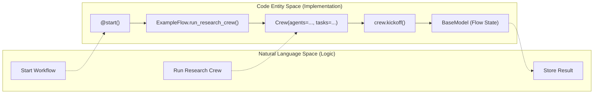
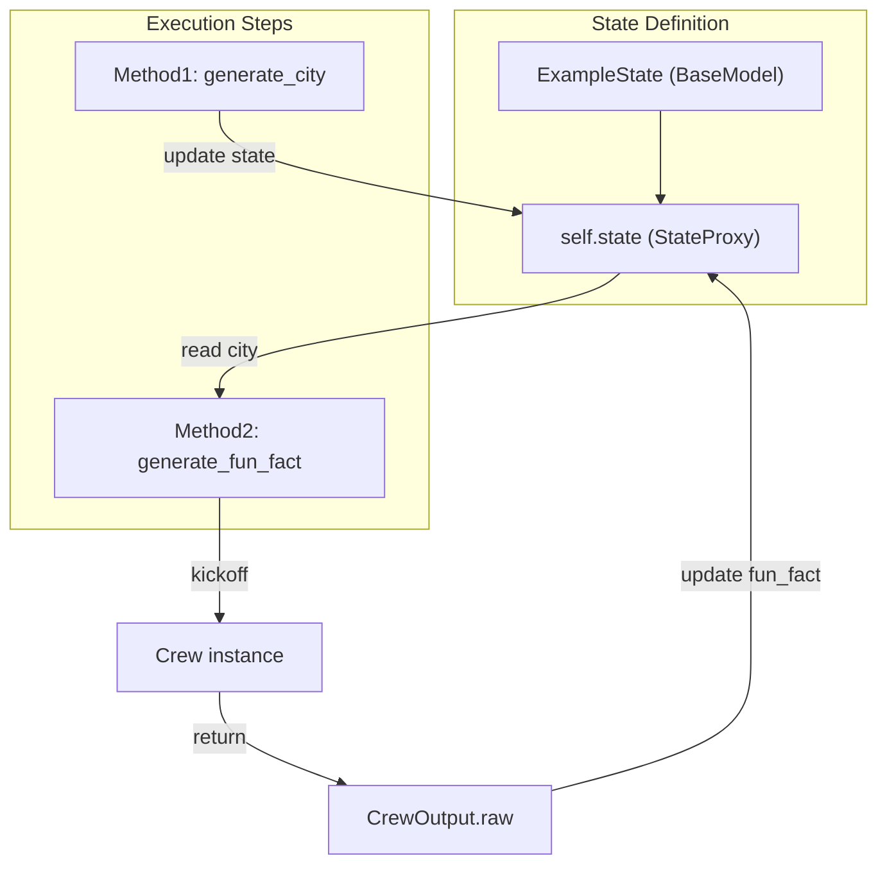
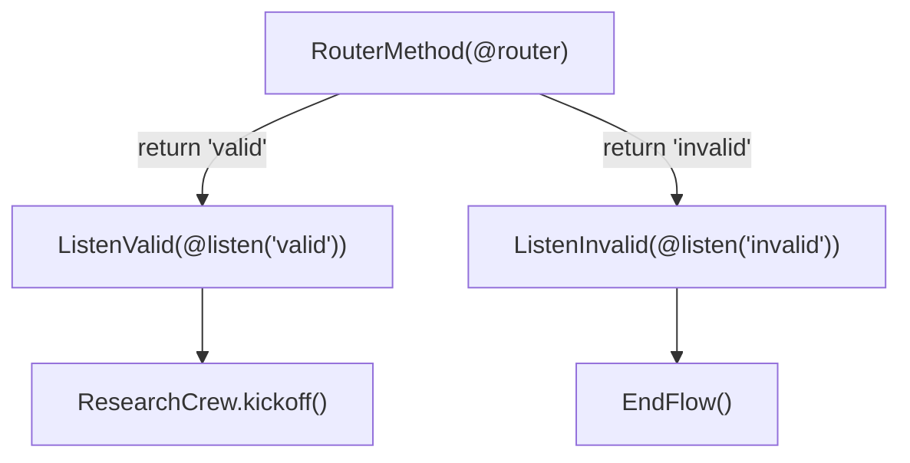

<!-- source: DeepWiki mcp.deepwiki.com · repo crewAIInc/crewAI · page 3.4 Composing Crews within Flows · fetched 2026-10-26 -->

# Composing Crews within Flows

Relevant source files

The following files were used as context for generating this wiki page:

- [docs/edge/ar/concepts/crews.mdx](docs/edge/ar/concepts/crews.mdx)
- [docs/edge/ar/concepts/flows.mdx](docs/edge/ar/concepts/flows.mdx)
- [docs/edge/ar/guides/flows/conversational-flows.mdx](docs/edge/ar/guides/flows/conversational-flows.mdx)

This page explains how to embed `Crew` instances as execution units within a `Flow`, combining the autonomous multi-agent collaboration of Crews with the structured orchestration and control flow of Flows. This pattern is the recommended production architecture for complex AI applications.

---

## Why Embed Crews in Flows

Crews provide autonomous multi-agent collaboration for complex tasks (research, writing, analysis), while Flows provide structured orchestration, state management, and control flow. Composing them together gives you:

- **Precise control**: Use Flow decorators (`@start`, `@listen`, `@router`) to define when and how Crews execute [docs/edge/ar/concepts/flows.mdx:100-132]().
- **State management**: Pass data between Crews via Flow state typed with Pydantic models [docs/edge/ar/concepts/flows.mdx:184-192]().
- **Conditional execution**: Use `@router` to execute different Crews based on runtime conditions [docs/edge/ar/concepts/flows.mdx:20-21]().
- **Error boundaries**: Handle Crew failures at the Flow level using task guardrails or standard Python logic.
- **Observability**: Flow events capture the complete execution hierarchy including Crew operations [docs/edge/ar/concepts/flows.mdx:10-13]().
- **Persistence**: Use state persistence to save flow state and resume execution between crew steps [docs/edge/ar/concepts/flows.mdx:88-96]().

The "Flow-First" mindset emphasizes starting with a Flow and embedding Crews as task-specific units rather than running Crews standalone [docs/edge/ar/concepts/flows.mdx:10-12]().

Sources: [docs/edge/ar/concepts/flows.mdx:10-21](), [docs/edge/ar/concepts/flows.mdx:88-96](), [docs/edge/ar/concepts/flows.mdx:184-192]()

---

## Basic Pattern: Crew as a Flow Method

The fundamental pattern is to instantiate and kick off a Crew inside a Flow method. The Flow method controls when the Crew executes and what inputs it receives from the Flow state.

**Diagram: Flow-to-Crew Execution Bridge**
This diagram associates the logical flow of a method with the specific code entities involved in execution.

Sources: [docs/edge/ar/concepts/flows.mdx:28-59](), [docs/edge/ar/concepts/flows.mdx:184-192]()

---

## Flow State and Crew Inputs

Flow state acts as the data pipeline between Crews. Using a Pydantic `BaseModel` ensures type safety when passing intermediate results from one crew to another.

**Diagram: Data Flow between Entities**

The `Flow` class manages state access across listeners, ensuring that when a Crew finishes and updates the state, the next listener receives the most recent data [docs/edge/ar/concepts/flows.mdx:16-18](), [docs/edge/ar/concepts/flows.mdx:176-180]().

Sources: [docs/edge/ar/concepts/flows.mdx:16-18](), [docs/edge/ar/concepts/flows.mdx:54-56](), [docs/edge/ar/concepts/flows.mdx:176-180]()

---

## Sequential Crew Execution with @listen

Use `@listen(previous_method)` to execute Crews in sequence. Each listener method can receive the return value of the previous method as an argument, or pull data directly from `self.state`.

| Feature | Description | Source |
| :--- | :--- | :--- |
| **Triggering** | `@listen()` triggers when the specified method completes. | [docs/edge/ar/concepts/flows.mdx:110-113]() |
| **Data Passing** | Receives the output of the previous step as a parameter. | [docs/edge/ar/concepts/flows.mdx:152-154]() |
| **Last Step** | The output of the final completed method is returned by `kickoff()`. | [docs/edge/ar/concepts/flows.mdx:137-140]() |

Sources: [docs/edge/ar/concepts/flows.mdx:110-132](), [docs/edge/ar/concepts/flows.mdx:137-173]()

---

## Conditional Crew Execution with @router

Use `@router()` to select which Crew to execute based on runtime conditions. The router method returns a string outcome that triggers specific listeners.

**Diagram: Router Routing to Crews**

This pattern is essential for handling edge cases and ensuring predictable application behavior [docs/edge/ar/concepts/flows.mdx:20-21]().

Sources: [docs/edge/ar/concepts/flows.mdx:20-21](), [docs/edge/ar/concepts/flows.mdx:100-110]()

---

## Human-in-the-Loop (HITL) with Crews

Flows support pausing execution for human feedback. This is particularly useful between Crew steps to validate a Crew's output before passing it to the next one.

**Integration Pattern:**
- Use flow methods or state checks to determine when human intervention is required.
- The flow can be persisted using state mechanisms to allow resuming after the human provides input [docs/edge/ar/concepts/flows.mdx:88-96]().
- If a flow needs to be resumed, use `Flow.kickoff(inputs=...)` to restore the state [docs/edge/ar/concepts/flows.mdx:81-83]().

Sources: [docs/edge/ar/concepts/flows.mdx:81-96]()

---

## Advanced Composition Patterns

### 1. Task Guardrails
Before passing Crew output back to the Flow state, use task guardrails to validate the results. This ensures that the agents produced high-quality, expected data [docs/edge/ar/concepts/crews.mdx:53-65]().

### 2. Structured Outputs
Always use structured outputs (`output_pydantic` or `output_json`) in the Crew's Tasks when passing data between Flow steps. This prevents parsing errors and ensures type safety within the Flow [docs/edge/ar/concepts/crews.mdx:49-65]().

### 3. Async Execution
For long-running crews, use asynchronous kickoff methods within the Flow to avoid blocking the execution thread, allowing for better scalability in production environments.

### 4. Flow Visualization
Use `flow.plot()` to generate an HTML file visualizing the orchestration of Crews and methods. This is vital for debugging complex topologies [docs/edge/ar/concepts/flows.mdx:80-85](), [docs/edge/ar/concepts/flows.mdx:174-175]().

Sources: [docs/edge/ar/concepts/crews.mdx:49-65](), [docs/edge/ar/concepts/flows.mdx:80-85](), [docs/edge/ar/concepts/flows.mdx:174-175]()

---

