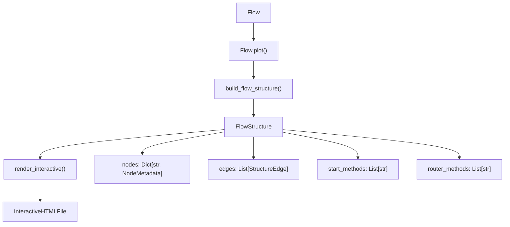
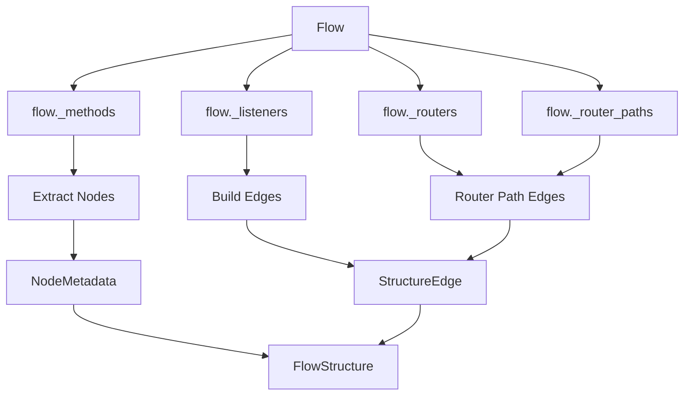
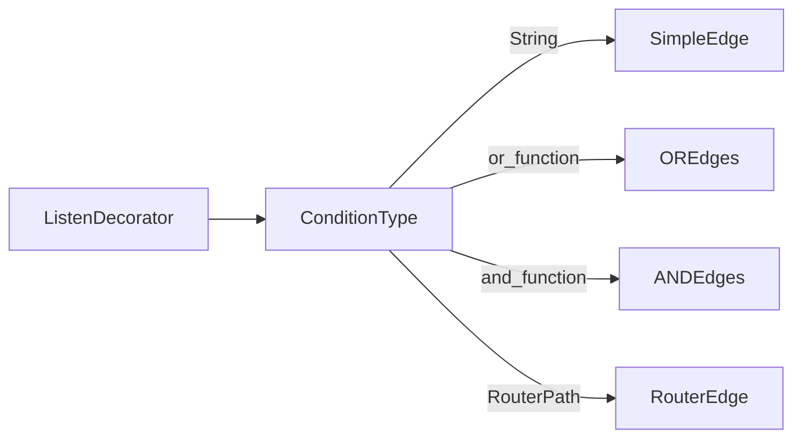
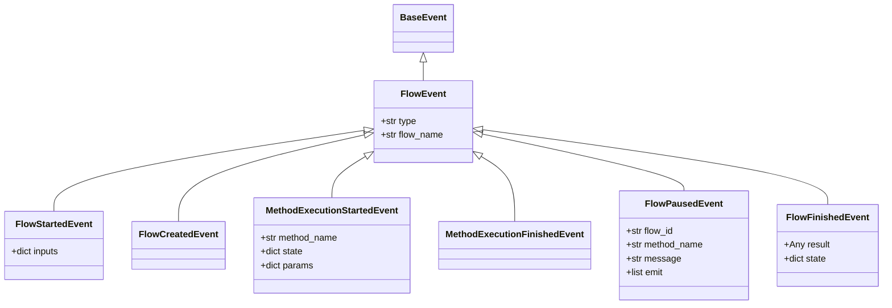
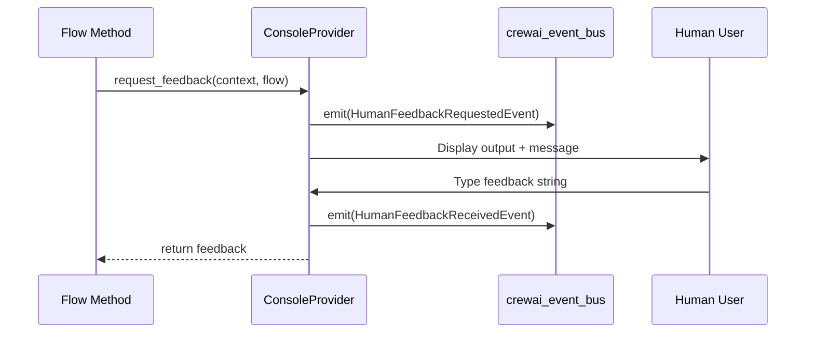

<!-- source: DeepWiki mcp.deepwiki.com · repo crewAIInc/crewAI · page 3.5 Flow Visualization and Events · fetched 2026-10-26 -->

# Flow Visualization and Events

Relevant source files

The following files were used as context for generating this wiki page:

- [docs/edge/ar/concepts/event-listener.mdx](docs/edge/ar/concepts/event-listener.mdx)
- [docs/edge/ar/concepts/flows.mdx](docs/edge/ar/concepts/flows.mdx)

This document details the flow visualization engine and the event emission lifecycle for CrewAI Flows. The visualization system inspects flow definitions to generate interactive HTML artifacts representing flow topology, method relationships, and control paths. The event system emits structured Pydantic models through the internal event bus to support monitoring, observability, and human-in-the-loop coordination.

## Flow Visualization System

### The `plot()` Method

The `Flow` class exposes a `plot()` method that initiates structural analysis of the flow and invokes the interactive rendering pipeline. This method inspects decorated methods, routers, and trigger listeners to build a graph description.

Title: Flow Visualization Data Flow

**Sources:** [lib/crewai/src/crewai/flow/flow.py:47](), [lib/crewai/src/crewai/flow/visualization/builder.py:178-210](), [lib/crewai/src/crewai/flow/visualization/__init__.py:13-17]()

The `plot()` method parameters and return values:

| Parameter | Type | Default | Description |
|-----------|------|---------|-------------|
| `filename` | `str` | `"flow_structure.html"` | Target output filename for the rendered HTML report |
| `show` | `bool` | `True` | Automatically open the generated HTML file in the default browser |

**Returns:** `str` representing the absolute path to the generated HTML file in a temporary system directory.

**Sources:** [lib/crewai/src/crewai/flow/flow.py:47]()

### Flow Structure Building

The `build_flow_structure()` function extracts the static topology of a `Flow` instance. It introspects internal attributes like `flow._methods`, `flow._listeners`, `flow._routers`, and `flow._router_paths`.

Title: Flow Structure Analysis

**Sources:** [lib/crewai/src/crewai/flow/visualization/builder.py:178-210](), [lib/crewai/src/crewai/flow/visualization/types.py:10-40]()

#### Node Metadata Extraction

During introspection, the engine extracts comprehensive metadata for every node:

| Metadata Field | Type | Description |
|----------------|------|-------------|
| `type` | `str` | Categorization: `"start"`, `"listen"`, or `"router"` [lib/crewai/src/crewai/flow/visualization/types.py:10-30]() |
| `is_router` | `bool` | Indicates whether the node functions as a router [lib/crewai/src/crewai/flow/visualization/types.py:10-30]() |
| `router_paths` | `List[str]` | Enumerated string keys representing possible return paths [lib/crewai/src/crewai/flow/visualization/types.py:10-30]() |
| `trigger_methods` | `List[str]` | Methods required to trigger this listener [lib/crewai/src/crewai/flow/visualization/types.py:10-30]() |
| `condition_type` | `str \| None` | Logical evaluation mode: `"OR"`, `"AND"`, or `"IF"` [lib/crewai/src/crewai/flow/visualization/types.py:10-30]() |
| `method_signature` | `dict` | Parameter definitions and return type annotations [lib/crewai/src/crewai/flow/visualization/types.py:10-30]() |
| `source_code` | `str` | Raw string representation of the method source [lib/crewai/src/crewai/flow/visualization/types.py:10-30]() |
| `has_human_feedback` | `bool` | Flag detected via `_has_human_feedback` introspection [lib/crewai/src/crewai/flow/flow_serializer.py:161-171]() |

**Sources:** [lib/crewai/src/crewai/flow/visualization/types.py:10-30](), [lib/crewai/src/crewai/flow/visualization/builder.py:192-208](), [lib/crewai/src/crewai/flow/flow_serializer.py:161-171]()

#### Edge Construction

Edges represent dependency links. The builder maps conditional decorators to specific edge properties:

Title: Condition Edge Mapping

**Sources:** [lib/crewai/src/crewai/flow/visualization/builder.py:108-175](), [lib/crewai/src/crewai/flow/visualization/types.py:32-40]()

#### Router Path Inference

Router paths are dynamically resolved via AST parsing helpers. The `get_possible_return_constants()` utility inspects:
- **Type Annotations:** `Literal["a", "b"]` or union types `"a" | "b"`. [lib/crewai/src/crewai/flow/utils.py:44-126]()
- **Enum Members:** Extracting string definitions from `Enum` subclasses. [lib/crewai/src/crewai/flow/utils.py:69-97]()
- **Hardcoded Return Statements:** Static string literals like `return "next_step"`. [lib/crewai/src/crewai/flow/utils.py:154-174]()

**Sources:** [lib/crewai/src/crewai/flow/utils.py:154-210](), [lib/crewai/src/crewai/flow/visualization/builder.py:204-208]()

### Interactive HTML Generation

The renderer writes three localized assets to a temporary directory prefixed with `crewai_flow_`:
1. **HTML Template:** Jinja2-rendered markup using `interactive_flow.html.j2` [lib/crewai/src/crewai/flow/visualization/renderers/interactive.py:204-466]().
2. **Cascading Stylesheet:** UI presentation styling from `style.css` [lib/crewai/src/crewai/flow/visualization/renderers/interactive.py:204-466]().
3. **JavaScript Controller:** Interactive graph renderer via `interactive.js`, populated with embedded JSON payloads for `nodeData` and `dagData` [lib/crewai/src/crewai/flow/visualization/renderers/interactive.py:204-466]().

**Sources:** [lib/crewai/src/crewai/flow/visualization/renderers/interactive.py:204-466]()

---

## Flow Lifecycle Events

Flow execution emits typed Pydantic events through the global `crewai_event_bus` instance [docs/edge/ar/concepts/event-listener.mdx:14-20]().

### Event Hierarchy

Title: Flow Event Entity Space

**Sources:** [lib/crewai/src/crewai/events/types/flow_events.py:8-115]()

### Lifecycle Event Emission

Events are dispatched at defined transitions throughout `kickoff_async` execution loops.

| Event Type | Emitted At | Key Attributes |
|------------|------------|----------------|
| `FlowCreatedEvent` | Inside `Flow.__init__` | `flow_name` [lib/crewai/src/crewai/events/types/flow_events.py:23-28]() |
| `FlowStartedEvent` | Beginning of execution | `inputs` [lib/crewai/src/crewai/events/types/flow_events.py:15-21]() |
| `MethodExecutionStartedEvent` | Prior to method invocation | `method_name`, `state`, `params` [lib/crewai/src/crewai/events/types/flow_events.py:30-38]() |
| `MethodExecutionFinishedEvent` | Upon successful return | `result`, `state` [lib/crewai/src/crewai/events/types/flow_events.py:40-48]() |
| `FlowPausedEvent` | When `@human_feedback` raises `HumanFeedbackPending` | `flow_id`, `method_name`, `message` [lib/crewai/src/crewai/events/types/flow_events.py:93-115]() |
| `FlowFinishedEvent` | Successful flow termination | `result`, `state` [lib/crewai/src/crewai/events/types/flow_events.py:84-91]() |
| `FlowFailedEvent` | Execution termination via unhandled exception | `flow_name`, `error` [docs/edge/ar/concepts/event-listener.mdx:160]() |

**Sources:** [lib/crewai/src/crewai/events/types/flow_events.py:8-115](), [docs/edge/ar/concepts/event-listener.mdx:156-162]()

### Human Feedback and Input Events

Interactive pausing and resumption trigger dedicated event models:

* **`FlowInputRequestedEvent`**: Emitted when `Flow.ask()` pauses execution for user input [lib/crewai/src/crewai/events/types/flow_events.py:123-142]().
* **`FlowInputReceivedEvent`**: Emitted when input is successfully captured [lib/crewai/src/crewai/events/types/flow_events.py:144-167]().
* **`HumanFeedbackRequestedEvent`**: Dispatched by feedback providers (e.g., `ConsoleProvider.request_feedback`) during human review checkpoints [lib/crewai/src/crewai/events/types/flow_events.py:169-191]().
* **`HumanFeedbackReceivedEvent`**: Emitted when review feedback is submitted [lib/crewai/src/crewai/events/types/flow_events.py:193-213]().

Title: Human Interaction Sequence

**Sources:** [lib/crewai/src/crewai/flow/async_feedback/providers.py:68-140](), [lib/crewai/src/crewai/events/types/flow_events.py:169-213]()

### Observability Context Variables

The event and execution layers utilize Python `contextvars` to maintain contextual correlation across asynchronous tasks:

* **`current_flow_id`**: Identifies the unique execution run. [lib/crewai/src/crewai/flow/flow_context.py:14-16]()
* **`current_flow_method_name`**: Tracks the currently executing method name. [lib/crewai/src/crewai/flow/flow_context.py:18-20]()
* **`current_flow_request_id`**: Correlates external platform requests to local executions. [lib/crewai/src/crewai/flow/flow_context.py:10-12]()

**Sources:** [lib/crewai/src/crewai/flow/flow_context.py:1-21]()

---

