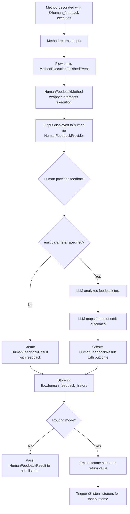
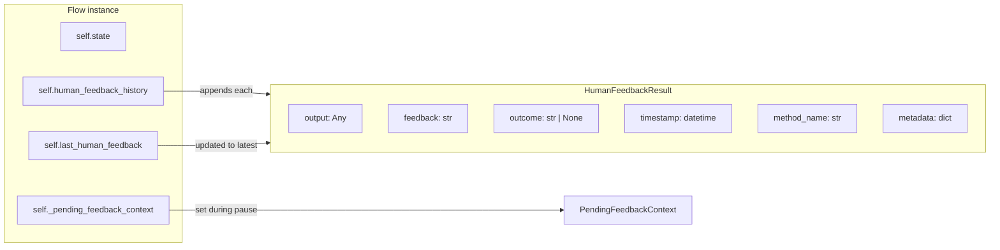
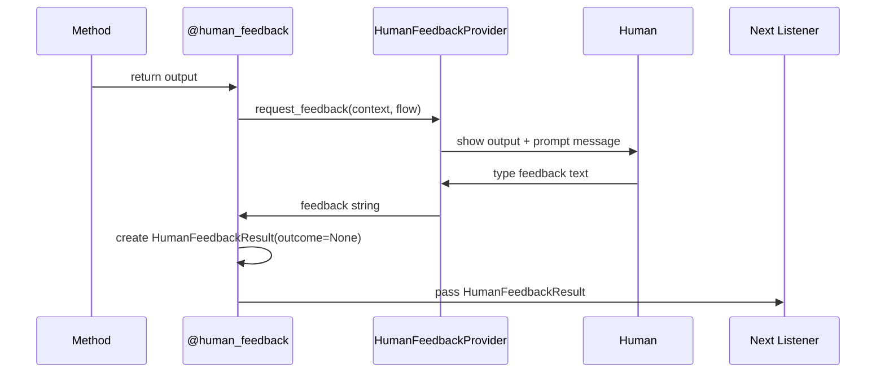
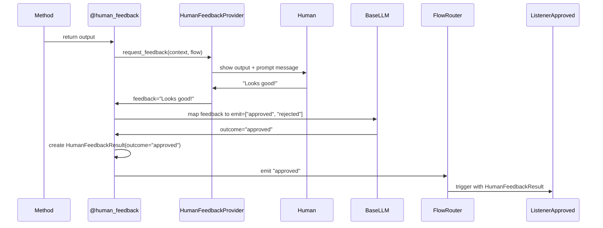
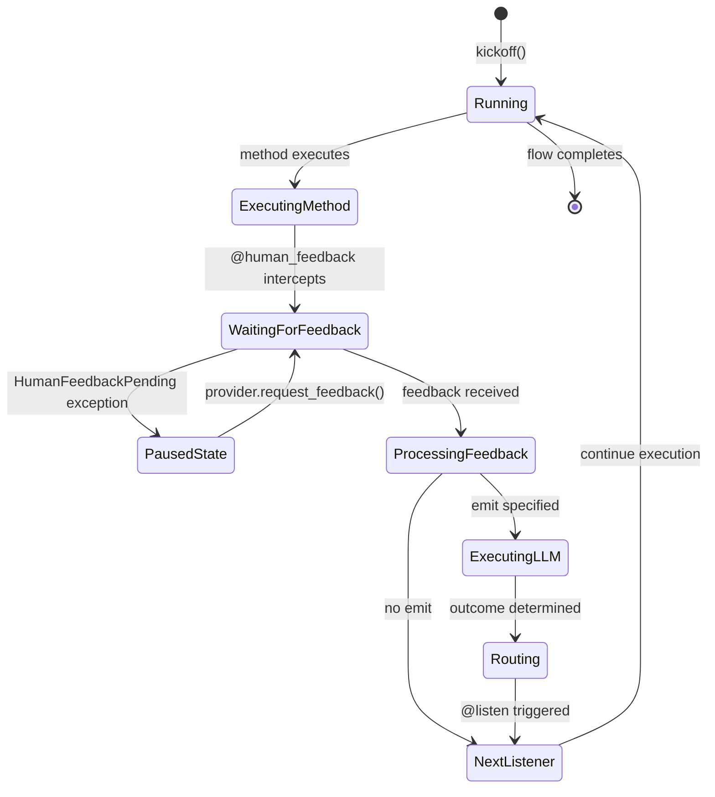
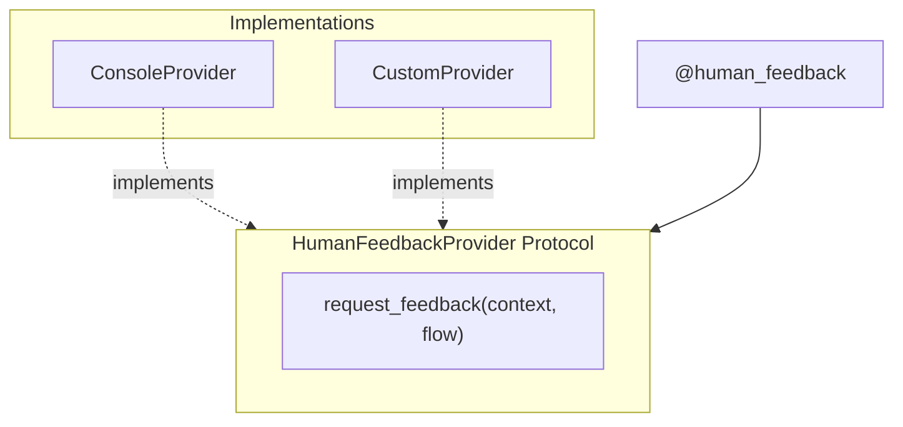
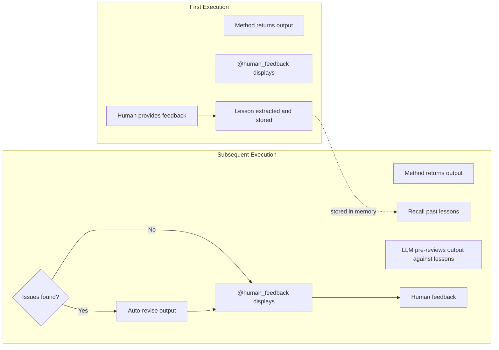

<!-- source: DeepWiki mcp.deepwiki.com · repo crewAIInc/crewAI · page 3.6 Human Feedback in Flows · fetched 2026-10-26 -->

# Human Feedback in Flows

<details>
<summary>Relevant source files</summary>

The following files were used as context for generating this wiki page:

- [docs/edge/ar/api-reference/resume.mdx](docs/edge/ar/api-reference/resume.mdx)
- [docs/edge/ar/learn/human-feedback-in-flows.mdx](docs/edge/ar/learn/human-feedback-in-flows.mdx)

</details>


This document explains the human feedback system in CrewAI Flows, which enables human-in-the-loop (HITL) workflows. The `@human_feedback` decorator allows flows to pause execution, present output for human review, collect feedback, and optionally route to different execution paths based on the feedback outcome. This system is essential for quality assurance gates, approval workflows, and interactive refinement of AI outputs.

For information about flows in general, see [Flow Creation and Structure](#3.1). For information about flow decorators (`@start`, `@listen`, `@router`), see [Flow Decorators](#3.2). For information about state management in flows, see [State Management and Persistence](#3.3).

---

## Architecture Overview

The human feedback system integrates tightly with the flow execution engine (`lib/crewai/src/crewai/flow/flow.py`). When a method decorated with `@human_feedback` (`lib/crewai/src/crewai/flow/human_feedback.py`) completes, the flow pauses and presents the output to a human reviewer. The system supports two modes: **non-routing mode** (simple feedback collection) and **routing mode** (LLM-driven outcome mapping that triggers specific listeners).

### Human Feedback Execution Flow



Sources: [lib/crewai/src/crewai/flow/flow.py:47](), [lib/crewai/src/crewai/flow/human_feedback.py:193-209](), [docs/edge/ar/learn/human-feedback-in-flows.mdx:14-21]()

### Flow State and Feedback Storage

The `Flow` class maintains internal state to track feedback history and handle the context required for pausing and resuming execution.



Sources: [lib/crewai/src/crewai/flow/flow.py:47](), [lib/crewai/src/crewai/flow/human_feedback.py:128-165](), [docs/edge/ar/learn/human-feedback-in-flows.mdx:93-98]()

---

## The @human_feedback Decorator

The `@human_feedback` decorator is implemented as a method wrapper that intercepts the return value of a flow method, presents it for human review, and manages the feedback collection and routing logic. It requires **CrewAI 1.8.0 or later** [docs/edge/ar/learn/human-feedback-in-flows.mdx:10-12]().

### Decorator Parameters

| Parameter | Type | Required | Purpose |
|-----------|------|----------|---------|
| `message` | `str` | Yes | Prompt text displayed to the human alongside the output [lib/crewai/src/crewai/flow/human_feedback.py:173-174]() |
| `emit` | `Sequence[str]` | No | List of possible outcome strings. Enables routing mode [lib/crewai/src/crewai/flow/human_feedback.py:175-176]() |
| `llm` | `str \| BaseLLM` | When `emit` provided | LLM instance for interpreting feedback and mapping to outcomes [lib/crewai/src/crewai/flow/human_feedback.py:177-178]() |
| `default_outcome` | `str` | No | Outcome to use when no feedback provided (must be in `emit`) [lib/crewai/src/crewai/flow/human_feedback.py:179-180]() |
| `metadata` | `dict` | No | Additional context data attached to `HumanFeedbackResult` [lib/crewai/src/crewai/flow/human_feedback.py:181-182]() |
| `provider` | `HumanFeedbackProvider` | No | Custom feedback provider for async/non-blocking collection [lib/crewai/src/crewai/flow/human_feedback.py:183-186]() |
| `learn` | `bool` | No | Enable HITL learning (distill lessons from feedback) [lib/crewai/src/crewai/flow/human_feedback.py:187-188]() |
| `learn_limit` | `int` | No | Max past lessons to recall for pre-review (default 5) [lib/crewai/src/crewai/flow/human_feedback.py:189-191]() |

Sources: [lib/crewai/src/crewai/flow/human_feedback.py:168-191](), [docs/edge/ar/learn/human-feedback-in-flows.mdx:46-62]()

### Decorator Stacking Order

The `@human_feedback` decorator must be placed as the innermost decorator (closest to the function definition) so it can intercept the return value before the flow system processes it [lib/crewai/src/crewai/flow/human_feedback.py:193-209]():

```python
# Correct order
@start()
@human_feedback(message="Review this:")
def my_method(self):
    return "output"
```

Sources: [lib/crewai/src/crewai/flow/human_feedback.py:193-209]()

---

## Non-Routing Mode (Simple Feedback Collection)

When `emit` is not specified, the decorator operates in non-routing mode. It collects the human's feedback text and passes a `HumanFeedbackResult` object to the next listener without any LLM interpretation.

### Execution Flow



Sources: [lib/crewai/src/crewai/flow/human_feedback.py:128-165](), [docs/edge/ar/learn/human-feedback-in-flows.mdx:35-38]()

### HumanFeedbackResult Structure

The `HumanFeedbackResult` dataclass captures all information about the feedback interaction:

```python
@dataclass
class HumanFeedbackResult:
    output: Any              # Original method return value
    feedback: str            # Raw feedback text from human
    outcome: str | None      # Mapped outcome (None in non-routing mode)
    timestamp: datetime      # When feedback was received
    method_name: str         # Name of decorated method
    metadata: dict           # Decorator metadata parameter
```

Sources: [lib/crewai/src/crewai/flow/human_feedback.py:128-165](), [docs/edge/ar/learn/human-feedback-in-flows.mdx:35-38]()

---

## Routing Mode (LLM-Driven Outcome Mapping)

When the `emit` parameter is provided, the decorator operates in routing mode. The human's free-form feedback text is interpreted by an LLM, which maps it to one of the specified outcomes [docs/edge/ar/learn/human-feedback-in-flows.mdx:46-47]().

### Routing Execution Flow



Sources: [lib/crewai/src/crewai/flow/human_feedback.py:214-221](), [docs/edge/ar/learn/human-feedback-in-flows.mdx:46-74]()

### LLM Outcome Mapping

The LLM uses structured outputs to ensure the response is exactly one of the specified `emit` outcomes. The chosen outcome is stored in `HumanFeedbackResult.outcome` and used to route execution to the corresponding `@listen` decorators [lib/crewai/src/crewai/flow/human_feedback.py:214-221]().

Sources: [lib/crewai/src/crewai/flow/human_feedback.py:214-221](), [docs/edge/ar/learn/human-feedback-in-flows.mdx:46-74]()

---

## Flow Pause and Resume Mechanism

When a flow encounters a `@human_feedback` decorated method with an asynchronous or non-blocking provider, it transitions to a paused state.

### Pause State Transitions



Sources: [lib/crewai/src/crewai/flow/async_feedback/types.py:141-188](), [docs/edge/ar/learn/human-in-the-loop.mdx:38-40]()

### HumanFeedbackPending Exception

The `HumanFeedbackPending` exception is a control flow signal used by providers to pause execution. When raised, the flow framework stops execution and returns the exception object to the caller, containing the `PendingFeedbackContext` [lib/crewai/src/crewai/flow/async_feedback/types.py:141-188]().

### Pending Feedback Context

The `PendingFeedbackContext` captures all information required to reconstruct and resume a flow, including `flow_id`, `method_name`, and the `method_output` that needs review [lib/crewai/src/crewai/flow/async_feedback/types.py:19-64]().

Sources: [lib/crewai/src/crewai/flow/async_feedback/types.py:19-188](), [docs/edge/ar/learn/human-in-the-loop.mdx:38-40]()

---

## Accessing Feedback History

The `Flow` class maintains two attributes for accessing human feedback throughout execution:

### last_human_feedback

The `last_human_feedback` attribute provides access to the most recent `HumanFeedbackResult` [lib/crewai/src/crewai/flow/flow.py:47]().

### human_feedback_history

The `human_feedback_history` attribute is a list containing all `HumanFeedbackResult` objects collected during the flow execution [lib/crewai/src/crewai/flow/flow.py:47](). This preserves a complete audit trail of human interventions.

Sources: [lib/crewai/src/crewai/flow/flow.py:47](), [docs/edge/ar/learn/human-feedback-in-flows.mdx:85]()

---

## Feedback Providers

The system uses a `HumanFeedbackProvider` protocol to support different collection mechanisms, such as console-based blocking input or webhook-based asynchronous input.

### Provider Architecture



Sources: [lib/crewai/src/crewai/flow/async_feedback/types.py:228-243](), [lib/crewai/src/crewai/flow/async_feedback/console_provider.py:10-15](), [docs/edge/ar/learn/human-feedback-in-flows.mdx:87-89]()

---

## HITL Learning

The `learn=True` parameter enables Human-In-The-Loop learning, where the system distills lessons from human feedback and uses them to improve future outputs [docs/edge/ar/learn/human-feedback-in-flows.mdx:76-78]().

### Learning Workflow



Sources: [lib/crewai/src/crewai/flow/human_feedback.py:187-191](), [docs/edge/ar/learn/human-feedback-in-flows.mdx:76-78]()

---

