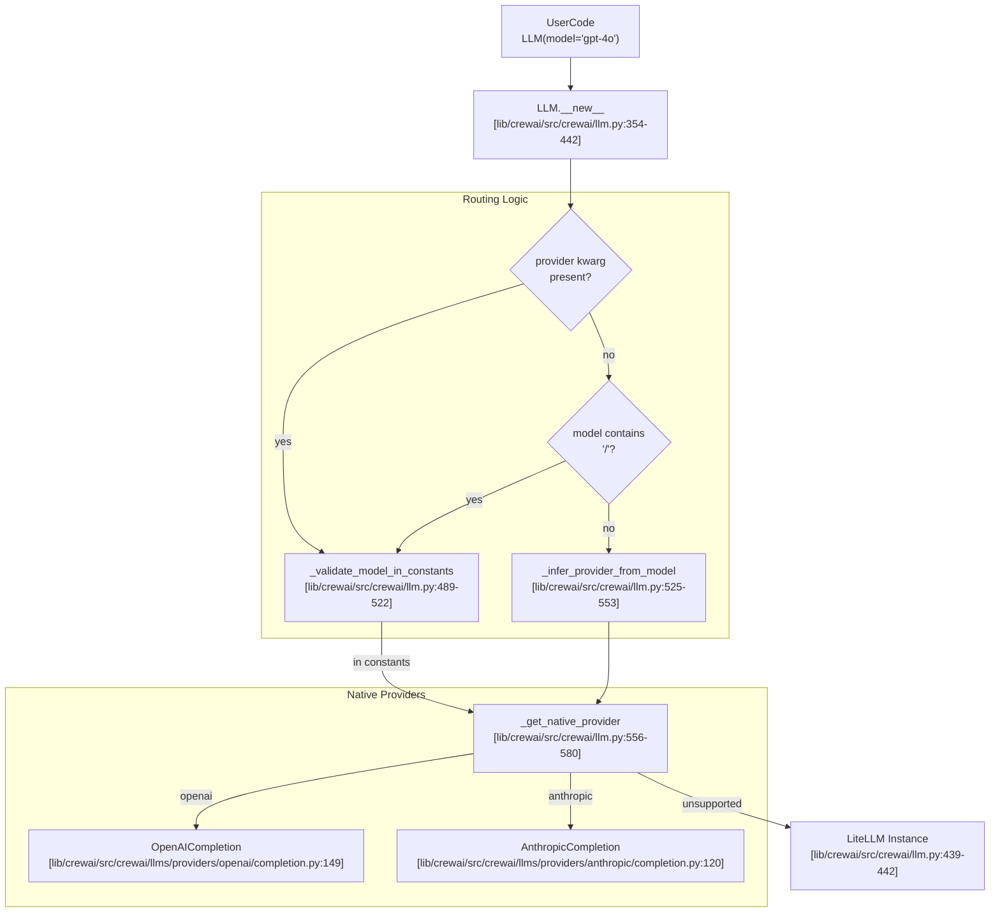

<!-- source: DeepWiki mcp.deepwiki.com · repo crewAIInc/crewAI · page 4 LLM Integration · fetched 2026-10-26 -->

# LLM Integration

Relevant source files

The following files were used as context for generating this wiki page:

- [docs/edge/ar/concepts/llms.mdx](docs/edge/ar/concepts/llms.mdx)
- [docs/edge/ar/learn/custom-llm.mdx](docs/edge/ar/learn/custom-llm.mdx)

## Overview

The LLM Integration system provides a unified abstraction layer for interacting with multiple Large Language Model providers in CrewAI [lib/crewai/src/crewai/llm.py:351-442](). Using a factory pattern, the system routes model requests to native SDK implementations for optimal performance and feature support, while maintaining automatic fallback to LiteLLM for broader model coverage [lib/crewai/src/crewai/llm.py:439-442](). This allows agents and tasks to interface with diverse models consistently while preserving provider-specific capabilities like tool calling, structured outputs, and extended thinking.

**Related Pages**: For details on LLM factory routing, the `BaseLLM` abstract interface, and LiteLLM fallback, see [LLM Architecture and Providers](#4.1). For provider-specific integrations, see [Provider-Specific Implementations](#4.2). For interception and hooks, see [LLM Hooks System](#4.3). For execution modes and streaming, see [Tool Calling and Streaming](#4.4). For normalization requirements, see [Message Formatting Across Providers](#4.5).

---

## LLM Architecture and Providers

The `LLM` class implements a factory pattern that determines which provider implementation to instantiate based on model string prefixes, explicit provider arguments, or pattern matching [lib/crewai/src/crewai/llm.py:351-442](). All provider implementations inherit from the `BaseLLM` abstract base class in [lib/crewai/src/crewai/llms/base_llm.py:84-101](), which defines unified synchronous and asynchronous call interfaces.

### Factory Routing and Execution Bridge

For details, see [LLM Architecture and Providers](#4.1).

Sources: [lib/crewai/src/crewai/llm.py:351-603](), [lib/crewai/src/crewai/llms/base_llm.py:84-101]()

---

## Provider-Specific Implementations

CrewAI prioritizes native SDK integrations for major providers to ensure robust feature support, while supporting self-hosted and alternative endpoints via OpenAI-compatible layers [lib/crewai/src/crewai/llms/providers/openai_compatible/completion.py:111-187]().

- **OpenAI Provider**: Native integration supporting Chat Completions and stateful Responses API [lib/crewai/src/crewai/llms/providers/openai/completion.py:149]().
- **Azure Provider**: Enterprise Azure OpenAI configuration via `AzureCompletion` [lib/crewai/src/crewai/llms/providers/azure/completion.py:72]().
- **Anthropic Provider**: Native Messages API support with extended thinking and tool blocks [lib/crewai/src/crewai/llms/providers/anthropic/completion.py:120]().
- **Gemini Provider**: Google Gen AI SDK integration for direct API and Vertex AI [lib/crewai/src/crewai/llms/providers/gemini/completion.py:40]().
- **Bedrock Provider**: AWS Bedrock Converse API integration [lib/crewai/src/crewai/llms/providers/bedrock/completion.py:208]().
- **Snowflake and OpenAI-Compatible**: Support for Cortex AI and custom endpoints.

For details, see [Provider-Specific Implementations](#4.2).

Sources: [lib/crewai/src/crewai/llms/providers/openai/completion.py:149](), [lib/crewai/src/crewai/llms/providers/anthropic/completion.py:120]()

---

## LLM Hooks System

The LLM hooks system enables interception of execution flows before and after model invocation [lib/crewai/src/crewai/llms/base_llm.py:494-528](). 

- **`before_llm_call`**: Allows modifying input messages, injecting context, or blocking requests [lib/crewai/src/crewai/llms/base_llm.py:494-517]().
- **`after_llm_call`**: Facilitates response sanitization, logging, and token verification before results are returned to agents [lib/crewai/src/crewai/llms/base_llm.py:519-528]().

For details, see [LLM Hooks System](#4.3).

Sources: [lib/crewai/src/crewai/llms/base_llm.py:494-528]()

---

## Tool Calling and Streaming

CrewAI manages structured tool execution and real-time output generation across providers.

- **Streaming**: Implemented via `LLMStreamChunkEvent` to stream responses chunk-by-chunk [lib/crewai/src/crewai/llm.py:33]() for responsive UIs and logging.
- **Tool Calling**: Managed through native provider capabilities or orchestrated by `CrewAgentExecutor` [lib/crewai/src/crewai/llms/base_llm.py:530-593]().
- **Token Usage Tracking**: Consistently extracted across all providers and aggregated into metrics [lib/crewai/src/crewai/llms/base_llm.py:475-492]().

For details, see [Tool Calling and Streaming](#4.4).

Sources: [lib/crewai/src/crewai/llm.py:33](), [lib/crewai/src/crewai/llms/base_llm.py:475-593]()

---

## Message Formatting Across Providers

Because different model APIs expect specific payload structures, role definitions, and tool result formats, the base layer normalizes messages prior to dispatch [lib/crewai/src/crewai/llms/base_llm.py:291-380]().

- **System Message Extraction**: Handled differently depending on whether the provider supports top-level system parameters or requires inline system roles.
- **Role Mapping**: Translates standard roles (`user`, `assistant`, `system`) to provider-specific equivalents (e.g., `model` role for Gemini).
- **Tool Result Structures**: Formats tool outputs into the exact JSON or block schemas required by Anthropic, OpenAI, Bedrock, or Gemini.

For details, see [Message Formatting Across Providers](#4.5).

Sources: [lib/crewai/src/crewai/llms/base_llm.py:291-380]()

---

