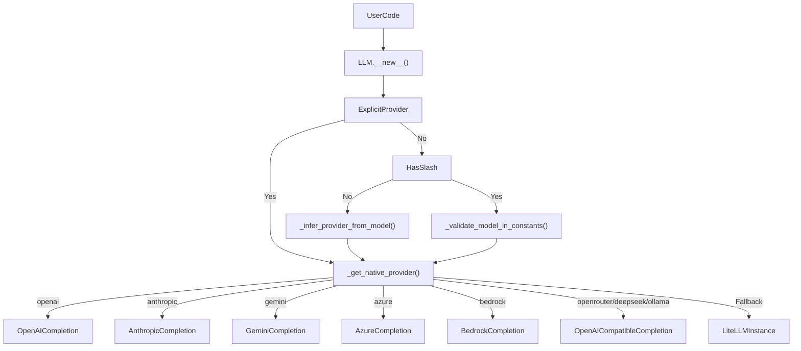
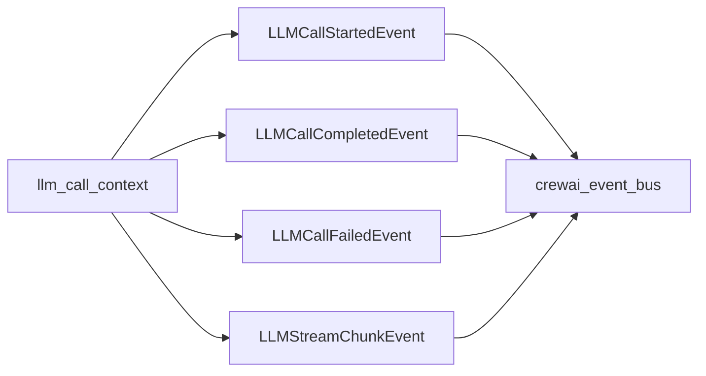
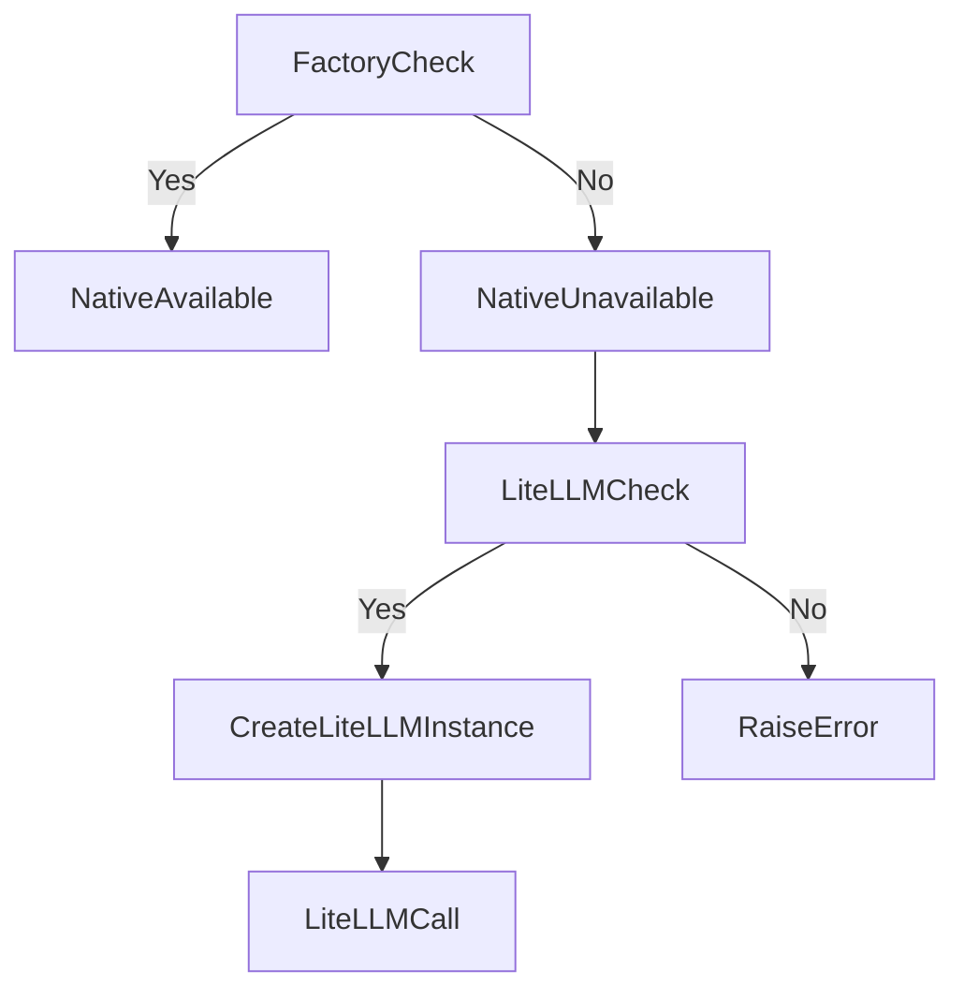

<!-- source: DeepWiki mcp.deepwiki.com · repo crewAIInc/crewAI · page 4.1 LLM Architecture and Providers · fetched 2026-10-26 -->

# LLM Architecture and Providers

<details>
<summary>Relevant source files</summary>

The following files were used as context for generating this wiki page:

- [docs/edge/ar/concepts/llms.mdx](docs/edge/ar/concepts/llms.mdx)
- [docs/edge/ar/learn/custom-llm.mdx](docs/edge/ar/learn/custom-llm.mdx)

</details>


This document describes the LLM abstraction layer in CrewAI, including the factory pattern for provider routing, the base interface for LLM implementations, native provider integrations, and the fallback to LiteLLM. This architecture enables agents to interact with multiple LLM providers through a unified interface while leveraging provider-specific optimizations.

For information about how agents execute tasks using LLMs, see [Crews: Autonomous Agent Orchestration](). For tool execution patterns, see [Tool Calling and Streaming](). For observability and event emission, see [Observability and Monitoring]().

Sources: [lib/crewai/src/crewai/llm.py:354-442](), [docs/edge/ar/concepts/llms.mdx:1-30]()

---

## Factory Pattern and Provider Routing

The `LLM` class serves as a factory that routes model requests to native SDK implementations or falls back to LiteLLM for broader model support. The factory uses `__new__` to return instances of provider-specific classes rather than `LLM` instances [lib/crewai/src/crewai/llm.py:354-442]().

### Routing Logic

Title: LLM Factory Provider Selection Flow

Sources: [lib/crewai/src/crewai/llm.py:354-442](), [lib/crewai/src/crewai/llm.py:525-580]()

The routing priority is:
1. **Explicit provider parameter**: `LLM(model="gpt-4o", provider="openai")` [lib/crewai/src/crewai/llm.py:365-367]()
2. **Provider prefix in model string**: `LLM(model="openai/gpt-4o")` [lib/crewai/src/crewai/llm.py:375-377]()
3. **Model pattern matching**: `LLM(model="gpt-4o")` → inferred as OpenAI [lib/crewai/src/crewai/llm.py:525-553]()
4. **LiteLLM fallback**: Used when no native provider matches and `crewai[litellm]` is installed [lib/crewai/src/crewai/llm.py:439-442]().

Sources: [lib/crewai/src/crewai/llm.py:354-442](), [lib/crewai/src/crewai/llm.py:525-580]()

### Provider Inference

The `_infer_provider_from_model()` method checks model names against provider constants and patterns [lib/crewai/src/crewai/llm.py:525-553]():

| Model Pattern | Inferred Provider | Constants Check |
|--------------|------------------|-----------------|
| `gpt-4`, `gpt-4o`, `o1-*`, `o3-*`, `o4-*` | `openai` | `OPENAI_MODELS` |
| `claude-*`, `anthropic.*` | `anthropic` | `ANTHROPIC_MODELS` |
| `gemini-*`, `gemma-*`, `learnlm-*` | `gemini` | `GEMINI_MODELS` |
| Contains `.` (e.g., `anthropic.claude-3`) | `bedrock` | `BEDROCK_MODELS` |
| `gpt-35-*`, `azure-*` | `azure` | Pattern-based |

The `_validate_model_in_constants()` method first checks hardcoded constants, then falls back to pattern matching to support new models and "latest" versions without requiring constant updates [lib/crewai/src/crewai/llm.py:489-522]().

Sources: [lib/crewai/src/crewai/llm.py:525-553](), [lib/crewai/src/crewai/llm.py:489-522]()

### Supported Native Providers

Native integrations communicate directly via provider SDKs, bypassing the LiteLLM translation layer for better performance and simpler debugging [docs/edge/ar/learn/litellm-removal-guide.mdx:21-27]().

The `SUPPORTED_NATIVE_PROVIDERS` constant defines providers that get native SDK implementations [lib/crewai/src/crewai/llm.py:318-328]():

```python
SUPPORTED_NATIVE_PROVIDERS = [
    "openai",
    "anthropic", 
    "claude",
    "azure",
    "azure_openai",
    "google",
    "gemini",
    "bedrock",
    "aws",
    "openrouter",
    "deepseek",
    "ollama",
    "ollama_chat",
    "hosted_vllm",
    "cerebras",
    "dashscope",
]
```

When a model routes to a native provider, the factory imports the provider-specific class. If the specific SDK (e.g., `openai`, `anthropic`) is not installed, the system will attempt to use LiteLLM if available or raise an error [lib/crewai/src/crewai/llm.py:556-580]().

Sources: [lib/crewai/src/crewai/llm.py:318-328](), [lib/crewai/src/crewai/llm.py:556-580]()

---

## BaseLLM Abstract Interface

All LLM implementations extend `BaseLLM`, which defines the contract for interacting with language models [lib/crewai/src/crewai/llms/base_llm.py:84-552]().

Title: BaseLLM Architecture and Implementation

```mermaid
graph TB
    BaseLLM["BaseLLM"]
    
    CoreMethods["CoreMethods"]
    EventEmission["EventEmission"]
    MessageFormatting["MessageFormatting"]
    ToolExecution["ToolExecution"]
    TokenTracking["TokenTracking"]
    HookSystem["HookSystem"]
    
    BaseLLM --> CoreMethods
    BaseLLM --> EventEmission
    BaseLLM --> MessageFormatting
    BaseLLM --> ToolExecution
    BaseLLM --> TokenTracking
    BaseLLM --> HookSystem
    
    OpenAIComp["OpenAICompletion"]
    AnthropicComp["AnthropicCompletion"]
    GeminiComp["GeminiCompletion"]
    AzureComp["AzureCompletion"]
    BedrockComp["BedrockCompletion"]
    OpenAICompatible["OpenAICompatibleCompletion"]
    LiteLLMClass["LLM_LiteLLM"]
    
    BaseLLM -.-> OpenAIComp
    BaseLLM -.-> AnthropicComp
    BaseLLM -.-> GeminiComp
    BaseLLM -.-> AzureComp
    BaseLLM -.-> BedrockComp
    BaseLLM -.-> OpenAICompatible
    BaseLLM -.-> LiteLLMClass
```

Sources: [lib/crewai/src/crewai/llms/base_llm.py:84-552]()

### Core Interface Methods

The abstract `call()` method signature defines the contract [lib/crewai/src/crewai/llms/base_llm.py:164-201]():

```python
@abstractmethod
def call(
    self,
    messages: str | list[LLMMessage],
    tools: list[dict[str, BaseTool]] | None = None,
    callbacks: list[Any] | None = None,
    available_functions: dict[str, Any] | None = None,
    from_task: Task | None = None,
    from_agent: Agent | None = None,
    response_model: type[BaseModel] | None = None,
) -> str | Any:
```

The `acall()` method provides async support with the same interface [lib/crewai/src/crewai/llms/base_llm.py:202-238]().

Sources: [lib/crewai/src/crewai/llms/base_llm.py:164-238]()

### Event Emission Integration

All LLM calls emit events through the `crewai_event_bus` using a call context manager `llm_call_context` [lib/crewai/src/crewai/llms/base_llm.py:62-70]().

Title: LLM Call Event Flow

Sources: [lib/crewai/src/crewai/llms/base_llm.py:62-82](), [lib/crewai/src/crewai/llms/base_llm.py:485-551]()

---

## OpenAI-Compatible Providers

CrewAI includes a dedicated implementation for OpenAI-compatible APIs. This allows connecting to local inference servers (Ollama, vLLM) or third-party providers using the `openai/` prefix and a custom `base_url` [docs/edge/ar/learn/litellm-removal-guide.mdx:231-252]().

### Provider Registry

The `OPENAI_COMPATIBLE_PROVIDERS` registry in `OpenAICompatibleCompletion` maps provider names to `ProviderConfig` objects [lib/crewai/src/crewai/llms/providers/openai_compatible/completion.py:43-90]():

| Provider | Base URL | API Key Env | Key Required |
|----------|----------|-------------|--------------|
| `openrouter` | `https://openrouter.ai/api/v1` | `OPENROUTER_API_KEY` | Yes |
| `deepseek` | `https://api.deepseek.com/v1` | `DEEPSEEK_API_KEY` | Yes |
| `ollama` | `http://localhost:11434/v1` | `OLLAMA_API_KEY` | No |
| `cerebras` | `https://api.cerebras.ai/v1` | `CEREBRAS_API_KEY` | Yes |
| `dashscope` | `https://dashscope-intl.aliyuncs.com/compatible-mode/v1` | `DASHSCOPE_API_KEY` | Yes |

Sources: [lib/crewai/src/crewai/llms/providers/openai_compatible/completion.py:43-90]()

### Implementation Details

The `OpenAICompatibleCompletion` class inherits from `OpenAICompletion` and resolves the correct `base_url`, `api_key`, and `default_headers` based on the provider configuration [lib/crewai/src/crewai/llms/providers/openai_compatible/completion.py:111-187]().

For Ollama, it includes a helper `_normalize_ollama_base_url` to ensure the `/v1` suffix is present [lib/crewai/src/crewai/llms/providers/openai_compatible/completion.py:93-108]().

Sources: [lib/crewai/src/crewai/llms/providers/openai_compatible/completion.py:93-187]()

---

## LiteLLM Fallback

LiteLLM serves as a translation layer for over 100 providers not natively integrated. It is used as a fallback when the `LLM` factory cannot match a native provider [docs/edge/ar/learn/litellm-removal-guide.mdx:10-15]().

Title: LiteLLM Fallback Decision Flow

Sources: [lib/crewai/src/crewai/llm.py:406-442](), [lib/crewai/src/crewai/llm.py:584-724]()

The fallback logic in `__new__` checks `LITELLM_AVAILABLE` before attempting instantiation [lib/crewai/src/crewai/llm.py:431-442](). When LiteLLM is used, the `call()` method routes through `litellm.completion()` [lib/crewai/src/crewai/llm.py:584-724]().

Sources: [lib/crewai/src/crewai/llm.py:406-442](), [lib/crewai/src/crewai/llm.py:584-724]()

---

## Context Window and Token Tracking

CrewAI maintains an internal map of context window sizes for popular models to prevent overflow errors [lib/crewai/src/crewai/llm.py:173-250]().

### Context Window Sizes

| Model Group | Examples | Context Window |
|-------------|----------|----------------|
| OpenAI | `gpt-4o`, `gpt-4-turbo`, `o1-preview` | 128,000 |
| Gemini | `gemini-1.5-pro`, `gemini-2.0-flash` | 1,048,576 - 2,097,152 |
| Llama (Groq) | `llama-3.1-70b-versatile` | 131,072 |
| DeepSeek | `deepseek-chat` | 128,000 |

Sources: [lib/crewai/src/crewai/llm.py:173-250]()

### Token Tracking Implementation

The `BaseLLM` class tracks usage metrics in a `_token_usage` dictionary [lib/crewai/src/crewai/llms/base_llm.py:105-111](). These metrics are updated via `_track_token_usage_internal()` and can be retrieved using `get_usage_metrics()` [lib/crewai/src/crewai/llms/base_llm.py:416-451]().

Sources: [lib/crewai/src/crewai/llms/base_llm.py:105-152](), [lib/crewai/src/crewai/llms/base_llm.py:416-451]()

---

## Provider Configuration Options

When initializing an `LLM` via the factory or YAML, several parameters control behavior across providers [docs/edge/ar/concepts/llms.mdx:72-97]():

| Parameter | Type | Description |
|-----------|------|-------------|
| `model` | `str` | The model identifier (e.g., `openai/gpt-4o`) |
| `temperature` | `float` | Controls randomness (0.0 to 1.0) |
| `max_tokens` | `int` | Maximum length of generated response |
| `timeout` | `int` | Request timeout in seconds |
| `response_format` | `dict` | For structured outputs (e.g., `{"type": "json"}`) |
| `base_url` | `str` | Custom API endpoint |

Sources: [docs/edge/ar/concepts/llms.mdx:72-97]()

---

