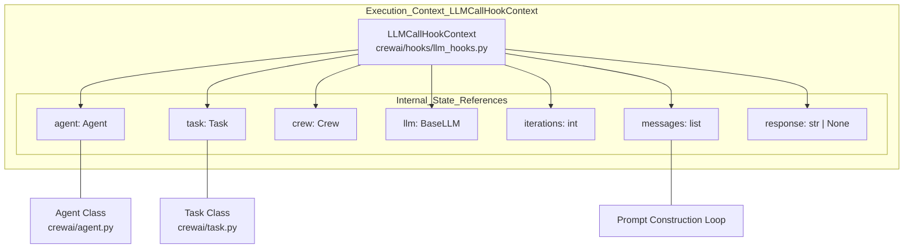
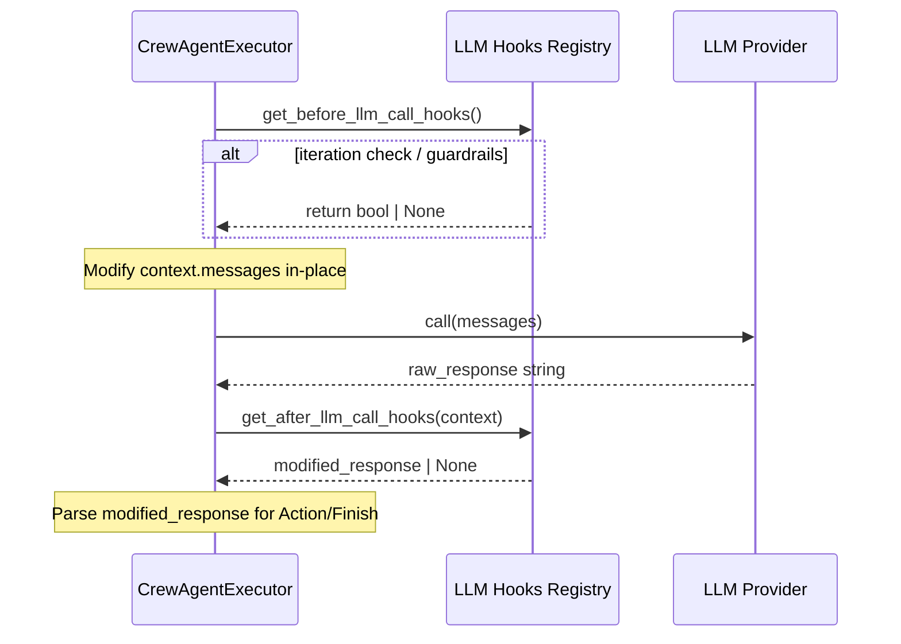

<!-- source: DeepWiki mcp.deepwiki.com · repo crewAIInc/crewAI · page 4.3 LLM Hooks System · fetched 2026-10-26 -->

# LLM Hooks System

Relevant source files

The following files were used as context for generating this wiki page:

- [docs/edge/ar/concepts/llms.mdx](docs/edge/ar/concepts/llms.mdx)
- [docs/edge/ar/learn/execution-hooks.mdx](docs/edge/ar/learn/execution-hooks.mdx)

## Purpose and Scope

The LLM Hooks System provides a mechanism for intercepting and modifying the interaction cycle between CrewAI Agents and Large Language Models (LLMs). This system allows for fine-grained control over the runtime behavior, enabling developers to:
1.  **Modify Prompts**: Intercept messages before they reach the LLM to inject context or apply guardrails. [docs/edge/ar/learn/llm-hooks.mdx:17-25]()
2.  **Sanitize Responses**: Transform or redact sensitive information from LLM outputs before the agent processes them. [docs/edge/ar/learn/llm-hooks.mdx:34-41]()
3.  **Monitor Execution**: Track token usage, log iterations, or implement human-in-the-loop approval gates. [docs/edge/ar/learn/llm-hooks.mdx:162-176]()

The system operates at two levels: high-level **Agent Hooks** (via the execution loop) and low-level **HTTP Interceptors** (via `httpx`).

Sources: [docs/edge/ar/learn/llm-hooks.mdx:1-41]()

---

## Agent-Level Execution Hooks

Agent-level hooks are integrated directly into the `CrewAgentExecutor` lifecycle. They allow developers to modify the `LLMMessage` list or the raw response string using the `LLMCallHookContext`.

### LLMCallHookContext Entity
The `LLMCallHookContext` object provides the hook function with a comprehensive view of the current execution state, including references to the agent, task, and crew. [docs/edge/ar/learn/llm-hooks.mdx:56-65]()

Sources: [docs/edge/ar/learn/llm-hooks.mdx:56-65](), [lib/crewai/src/crewai/hooks/llm_hooks.py:5-15]()

### Hook Execution Flow
The `CrewAgentExecutor` invokes these hooks during its main execution loop.

1.  **Before Hook**: Executes before the LLM call. If it returns `False`, execution is blocked. [docs/edge/ar/learn/llm-hooks.mdx:28-32]()
2.  **After Hook**: Executes after the LLM returns a result. It can return a modified string to replace the original response. [docs/edge/ar/learn/llm-hooks.mdx:45-49]()

Sources: [lib/crewai/src/crewai/agents/crew_agent_executor.py:160-163](), [docs/edge/ar/learn/llm-hooks.mdx:11-15]()

---

## Hook Registration Methods

CrewAI supports three distinct ways to register LLM hooks, ranging from global scope to crew-specific scope.

### 1. Global Functional Registration
Registered using `register_before_llm_call_hook` or `register_after_llm_call_hook`. These apply to all agents in all crews within the application. [docs/edge/ar/learn/llm-hooks.mdx:83-95]()

### 2. Decorator Pattern (Recommended)
Developers can use `@before_llm_call` and `@after_llm_call` for clean, modular hook definitions. [docs/edge/ar/learn/llm-hooks.mdx:101-116]()

### 3. Crew-Specific Hooks
Defined within a `@CrewBase` class using `@before_llm_call_crew` and `@after_llm_call_crew`. These are scoped only to the specific project crew. [docs/edge/ar/learn/llm-hooks.mdx:118-146]()

Sources: [docs/edge/ar/learn/llm-hooks.mdx:81-146](), [lib/crewai/src/crewai/hooks/llm_hooks.py:1-40]()

---

## HTTP-Level Interceptors

Low-level interceptors use `httpx` transport to modify the raw bytes/JSON of API requests. This is independent of the agent's internal state logic.

### BaseInterceptor Interface
The `BaseInterceptor` defines the contract for transport-layer modification. [lib/crewai/src/crewai/llms/base_llm.py:42-46]()

| Method | Signature | Role |
| :--- | :--- | :--- |
| `on_outbound` | `(message: TRequest) -> TRequest` | Modifies the raw `httpx.Request` before sending. |
| `on_inbound` | `(message: TResponse) -> TResponse` | Modifies the raw `httpx.Response` before parsing by the provider SDK. |

### Provider Support Matrix
The interceptor system requires native integration within the provider's completion class to wrap the HTTP client. [lib/crewai/src/crewai/llms/providers/openai/completion.py:251-262]()

| Provider | Status | Implementation Detail |
| :--- | :--- | :--- |
| **OpenAI** | Supported | Uses `HTTPTransport` in `client_config`. [lib/crewai/src/crewai/llms/providers/openai/completion.py:251-262]() |
| **Anthropic** | Supported | Injected via `client_params["http_client"]`. [lib/crewai/src/crewai/llms/providers/anthropic/completion.py:236-239]() |
| **Azure** | Not Supported | Raises `NotImplementedError`. [lib/crewai/src/crewai/llms/providers/azure/completion.py:120-124]() |
| **Gemini** | Not Supported | Raises `NotImplementedError`. [lib/crewai/src/crewai/llms/providers/gemini/completion.py:98-102]() |

Sources: [lib/crewai/src/crewai/llms/base_llm.py:42-46](), [lib/crewai/src/crewai/llms/providers/openai/completion.py:251-262]()

---

## Implementation Details

### Message In-Place Modification
When using Agent Hooks, `context.messages` must be modified **in-place**. Reassigning the list (`context.messages = [...]`) will not reflect changes in the executor because it breaks the reference. [docs/edge/ar/learn/llm-hooks.mdx:67-79]()

### Response Sanitization Example
The `after_llm_call` hook is typically used to redact sensitive information (e.g., PII, API Keys) from the LLM output before it is parsed by the agent. [docs/edge/ar/learn/llm-hooks.mdx:191-206]()

Sources: [docs/edge/ar/learn/llm-hooks.mdx:67-206]()

## Summary of Key Entities

| Entity | Location | Role |
| :--- | :--- | :--- |
| `CrewAgentExecutor` | `crewai/agents/crew_agent_executor.py` | Core loop that triggers agent-level hooks. |
| `LLMCallHookContext` | `crewai/hooks/llm_hooks.py` | Data container passed to hook functions. |
| `BaseInterceptor` | `crewai/llms/base_llm.py` | Interface for low-level HTTP interception. |
| `HTTPTransport` | `crewai/llms/hooks/transport.py` | `httpx` wrapper for transport interception. |

Sources: [lib/crewai/src/crewai/agents/crew_agent_executor.py:32-163](), [lib/crewai/src/crewai/hooks/llm_hooks.py:5-40](), [lib/crewai/src/crewai/llms/base_llm.py:42-46]()

---

