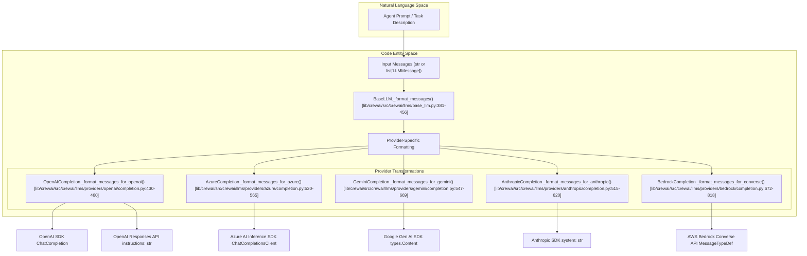
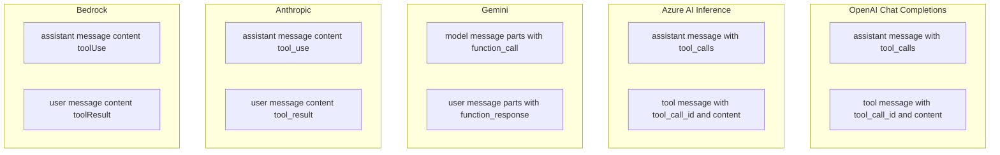
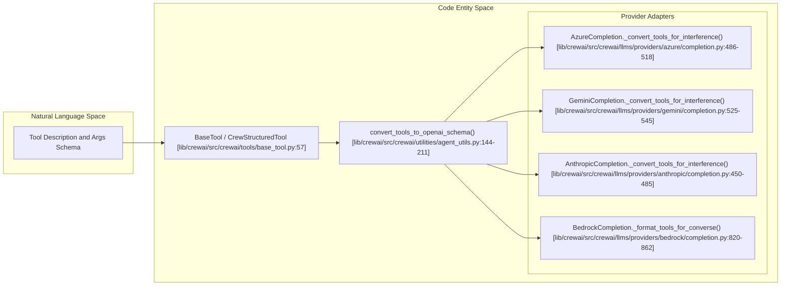

<!-- source: DeepWiki mcp.deepwiki.com · repo crewAIInc/crewAI · page 4.5 Message Formatting Across Providers · fetched 2026-10-26 -->

# Message Formatting Across Providers

<details>
<summary>Relevant source files</summary>

The following files were used as context for generating this wiki page:

- [docs/edge/ar/concepts/llms.mdx](docs/edge/ar/concepts/llms.mdx)

</details>


## Purpose and Scope

This document explains how CrewAI's LLM providers transform messages from the internal unified format into provider-specific formats required by different LLM APIs. Each provider (OpenAI, Azure, Gemini, Anthropic, Bedrock) has unique requirements for message structure, role names, system message handling, and tool call/result formatting.

For general information about LLM integration and the factory pattern, see [LLM Architecture and Providers](4.1). For tool calling specifics, see [Tool Calling and Streaming](4.4).

Sources: [lib/crewai/src/crewai/llms/base_llm.py:381-456]()

---

## Message Format Transformation Overview

CrewAI maintains an internal unified message format (`LLMMessage`) defined in `crewai.utilities.types`. This format is transformed by each provider into the format required by its respective SDK. This transformation typically happens in the `_format_messages()` method or provider-specific formatting methods.

### Message Transformation Pipeline



Sources: [lib/crewai/src/crewai/llms/base_llm.py:381-456](), [lib/crewai/src/crewai/llms/providers/openai/completion.py:361-420](), [lib/crewai/src/crewai/llms/providers/azure/completion.py:520-565](), [lib/crewai/src/crewai/llms/providers/gemini/completion.py:547-669](), [lib/crewai/src/crewai/llms/providers/anthropic/completion.py:515-620](), [lib/crewai/src/crewai/llms/providers/bedrock/completion.py:672-818]()

---

## System Message Extraction

Different providers handle system messages in fundamentally different ways. Some include them in the message array, while others require them as separate top-level parameters.

### System Message Handling by Provider

| Provider | System Message Location | Extraction Method | Multiple System Messages |
|----------|------------------------|-------------------|-------------------------|
| **OpenAI Chat Completions** | In `messages` array | No extraction needed | Concatenated if multiple |
| **OpenAI Responses API** | Separate `instructions` parameter | Extracted from messages | Concatenated with `\n\n` |
| **Azure** | In `messages` array | No extraction needed | Concatenated if multiple |
| **Gemini** | Separate `system_instruction` | Extracted and converted to Content | Concatenated with `\n\n` |
| **Anthropic** | Separate `system` parameter | Extracted from messages | Concatenated with `\n\n` |
| **Bedrock** | Separate `system` array | Extracted to `SystemContentBlockTypeDef` | Separate blocks maintained |

### OpenAI Responses API System Message Extraction

The Responses API extracts system messages and concatenates them into the `instructions` parameter in `OpenAICompletion._call_responses_api()` [lib/crewai/src/crewai/llms/providers/openai/completion.py:632-646]().

```python
instructions: str | None = self.instructions
input_messages: list[LLMMessage] = []

for message in messages:
    if message.get("role") == "system":
        content = message.get("content", "")
        content_str = content if isinstance(content, str) else str(content)
        if instructions:
            instructions = f"{instructions}\n\n{content_str}"
        else:
            instructions = content_str
    else:
        input_messages.append(message)
```

### Gemini System Instruction Conversion

Gemini extracts system messages in `GeminiCompletion._format_messages_for_gemini()` [lib/crewai/src/crewai/llms/providers/gemini/completion.py:595-600]() and converts them to a `types.Content` object in the generation config [lib/crewai/src/crewai/llms/providers/gemini/completion.py:465-470]().

Sources: [lib/crewai/src/crewai/llms/providers/openai/completion.py:618-680](), [lib/crewai/src/crewai/llms/providers/gemini/completion.py:547-669](), [lib/crewai/src/crewai/llms/providers/gemini/completion.py:437-523]()

---

## Role Mapping Differences

Each provider uses different role names for messages, requiring transformation from CrewAI's internal format.

### Role Name Mapping Table

| Internal Role | OpenAI/Azure | Gemini | Anthropic | Bedrock |
|--------------|-------------|---------|-----------|---------|
| `system` | `system` | *(extracted)* | *(extracted)* | *(extracted)* |
| `user` | `user` | `user` | `user` | `user` |
| `assistant` | `assistant` | `model` | `assistant` | `assistant` |
| `tool` | `tool` | `user` (with function_response) | `user` (with tool_result) | `user` (with toolResult) |

### Gemini Role Transformation
Gemini specifically maps `assistant` to `model` [lib/crewai/src/crewai/llms/providers/gemini/completion.py:661-667]().

Sources: [lib/crewai/src/crewai/llms/providers/gemini/completion.py:547-669]()

---

## Tool Message Formatting

Tool calls and results are the most varied structures across providers.

### Tool Message Format Comparison



### Anthropic Tool Message Flush
Anthropic requires tool results to be flushed as a user message before any subsequent assistant message [lib/crewai/src/crewai/llms/providers/anthropic/completion.py:560-565]().

### Bedrock Structured Data Preprocessing
`BedrockCompletion` includes a unique `_preprocess_structured_data` function [lib/crewai/src/crewai/llms/providers/bedrock/completion.py:52-117]() that handles common Claude-on-Bedrock issues where array fields are returned as markdown-formatted strings instead of proper JSON arrays.

Sources: [lib/crewai/src/crewai/llms/providers/openai/completion.py:430-460](), [lib/crewai/src/crewai/llms/providers/azure/completion.py:520-565](), [lib/crewai/src/crewai/llms/providers/gemini/completion.py:547-669](), [lib/crewai/src/crewai/llms/providers/anthropic/completion.py:515-620](), [lib/crewai/src/crewai/llms/providers/bedrock/completion.py:672-818](), [lib/crewai/src/crewai/llms/providers/bedrock/completion.py:52-117]()

---

## Tool Format Conversion

Each provider has a specific conversion method to transform CrewAI's tool dictionaries into provider-native schemas.

### Tool Definition Schemas

| Provider | Conversion Method | Native Type |
|----------|-------------------|-------------|
| **Azure** | `_convert_tools_for_interference` | `ChatCompletionsToolDefinition` |
| **Gemini** | `_convert_tools_for_interference` | `types.Tool` |
| **Anthropic** | `_convert_tools_for_interference` | `dict` (Anthropic format) |
| **Bedrock** | `_format_tools_for_converse` | `ConverseToolTypeDef` |

### Conversion Entity Bridge



Sources: [lib/crewai/src/crewai/utilities/agent_utils.py:144-211](), [lib/crewai/src/crewai/llms/providers/azure/completion.py:486-518](), [lib/crewai/src/crewai/llms/providers/gemini/completion.py:525-545](), [lib/crewai/src/crewai/llms/providers/anthropic/completion.py:450-485](), [lib/crewai/src/crewai/llms/providers/bedrock/completion.py:820-862]()

---

## Content Structure Requirements

### Gemini Parts-Based Content
Gemini converts all content (text and multimodal) into `types.Part` objects within `types.Content` [lib/crewai/src/crewai/llms/providers/gemini/completion.py:573-592]().

### Azure Content Normalization
Azure requires string content and explicitly converts `None` values to empty strings [lib/crewai/src/crewai/llms/providers/azure/completion.py:536-563]().

### Anthropic Thinking Blocks
Anthropic provider supports extended thinking configurations. The `_extract_thinking_block` method [lib/crewai/src/crewai/llms/providers/anthropic/completion.py:487-513]() extracts `ThinkingBlock` or `redacted_thinking` data from content blocks.

Sources: [lib/crewai/src/crewai/llms/providers/gemini/completion.py:547-669](), [lib/crewai/src/crewai/llms/providers/azure/completion.py:520-565](), [lib/crewai/src/crewai/llms/providers/anthropic/completion.py:487-513]()

---

