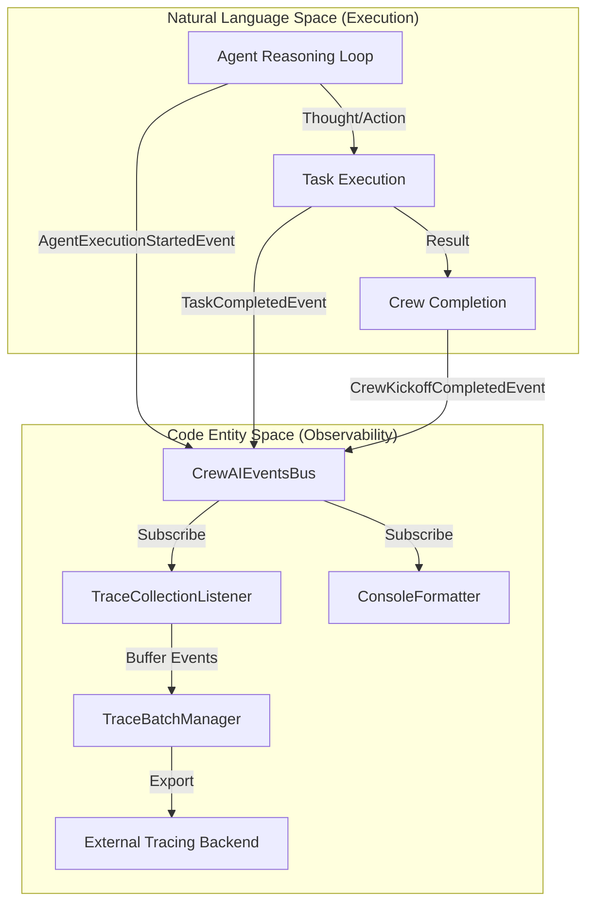
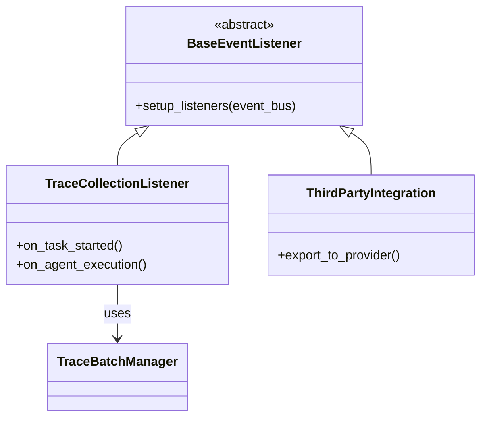

<!-- source: DeepWiki mcp.deepwiki.com · repo crewAIInc/crewAI · page 6 Observability and Monitoring · fetched 2026-10-26 -->

# Observability and Monitoring

Relevant source files

The following files were used as context for generating this wiki page:

- [docs/edge/ar/concepts/event-listener.mdx](docs/edge/ar/concepts/event-listener.mdx)

The CrewAI observability stack provides a multi-layered approach to monitoring agent execution, ranging from real-time console feedback to deep telemetry and third-party platform integrations. This system ensures that developers can track agent reasoning, monitor resource consumption, and debug complex multi-agent interactions across both local development and production environments.

## Core Observability Architecture

The observability system is built on an event-driven architecture that captures granular lifecycle events from Agents, Tasks, and Crews.

| Component | Role | Code Entity |
| :--- | :--- | :--- |
| **Event Bus** | Central hub for dispatching execution events | `CrewAIEventsBus` |
| **Base Event** | Abstract foundation for all system events | `BaseEvent` |
| **Event Listener** | Base class for building custom monitors | `BaseEventListener` |
| **Telemetry** | Internal system for usage and performance tracking | `Telemetry` |
| **Tracing** | Detailed execution path recording | `TraceCollectionListener` |
| **Formatting** | Visual representation of internal state for humans | `ConsoleFormatter` |

### System Event Flow
The following diagram illustrates how internal execution events are propagated from the "Natural Language Space" (Agent reasoning) into the "Code Entity Space" for monitoring.

**Diagram: Execution Event Propagation**

Sources: [docs/edge/ar/concepts/event-listener.mdx:14-20](), [docs/edge/ar/concepts/event-listener.mdx:49-74](), [docs/edge/ar/concepts/event-listener.mdx:102-103]()

---

## Event Bus and Listeners
The `crewai/events` package provides the core infrastructure for capturing and reacting to system actions. Developers can extend `BaseEventListener` to build custom listeners [docs/edge/ar/concepts/event-listener.mdx:17-18]() that subscribe to the `CrewAIEventsBus` [docs/edge/ar/concepts/event-listener.mdx:16-16]().

For details, see [Event Bus and Listeners](#6.1).

Sources: [docs/edge/ar/concepts/event-listener.mdx:14-20](), [docs/edge/ar/concepts/event-listener.mdx:41-45]()

---

## Built-in Tracing and Telemetry
CrewAI includes a native tracing system designed to capture the "thought process" of agents. This includes recording inputs, outputs, tool usage, and token consumption metrics. The system uses a batching mechanism to ensure that monitoring does not negatively impact the performance of the agent execution loop.

*   **Trace Collection**: Managed by `TraceCollectionListener`, which subscribes to the `CrewAIEventsBus` to capture events like `AgentReasoningStartedEvent` and `ToolUsageFinishedEvent` [docs/edge/ar/concepts/event-listener.mdx:129-130](), [docs/edge/ar/concepts/event-listener.mdx:179-180]().
*   **Performance Optimization**: The `TraceBatchManager` caches events and dispatches them in batches to reduce network overhead.
*   **Privacy & Control**: Users can manage tracing enablement and telemetry via the `OTEL_SDK_DISABLED` flag and standard consent flows.

For details, see [Built-in Tracing and Telemetry](#6.2).

Sources: [docs/edge/ar/concepts/event-listener.mdx:112-131](), [docs/edge/ar/concepts/event-listener.mdx:176-180]()

---

## Console Formatter and Output
For local development, CrewAI provides a rich console output experience. This system translates the complex, asynchronous operations of a Crew into a readable stream of updates.

*   **Rich Text Rendering**: The `ConsoleFormatter` class handles the color-coding and structural layout of agent "thoughts" and task transitions.
*   **Status Panels**: Real-time status updates show which agent is currently working and what tool is being invoked.
*   **Streaming**: Supports real-time streaming of LLM responses via `LLMStreamChunkEvent` to provide immediate feedback during long-running generations [docs/edge/ar/concepts/event-listener.mdx:168-168]().

For details, see [Console Formatter and Output](#6.3).

Sources: [docs/edge/ar/concepts/event-listener.mdx:167-168]()

---

## Third-Party Observability Integrations
CrewAI is designed to be extensible, allowing developers to pipe execution data into professional LLM observability platforms. These integrations provide advanced features like cost tracking, prompt versioning, and dataset generation for fine-tuning.

Supported integrations include:
*   **Tracing Platforms**: Langfuse, Portkey, Weave, and Langtrace.
*   **Agent Monitoring**: AgentOps and OpenLIT.
*   **Enterprise Observability**: Datadog, Arize Phoenix, Opik, Braintrust, and MLflow.

These integrations typically hook into the `BaseEventListener` system [docs/edge/ar/concepts/event-listener.mdx:18-18]() by implementing the `setup_listeners` method [docs/edge/ar/concepts/event-listener.mdx:41-42]() to transform CrewAI events into the specific schema required by each provider.

**Diagram: Integration Interface**

For details, see [Third-Party Observability Integrations](#6.4).

Sources: [docs/edge/ar/concepts/event-listener.mdx:18-18](), [docs/edge/ar/concepts/event-listener.mdx:37-45](), [docs/edge/ar/concepts/event-listener.mdx:49-74]()

---

